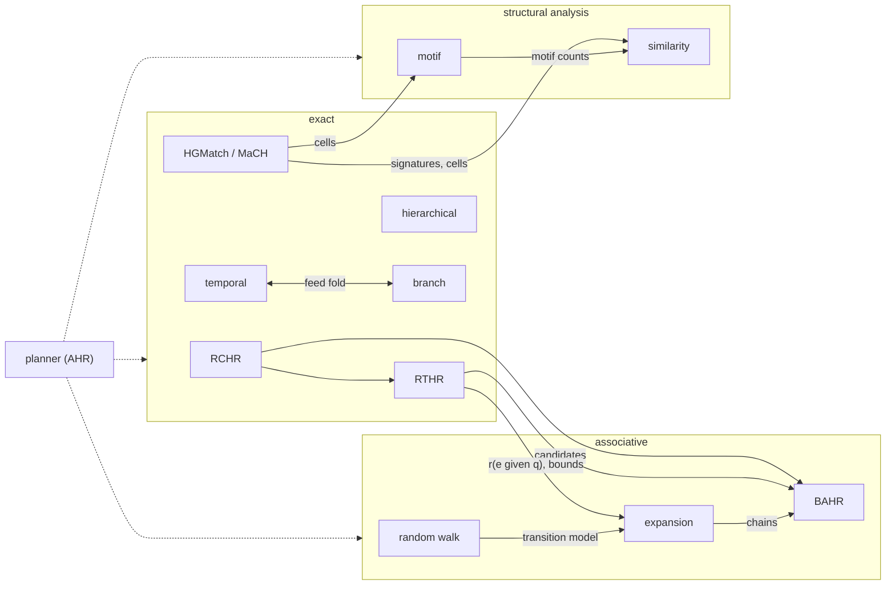

# Retrieval algorithms

Design documents for HStore's retrieval algorithms. Each page states the problem precisely, separates what comes from
published work from what is HStore design, maps the algorithm onto HStore's storage, traces a small example by hand,
and gives costs and the limits of a first version. Step 1 of the build order below is implemented; the pages for it
say what was built and where it differs from the design.

## Pages

| Page | Question it answers | Basis | New storage |
|---|---|---|---|
| [role-constrained-hyperedge-retrieval](role-constrained-hyperedge-retrieval.md) (RCHR) | which hyperedges have these members in these roles, weights, validity, properties | inverted-index intersection; role filter on reverse-index posting values is ours | slot 2 summary change (rebuild); slot 50 designed, deferred |
| [role-time-aware-scoring](role-time-aware-scoring.md) (RTHR) | how well does a hyperedge fit a query hyperedge, and which `k` fit best | linear feature scoring, threshold-style top-k; components and bounds are ours | none |
| [hypergraph-structure-first-matching](hypergraph-structure-first-matching.md) (HGMatch, MaCH) | where does this exact pattern of hyperedges occur | HGMatch (ICDE 2023), MaCH (arXiv 2512.10621) | slots 47 to 49 |
| [temporal-hypergraph-retrieval](temporal-hypergraph-retrieval.md) | what held at `t`, what appeared or disappeared, in validity time and in generation time | interval indexing; endpoint reduction and feed fold are ours | slot 53; slot 2 summary change (same rebuild) |
| [hierarchical-hyperedge-retrieval](hierarchical-hyperedge-retrieval.md) | best paths through nested hyperedges, top-down or bottom-up | best-first search with admissible bounds | slot 56 |
| [branch-retrieval](branch-retrieval.md) | what a branch changed, what survived, how branches compare, which is nearest | dataset versioning; feed reconstruction and bounded nearest are ours | none |
| [role-aware-random-walk](role-aware-random-walk.md) | which atoms and hyperedges are associated with these seeds | edge-dependent vertex weights (Chitra, Raphael), local push (Andersen, Chung, Lang) | none |
| [query-directed-expansion](query-directed-expansion.md) | the best connected evidence around these seeds | best-first search; value and bounds are ours | none |
| [budgeted-associative-retrieval](budgeted-associative-retrieval.md) (BAHR) | which set of hyperedges best covers the query within a budget | submodular maximization under a knapsack; the objective is a proposal | none |
| [hypergraph-motif-retrieval](hypergraph-motif-retrieval.md) | how often each three-hyperedge pattern occurs, and where | h-motifs, MoCHy (PVLDB 2020) | none; a view kind on slots 42 and 43 |
| [hypergraph-similarity-search](hypergraph-similarity-search.md) | which subhypergraphs are closest to this one | edit distance with filter and verify; hypergraph lower bounds are ours | none |
| [adaptive-retrieval-planner](adaptive-retrieval-planner.md) (AHR) | which plan runs, under which budget, and how results are combined | cost-based access path selection, feedback, rank fusion | none |

## How they fit together

## Shared pieces

| Piece | Defined in | Used by |
|---|---|---|
| `SortedIds` seekable cursors over inline and promoted postings | HGMatch | RCHR (with role filter), temporal |
| `Scorer` with `Evidence` levels | RCHR | RTHR, expansion, BAHR, random walk |
| `EdgeScore` with per-slot cover | RTHR | BAHR |
| `TransitionModel` | random walk | expansion |
| change-feed fold with lineage filter | temporal, branch (one implementation) | motif census view refresh |
| signature slots 47 to 49 | HGMatch | RTHR bounds, similarity lower bounds |
| reverse-index summaries with roles and validity (one rebuild of slot 2) | RCHR, temporal | random walk, expansion |
| task scheduler (`ForkJoinPool`, `CountedCompleter`) | HGMatch | RCHR and others when parallelised |

New retrieval code goes in `io.hstore.db.retrieve`. Branch and generation-time pieces that extend `Temporal` and
`BranchMerge` stay in `io.hstore.db.temporal`.

## Slot allocation

Existing slots end at 46 and schemas at 83.

| Slot | Name | Schemas | Page | Status |
|---|---|---|---|---|
| 47 | `edge-signature` | 84 | HGMatch | proposed |
| 48 | `signature-edges` | 85, 86 | HGMatch | proposed |
| 49 | `signature-names` | 87 | HGMatch | proposed |
| 50 | `role-edges` | 88, 89 | RCHR | designed, deferred |
| 53 | `validity-endpoints` | 96 to 98 | temporal | proposed |
| 56 | `child-edges` | 104, 105 | hierarchical | proposed |

Ids 51, 52, 54, 55 and 57 to 74 stay reserved for these pages. Every proposed slot needs a storage format change and a
one-time rebuild, and the slot 2 summary change needs a rebuild of the reverse index. Those should land together.

## Build order

The proposal's order (exact role-aware retrieval, then structural matching, then budgeted associative retrieval) holds,
with the dependencies made explicit:

| Step | Contents | Needs |
|---|---|---|
| 1 | RCHR planner changes (merged legs, role-filtered postings, `RoleSets` cache), RTHR scorer; built as `MATCH` role legs (#108) and `RANK` (#109) | nothing new on disk |
| 2 | slot 2 rebuild with role and validity summaries; temporal slot 53; the shared feed fold | format change |
| 3 | HGMatch with slots 47 to 49, then MaCH mode | format change |
| 4 | branch retrieval, hierarchical (slot 56) | the feed fold; format change for slot 56 |
| 5 | random walk, expansion, then BAHR | RTHR, RCHR |
| 6 | motif census view, similarity search | HGMatch slots |
| alongside each | the AHR rules and `EXPLAIN` lines for that family; learned plan choice only after feedback exists | |

## Measuring

Every page lists what it needs measured. The method is common to all of them:

| Rule | Detail |
|---|---|
| exact algorithms | result count equal to a brute-force baseline on small inputs before any timing |
| approximate algorithms | recall@k and rank correlation against the exact or converged answer; report the certificate next to the true error |
| metrics | p50, p95, p99 latency; page visits and cache hits (`IoTrace`); candidates generated and verified; memory; write cost per membership change for every new slot |
| workloads | large hyperedges, hub members, nested edges, temporal updates, skewed memberships, repeated patterns, several tenants |
| runs | quiet machine, no parallel builds or agents; medians of repeated runs; both sides of a comparison from the same run and the same source |

Placeholders that the measurements must replace: `chs_candidate_limit` (HGMatch), the RTHR default weights, the walk's
default `alpha` and `epsilon`, the expansion frontier cap, BAHR's `kappa`, and the benefit of role pruning in slot 2.
