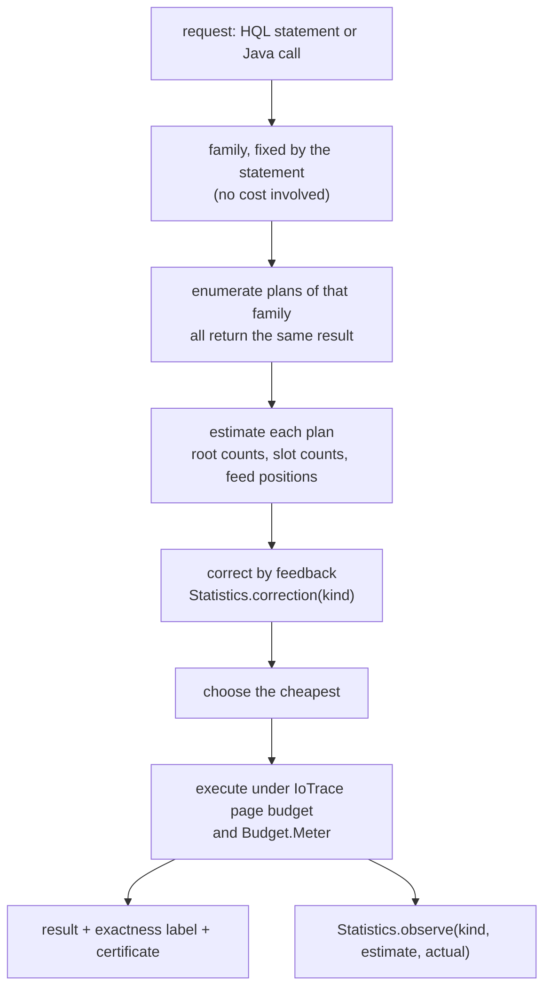

# Adaptive retrieval planning (AHR)

This page describes how a retrieval request is turned into one of the algorithms in this directory, how the plan
inside an algorithm is chosen, and how budgets, exactness and result fusion are handled. It extends the existing
`MATCH` planner ([planner](../docs/database/planner.md)) rather than replacing it.

The proposal: "Rather than executing the same retrieval strategy for every query, select an execution plan from query
structure and index statistics. A query classifier routes exact member and role queries to posting-list
intersections, structural patterns to hyperedge-first matching, associative queries to random walk or best-first
expansion, similar-structure queries to a fingerprint index with verification, historical queries to a temporal index
and snapshot selection; then rank, deduplicate and return a bounded result. The optimizer estimates candidate counts,
membership fan-out, hyperedge cardinalities, temporal selectivity and verification cost, and chooses the cheapest plan
that satisfies the query's semantics. Deterministic cost rules first, learned cost estimation later."

## What changes from the proposal

The cost-based part is right and most of it exists already. Three parts change.

No classifier decides what a query means. The algorithms here do not answer the same question in different
ways. An exact match, a random-walk ranking and a similarity search return different sets for the same seeds. Picking
between them by cost, or by a learned classifier, would make the answer depend on statistics and on training data,
and two runs of the same request could return different things. The statement or API call fixes the meaning. The
planner chooses only among plans that return the same result for that meaning. The last clause of the proposal ("the
cheapest plan that satisfies the query's semantics") says this; the routing diagram contradicts it, so the diagram
goes.

A budget never turns an exact query into an approximate one silently. When an exact plan runs out of budget, the
statement fails with `ABORTED_RESOURCE_LIMIT`, as `MATCH` does today. Approximate algorithms take the budget as an
input and report how far their answer is from exact (the random walk's L1 certificate, expansion's dropped bound,
BAHR's upper bound).

Fusion is opt-in and rank-based. Scores from different families are on different scales (a PageRank mass, an RTHR
score in `[0, 1]`, an edit-distance bound). Adding them is meaningless. When a caller asks for several families
together, results are merged by reciprocal rank fusion, and exact results are never dropped or reordered by an
approximate family.

| Part | Status |
|---|---|
| cost-based choice among equivalent access paths | established: Selinger et al., *Access path selection in a relational database management system*, SIGMOD 1979, [doi:10.1145/582095.582099](https://doi.org/10.1145/582095.582099); HStore's `Planner` |
| correcting estimates from observed row counts | established: Stillger, Lohman, Markl, Kandil, *LEO: DB2's LEarning Optimizer*, VLDB 2001; HStore's `Statistics.observe` already keeps a per-path-kind correction |
| learning to choose among a fixed set of valid plans | established: Marcus et al., *Bao: Making Learned Query Optimization Practical*, SIGMOD 2021, [doi:10.1145/3448016.3452838](https://doi.org/10.1145/3448016.3452838) |
| rank fusion | established: Cormack, Clarke, Büttcher, *Reciprocal rank fusion outperforms Condorcet and individual rank learning methods*, SIGIR 2009, [doi:10.1145/1571941.1572114](https://doi.org/10.1145/1571941.1572114) |
| the families, their plan sets, estimators and budget mapping for HStore | ours |

## Two layers



## Families

| Family | Requests | Plans the planner chooses between | Estimate inputs | Result |
|---|---|---|---|---|
| edge retrieval ([RCHR](role-constrained-hyperedge-retrieval.md)) | `MATCH EDGE` with `CONTAINS`, `HAS … AS`, properties | role-filtered leapfrog with or without the type leg, `IndexRange`, `Intersection`, `TypeScan`, `ValidityTransition` (slot 53) | `|I(a)|` root counts, `countOfType`, `PostingIndex.countRange`, slot 53 `countRange` | exact |
| ranked edge retrieval (RCHR + [RTHR](role-time-aware-scoring.md)) | the above with `TOP k` by score | candidate plan as above; bound-ordered scoring is fixed | candidate estimate | exact top `k` |
| structural matching ([HGMatch](hypergraph-structure-first-matching.md)) | `HyperMatch` | on the fly with static order; CHS with match-and-filter; anchored seeding; threads | `Card(s)` from slot 48, `|I(a)|` of anchors, `Σ Card`, `|E(q)|` | exact |
| nested retrieval ([hierarchical](hierarchical-hyperedge-retrieval.md)) | roots or leaves plus a path of types and roles | bottom-up from a leaf anchor, top-down best-first | anchor degree, slot 56 child counts | exact top `k` |
| validity time ([temporal](temporal-hypergraph-retrieval.md)) | `VALID AT`, appeared and disappeared | `ValidityTransition` (slot 53), type scan | slot 53 `countRange`, `countOfType` | exact |
| generation time and branches ([temporal](temporal-hypergraph-retrieval.md), [branch](branch-retrieval.md)) | changes between generations, branch delta, compare, nearest | snapshot diff, change-feed fold | retained or not, `feed.covers`, feed byte positions | exact, or fail |
| associative ([walk](role-aware-random-walk.md), [expansion](query-directed-expansion.md), [BAHR](budgeted-associative-retrieval.md)) | one operator each | no plan choice; the budget sets parameters | the operator's own work bound | approximate with a certificate, or exact under the operator's definition |
| motif and similarity ([motif](hypergraph-motif-retrieval.md), [similarity](hypergraph-similarity-search.md)) | one operator each | as specified on those pages | as specified there | as specified there |

### Inside a family: rules where estimates are weak

Some choices have good estimates, others do not. Where estimates are poor, a rule on exact quantities beats a cost
formula built on guesses.

| Choice | Decided by | Why not a cost formula |
|---|---|---|
| access path for edge retrieval | cost (existing `Planner` formula) | all inputs are exact tree counts; independence is the only assumption |
| HGMatch on the fly vs CHS | rule: `Σ_e Card(e) ≤ chs_candidate_limit`, `|E(q)| > 2`, no anchor | estimating the number of partial embeddings of a subhypergraph query is itself hard; the rule needs only exact counts |
| hierarchical direction | rule: bottom-up whenever a leaf anchor exists | the anchor's ancestry is bounded by its degree chain, the descendants of roots are not |
| snapshot diff vs feed fold | rule: snapshot when retained, else feed when covered, else fail | the snapshot path is never worse when it exists, and availability is exact |
| `ValidityTransition` vs type scan | cost | `countRange` on slot 53 is exact for the number of endpoint postings |

Cardinality feedback per path kind still applies to cost-based choices: every new access path gets a `kind()`
(`validity-transition`, `role-incident`, …) and `Statistics.observe` corrects its estimates as `MATCH` does today.

## Cost model

All families charge the same two meters: page visits through `IoTrace` and rows through `Budget.Meter`. The cost
model is therefore stated in page visits, using the existing formula
`cost = 4 · pages + 0.01 · rows + 0.05 · rows · verification`.

| Plan | Page estimate |
|---|---|
| leapfrog over legs `d_1 ≤ … ≤ d_n` producing `c` rows | `Σ_i min(d_i / 128, c · h) + 3` |
| `TypeScan` of `T` | `|T| / 128 + 3` |
| `ValidityTransition` | `countRange / 128 + 3`, then `c` catalog reads for verification |
| HGMatch, CHS build | `Σ_e Card(e) · a_max · h / 128` index seeks as an upper bound; used only to compare with the page budget |
| feed fold from `g*` | `(feedEnd − position(g*)) / pageSize`, exact from the feed index |
| snapshot diff | `d · (h + 1)`, `d` unknown in advance; estimated from the number of commits on the branches since `g*` |

### Estimates guide, lower bounds reject

An estimate may be wrong by orders of magnitude, so it is never a reason to refuse a query. Only a proven lower bound
is. The feed fold's byte count is exact, so a feed path whose bytes exceed the budget is rejected before it starts.
An HGMatch query whose first scan alone (`Card(phi[0])` edges) exceeds the row budget is rejected the same way.
Everything else runs and is stopped by the meters if it overruns.

## Budgets for approximate operators

Associative operators accept a latency or work budget and turn it into their own parameters:

| Operator | Budget input | Parameter | Mapping |
|---|---|---|---|
| random walk | incidence reads `R` | `epsilon` | work is at most `(2 − alpha) / (alpha · epsilon)` reads, so `epsilon = (2 − alpha) / (alpha · R)` |
| expansion | rows `R` | frontier cap and `k` | the frontier cap bounds memory; `R` stops the loop and the result reports the bound of what was left |
| BAHR | knapsack cost and compute rows | `costBudget`, meter | lazy greedy stops on either |

A latency budget is converted to reads with a per-operator cost per read that `Statistics` measures as a moving
average, the same smoothing as cardinality feedback. Until there are observations, the operator runs on the row
budget alone. A fixed microseconds-per-read constant would be wrong on any machine but the one it was measured on.

## Fusion

When a request names several families, for example "exact matches of this pattern, plus related evidence":

1. Each family runs on the same snapshot and returns its list with provenance (`family`, rank, own score).
2. Items are identified by atom id. A hyperedge returned by two families is one item with two provenances.
3. If every list is a list of hyperedges scored by the same RTHR query, they are merged by RTHR score.
4. Otherwise the order is reciprocal rank fusion, `RRF(x) = Σ_lists 1 / (60 + rank(x))`, with the constant 60 from
   Cormack et al.
5. Exact results keep their membership: fusion may interleave them with associative ones but never drops one, and a
   `LIMIT` that would cut an exact result is reported in the result's trace.

## Learning later

`Statistics` already corrects estimates per path kind. The next step is the Bao pattern: for each family, the plan set
stays enumerated by rules, and a learner picks among those plans from observed latency. Since every plan in the set
returns the same result, a bad learned choice costs time and never correctness. A guard keeps the rule-chosen plan
whenever the learned one was slower on its last observations. Learned estimators that generate plans or change
semantics are out of scope.

## EXPLAIN

```
EXPLAIN MATCH EDGE r:Review WHERE r HAS @alice AS actor AND r HAS @bob AS reviewer RETURN count(*);

family edge-retrieval  exact
RoleIncident[@alice AS actor (1,200), @bob AS reviewer (40)] + TypeLeg(Review)  rows≈0  cost≈12
  -> Project(count)
  rejected TypeScan(Review) rows≈2,000,000 cost≈482,512
```

```
EXPLAIN HYPERMATCH …;

family structural-matching  exact
mode CHS (Σ Card = 903,120 ≤ chs_candidate_limit 1,048,576; |E(q)| = 4; no anchor)
order dynamic; threads 8
  rejected on-the-fly static order (rule)
```

## Worked example

Four requests on a store with 10 million atoms, 2 million `Review` edges, Alice in 1,200 reviews and Bob in 40.

| Request | Family | Decision | Numbers |
|---|---|---|---|
| reviews with Alice as actor and Bob as reviewer, count | edge retrieval | role-filtered leapfrog with the type leg | leg rows `40 · 1,200 / 10^7 ≈ 0`; cost `4 · 3 + …` ≈ 12. Type scan: `pages = 2·10^6 / 128 + 3 = 15,628`, `cost = 62,512 + 20,000 + 0.05 · 2·10^6 · 4 = 482,512` |
| a 4-hyperedge pattern, `Card = 120, 3,000, 3,000, 900,000`, no anchor | structural matching | CHS mode | `Σ Card = 903,120 ≤ 2^20` and `|E(q)| = 4 > 2` |
| the same pattern with the last `Card = 2,000,000` | structural matching | on the fly, static order | `Σ Card = 2,006,120 > 2^20` |
| associates of Ines, at most 25,000 incidence reads, `alpha = 0.2` | random walk | `epsilon = 1.8 / (0.2 · 25,000) = 3.6 · 10^-4` | certificate `‖r‖₁` returned with the ranking |

The structural decisions use only exact counts from slot 48. The walk's `epsilon` comes from its proven work bound,
not from an estimate.

## Complexity

Planning cost is small next to execution and is stated for completeness.

| Step | Cost |
|---|---|
| family selection | `O(1)`: syntax |
| plan enumeration | `O(p)` plans; edge retrieval keeps the existing limit of intersections of at most four parts |
| estimates | `O(log n)` per tree count, `O(|E(q)|)` slot 48 lookups for a pattern, `O(log segments)` for a feed position |
| fusion | `O(m log m)` for `m` items |

## Limits of the first version

| Not supported | Reason |
|---|---|
| choosing between families by cost | they answer different questions |
| cost-based choice between HGMatch modes | rule on exact counts instead; no reliable estimate of partial embeddings |
| learned plan choice | after enough feedback exists; rules first |
| latency budgets before the first observations | per-read costs are measured, not assumed |
| fusion by summing scores across families | scales are incompatible |
