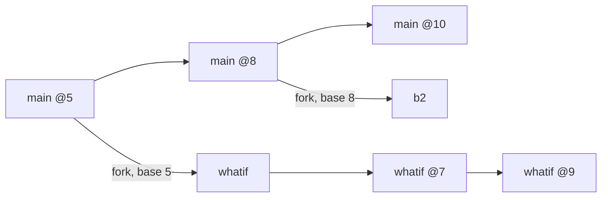
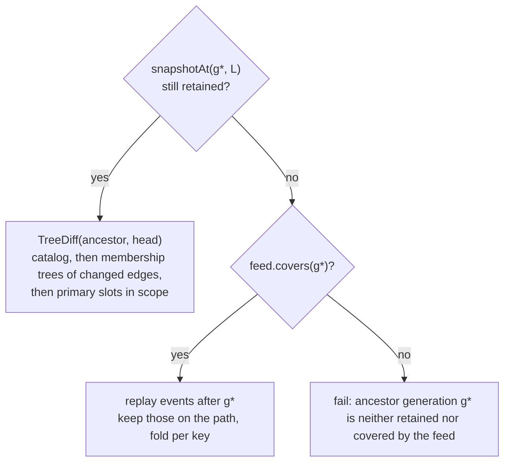
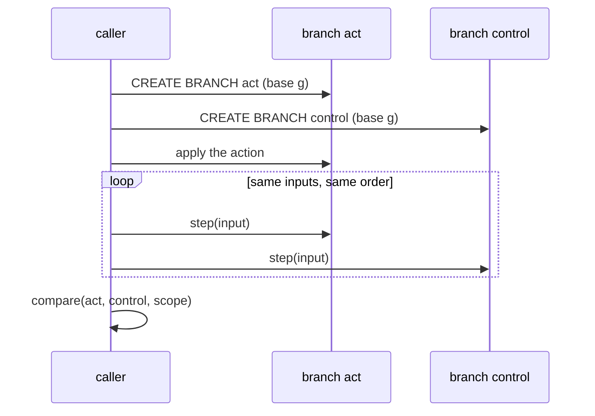

# Counterfactual and branch retrieval

This page covers retrieval across branches: what a branch changed since it forked, what survived, how two branches
differ relative to their common ancestor, which branch is closest to a given state, and what happened on a branch
after a given commit. It builds on HStore's copy-on-write branches, the global generation order, the change feed and
the structural tree diff.

## What the proposal asks and what it can deliver

The proposal: "Retrieve related states across persistent branches: what changed after an action, which interactions
survived, and which alternative state resembles the current one. Combine shared-ancestor discovery, structural deltas,
temporal constraints, and similarity ranking. Similarity alone does not establish causality."

All five retrieval questions can be answered exactly from data HStore already keeps. None of them needs a new slot.
What none of them can answer is "what did the action cause". Two branches that both kept receiving writes differ by
the action and by every other write that went to one side only. HStore can show the differences and their order. It
cannot attribute them. The [counterfactual workflow](#counterfactual-comparisons) section states what a caller has to
do for a comparison to mean "effect of the action".

| Part | Status |
|---|---|
| branching datasets with shared storage, diffs between versions | established; for example Maddox et al., *Decibel: The Relational Dataset Branching System*, PVLDB 9(9), 2016, [doi:10.14778/2947618.2947619](https://doi.org/10.14778/2947618.2947619) |
| three-way comparison against the common ancestor | established (version control, and HStore's own `BranchMerge.side`) |
| diff cost proportional to the difference, through shared subtrees | HStore's `TreeDiff` with `Ref.same` ([persistent tree](../docs/storage/persistent-tree.md)) |
| rebuilding a side's net change from the change feed when the ancestor snapshot is gone | ours |
| ranking branches by exact symmetric difference with count lower bounds | ours |

## What HStore keeps

| Fact | Where | Lifetime |
|---|---|---|
| branch tree: `Branch(id, name, parent, baseGeneration, createdAt, state, roots)` | every `Generation` | as long as the database; closed branches keep their record with empty roots |
| generation ids | global across branches, one per published commit | forever (ids) |
| full snapshots of past generations | `TransactionManager.history` | last `history_limit` = 64 generations, in memory only; after a restart only the checkpointed generation and those replayed after it |
| logical change of every commit: `CommitEvent(generation, txnId, wallTime, branch, members, slots)` | change feed segments on disk | `feed_retention_generations` = 100,000 by default, plus holds |
| current head of every active branch | the current generation | always |

`createBranch` records `baseGeneration = head.id` and copies the parent's `RootVector` by reference. A branch at the
moment of its creation is exactly its parent at `baseGeneration`. Feed events carry the branch id, and empty commits
(branch creation, closing, compaction) leave no event, so generation ids in the feed increase but are not contiguous.

The asymmetry in the table drives the design. Past snapshots are scarce (64 generations, lost on restart). Past
changes are plentiful (100,000 generations, on disk). Every query below therefore has a snapshot path and a feed
path, and picks the first that is available.

## The five queries

| Query | Question | Output |
|---|---|---|
| `delta(b, since)` | what changed on `b` after generation `since` (default: its fork) | net changes per key |
| `survivors(b, scope)` | which entries in scope existed at the fork and are untouched on `b` | keys |
| `compare(b, c, scope)` | how `b` and `c` diverged from their common ancestor | net changes per key, classified |
| `nearest(target, candidates, scope, k)` | which branches are closest to `target` | `k` branches with distances |
| `after(b, g, scope, window)` | which later commits on `b` touched the atoms of commit `g` | commits and their changes, in order |

A **key** is either an incidence `(edge, member)` or a primary slot entry `(slot, key)`, the same granularity as
`BranchMerge` conflicts. Derived slots are not keys: they follow from the primary ones.

### Common ancestor

Two branches share history up to their lowest common ancestor in the branch tree, at the earlier of the two
generations where their paths left it.

```
ancestor(b, c):
    L      = lowest common ancestor of b and c in the parent tree
    g_b    = baseGeneration of the child of L on the path to b, or +∞ if b = L
    g_c    = the same for c
    return (L, min(g_b, g_c))
```



For `whatif` and `b2` above, `L = main`, `g_whatif = 5`, `g_b2 = 8`, and the common ancestor is `main @5`. Changes on
`main` between 5 and 8 belong to `b2`'s side.

### Net change of a side

A side is the path from the ancestor point `(L, g*)` to a branch head. Its net change can come from two places.



The snapshot path is `Temporal.diff` plus `TreeDiff` over the primary slots, which is what `BranchMerge.side` already
does. The feed path keeps only events on the branches along the path, each within its window:

```
path L = x0 -> x1 -> ... -> xk = b
keep event e iff  e.branch = L  and g* < e.generation <= base(x1)
              or  e.branch = xi and base(xi) < e.generation <= base(xi+1)     (base(x(k+1)) = +∞)
```

Folding keeps, per key, the `before` of the first event and the `after` of the last, and drops keys whose `before`
equals their `after`. Member changes give incidence keys (`Added` has no before, `Removed` no after, `Updated` both).
Slot changes give slot keys directly. The membership of an edge never appears as a catalog slot change (`Workspace.store`
replaces the catalog tree directly), so incidences are counted once.

Both paths return the same net change. The snapshot path costs `O(d · (h + B))` page work for `d` differing entries,
tree height `h` and `B` entries per leaf, because `Ref.same` lets `TreeDiff` skip every shared subtree. The feed path
costs a sequential read of the feed after `g*` (all branches interleave in one file) plus `O(d log d)` for the fold.

### delta and survivors

`delta(b, since)` is the net change of the path from `(b's ancestor point at since)` to `b`'s head, through the
snapshot or the feed. `since` defaults to `b`'s fork, `(parent, baseGeneration)`.

`survivors(b, scope)` lists keys in scope that are in `b`'s head and not in `delta(b, fork)`. A key cannot be in the
head, untouched since the fork, and absent at the fork, so this needs no ancestor snapshot.

### compare

`compare(b, c, scope)` computes both sides from the common ancestor and classifies every key that either side
touched:

| Class | Meaning |
|---|---|
| `ONLY_B`, `ONLY_C` | one side changed it, the other did not |
| `BOTH_SAME` | both changed it to the same value |
| `BOTH_DIFFERENT` | both changed it, to different values: what `MERGE` reports as a conflict |

This is `BranchMerge`'s conflict detection made read-only and scoped, without opening a write transaction.

### nearest

Distance between two states is the size of the symmetric difference of their entries in scope, `d(A, B) = |A \ B| +
|B \ A|`. Jaccard similarity follows from the same diff and the two sizes: `|A ∩ B| = |A| − |A \ B|`.

Ranking `m` candidate branches against a target uses a lower bound first. `||A| − |B|| ≤ d(A, B)` always, and the
sizes are root counts:

| Scope | `|A|` in `O(1)` |
|---|---|
| all incidences | `PostingIndex.total` of the `REVERSE` slot (sum of posting weights at the root) |
| atoms of a type in a tenant | `PostingIndex.count` of `TYPES` at `typeKey(tenant, type)` |
| incidences of one tenant | not available; lower bound 0 |

```
order candidates by lower bound ascending
for each candidate c:
    if lowerBound(c) >= k-th best distance so far: stop
    d = |TreeDiff(target, c) restricted to scope|        cost O(d · (h + B))
    keep the k smallest
```

The diff runs directly between the two heads. No ancestor is needed, and shared subtrees are skipped whatever their
history. Two branches that made the same change independently do not share pages for it: the diff descends into those
subtrees, compares entries, and reports nothing for equal ones. The result stays exact and only the cost grows.

Narrower scopes are cheaper. For the neighbourhood of an atom `x`, compare `I(x)` in the two heads with `TreeDiff`,
then for each edge present on both sides compare the membership roots: `Ref.same` or equal fingerprints with equal
counts mean identical with probability `1 − 2⁻⁶⁴`, which `TreeAlgebra.equal` then confirms; anything else is diffed.

### after

`after(b, g, scope, window)` reads the event of commit `g` from the feed, takes the atoms it touched (edges and members
of member changes, keys of slot changes), and returns every later event on `b` within `window` generations that
touches one of them. Results are ordered by generation. They describe succession, not effect.

## Worked example

```
g5   main     E1 = Team{alice, bob}, E2 = Team{carol, dave}
g6   (empty)  CREATE BRANCH whatif          base = 5
g7   whatif   remove bob from E1            the action
g8   main     add erin to E2
g9   whatif   add bob to E2
g10  main     create E3 = Team{bob, erin}
```

Feed events after 5, by branch:

| generation | branch | change |
|---|---|---|
| 7 | whatif | `Removed(E1, bob)` |
| 8 | main | `Added(E2, erin)` |
| 9 | whatif | `Added(E2, bob)` |
| 10 | main | catalog `E3` created; `Added(E3, bob)`, `Added(E3, erin)` |

`compare(whatif, main, incidences)`: the ancestor is `(main, 5)`. If generation 5 has left the history window (or the
server restarted), the feed path applies, because `feed.covers(5)`.

| key | whatif side | main side | class |
|---|---|---|---|
| `(E1, bob)` | present to absent | | `ONLY_WHATIF` |
| `(E2, bob)` | absent to present | | `ONLY_WHATIF` |
| `(E2, erin)` | | absent to present | `ONLY_MAIN` |
| `(E3, bob)`, `(E3, erin)` | | absent to present | `ONLY_MAIN` |

`survivors(whatif, incidences)` = `(E1, alice)`, `(E2, carol)`, `(E2, dave)`.

`after(whatif, 7, scope, 10)`: commit 7 touched `E1` and `bob`. The later event on `whatif` touching either is
generation 9, `Added(E2, bob)`.

The tempting conclusion is wrong. "Removing bob from E1 led to bob ending up in one team on `whatif` and two on
`main`" mixes the action with generations 8 and 10, which `whatif` never received. The comparison has no control.

`nearest(whatif, {main, b2}, incidences, 1)`, where `b2` was forked from `main` at 8 and has no commits:

| candidate | entries | lower bound `||A| − |B||` | exact `d` | Jaccard |
|---|---|---|---|---|
| `b2` (main @8) | 5 | 1 | 3: `{E2:bob}` vs `{E1:bob, E2:erin}` | 3/6 = 0.5 |
| `main` (@10) | 7 | 3 | 5 | 3/8 = 0.375 |

`whatif` has 4 entries. `b2` is diffed first (bound 1) and gives 3. `main`'s bound 3 is not below 3, so `main` is
never diffed. Nearest: `b2`.

## Counterfactual comparisons

For a difference to be read as the effect of an action, the two branches must receive the same inputs apart from the
action. HStore cannot check that. The workflow that makes it true:



Both branches fork from the same generation, so their common ancestor is `(parent, g)` and the comparison sees only
what happened on the two branches. If `step` is deterministic in its inputs and the state it reads (for example a
`StateBindings.transition` driven by the same events), every `ONLY_ACT`, `ONLY_CONTROL` and `BOTH_DIFFERENT` key is a
consequence of the action, within that model of the world. `SAMPLE ... INTO BRANCH` (degree-preserving swaps) is the
same idea for structural null models: compare a statistic on `main` with the same statistic on sampled branches.

## Implementation

```java
sealed interface Key {
    record Member(long edge, long member) implements Key {}
    record Entry(int slot, long key) implements Key {}
}

record Net(Key key, Optional<Object> before, Optional<Object> after) {}

enum Side { ONLY_LEFT, ONLY_RIGHT, BOTH_SAME, BOTH_DIFFERENT }

record AncestorPoint(int branch, long generation) {}

sealed interface Scope {
    record Incidences() implements Scope {}
    record OfType(int tenant, int type) implements Scope {}
    record Around(long atom) implements Scope {}
}
```

`BranchRetrieval` (package `io.hstore.db.temporal`, next to `Temporal` and `BranchMerge`) provides the five queries.
Side computation is shared with `BranchMerge.side`: the snapshot path is exactly that function, and the feed path is a
new `FeedFold` that `BranchMerge` can also use, which would let a merge proceed after the fork generation has left
the history window. It is the same fold as the generation-time fold in
[temporal retrieval](temporal-hypergraph-retrieval.md#q3-in-generation-time-is-a-fold-over-the-change-feed), with the
same lineage filter; one implementation serves both pages. The temporal page folds presence only, this page keeps the
first `before` and last `after` values, so the shared fold keeps values and presence is derived from them. That change is outside this page but falls out of it.

Folding runs over a `HashMap<Key, Net>` sized by the number of touched keys. Feed replay is a single sequential scan
from the segment that holds `g* + 1`, found through the feed index.

## Security

Branches, `DIFF`, `HISTORY` and `SAMPLE` are restricted to admins of the default tenant (`Executor.engineWide`).
These queries read across branches and from the feed, so v1 has the same restriction. Opening them to tenant users
would need every result filtered by tenant (catalog records carry `tenant`; incidence keys inherit the edge's), size
bounds that respect tenants (only per-type counts do), and a decision on whether tenant users may see branches at all.
That decision is not made here.

## Complexity

Notation: `d` differing entries, `h` tree height, `B` entries per leaf, `F` feed bytes after the ancestor generation,
`m` candidate branches.

| Query | Snapshot path | Feed path | Memory |
|---|---|---|---|
| ancestor | `O(depth of branch tree)` | same | `O(1)` |
| `delta`, one side of `compare` | `O(d · (h + B))` | `O(F)` read plus `O(d log d)` fold | `O(d)` |
| `survivors` | `delta` plus a scan of scope | same | `O(d)` |
| `compare` | two sides plus a hash join on keys | same | `O(d_b + d_c)` |
| `nearest` | `O(m log m)` bounds, then `O(d_i · (h + B))` per diffed candidate | not used (heads are always live) | `O(k)` |
| `after` | | `O(F_window)` | `O(touched atoms)` |

## Limits of the first version

| Not supported | Reason |
|---|---|
| ancestors older than both the history window and the feed retention | neither a snapshot nor the events exist; the query fails and says which generation is missing |
| closed (merged or dropped) branches as `nearest` candidates | their roots are emptied on close; their history is still in the feed, so `delta` and `after` still work |
| derived-slot differences (indexes) | not keys; they follow from primary changes |
| causal attribution | needs the controlled workflow above |
| tenant users | see [security](#security) |
