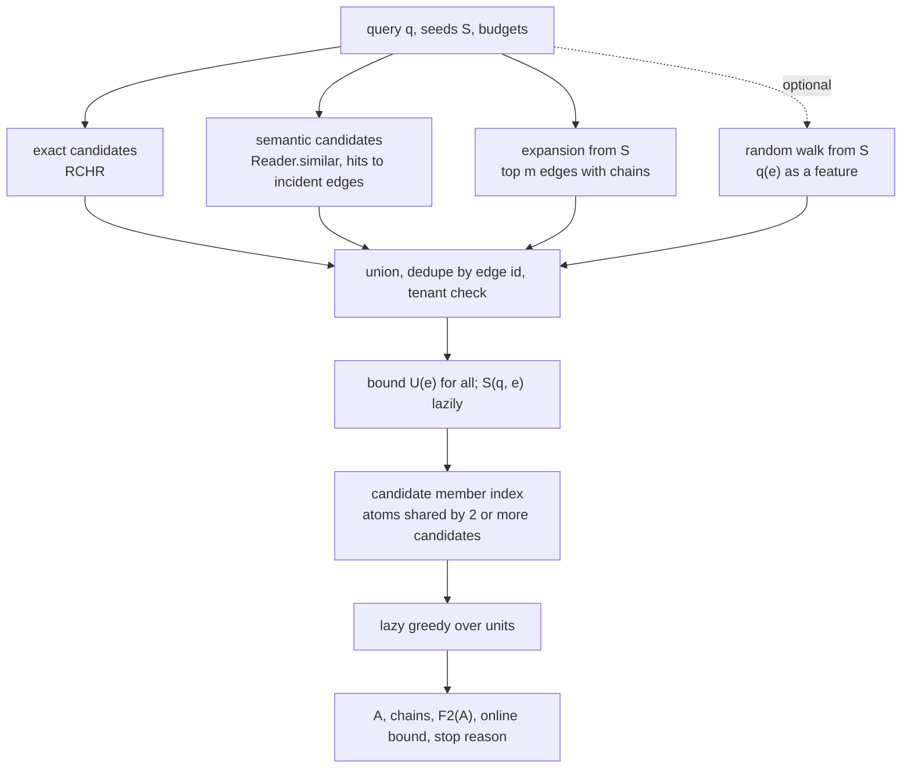

# Budgeted associative hyperedge retrieval (BAHR)

Status: a proposal for HStore. Nothing on this page is implemented, and none of it has been measured. The parts that
come from the literature are cited; the composition, the objective we recommend and the connectivity heuristic are
ours and need the benchmarks listed at the end before anyone relies on them.

BAHR selects a small set of hyperedges to hand to an agent: given a query, seeds and a strict budget (result size,
serialized size or compute), it gathers candidates, scores them, and picks a set that covers the query without
repeating itself. The proposal states the selection as

```
max over A ⊆ C of   Σ_{e ∈ A} r(e|q) + λ Coverage(A, q) - μ Redundancy(A) - ν Cost(A)
```

Most of this page is about what that objective is mathematically, which algorithms have which guarantees for it, and
what connectivity does to those guarantees. The short version:

| Formulation | Properties | Best practical algorithm | Guarantee |
|---|---|---|---|
| the proposal with `μ > 0` | submodular, not monotone, can be negative | greedy or random greedy | `1/e` only if the objective is non-negative on every subset; none in general |
| the proposal with `μ = 0`, cost as a penalty `ν > 0`, at most `k` hyperedges | monotone submodular minus modular | distorted greedy | `g(S) - ν c(S) >= (1 - 1/e) g(OPT) - ν c(OPT)` |
| recommended: redundancy folded into capped coverage, cost as a budget | monotone submodular, non-negative, knapsack | lazy cost-benefit greedy plus best single (or Greedy+) | `>= (1 - 1/e) / 2`, about 0.316; Greedy+ 1/2 |
| any of these with "the result must be connected" | adds a Steiner-type constraint | greedy on a fixed tree of chains | none proven; an a posteriori bound is reported |

| Page | Question it answers | Score |
|---|---|---|
| [role-aware-random-walk.md](role-aware-random-walk.md) | which atoms and hyperedges are associated with the seeds, counting every path | sum over all walks |
| [query-directed-expansion.md](query-directed-expansion.md) | which hyperedges are reachable through one strong, explainable chain | maximum over single paths |
| this page | which set of hyperedges to hand to an agent under a budget | set objective over candidates |

The relevance score `r(e|q)` is `S(q, e)` from [role-time-aware-scoring.md](role-time-aware-scoring.md) (RTHR), with its
upper bound `U(e)`, called through the `Scorer` interface of
[role-constrained-hyperedge-retrieval.md](role-constrained-hyperedge-retrieval.md) (RCHR), which also produces the exact
candidates. Both are written in parallel with this page.

## Problem

### Inputs and output

| Input | Meaning |
|---|---|
| `q` | an RTHR `ScoreQuery`: slots (a fixed atom or any atom of a type, optional roles, a weight `w_i`), an optional time, soft attribute predicates, an optional text |
| `S` | seed atoms or hyperedges of the reader's tenant; may be empty |
| result budget | at most `k` hyperedges, or a total cost `Σ c(e) <= B` |
| compute budget | `Budget.Meter` rows, deadline, page budget |
| `connected` | whether every returned hyperedge must be linked to a seed through shared members of returned hyperedges; needs at least one seed |

Output: a set `A` of hyperedges with their members, for each hyperedge its score and the slots it covers, the chain
that connects it when `connected` is set, the objective value, an upper bound on the optimum when one can be computed,
and why the run stopped.

### Terms of the objective

The proposal leaves `Coverage`, `Redundancy` and `Cost` open. Whether the objective has any useful structure depends
entirely on how they are defined. We fix definitions first. `C` is the candidate set, `x` ranges over atoms.

| Term | Definition | From |
|---|---|---|
| `r(e)` | `S(q, e)` in `[0, 1]` | RTHR |
| `cover(e, i)` | how well `e` fills slot `i`: 1 when the slot is filled in an accepted role, 1/2 when filled in another role, 0 when not filled; that is `m(i, π(i)) (1 + ρ(i, π(i))) / 2` from RTHR's assignment `π` | RTHR, per slot |
| `Cov_prob(A)` | `Σ_i w_i (1 - Π_{e ∈ A} (1 - cover(e, i)))` | ours |
| `Cov_sat(A)` | `Σ_i w_i min(1, Σ_{e ∈ A} cover(e, i))` | ours |
| `Red_pair(A)` | `Σ_{e < f in A} J(e, f)` with `J` the Jaccard similarity of member sets (`TreeAlgebra.jaccard`) | MMR-style |
| `Red_count(A)` | `Σ_x max(0, n_x(A) - 1)`, `n_x(A)` = number of hyperedges in `A` containing `x` | ours |
| `c(e)` | serialized size of `e` for the agent, `c_0 + c_1 * min(|M(e)|, m_cap)`, or `|M(e)|` | ours |

`cover` needs RTHR to expose the per-slot result of its assignment, not only `S(q, e)`. That is a requirement on the
scoring page's interface. Without it, the slots collapse into the five components and coverage becomes much coarser.

## Literature

### Submodular maximization

A set function `f` is submodular when adding an element to a larger set gains no more than adding it to a smaller one:
`f(A + e) - f(A) >= f(B + e) - f(B)` for `A ⊆ B`, `e ∉ B`. It is monotone when adding never loses.

| Source | Result we use |
|---|---|
| G. L. Nemhauser, L. A. Wolsey, M. L. Fisher, *An analysis of approximations for maximizing submodular set functions I*, Mathematical Programming 1978, [doi:10.1007/BF01588971](https://doi.org/10.1007/BF01588971) | greedy reaches `(1 - 1/e)` of the optimum for a non-negative monotone submodular `f` with `f(∅) = 0` and at most `k` elements (as restated in CELF, Theorem 2) |
| M. Minoux, *Accelerated greedy algorithms for maximizing submodular set functions*, Optimization Techniques 1978, [doi:10.1007/BFb0006528](https://doi.org/10.1007/BFb0006528) | lazy evaluation of marginal gains; checked title only |
| J. Leskovec, A. Krause, C. Guestrin, C. Faloutsos, J. VanBriesen, N. Glance, *Cost-effective Outbreak Detection in Networks*, KDD 2007, [doi:10.1145/1281192.1281239](https://doi.org/10.1145/1281192.1281239) (CELF) | Theorem 3: with costs and a budget, the better of unit-cost greedy and cost-benefit greedy reaches `(1 - 1/e) / 2`; lazy evaluation, up to 700 times faster than plain greedy in their experiments; Theorem 4: an online upper bound on the optimum for any solution, `OPT <= f(A) + Σ` of the best remaining marginal gains filling the budget (the last one fractionally) |
| S. Khuller, A. Moss, J. Naor, *The budgeted maximum coverage problem*, Information Processing Letters 1999, [doi:10.1016/S0020-0190(99)00031-9](https://doi.org/10.1016/S0020-0190(99)00031-9) | for budgeted coverage: cost-benefit greedy plus the best single set reaches `(1 - 1/e) / 2`; enumerating 3 elements and then running greedy reaches `1 - 1/e` (both as summarized by Feldman et al. below; we did not read the original) |
| M. Sviridenko, *A note on maximizing a submodular set function subject to a knapsack constraint*, Operations Research Letters 2004, [doi:10.1016/S0167-6377(03)00062-2](https://doi.org/10.1016/S0167-6377(03)00062-2) | the 3-element enumeration reaches `1 - 1/e` for any monotone submodular function, in `O(n^5)` (as summarized by Feldman et al.) |
| M. Feldman, Z. Nutov, E. Shoham, *Practical Budgeted Submodular Maximization*, Algorithmica 2022, [doi:10.1007/s00453-022-01071-2](https://doi.org/10.1007/s00453-022-01071-2), [arXiv:2007.04937](https://arxiv.org/abs/2007.04937) | plain cost-benefit greedy has no constant ratio; with the best singleton ("Greedy") its ratio is in `[0.427, 0.462]` (earlier 0.405 by Tang et al., 0.35 by Wolsey); "Greedy+" (best augmentation of any greedy prefix by one element, Yaroslavtsev, Zhou, Avdiukhin) reaches 1/2; one guess plus Greedy+ reaches 0.6174 in about `O(n^2)`; two guesses reach `1 - 1/e` in about `O(n^3)` |
| C. Harshaw, M. Feldman, J. Ward, A. Karbasi, *Submodular Maximization Beyond Non-negativity: Guarantees, Fast Algorithms, and Applications*, ICML 2019, [arXiv:1904.09354](https://arxiv.org/abs/1904.09354) | for `f = g - c`, `g` monotone non-negative submodular and `c` non-negative modular, at most `k` elements: distorted greedy makes `O(nk)` evaluations and returns `S` with `g(S) - c(S) >= (1 - 1/e) g(OPT) - c(OPT)` (their Theorem 3 with `γ = 1`) |
| N. Buchbinder, M. Feldman, J. Naor, R. Schwartz, *Submodular Maximization with Cardinality Constraints*, SODA 2014, [doi:10.1137/1.9781611973402.106](https://doi.org/10.1137/1.9781611973402.106) | random greedy: `1/e` for a non-negative, not necessarily monotone, submodular `f` with at most `k` elements, `O(nk)` (Theorem 1.3); still `1 - 1/e` when `f` is monotone |
| N. Buchbinder, M. Feldman, J. Naor, R. Schwartz, *A Tight Linear Time (1/2)-Approximation for Unconstrained Submodular Maximization*, FOCS 2012, [doi:10.1109/FOCS.2012.73](https://doi.org/10.1109/FOCS.2012.73) | double greedy, 1/2, no cardinality or budget constraint; non-negative `f` |
| J. Carbonell, J. Goldstein, *The use of MMR, diversity-based reranking for reordering documents and producing summaries*, SIGIR 1998, [doi:10.1145/290941.291025](https://doi.org/10.1145/290941.291025) | relevance minus similarity to what is already selected, chosen greedily; the origin of the "relevance minus redundancy" shape |

All the multiplicative guarantees above assume `f >= 0` on the sets considered. That assumption matters below.

### Connectivity

| Source | Result we use |
|---|---|
| M. X. Goemans, D. P. Williamson, *A General Approximation Technique for Constrained Forest Problems*, SIAM J. Computing 1995, [doi:10.1137/S0097539793242618](https://doi.org/10.1137/S0097539793242618) | prize-collecting Steiner tree (minimize tree cost plus the penalties of vertices left out): 2-approximation |
| N. Garg, *Saving an epsilon: a 2-approximation for the k-MST problem in graphs*, STOC 2005, [doi:10.1145/1060590.1060650](https://doi.org/10.1145/1060590.1060650) | cheapest tree that spans `k` vertices: 2-approximation (checked title and citations, not the paper) |
| M. Bateni, M. Hajiaghayi, V. Liaghat, *Improved Approximation Algorithms for (Budgeted) Node-Weighted Steiner Problems*, ICALP 2013, [doi:10.1007/978-3-642-39206-1_8](https://doi.org/10.1007/978-3-642-39206-1_8), [arXiv:1304.7530](https://arxiv.org/abs/1304.7530) | Net Worth (maximize prize minus cost of a connected subgraph) admits no approximation within any finite factor (stated in their introduction; Theorem 5 proves it for the rooted problem, directed or undirected, adapting Feigenbaum, Papadimitriou and Shenker); budgeted node-weighted Steiner tree (maximize prize, cost at most a budget): `O(log n)` unrooted, bicriteria `(1 + ε, O(log n) / ε²)` rooted |
| T.-W. Kuo, K. C.-J. Lin, M.-J. Tsai, *Maximizing Submodular Set Function With Connectivity Constraint: Theory and Application to Networks*, IEEE/ACM Transactions on Networking 2015, [doi:10.1109/TNET.2014.2301816](https://doi.org/10.1109/TNET.2014.2301816) | monotone submodular, connected, at most `k` vertices: `Ω(1/sqrt(k))`. We could not read the paper; the bound is as stated by Hajiaghayi, Kortsarz, MacDavid, Purohit and Sarpatwar, *Approximation Algorithms for Connected Maximum Cut and Related Problems*, ESA 2015, [arXiv:1507.00648](https://arxiv.org/abs/1507.00648), who also note that no non-trivial approximation was known for non-monotone submodular functions under connectivity at the time |
| C. Chekuri, M. Pál, *A Recursive Greedy Algorithm for Walks in Directed Graphs*, FOCS 2005, [doi:10.1109/SFCS.2005.9](https://doi.org/10.1109/SFCS.2005.9) | submodular orienteering (a walk of bounded length maximizing a submodular function of the visited nodes): `O(log OPT)` in quasi-polynomial time (from the abstract) |
| H. Cho, D. Shaw, *A Depth-First Dynamic Programming Algorithm for the Tree Knapsack Problem*, INFORMS J. Computing 1997, [doi:10.1287/ijoc.9.4.431](https://doi.org/10.1287/ijoc.9.4.431) | knapsack where an item can be taken only with its parent in a tree: exact in `Θ(nH)` for `n` nodes and capacity `H` |

## What the objective is

### Term by term

| Term | Class | Why |
|---|---|---|
| `Σ r(e)` | modular, non-negative | a sum of per-element values |
| `Cov_prob`, `Cov_sat` | monotone submodular, non-negative | per slot, `Cov_prob` is a coverage function: the gain of `e` is `w_i cover(e, i) Π_{f ∈ A} (1 - cover(f, i))`, which can only shrink as `A` grows; `Cov_sat` is a concave non-decreasing function of a non-negative sum |
| `-μ Red_pair`, `-μ Red_count` | submodular, not monotone | the gain of `e` in `Red_pair` is `Σ_{f ∈ A} J(e, f)` and in `Red_count` the number of members of `e` already covered; both only grow with `A`, so `Red` is supermodular and `-Red` submodular, and adding a redundant hyperedge lowers the objective |
| `-ν Cost` | modular, non-positive | |

The sum of submodular functions is submodular. The proposal's objective `F1 = Σ r + λ Cov - μ Red - ν Cost` is
submodular with either redundancy. It is monotone only when every marginal is non-negative,
`r(e) + λ ΔCov(e|A) >= μ ΔRed(e|A) + ν c(e)` for all `A` and `e`, which fails as soon as two candidates overlap
enough or one is expensive. `F1(∅) = 0`, and `F1` can be negative.

### Why redundancy is needed, and why subtracting it is the wrong way

With `μ = 0` the objective rewards duplicates. `Σ r` is modular: a second copy of a claim adds its full relevance
again; coverage saturates but relevance does not. The worked example below picks a resubmitted copy of a claim for
exactly that reason. So the proposal is right that redundancy has to be in the objective.

Subtracting it costs monotonicity, and with it non-negativity on the sets the algorithms visit. Every multiplicative
guarantee in the table above needs `f >= 0`. For the proposal's form with `μ > 0`, random greedy's `1/e` applies only
when `F1` is non-negative on every subset of `C`, as Theorem 1.3 of Buchbinder et al. assumes, and nothing checks that
at query time. With `ν > 0` as well, there is no guarantee we know of.

### Recommended form: redundancy as diminishing returns

Spread each hyperedge's relevance over its members and cap what any atom can contribute:

```
Rel_cap(A) = Σ_x min(kappa, Σ_{e ∈ A, x ∈ M(e)} r(e) / |M(e)|)
F2(A)      = Rel_cap(A) + λ Cov(A)          subject to  Σ_{e ∈ A} c(e) <= B   (and/or |A| <= k)
```

| Property | Holds | Why |
|---|---|---|
| monotone submodular | yes | per atom, `min(kappa, ·)` is concave and non-decreasing of a non-negative sum; `Cov` as above |
| non-negative, `F2(∅) = 0` | yes | |
| a single hyperedge keeps its relevance | when `kappa >= max_e r(e) / |M(e)|` | no atom is capped by one hyperedge alone, so `Rel_cap({e}) = r(e)` |
| an exact duplicate adds nothing | when every member of the duplicate is already at `kappa` | the caps are reached by the first copy |
| partial overlap is discounted | in proportion to the shared members | |

Cost moves from the objective into a constraint. That is not only a mathematical convenience. An agent has a context
budget, and a size limit is what the caller actually has. With connectivity, the penalty form "prize minus cost" is
the Net Worth problem, which has no finite approximation ratio at all (Bateni et al., Theorem 5).

If a caller insists on the penalty form, `F2 - ν Cost` with at most `k` hyperedges is exactly the setting of distorted
greedy, with `g(S) - ν c(S) >= (1 - 1/e) g(OPT) - ν c(OPT)`. It is offered as an option without connectivity.

### Which algorithm with which guarantee

| Objective | Constraint | Algorithm | Guarantee | Evaluations |
|---|---|---|---|---|
| `F2` | `|A| <= k` | lazy greedy (Minoux, CELF) | `1 - 1/e` | `O(nk)` worst case, far fewer in practice |
| `F2` | `Σ c <= B` | lazy cost-benefit greedy, then the best single candidate | `(1 - 1/e) / 2`; in fact `[0.427, 0.462]` | `O(nk)` |
| `F2` | `Σ c <= B` | Greedy+ | 1/2 | `O(nk)` plus one pass per prefix |
| `F2` | `Σ c <= B` | one guess plus Greedy+; two guesses; three guesses | 0.6174; `1 - 1/e`; `1 - 1/e` | about `O(n^2)`, `O(n^3)`, `O(n^5)` |
| `F2 - ν Cost` | `|A| <= k` | distorted greedy | `(1 - 1/e) g(OPT) - ν c(OPT)` | `O(nk)` |
| `F1`, `μ > 0`, `ν = 0`, non-negative on every subset | `|A| <= k` | random greedy | `1/e` | `O(nk)` |
| `F1`, `μ > 0`, `ν > 0` | any | greedy | none | `O(nk)` |
| any of the above | connected | chain-augmented lazy greedy ([below](#connectivity)) | none proven; a posteriori bound | `O(nk)` units |

`n = |C|`. The guessing variants are listed to show where `1 - 1/e` is reachable; with a few thousand candidates
`O(n^3)` evaluations is out of reach of a query budget. The first version implements lazy cost-benefit greedy with
the best singleton, and Greedy+ as an option.

### Connectivity

"Select a subhypergraph" can mean any set of hyperedges, or a set that is connected to the seeds through shared
members. For an agent the second is usually what is wanted, because a disconnected hyperedge comes without a reason for
being there. In graph terms, `A` together with the seeds must induce a connected subgraph of the star expansion
(atoms and hyperedges as nodes, memberships as edges), where atoms are free connecting nodes and hyperedges carry
prize and cost: a node-weighted Steiner problem. Connectivity changes the problem class:

| Variant | Known | Source |
|---|---|---|
| prize minus cost, connected (Net Worth) | no approximation within any finite factor | Bateni et al. Theorem 5 |
| modular prize, connected, cost budget | `O(log n)`, or rooted `(1 + ε, O(log n) / ε²)` bicriteria | Bateni et al. |
| cheapest connected set spanning `k` atoms | 2-approximation | Garg |
| monotone submodular, connected, `|A| <= k` | `Ω(1/sqrt(k))` | Kuo et al., as reported by Hajiaghayi et al. |
| submodular, bounded walk | `O(log OPT)`, quasi-polynomial time | Chekuri and Pál |
| non-monotone submodular, connected | nothing non-trivial known in 2015 | Hajiaghayi et al.; we did not survey later work |
| modular prize, connected within a fixed tree, budget | exact, `Θ(nH)` | Cho and Shaw |

None of the general results is practical inside a query. The algorithms behind them are LP-based or primal-dual and
run over the whole input graph, which for us is the hypergraph around the seeds with no natural boundary. We restrict
connectivity to a fixed structure that the expansion already produces.

Every candidate gets a chain: the hyperedges on its best chain to a seed in
[query-directed-expansion.md](query-directed-expansion.md), which returns them as `parent` links. A candidate that came
from exact or semantic retrieval and was not reached by the expansion gets a chain if one of its members is an atom the
expansion settled: its chain is that atom's chain. Otherwise it is not eligible when `connected` is set. The chains form
a forest `T` rooted at the seeds, and a set is admissible when it is closed under parents in `T`.

On a fixed tree, the modular version is the tree knapsack and is solved exactly by dynamic programming (Cho and Shaw).
For `F2` we use greedy over units: the unit of a candidate `e` is `e` together with the hyperedges of its chain that are
not selected yet, with gain `F2(A ∪ unit) - F2(A)` and cost `c(unit)`. Two facts keep lazy evaluation valid for units:

1. As `A` grows, the gain of a fixed set of hyperedges can only shrink (`F2` is submodular).
2. As `A` grows, the unit only loses members. Its cost can only shrink, and never below `c(e)`.

Hence `gain / c(e)` from an earlier evaluation is an upper bound on the unit's density at any later point, and it is the
key we store. A popped unit is re-evaluated and accepted when its exact density is at least the largest stored key.

We know of no approximation guarantee for this greedy. What we can always report is CELF's online bound computed on
the relaxation without connectivity. The connected optimum is at most the unconstrained optimum, which is at most that
bound, so `F2(A) / bound` is a certified lower bound on how close the returned set is to the best connected set. We also
lose optimality relative to sets that would be connected through other paths than those in `T`; the bound covers that
loss too, because it ignores connectivity altogether.

## The algorithm



### Phase 1: candidates

The compute budget is split between generation and selection (by default two thirds for generation). Each generator
gets a cap on the candidates it may contribute.

| Generator | Produces | Notes |
|---|---|---|
| exact | hyperedges that meet the hard constraints of `q` | RCHR; candidates come with their anchored postings, so RTHR's bound is cheap |
| semantic | `Reader.similar(text, k_s, FRESH)` hits; a hit that is a hyperedge is a candidate, a hit that is a node contributes its incident hyperedges (up to a cap per hit) | `Writer.embed` accepts any atom and the semantic plane indexes every row of slot 36, so hyperedges can have vectors; only `NodeRecord` carries an `embeddingRef` |
| expansion | the top `m` hyperedges from the seeds with their chains | `query-directed-expansion.md`; also provides the chains for connectivity |
| random walk | top hyperedges by `q(e)` | optional; `q(e)` can enter `r` as a feature or rank candidates when the query has no text and no slots |

Recall is relative to `C`. Every guarantee in this page is about the best subset of `C`, never about the best subset
of the database. A relevant hyperedge that no generator produced is lost without a trace, which is why the benchmark
has to measure generator recall separately from selection quality.

### Phase 2: scores, lazily

All candidates get `U(e)` (cheap). `S(q, e)` and the per-slot `cover(e, i)` are computed only when a candidate's unit
is popped for exact evaluation. The initial key of a candidate is the sum, over the hyperedges of its unit, of `U(f)`
plus `λ Σ_i w_i` for coverage, divided by `c(e)`. The gain of a set is at most the sum of its members' single gains
(submodularity), and the unit's cost never drops below `c(e)`, so this bounds the unit's density now and later. This
is the same lazy structure as RTHR's top-k and CELF's lazy greedy; a candidate that never reaches the top of the heap
is never fully scored.

### Phase 3: candidate member index

`Rel_cap` and `Red_count` need, for every member of a candidate, how much of it is already taken. Only atoms that occur
in two or more candidates can ever be capped by another candidate. We build, once, a map from atom to the candidates
that contain it and keep only atoms with two or more entries. Building it reads `Σ_{e ∈ C} min(|M(e)|, m_cap)`
members. For a hyperedge with more than `m_cap` members (default 4,096) the rest are not indexed; its overlap with
other candidates is then underestimated and the result records that it was truncated.

### Phase 4: selection

Lazy greedy over units, then the best single unit, then (optionally) Greedy+. The online bound is computed from the
final marginal gains.

## Worked example

The hypergraph of [role-aware-random-walk.md](role-aware-random-walk.md#running-example) at `t = 2026-06-01`, seed ines,
plus two more candidates: `c3`, a resubmitted copy of claim `c1` with the same members, and `g1`, a Note hyperedge
{note-17, ben} that semantic search returned because note-17's text mentions metformin. The query has four slots of
weight 1: `x1` patient ines, `x2` drug metformin, `x3` a Provider in role `provider`, `x4` a Hospital in role `site`.
The budget is `B = 8` with `c(e) = |M(e)|` (admitted members), `λ = 1`, and coverage `Cov_prob`.

| Candidate | members at `t` | `c(e)` | `r(e)` | `cover` | source |
|---|---|---|---|---|---|
| `c1` Claim | ines, ada, metformin | 3 | 0.90 | `x1` 1, `x2` 1, `x3` 1 | exact |
| `c3` Claim | ines, ada, metformin | 3 | 0.85 | `x1` 1, `x2` 1, `x3` 1 | exact |
| `v1` Visit | ines, ada | 2 | 0.35 | `x1` 1, `x3` 1 | expansion |
| `c2` Claim | clara, metformin | 2 | 0.40 | `x2` 1, `x3` 1 | expansion |
| `s1` Staffing | ada, st-olaf | 2 | 0.50 | `x3` 0.5 (ada is `staff`), `x4` 1 | expansion |
| `g1` Note | note-17, ben | 2 | 0.60 | `x2` 0.5 | semantic |

Chains for connectivity: `c1`, `c3`, `v1` contain the seed; `c2` hangs off metformin and `s1` off ada, both reached
through `c1`; `g1` shares no member with anything the expansion settled and is not eligible when `connected` is set.
In the tables below, `c2` and `s1` are shown with their own gains; with `connected` set and `c1` not yet selected their
units would include `c1`, and greedy takes `c1` first anyway.

### The proposal's objective with `μ = 0`

Marginal gains `F1(A + e) - F1(A)` (density = gain / cost):

| `A` | `c1` | `c3` | `v1` | `c2` | `s1` | `g1` | pick |
|---|---|---|---|---|---|---|---|
| `{}` | 3.90 (1.30) | 3.85 (1.28) | 2.35 (1.18) | 2.40 (1.20) | 2.00 (1.00) | 1.10 (0.55) | `c1` |
| `{c1}` | | 0.85 (0.28) | 0.35 (0.18) | 0.40 (0.20) | 1.50 (0.75) | 0.60 (0.30) | `s1` |
| `{c1, s1}` | | 0.85 (0.28) | 0.35 (0.18) | 0.40 (0.20) | | 0.60 (0.30) | `g1`, or `c3` if connected |

Unconstrained, greedy takes `g1` (6.00); the optimum under `F1` is `{c1, c3, s1}` at 6.25, a set with a verbatim
duplicate. With `connected`, greedy takes `c3` and lands on that duplicate-carrying optimum. Either way the objective
prefers the copy of `c1` to the visit or the other claim.

### With the pairwise penalty, `μ = 1`

`J(c1, c3) = 1`, so `F1({c1, c3}) = 3.75 < F1({c1}) = 3.90`: adding a candidate lowers the objective, which is the
non-monotonicity in one line. Greedy now takes `c1`, `s1`, then `g1` (5.75) or, connected, `c2` (5.30). The duplicate
is gone, at the price of every guarantee.

### The recommended objective `F2`, `kappa = 0.3`

With `kappa = max r(e) / |M(e)| = 0.9 / 3` no single hyperedge is capped. Marginal gains:

| `A` | `c1` | `c3` | `v1` | `c2` | `s1` | `g1` | pick (connected) |
|---|---|---|---|---|---|---|---|
| `{}` | 3.90 (1.30) | 3.85 (1.28) | 2.35 (1.18) | 2.40 (1.20) | 2.00 (1.00) | 1.10 (0.55) | `c1` |
| `{c1}` | | 0 | 0 | 0.20 (0.10) | 1.25 (0.63) | 0.60 (0.30) | `s1` |
| `{c1, s1}` | | 0 | 0 | 0.20 (0.10) | | 0.60 (0.30) | `c2` |

After `c1`, ines, ada and metformin each hold 0.3 = `kappa`, so `c3` and `v1` gain exactly nothing: the duplicate is
handled without a penalty term. Connected greedy returns `{c1, s1, c2}` with `F2 = 5.35` at cost 7, which is also the
connected optimum (found by enumeration). Unconstrained, greedy takes `g1` instead of `c2` (5.75, the unconstrained
optimum).

CELF's online bound for the connected result: the remaining positive gains are `g1` 0.60 at cost 2 (`c3`, `v1` are 0),
which fit in `B`, so `OPT <= 5.35 + 0.60 = 5.95` and the returned set is certified to be within `5.35 / 5.95 = 0.90` of
the best connected set. The true ratio is 1; the bound is loose because it lets `g1` in without connectivity.

## Implementation in HStore

### What carries over and what does not

| Assumption in the literature | HStore reality | What we do |
|---|---|---|
| the ground set is given | candidates must be generated within a budget | four generators with caps; guarantees are relative to `C` |
| `f(A)` is an oracle with unit cost | `r(e)` may need a member scan; coverage needs RTHR's assignment | lazy keys from `U(e)`; exact scores only on pop |
| elements are independent | hyperedges share members, and a member may itself be a hyperedge | overlap through the candidate member index; a nested hyperedge is an atom like any other |
| connectivity is over a given graph | the connecting structure is the hypergraph itself, unbounded | chains from the expansion, a fixed forest `T` |
| one tenant | candidates from postings and semantic hits can belong to other tenants | tenant checks at generation ([below](#tenant-isolation)) |
| costs are given | the cost of a hyperedge for an agent is its serialized size | `c(e)` from `|M(e)|`, `O(1)` from the catalog record |

### Storage: no new slots

Everything BAHR computes is specific to one query: candidates, scores, the member index, the selection. The inputs are
the catalog, the reverse index, the membership trees, the property bags (RTHR attributes) and slot 36 (embeddings),
all of which exist. A slot would only make sense for something reused across queries, such as precomputed hyperedge
similarities for `Red_pair`; maintaining those would cost a pass over every overlapping hyperedge per membership
change, which is far more than any query saves.

### Tenant isolation

| Generator or step | Rule |
|---|---|
| exact | RCHR's rules: anchors resolved with `Reader.require`, postings filtered by the edge record's tenant |
| semantic | `Reader.similar` admits only `Reader.visible` atoms; incident hyperedges of a node hit are filtered by `EdgeRecord.tenant()`, as in `Hora.neighbors` |
| expansion, walk | their own rules ([query-directed-expansion.md](query-directed-expansion.md#tenant-isolation)) |
| member index | members of owned hyperedges; an atom that is not owned (only possible in databases written before `Writer.incidence` checked tenants) is skipped with `Reader.owns` and never serialized |
| output | only candidates that passed a tenant check, with members filtered the same way |

### Budgets

| Budget | Phase | On exhaustion |
|---|---|---|
| `Budget.Meter` rows, two thirds | generation: postings, members, semantic hits | each generator stops at its share; selection runs on what was found |
| `Budget.Meter` rows, the rest | selection: one row per exact evaluation of a unit | greedy stops; the prefix selected so far is a valid result |
| `Budget.maxTime` | both | same |
| `IoTrace` page budget | both | with the accessor proposed in [role-aware-random-walk.md](role-aware-random-walk.md#budgets), stop at 90%; without it, the query fails |

Greedy is anytime: every prefix it builds satisfies the constraints, and the online bound can be computed for it.

### Determinism

For one snapshot, the exact, expansion and walk generators are deterministic, and the selection breaks ties by
ascending edge id. Semantic candidates are the exception. `FRESH` waits until the HNSW index has applied the reader's
generation and verifies every hit against the snapshot, but the index is shared and keeps changing: a later insert
can change which neighbors the graph search visits. Two runs at the same generation can then see different semantic
candidates. Callers that need reproducible results either disable the semantic generator or accept that variance.

### API

```java
public record SelectionParams(double lambda, double kappa, OptionalInt k, OptionalDouble costBudget,
                              boolean connected, boolean greedyPlus, int memberCap) {}

public record Candidate(long edge, double bound, double cost, long[] chain, Source source) {
    public enum Source { EXACT, SEMANTIC, EXPANSION, WALK }
}

public record Chosen(long edge, double relevance, double[] cover, long[] chain) {}

public record Retrieval(List<Chosen> edges, double value, OptionalDouble upperBound, boolean truncatedMembers, Stop stop) {
    public enum Stop { BUDGET_FILLED, NO_POSITIVE_GAIN, COMPUTE_BUDGET }
}

Retrieval evidence = AssociativeRetrieval.on(reader, scorer)
        .retrieve(query, List.of(ines), new SelectionParams(1.0, 0.3, OptionalInt.empty(), OptionalDouble.of(8), true, false, 4096),
                Budget.DEFAULT);
```

The selection loop:

```java
final class LazySelector {

    private record Keyed(Candidate candidate, double key) {}

    private static final Comparator<Keyed> ORDER = Comparator.comparingDouble(Keyed::key).reversed()
            .thenComparingLong(keyed -> keyed.candidate().edge());

    Selection select(List<Candidate> candidates, Objective objective, Selection selection, Budget.Meter meter) {
        PriorityQueue<Keyed> heap = new PriorityQueue<>(ORDER);
        candidates.forEach(candidate -> heap.add(new Keyed(candidate, objective.upper(selection.unit(candidate)) / candidate.cost())));
        while (!heap.isEmpty()) {
            if (!meter.tryConsume(1)) {
                return selection.stopped(Retrieval.Stop.COMPUTE_BUDGET);
            }
            Keyed top = heap.poll();
            Unit unit = selection.unit(top.candidate());
            if (unit.isEmpty() || !selection.fits(unit)) {
                continue;
            }
            double gain = objective.gain(selection, unit);
            if (gain <= 0) {
                continue;
            }
            double next = heap.isEmpty() ? Double.NEGATIVE_INFINITY : heap.peek().key();
            if (gain / unit.cost() >= next) {
                selection = selection.with(unit, gain);
            } else {
                heap.add(new Keyed(top.candidate(), gain / top.candidate().cost()));
            }
        }
        return selection.stopped(selection.full() ? Retrieval.Stop.BUDGET_FILLED : Retrieval.Stop.NO_POSITIVE_GAIN);
    }
}

sealed interface Objective permits Objective.CappedCoverage, Objective.Penalized {

    double upper(Unit unit);

    double gain(Selection selection, Unit unit);

    record CappedCoverage(double kappa, double lambda, double[] slotWeights, Scorer scorer) implements Objective {
        public double upper(Unit unit) {
            return unit.candidates().stream().mapToDouble(Candidate::bound).sum() + lambda * Arrays.stream(slotWeights).sum();
        }

        public double gain(Selection selection, Unit unit) {
            return selection.cappedMass(unit, kappa) + lambda * selection.coverageGain(unit, slotWeights);
        }
    }

    record Penalized(double lambda, double mu, double nu, double[] slotWeights, Scorer scorer) implements Objective {
        public double upper(Unit unit) {
            return unit.candidates().stream().mapToDouble(Candidate::bound).sum() + lambda * Arrays.stream(slotWeights).sum();
        }

        public double gain(Selection selection, Unit unit) {
            return selection.relevance(unit) + lambda * selection.coverageGain(unit, slotWeights)
                    - mu * selection.redundancyGain(unit) - nu * unit.cost();
        }
    }
}
```

`Selection` is immutable: `with` returns a new selection, which makes Greedy+ (try one more candidate on every prefix)
a matter of keeping the prefixes. `Selection.unit` returns the candidate plus the hyperedges of its chain that are not
selected yet, or the candidate alone when `connected` is off. `Penalized` is only correct for the lazy loop when its
marginal gains are non-increasing, which holds for `F1` (it is submodular); with `μ > 0` the loop still runs but no
guarantee comes with it, and the result reports no upper bound.

### Execution and parallelism

The generators are independent and run concurrently, one virtual thread each, on the same `Reader`. Their results are
merged in a fixed order (exact, expansion, walk, semantic; then by edge id), and concurrency does not change `C`. Each
task re-binds the caller's `IoTrace` (same accessor as in the other two pages). Selection is sequential. Scoring the
top few heap entries ahead of time in parallel is possible, as in the expansion, and does not change the result.

## Complexity

Notation: `n = |C|`, `k` = selected hyperedges, `d` = maximum chain length, `m̄` = average indexed members per candidate,
`T_S` = one RTHR full score.

| Part | Literature | HStore |
|---|---|---|
| candidate generation | not part of the problem | sum of the generators' costs, capped by their budget shares |
| bounds | | `O(n)` `U(e)` evaluations, cheap |
| member index | | `O(n m̄)` member reads and map updates |
| greedy, cardinality or knapsack | `O(nk)` oracle calls; lazy evaluation usually far fewer | `O(nk)` unit evaluations worst case, each `O(d m̄ + slots)` plus `T_S` on the first evaluation of a candidate |
| Greedy+ | `O(nk)` more | same, optional |
| online bound | `O(n log n)` | one pass over the final gains |
| guarantee | as in the table above | the same for `F2` without connectivity; with connectivity, the a posteriori ratio only |
| memory | | `O(n m̄)` for the index, `O(n)` heap |

## Limits of the first version

| Not supported | Reason | Today |
|---|---|---|
| the proposal's objective with `μ > 0` as the default | non-monotone, no guarantee | available as `Penalized`, no bound reported |
| enumeration variants (1, 2, 3 guesses) | `O(n^2)` to `O(n^5)` evaluations | lazy greedy, best singleton, Greedy+ |
| connectivity through paths outside the expansion's chains | Steiner-type, see above | ineligible candidates are reported, not connected |
| required targets (connect these entities to each other) | group Steiner | one expansion per target, then selection |
| learned weights for `λ`, `kappa`, generator shares | no judged data | defaults |
| incremental results as the graph changes | everything is per query | rerun |

### What must be benchmarked

None of the following exists yet, and the defaults on this page mean nothing until they do.

| Question | Measure | Needs |
|---|---|---|
| generator recall | share of judged relevant hyperedges that reach `C`, per generator and combined | a judged query set; the current benchmark dataset has no roles, weights or validity |
| selection quality | `F2(A)` against the exact optimum by enumeration or an ILP on small `C`; the online bound's tightness | small instances |
| does `F2` match what agents need | task success of an agent given `A` from `F2`, from `F1` with and without `μ`, from top-k by `r`, from the walk's top-k | an agent harness and tasks |
| cost of connectivity | value and recall with `connected` on and off; share of candidates made ineligible | the expansion running |
| latency and budget split | latency and pages per phase for `B` from 10 to 200 hyperedges; best generation share | the page budget accessor |
| truncation | how often `m_cap` truncation changes the selected set | datasets with hyperedges above 4,096 members |
| semantic variance | how often two runs at one generation return different sets | concurrent embedding writes |
