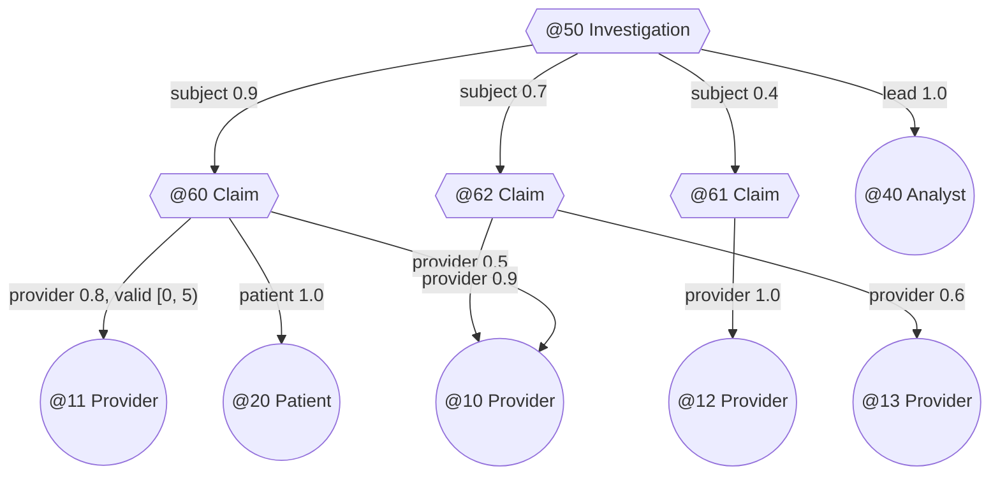
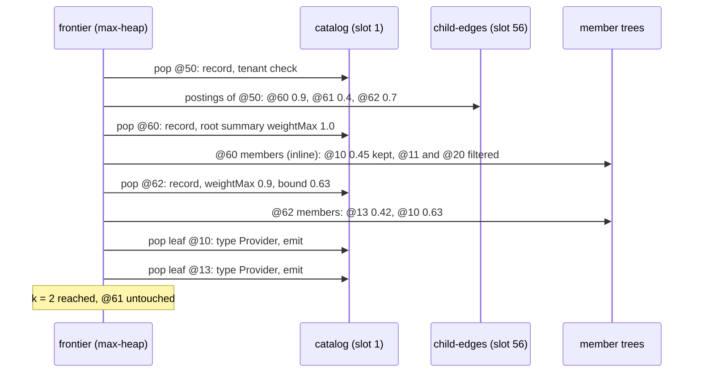

# Hierarchical hyperedge retrieval

Status: proposal. The proposal this page answers: retrieve coarse groups first, then refine into nested hyperedges and
their members; use branch summaries and structural fingerprints to prune irrelevant subtrees before loading full
memberships; exploit native nested hyperedges and persistent tree summaries rather than flattening.

Two words in that text need pinning down first.

| Word | Means here | Does not mean |
|---|---|---|
| branch summary | the `Summary` stored on every child reference of a B+-tree `Branch` node (`engine/.../tree/Branch.java`, `Summary.java`), and the root summary that an edge's catalog record carries for its member tree | an HStore branch (`catalog/Branch.java`), the copy-on-write fork made by `CREATE BRANCH` |
| structural fingerprint | `Summary.fingerprint`, the SET or SEQUENCE hash of a tree's entries (`FingerprintMode`) | any similarity measure; the fingerprint is a hash and says nothing about how close two groups are |

## Problem

A hyperedge can contain hyperedges (`docs/storage/topology.md`, higher-order hyperedges). Write `p -> c` when `c` is
a member of `p` and `c` is itself an edge. The nesting graph is directed and may have shared children (one claim in
two investigations) and cycles (nothing stops an edge from containing an ancestor).

A hierarchical query starts at a set of roots and walks down a fixed number of levels:

```
roots   : an edge, or the edges an access path returns (a type, an RCHR query)
level j : child edges of type T_j whose membership in the parent has roles ρ_j, is valid at t, weight in [lo, hi]
leaf    : members of the last level with atom type L, roles ρ_L, valid at t, weight in [lo, hi]
mode    : all paths | distinct leaves (best path per leaf) | top k
score   : Π over the path of the membership weights, times leafScore(leaf) ∈ [0, 1]
```

A result is a path `(root, c_1, .., c_d, leaf)`. A path that revisits an edge is a cycle and is not a result.

### Running example



Query: from `@50`, one level of `Claim` children in role `subject`, leaves of type `Provider` in role `provider`
valid at `t = 7`, top 2 distinct providers by path weight. The answer is `@10` (0.7 · 0.9 = 0.63, through `@62`) and
`@13` (0.7 · 0.6 = 0.42). `@11` is not valid at 7, `@12` scores 0.4 · 1.0 = 0.4, and `@10`'s other path (0.45) is not
its best.

## What exists today

| Feature | Where | Behaviour |
|---|---|---|
| `EXPAND e DEPTH d` | `Hora.expand` (`hora/Hora.java`) | depth-first from `e`; members outside the reader's tenant are skipped, and `reader.atom(member)` decides whether to descend; emits leaves with status `EMIT`, `CYCLE` or `BUDGET_EXHAUSTED`; no filters, no ordering |
| `PATTERN … WHERE i CONTAINS s AND i = @120` | `PatternMatcher` | one level of containment per constraint; candidates for `s` are `M(i)` by leapfrog, then a type filter |
| parents of an atom | reverse index, slot 2 | `I(c)` lists every edge that contains `c`, including parent edges of a nested `c` |
| per-edge pruning | `Hyperedge.validAt`, `withRoleSets`, `weightedBetween` | pruned scans of one member tree |

Reading `Hora.expand` for this page turned up three problems. Two are fixed: a member of another tenant is now
skipped instead of failing the traversal, and cycles are tested against the current path, so a child shared by two
parents is expanded under both (with every emitted row charged to the row budget, which bounds the extra paths). One
remains:

| Problem | Effect |
|---|---|
| every member costs a catalog lookup to find out whether it is an edge | an edge with a million node members and three nested edges costs a million lookups to find the three |

## What summaries can and cannot prune

Every reference in a member tree carries a `Summary` of its subtree, and the root reference sits in the edge's catalog
record (`EdgeRecord.members`, either `Ref.Stored` with the summary or `Ref.Inline` whose summary is computed from at
most 32 entries). For a child edge that the walk has not yet opened, its root summary is one catalog lookup away.

| Field | Prunes | Cannot tell |
|---|---|---|
| `count` | edges or subtrees below a size bound; also the number of members to expect | how many members are edges, or how many leaves lie below |
| `min`, `max` (member ids) | subtrees that cannot contain a given member id | anything about kinds or types: node and edge ids come from one allocator (`TransactionManager.allocateAtom`) |
| `weightMin`, `weightMax`, `weightSum` | subtrees with no weight in range; an upper bound for weight-based scores | the weights one level further down |
| `timeMin`, `timeMax` | subtrees with no member valid at `t` (`mayBeValidAt`) or overlapping a window | validity of grandchildren |
| `roleBits` | subtrees with no role set from the requested buckets (`mayHaveRoles`); proves absence only | presence of a role |
| `fingerprint` | nothing by relevance. Equal fingerprints and counts mean equal contents with high probability, confirmed by `TreeAlgebra.equal` | similarity; nearby groups have unrelated hashes |

Summaries are per tree. None of them is transitive: an investigation's summary describes its claims as members (their
ids, their membership weights and roles), not the claims' members. Everything below one level has to be read, or
bounded by an assumption.

The fingerprint's real use here is deduplication. In all-paths mode two different child edges with equal fingerprints
expand to the same leaves, so the second expansion can reuse the first's result after `TreeAlgebra.equal` confirms
the match.

## Background

| Topic | Source | Relation |
|---|---|---|
| best-first search over a hierarchy with bounds on subtrees, yielding results incrementally in exact order | G. R. Hjaltason, H. Samet, *Distance browsing in spatial databases*, ACM TODS 24(2), 1999, [doi:10.1145/320248.320255](https://doi.org/10.1145/320248.320255) | the algorithm below is this search, with weight-product bounds instead of distance bounds |
| stopping once no unseen object can beat the current top `k` | R. Fagin, A. Lotem, M. Naor, *Optimal aggregation algorithms for middleware*, JCSS 66(4), 2003, [doi:10.1016/S0022-0000(03)00026-6](https://doi.org/10.1016/S0022-0000(03)00026-6) | the stopping rule |
| tree-organised retrieval over recursively summarised text | P. Sarthi et al., *RAPTOR: Recursive Abstractive Processing for Tree-Organized Retrieval*, [arXiv:2401.18059](https://arxiv.org/abs/2401.18059) | contrast, see below |
| links that point to links | B. Iordanov, *HyperGraphDB: A Generalized Graph Database*, WAIM 2010 workshops, LNCS, pp. 25 to 36, [doi:10.1007/978-3-642-16720-1_3](https://doi.org/10.1007/978-3-642-16720-1_3) | the same modelling choice as HStore's nested hyperedges |
| per-block aggregates used to skip data | G. Moerkotte, *Small Materialized Aggregates*, VLDB 1998, pp. 476 to 487 | what a branch summary is |

RAPTOR builds a tree by clustering text chunks and summarising each cluster with a language model, then retrieves
either by "tree traversal" (keep the top-`k` nodes per layer by similarity and descend only into their children) or
from a "collapsed tree" (rank every node of every layer together). The authors compare the two on 20 stories from
QASPER and report that "the collapsed tree approach consistently performs better". Per-layer top-`k` is greedy: a
relevant leaf under a parent that scores poorly is never reached. The search below avoids that by descending on
upper bounds, which needs a score whose value at a parent bounds every descendant. Weight products in `[0, 1]` have
that property. Embedding similarity does not (a group's vector says nothing certain about its members' vectors), so
for similarity HStore would do what RAPTOR found better anyway: rank flat over the semantic plane and filter by
ancestry. HStore's hierarchy is modelled by the user, and its summaries are monoid aggregates, not text.

The bound-driven descent is established (Hjaltason and Samet); applying it to nested hyperedges with HStore's
summaries, the bounds below and the child-edge index are this page's proposal.

## The algorithm

### Direction

| Situation | Direction | Why |
|---|---|---|
| a leaf is given (an anchor) | bottom-up through the reverse index | `I(leaf)` lists its parents with their roles in the posting values; each level up is one more posting read, and only edges on a path to the anchor are touched |
| roots are given, leaves are open | top-down, best-first | the only way down is through members |
| both | bottom-up, then keep paths that reach a root | the anchor's ancestry is usually far smaller than the roots' descendants |

Bottom-up on the example ("investigations that reach provider `@10` through a claim"): `I(@10) = {@60, @62}`, both in
role `provider` (posting role sets), both `Claim`; `I(@60) = I(@62) = {@50}` in role `subject`; result `@50`. Four
postings and the records of `@60`, `@62` and `@50`; no member tree.

### Bounds

Assume every membership weight on a path lies in `[0, 1]` and `leafScore ∈ [0, 1]`. For a frontier item whose path so
far has weight product `p`:

| Item | What is known | Upper bound |
|---|---|---|
| child edge, not opened | the link weight `w` (from the parent's member entry) | `p · w` |
| child edge, catalog record read | its member tree root summary `S` | `p · w · S.weightMax` |
| subtree of a member tree | its summary `S'` | `p · S'.weightMax` |
| leaf member | its weight `w_v` | exact: `p · w_v · leafScore(v)` |

Each bound is at least the score of every complete path below the item: the next factor is at most the subtree's
`weightMax`, and every later factor is at most 1. A child's bound never exceeds its parent's, since `w ≤ 1` and a
subtree's `weightMax` is at most its parent's.

Filters prune without scoring. An item is dropped when its summary shows no member valid at `t`
(`!mayBeValidAt(t)`), no role set from the requested buckets (`!mayHaveRoles(mask)`), or no weight in range
(`!mayHaveWeightIn(lo, hi)`). At an intermediate level the mask is the child role `ρ_j`; at the last level it is the
leaf role `ρ_L`.

The `[0, 1]` assumption is checked, not trusted. An edge whose root summary has `weightMin < 0` or `weightMax > 1`
makes the search fail with an error naming the edge, because the bounds above would be wrong for it. A caller with
other weights can pass a cap `W ≥ 1` and the remaining-levels factor becomes `W^(levels left)`; the bound is then
valid but loose.

### Search

```
frontier <- max-heap by bound;  push every root with bound 1
emitted  <- {}
while frontier not empty and results < k:
    x <- pop
    match x:
      Root(e) | Child(e):
          read e's catalog record; check tenant, type, filters on its root summary S
          b <- tightened bound
          if b < peek(frontier).bound: push x with b; continue
          if more levels: push Child items from e's child-edge postings (or member tree), skipping any already on the path
          else:           push Subtree(root of e's member tree)
      Subtree(r):
          node <- open(r)
          branch: push each child reference that passes the filters, bound p · child.summary.weightMax
          leaf:   push each entry that passes the filters as Leaf, exact score
      Leaf(v, path):
          if v's atom type is not L, or (distinct mode and v in emitted): drop
          emit (path, v); emitted += v
```

Leaf type checks wait until a leaf is popped, so catalog lookups are paid only for leaves good enough to be emitted.
A leaf popped from the heap has an exact score at least every bound left in the heap, and every bound is at least the
scores below it, so results come out in exact descending order and the search can stop after `k`. In distinct-leaves
mode the first time a leaf is popped is its best path.

### Trace of the running example

| Step | Pop | Bound | Reads | Pushes | Frontier after |
|---|---|---|---|---|---|
| 1 | `Root @50` | 1.0 | record of `@50`; child postings of `@50` | `@60` 0.9, `@62` 0.7, `@61` 0.4 (`@40` is not an edge, so it is not in the child index) | `@60` 0.9, `@62` 0.7, `@61` 0.4 |
| 2 | `Child @60` | 0.9 | record of `@60`: Claim, root `weightMax` 1.0, so 0.9 · 1.0 = 0.9 | leaf `@10` 0.45; `@11` fails valid at 7; `@20` fails role | `@62` 0.7, `@10` 0.45, `@61` 0.4 |
| 3 | `Child @62` | 0.7 | record of `@62`: `weightMax` 0.9, tightened to 0.63, still above 0.45 | leaf `@13` 0.42, leaf `@10` 0.63 | `@10` 0.63, `@10` 0.45, `@13` 0.42, `@61` 0.4 |
| 4 | `Leaf @10` via `@62` | 0.63 | record of `@10`: Provider | emit 1 | |
| 5 | `Leaf @10` via `@60` | 0.45 | none | already emitted, drop | |
| 6 | `Leaf @13` | 0.42 | record of `@13`: Provider | emit 2, stop | `@61` 0.4 left |

`@61` is never opened: neither its catalog record nor its members are read. Its bound 0.4 came from the link weight in
`@50`'s child postings.



## Implementation in HStore

### What carries over and what does not

| Assumption in best-first search | HStore | What we do |
|---|---|---|
| one static hierarchy, every node's bound stored | the hierarchy is the nesting graph, changed by every commit; only one-level summaries exist | bounds use the one-level summary plus the `[0, 1]` cap for the rest |
| children of a node are listed in the node | children of an edge are mixed with node members in one member tree keyed by atom id | slot 56 lists child edges separately |
| a tree, not a graph | shared children and cycles | cycle test against the path; distinct mode dedupes leaves |
| subtree bounds are tight | B+-tree subtrees are member-id ranges; a subtree's `weightMax` is tight only when weights cluster by id | correct either way; when weights do not cluster, the per-subtree bound is close to the edge's maximum and only whole edges get pruned |
| node access is uniform | an inline member tree is free once the catalog record is read; a stored one costs pages | items for inline trees are expanded directly to leaves instead of going through `Subtree` items |

### Child-edge index (slot 56)

| Slot | Kind | Schemas | Directory key | Postings |
|---|---|---|---|---|
| 56 `child-edges` | derived | 104 directory, 105 postings | parent edge id | child edge id -> `ChildLink(roleSet, weight, validFrom, validTo, locator)` |

The postings measure feeds weight, validity and role bits, so a parent with many child edges can prune them by role,
time and weight from postings-tree summaries without reading any child:

```java
record ChildLink(int roleSet, long weight, long validFrom, long validTo, long locator) {
    static ChildLink of(Incidence incidence, long locator) {
        return new ChildLink(incidence.roleSet(), incidence.weight(), incidence.validFrom(), incidence.validTo(), locator);
    }
}

static final EntryMeasure<ChildLink> MEASURE = (child, link, into) -> into
        .entry(child, Hashing.of(link.roleSet(), link.weight(), link.validFrom(), link.validTo(), link.locator()))
        .weight(link.weight())
        .validity(link.validFrom(), link.validTo())
        .roles(Incidence.roleBit(link.roleSet()));
```

The derivation `NestingIndexing`:

| Member change | Work |
|---|---|
| any | look up the member's catalog record in the workspace; stop if it is not an `EdgeRecord` |
| `Added(parent, incidence, locator)` | `add(parent -> member, ChildLink.of(incidence, locator))` |
| `Updated` | overwrite the posting with the new link |
| `Removed` | remove the posting |

Deleting a child edge removes it from every parent through the reverse index and emits `Removed` for each, and
deleting a parent emits `Removed` for each of its members, so the index follows both without extra code.

The cost is the catalog lookup on every membership change, including the common case of a node member. In the
`Writer` path it is usually a node-cache hit: `Writer.incidence` has just read the same record through
`requireVisible(member)`. HGMatch's `SignatureIndexing` needs the same record for the member's type, so if both land,
one lookup serves both. The posting update itself happens only for nested memberships.

Without slot 56 the search still works: an intermediate level scans the parent's member tree with the child role's
mask and checks each surviving member's record. When the child role is only ever used for child edges (as `subject`
is here), the mask already removes node members, and slot 56 adds little. It earns its cost when node members and
child edges share roles, or when parents have many node members and few children.

### Engine API: opening one node

`TreeCursor` hides nodes, but a best-first search over B+-tree subtrees needs a node's child references with their
summaries. `Branch.child` is package-private. A read-only addition to `Tree`:

```java
public sealed interface Opened<V> permits Opened.Children, Opened.Entries {
    record Children<V>(List<Ref> refs) implements Opened<V> {}
    record Entries<V>(long[] keys, List<V> values) implements Opened<V> {}
}

public Opened<V> open(Ref ref)
```

Opening a stored branch costs one page through the node cache and returns the child references, whose summaries were
encoded in that page. No format change.

### Search state

```java
sealed interface Item permits Item.Edge, Item.Subtree, Item.Leaf {
    double bound();
    Path path();

    record Edge(long edge, long link, double bound, boolean opened, Path path) implements Item {}
    record Subtree(Ref ref, TreeSchema<Incidence> schema, double prefix, double bound, Path path) implements Item {}
    record Leaf(long member, double score, Path path) implements Item {
        public double bound() {
            return score;
        }
    }
}

record Path(long[] edges) {
    boolean contains(long edge) {
        return Arrays.stream(edges).anyMatch(on -> on == edge);
    }

    Path then(long edge) {
        long[] next = Arrays.copyOf(edges, edges.length + 1);
        next[edges.length] = edge;
        return new Path(next);
    }
}
```

The heap is a `PriorityQueue<Item>` ordered by `bound` descending, ties by edge id so that results are deterministic.
The Java entry point is `Hora.refine(roots, spec, budget)` next to `Hora.expand`. HQL syntax is left to the grammar.

### Tenant isolation

| Step | Rule |
|---|---|
| roots | resolved through `Reader` (`reader.require`), so an invisible root is an error, as for `EXPAND` today |
| child ids from slot 56 | the directory key is a visible parent; each child id passes `reader.owns` before its record is read through `reader.view()`; a child of another tenant (old databases only) is skipped, not an error |
| child ids from a member scan | the same check |
| leaf type check | `reader.atom(v)`, which filters by tenant; a cross-tenant leaf has no type and is dropped |
| bottom-up | the anchor goes through `reader.visible`; edges from `I(anchor)` and from each parent's postings pass `reader.owns` |

### Budgets

A `Budget.Meter` is started per call. Opening an edge or a subtree charges 1 row, emitting a result charges 1. The
depth is `min(d, budget.maxDepth)` as for `EXPAND`. Page visits count against the statement's `IoTrace` budget. When
the meter refuses, the search stops and returns what it has emitted, which for top-`k` is a correct prefix of the
answer: every emitted result was emitted in exact order. The result says that it is a prefix.

### Parallel execution

Not proposed. A best-first search has one global frontier, and the work saved comes from popping in order. Parallel
expansion of the top few items would read pages that a sequential search might never need. Several roots with
independent `k` budgets could run in parallel, but nothing asks for that yet.

## Rejected: transitive summaries

Storing, per edge, an aggregate over all of its descendants (leaf count, time envelope, role bits, maximum path
weight) would give tight bounds at every level. It is not proposed.

| Cost | Why |
|---|---|
| write amplification | a change to any edge changes the aggregates of all its ancestors; with shared children that is the whole ancestor set in the nesting graph, followed through `I(e)` level by level |
| cycles | aggregates over a cyclic graph need a fixed point, recomputed on every change inside the cycle |
| write conflicts | every change below an investigation rewrites the investigation's record, so concurrent writers to unrelated claims conflict on the shared ancestor under OCC |

A per-edge flag "has nested members" was also considered. Slot 56's directory already answers it with one lookup
(`PostingIndex.count(parent) > 0`).

## Complexity

Notation: `d` depth, `a(e)` arity, `c(e)` child edges of `e`, `X` items popped, `h` heap size, `B` fanout, `N` catalog
size.

| Operation | Literature | HStore today (`EXPAND`) | Proposed |
|---|---|---|---|
| finding the child edges of `e` | listed in the node | `O(a(e))` catalog lookups | slot 56: `O(log_B N + c(e))`, or fewer with summary pruning |
| one level of a full expansion | `O(children)` | `O(a(e) · log_B N)` | `O(c(e) · log_B N)` |
| top-`k` from roots | best-first: proportional to the items whose bound exceeds the `k`-th score | not supported; full expansion then sort | `O(X · (log h + log_B N))`, `X` the items with bound above the `k`-th result's score, plus the leaves examined at the same level |
| bottom-up from an anchor | `O(path)` | `PATTERN`, one level per variable | `O(Σ deg(x))` posting reads over the atoms `x` on the climb, plus one record per parent kept |
| maintenance per membership change | n/a | n/a | one catalog lookup; one posting update when the member is an edge |
| storage | n/a | n/a | one posting per nested membership |

## Limits of the first version

| Not supported | Reason | Instead |
|---|---|---|
| scores whose parent value does not bound the children (embedding similarity) | no admissible bound | rank flat with `SIMILAR TO` and filter by ancestry |
| weights outside `[0, 1]` without a cap | the bounds would be wrong | error naming the edge, or pass `W` |
| constraints on a variable depth ("any number of levels") | the path spec fixes `d`; a variable depth with weight bounds is possible but needs a per-level type rule | `EXPAND` up to `maxDepth`, then filter |
| bounds tighter than one level | no transitive summaries (rejected above) | the `[0, 1]` cap |
| ordered edges with positional level constraints | positions are order labels in the member tree | residual check on the path |
