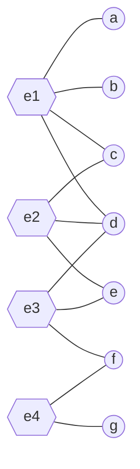
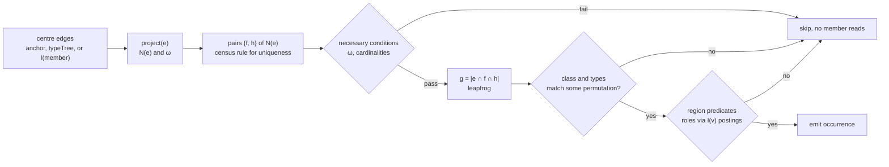
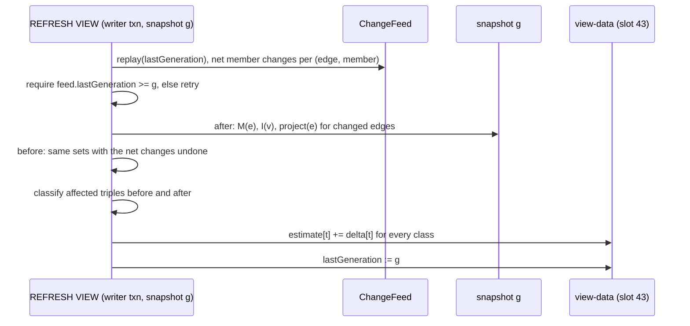

# Hypergraph motif retrieval

Status: proposal. The proposal this page answers: index frequent structural patterns (shared-group patterns, nested
interactions, repeated role arrangements and characteristic hyperedge intersections), use signatures to locate
candidate regions, then verify the exact pattern; hyperedge-triplet retrieval and motif mining provide the foundations;
best for recurring situations, anomalous interactions and structural analogies.

The proposal mixes three different problems and one wrong assumption. This page separates them, says which parts
the literature already solves, and decides against the persistent index the proposal asks for.

| Proposal says | What this page does instead | Why |
|---|---|---|
| "index frequent structural structures" | no index on the write path; on-demand counting, sampling, and an optional census view refreshed from the change feed | one membership change can reclassify tens of thousands of triples on an average edge of a co-authorship graph, and about 10^8 on a tag graph ([below](#is-a-persistent-motif-index-justified)) |
| "use signatures to locate candidate regions" | candidates come from the reverse index and pairwise overlaps; the HGMatch signature is not used | an h-motif is defined independently of hyperedge sizes and labels; a signature (edge type plus member label multiset) says nothing about how an edge overlaps others |
| "verify the exact pattern" | verification is a region-emptiness test, not exact membership | that is what an h-motif is; [relation to HGMatch](#relation-to-hgmatch-and-mach) states the difference precisely |
| "repeated role arrangements" | role predicates on regions, checked on retrieved occurrences; no role-aware classes | role-aware classes have no fixed count, they grow with the role vocabulary |
| "nested interactions" | one optional predicate: an edge of the triple is a member of another | h-motifs treat a nested edge as an ordinary member atom; motifs over the nesting graph are [hierarchical retrieval](hierarchical-hyperedge-retrieval.md) |
| "structural analogies" | not here | that is similarity search: [hypergraph-similarity-search.md](hypergraph-similarity-search.md) |

## What is established and what is ours

| Part | Source | Status |
|---|---|---|
| h-motifs: 26 classes of three connected hyperedges, defined by the emptiness of 7 Venn regions; MoCHy-E (exact), MoCHy-A (hyperedge sampling), MoCHy-A+ (hyperwedge sampling) | G. Lee, J. Ko, K. Shin, *Hypergraph Motifs: Concepts, Algorithms, and Discoveries*, PVLDB 13(11), 2020, pp. 2256 to 2269, [doi:10.14778/3407790.3407823](https://doi.org/10.14778/3407790.3407823), [arXiv:2003.01853](https://arxiv.org/abs/2003.01853) | established; definitions, theorems and numbers below are traced to this paper as "HM" with its numbering |
| hyperedge profile (HP), ternary h-motifs (3h-motifs, 431 classes with `θ = 1`) | G. Lee, S. Yoon, J. Ko, H. Kim, K. Shin, *Hypergraph Motifs and Their Extensions Beyond Binary*, [arXiv:2310.15668](https://arxiv.org/abs/2310.15668) | established; the arXiv page names no journal; cited as a preprint |
| top-k hyperedge triplets by region sizes (independent, disjoint, common weights) | J. Niu, I. D. Amburg, S. G. Aksoy, A. E. Sarıyüce, *Retrieving Top-k Hyperedge Triplets: Models and Applications*, IEEE BigData 2024, pp. 630 to 639, [doi:10.1109/BigData62323.2024.10825860](https://doi.org/10.1109/BigData62323.2024.10825860), [arXiv:2311.07783](https://arxiv.org/abs/2311.07783) | established; this is the PNNL-affiliated "hyperedge triplet" work (three of the four authors list PNNL) |
| temporal h-motifs: 96 classes for three connected hyperedges within a time window, THyMe+ exact counting | G. Lee, K. Shin, *THyMe+: Temporal Hypergraph Motifs and Fast Algorithms for Exact Counting*, ICDM 2021, [arXiv:2109.08341](https://arxiv.org/abs/2109.08341) | established; out of scope here ([time](#roles-nesting-time-duplicates)) |
| the 4 extra classes for triples with duplicated hyperedges | checked by enumerating all 128 region vectors (result in the appendix), and consistent with the 30-entry table in the authors' code, `motif_id.cpp` in [github.com/geon0325/MoCHy](https://github.com/geon0325/MoCHy) | derived here |
| mapping MoCHy onto HStore's reverse index, region predicates with roles, the census view and its delta rule, the decision against a motif index | | ours |

## Definitions

### Regions and classes

Three distinct hyperedges `e1, e2, e3` are connected when one of them shares a member with each of the other two
(HM Sec. 2.1). Their members fall into 7 regions. Number a region by the bitmask of the edges that contain its
members: bit 0 for `e1`, bit 1 for `e2`, bit 2 for `e3`.

```
+-----------------+------------+-----------------+
| e1              |            |              e2 |
|                 |            |                 |
|                 |    011     |                 |
|    001          |            |          010    |
|                 |            |                 |
|                 |            |                 |
|        +--------+------------+--------+        |
|        |        |            |        |        |
|        |  101   |    111     |  110   |        |
|        |        |            |        |        |
+--------+--------+------------+--------+--------+
         |                              |
         |             100              |
         |                              |
         |                           e3 |
         +------------------------------+

e1 is the upper left box, e2 the upper right box, e3 the lower box.
001 = e1 \ e2 \ e3     011 = e1 ∩ e2 \ e3     111 = e1 ∩ e2 ∩ e3
010 = e2 \ e3 \ e1     110 = e2 ∩ e3 \ e1
100 = e3 \ e1 \ e2     101 = e3 ∩ e1 \ e2
```

An h-motif is the 7-bit vector saying which regions are non-empty (HM Sec. 2.2). Of the `2^7 = 128` vectors, the paper
keeps 26 classes after removing permutations of the three edges, vectors that no connected triple produces, and
vectors whose triples contain two equal hyperedges. A class is closed when all three pairs of edges intersect and open
when one pair is disjoint; 6 of the 26 are open (HM Fig. 3, h-motifs 17 to 22).

HStore needs the excluded duplicate classes. Two edges with identical member sets are legal (two `Meeting` edges with
the same attendees), and the paper removed duplicated hyperedges from its data before counting (HM Sec. 4.1). An
enumeration of all 128 vectors (result in the [appendix](#appendix-class-table)) gives 30 connected classes: the
paper's 26 plus 4 in which two or three edges are equal as member sets. The authors' code uses the same 30
(`id_to_index` in `motif_id.cpp` has 30 distinct values), with a numbering that differs from the figure in the paper.

HStore therefore does not use the paper's numbers. A class is identified by its canonical code: the smallest of the
6 codes obtained by permuting `e1, e2, e3`, where the code sets bit `r - 1` for every non-empty region `r`. Codes fit
in 7 bits. The appendix lists all 30.

### Region sizes from five numbers

HM Lemma 2 computes every region size from the three cardinalities, the three pairwise overlaps `ω` and the triple
overlap `g = |e1 ∩ e2 ∩ e3|`:

```
|001| = |e1| - ω12 - ω31 + g        |011| = ω12 - g
|010| = |e2| - ω12 - ω23 + g        |110| = ω23 - g        |111| = g
|100| = |e3| - ω23 - ω31 + g        |101| = ω31 - g
```

The ternary refinement (3h-motifs) keeps three states per region, `0`, `1` and `≥ 2` for `θ = 1`, and has 431 classes
(arXiv:2310.15668 Sec. 5.1; reproduced by the same enumeration). It needs the sizes above and nothing else and costs
the same as the binary classes.

### Running example

```
e1 = {a, b, c, d}     e2 = {c, d, e}     e3 = {d, e, f}     e4 = {f, g}
```



Pairwise overlaps (the projected graph of HM Sec. 2.1, whose edges are the hyperwedges): `ω12 = 2`, `ω13 = 1`,
`ω23 = 2`, `ω34 = 1`; the other pairs are disjoint. There are 4 hyperwedges.

| Triple | Connected | `g` | non-empty regions (bit order of the triple) | canonical code |
|---|---|---|---|---|
| `{e1, e2, e3}` | closed | 1 | `001` {a, b}, `011` {c}, `110` {e}, `100` {f}, `111` {d} | 94 |
| `{e1, e2, e4}` | no: `e4` touches neither | | | |
| `{e1, e3, e4}` | open, centre `e3` | 0 | `001` {a, b, c}, `010` {e}, `100` {g}, `011` {d}, `110` {f} | 31 |
| `{e2, e3, e4}` | open, centre `e3` | 0 | `001` {c}, `100` {g}, `011` {d, e}, `110` {f} | 30 |

The last two triples have the same pairwise relations (a chain of two overlaps) and still fall into different classes:
in `{e2, e3, e4}` the centre `e3` has no member of its own. HM Sec. 2.2 makes the same point about pairwise views:
12 of the 26 h-motifs have the same pairwise relations, while their counts in real hypergraphs differ substantially.

## Three problems

| Problem | Input | Output | Algorithm |
|---|---|---|---|
| census | a scope (an edge type, or all edges of the tenant) | count per class, exact or estimated with a standard error | MoCHy-E, or MoCHy-A sampling |
| occurrence retrieval | a class, optional edge types per position, optional anchor, optional region predicates | the triples of that class, or the top `k` by a region-size weight | wedge enumeration with region filters |
| motif index | | | not built; [see why](#is-a-persistent-motif-index-justified) |

A per-edge profile sits between the first two: the hyperedge profile `HP(e)` counts, per class, the instances that
contain `e` (arXiv:2310.15668 Sec. 3.2). It is the input for "is this interaction unusual for its type".

### Relation to HGMatch and MaCH

[HGMatch](hypergraph-structure-first-matching.md) answers exact-membership queries: every query hyperedge maps to a
data hyperedge with exactly the image of its vertices, under an injective vertex map. An h-motif occurrence is a much
weaker statement.

| | HGMatch embedding | h-motif occurrence |
|---|---|---|
| unit | ordered tuple of data edges, one per query edge | unordered set of 3 distinct data edges |
| vertices | query vertices with labels, mapped injectively | none; regions are anonymous |
| per region | exact size and exact label multiset | non-empty or empty (binary), or `0 / 1 / ≥ 2` (ternary) |
| edge size | fixed by the query | free |
| symmetric patterns | one embedding per permutation of interchangeable query edges | one occurrence per triple |

MaCH (HGMatch page, [match-and-filter pruning](hypergraph-structure-first-matching.md#match-and-filter-pruning-mach))
gives the precise link. It groups the vertices of a partial embedding into cells by their incident hyperedge bitmap,
and an edge mapping is an embedding iff every cell has the same label multiset on both sides (MaCH Thm. 3). For three
edges the cells are exactly the 7 Venn regions above. So:

```
HGMatch / MaCH on 3 edges:   for every region r:  labels(r in data) = labels(r in query)   (multisets)
h-motif class t:             for every region r:  |r in data| > 0  <=>  r is non-empty in t
```

Every exact embedding of a connected three-edge query is an occurrence of that query's class; the converse fails. A
class is the union of infinitely many HGMatch queries, one per choice of region sizes and labels, which is why motif
retrieval enumerates triples and tests regions instead of calling the matcher. The bitmask profile code from the
HGMatch page is reused: a vertex's mask inside the triple is its region.

## What exists today

| Building block | Where | Use here |
|---|---|---|
| reverse index `I(v)`, postings carry `Incident(roleSet, locator)` | slot 2, `EngineSlots.REVERSE_INDEX` (`engine/.../catalog/EngineSlots.java`) | neighbours of an edge, roles of a region witness |
| edge cardinality in `O(1)` | `View.cardinality` (`engine/.../txn/View.java`), the member-tree root count | `|e|` in the region formulas |
| pairwise overlap | `TreeAlgebra.countIntersect` (`engine/.../tree/TreeAlgebra.java`), `Hora.overlap`, `Statistics.overlap` | `ω` when it was not counted during projection |
| k-way leapfrog | `TreeAlgebra.intersectKeys(List)` | `g`, driven by the smallest of the three member trees |
| neighbours with an overlap threshold | `Hora.edgeNeighbors`, `OVERLAP JOIN` (`hora/Hora.java`) | the same index nested loop as the projection below |
| a view recomputed from the change feed | `MaterializedViews` kind `OVERLAP_TOP_K` (`view/MaterializedViews.java`) | the template for the census view |
| null model | `SAMPLE n SWAPS ON T INTO BRANCH b` (`hora/SwapSampler.java`) | significance of a count; see [anomalies](#per-edge-profile-and-anomalies) |
| uniform sampling of an edge type | `View.typeTree(tenant, type)` then `Tree.at(rank)` on the counted postings tree | MoCHy-A's uniform hyperedge sample |

Nothing in HStore stores the projected graph. `N(e)` and `ω` are computed when needed.

## The algorithms

### Local projection

HM Alg. 1 builds the whole projected graph up front, in `O(Σ_{∧ij} |ei ∩ ej|)` time (HM Lemma 1) and `O(|E| + |∧|)`
space, which the paper notes "often exceeds" the space of the hypergraph itself (HM Sec. 3.4). HM Sec. 3.4 also
describes computing neighbourhoods on demand with a memo. HStore does that, per edge, from the reverse index:

```
project(e):
    ω <- empty map
    for v in M(e):
        for f in I(v), f != e, f passes reader.owns and the scope:
            ω[f] += 1
    return (N(e) = keys of ω, ω)
```

One pass over the postings of `e`'s members gives every neighbour together with its exact overlap, so no
`countIntersect` is needed for pairs that involve `e`. Cost `O(Σ_{v ∈ e} |I(v)|)` posting reads. A per-query memo keyed
by edge id holds the projections; HM Fig. 11 reports that memoising 1% of the projected graph's edges, chosen by
degree, gave about 2 times speed-up for MoCHy-A+ on threads-ubuntu. The memo therefore keeps the largest neighbourhoods first
under a byte budget.

### Classifying a triple

```java
record Overlaps(long first, long second, long third, long firstSecond, long secondThird, long thirdFirst, long all) {}

final class MotifClasses {
    private static final int[][] PERMUTATIONS = {{0, 1, 2}, {0, 2, 1}, {1, 0, 2}, {1, 2, 0}, {2, 0, 1}, {2, 1, 0}};
    private static final int[] CANONICAL = IntStream.range(0, 128).map(MotifClasses::smallest).toArray();

    static int code(Overlaps o) {
        long[] size = new long[8];
        size[1] = o.first() - o.firstSecond() - o.thirdFirst() + o.all();
        size[2] = o.second() - o.firstSecond() - o.secondThird() + o.all();
        size[4] = o.third() - o.secondThird() - o.thirdFirst() + o.all();
        size[3] = o.firstSecond() - o.all();
        size[6] = o.secondThird() - o.all();
        size[5] = o.thirdFirst() - o.all();
        size[7] = o.all();
        int code = IntStream.rangeClosed(1, 7).filter(r -> size[r] > 0).map(r -> 1 << (r - 1)).reduce(0, (a, b) -> a | b);
        return CANONICAL[code];
    }

    private static int smallest(int code) {
        return Arrays.stream(PERMUTATIONS).mapToInt(p -> permute(code, p)).min().orElseThrow();
    }

    private static int permute(int code, int[] p) {
        return IntStream.rangeClosed(1, 7).filter(r -> (code >> (r - 1) & 1) != 0)
                .map(r -> 1 << (moved(r, p) - 1)).reduce(0, (a, b) -> a | b);
    }

    private static int moved(int region, int[] p) {
        return IntStream.range(0, 3).filter(i -> (region >> i & 1) != 0).map(i -> 1 << p[i]).reduce(0, (a, b) -> a | b);
    }
}
```

`o.all()` is the only number that needs member reads: `TreeAlgebra.intersectKeys(List.of(m1, m2, m3)).count()` over
the three membership trees (`Hyperedge.membership()`). The leapfrog is driven by the smallest tree, which matches HM
Lemma 2's `O(min(|ei|, |ej|, |ek|))` up to the seek cost. It is skipped when `min(ω12, ω23, ω31) = 0`, because then
`g = 0`. A small edge keeps its member tree inline in the catalog record (`docs/storage/topology.md`), and the
intersection usually costs no page beyond three catalog leaves.

### Census

Exact counting is HM Alg. 2 on top of the local projection. Each instance is counted once by the rule of its line 4:
the triple `{ei, ej, ek}` found from centre `ei` with `ej, ek ∈ N(ei)` is counted iff `ej ∩ ek = ∅` or
`i < min(j, k)`.

```
census_exact(scope):
    for ei in scope:
        (N, ω) <- project(ei)
        for each unordered pair {ej, ek} of N:
            ωjk <- ω_k from project(ej) if memoised, else countIntersect
            if ωjk = 0 or i < min(j, k):
                count[code(...)] += 1
```

HM Thm. 1 bounds this by `O(Σ_{e} |e| · |N(e)|²)`; in HStore every set operation adds a `log` factor for the seek.

Sampled counting is HM Alg. 4 (MoCHy-A): draw `s` edges uniformly with replacement, enumerate every instance that
contains the sampled edge `ei` (lines 4 to 7: `ej ∈ N(ei)`, `ek ∈ N(ei) ∪ N(ej) \ {ei, ej}`, counted iff `ek ∉ N(ei)`
or `j < k`), and multiply the counts by `|E| / (3s)`. HM Thm. 2 proves the estimate unbiased; HM Thm. 3 gives the
average cost `O((s / |E|) · Σ_{e} |e| · |N(e)|²)`. Uniform sampling of an edge type is native in HStore:
`View.typeTree(tenant, type).at(rank)` with a uniform random rank, `O(log n)` on the counted postings tree.

The paper's better estimator, MoCHy-A+ (HM Alg. 5), samples hyperwedges uniformly. HM reports it up to 25 times more
accurate than MoCHy-A and up to 32 times faster than MoCHy-E (HM Sec. 1; Fig. 8 says 32.5 times). It needs `|∧|` and a
uniform draw from the set of overlapping pairs, and HStore has no structure that provides either. A hyperwedge slot
would ([index options](#index-options)); without it, a node-based pair draw has non-uniform probabilities that depend
on `|e ∩ f|` and node degrees, and an estimator over it would need its own unbiasedness proof. The first version
uses MoCHy-A and does not claim MoCHy-A+'s accuracy.

The paper gives the variance of MoCHy-A in closed form (HM Thm. 2, Eq. 5), but it needs the number of pairs of
instances sharing `l` hyperedges, which is as hard to get as the count. The `s` samples are independent and
identically distributed. The census reports the sample standard error of the `s` per-sample scaled counts instead.

| Mode | When | Result |
|---|---|---|
| `EXACT` | requested | exact counts, or `ABORTED_RESOURCE_LIMIT` when the budget runs out |
| `SAMPLE s` | requested | estimate and standard error per class |
| `AUTO` (default) | | exact with half the row budget; if the meter refuses, the partial count is discarded and the rest of the budget is spent on sampling |

`AUTO` does not estimate the cost up front. An estimate would need `|N(e)|` per edge, and a degree sum read through the
raw view would let other tenants' data change the plan, which the planner rule in `docs/database/security.md` forbids.
Trying under a budget avoids that.

### Per-edge profile and anomalies

`HP(e)` is the per-class count of instances containing `e`: MoCHy-A's inner loop for one fixed sample. Cost
`O(Σ_{f ∈ N(e)} (|N(e)| + |N(f)|) · min arity · log)` plus the projections of `e` and its neighbours.

"Anomalous interaction" then means: `HP(e)`, normalised to a distribution over classes, far from the type's average
profile (`3 · M[t] / |E_T|` per class from a census of `T` when all three edges are in the scope). The distance used to
rank is the application's choice. Neither paper evaluates anomaly detection with profiles; arXiv:2310.15668 uses HPs
as features for hyperedge prediction. This page offers the profile, not a claim that it detects anomalies.

For significance against chance, HM Eq. 1 compares a count with counts in randomised hypergraphs,
`Δt = (M[t] - M_rand[t]) / (M[t] + M_rand[t] + ε)` with `ε = 1`, where the paper randomises with a Chung-Lu model on
the bipartite incidence graph (HM Sec. 2.3). HStore's `SwapSampler` is a different null model: degree-preserving swaps
keep every node degree and every edge cardinality exactly. A census on a sampled branch gives `M_rand` under that
model, and the numbers are not comparable with the paper's. `SAMPLE` is restricted to admins of the default tenant
(`branch-retrieval.md`, security).

### Retrieving occurrences of a class

```java
record RegionPredicate(int region, OptionalInt memberType, OptionalLong member, List<Set<String>> rolesByPosition) {}

record MotifQuery(int code, boolean ternary, Optional<int[]> edgeTypes, OptionalLong anchorEdge,
                  List<RegionPredicate> regions, boolean nested, Optional<TripletWeight> rankBy, int limit) {}

enum TripletWeight { INDEPENDENT, DISJOINT, COMMON }

record Occurrence(long first, long second, long third, int code, long[] regionSizes) {}
```

`code` is given in positions: the query says which regions are non-empty with `e1, e2, e3` meaning positions, and
`edgeTypes` (if present) gives a type per position. An unordered data triple matches when some bijection from
positions to its edges agrees on the code and the types. That is at most 6 permutations, checked with the same
`permute` function as canonicalisation.

The class fixes necessary conditions that are cheap to test before `g` is computed:

| Condition in the class | Necessary condition on the data | Test cost |
|---|---|---|
| region `ij` and region `111` both empty | `ω_ij = 0` | from the projection |
| region `111` non-empty | `ω_ij ≥ 1` for every pair, and the third edge contains a member of `e_i ∩ e_j` | projection; third-edge candidates from `⋃_{v ∈ e_i ∩ e_j} I(v)` |
| region `i` alone empty | `e_i ⊆ e_j ∪ e_k`, so `|e_i| = ω_ij + ω_ik - g`, hence `|e_i| ≤ ω_ij + ω_ik` | `O(1)` |
| `c` non-empty regions inside `e_i` | `|e_i| ≥ c` | `O(1)` |
| ternary: region `ij` in state `≥ 2` | `ω_ij ≥ 2` | projection |

Enumeration follows the census rule so that each triple is produced once. The centre edge comes from the anchor, from
the type index of the centre position, or from the edges of a fixed region member (`RegionPredicate.member`, whose
`I(member)` lists every edge that can hold that position). Pairs of neighbours are filtered by the table, then
classified, then checked against the region predicates.



Region predicates are where roles live. A predicate on region `r` holds when some member `v` of that region satisfies
the type, the fixed atom if given, and for every position `i` in `r` a role in `rolesByPosition[i]`. Roles come from
the reverse index: `v`'s posting for edge `e_i` carries `Incident.roleSet`, which RCHR already shows equals the
incidence's role set in every view ([role filter](role-constrained-hyperedge-retrieval.md#the-role-filter-can-be-exact-without-reading-edges)).
The region's members are found by scanning the smallest edge of `r` and testing membership in the others (and absence
from the rest) with `Tree.contains`. Example: "triples of class 31 in which region `011` holds someone who is
`reviewer` in `e1` and `actor` in `e2`".

`nested = true` adds one check: some edge of the triple is a member of another, tested with `Tree.contains` on the
three membership trees (six lookups). That is all the first version does for nesting.

Top-`k` by a triplet weight uses the weights of Niu et al. (Eq. 1 of arXiv:2311.07783): with region sizes grouped
into independent (`001, 010, 100`), disjoint (`011, 110, 101`) and common (`111`),

```
W_j(T) = min over regions of type j of |region|  /  (1 + Σ of |region| over the types above j)
W_3 = g        W_2 = (min(ω12, ω23, ω31) - g) / (g + 1)
```

The paper's pruning bounds apply unchanged: `g ≤ min(ω12, ω23, ω31)`, so `W_3 ≤ min(ω12, ω23, ω31)` and
`W_2 ≤ min(ω12, ω23, ω31)` (arXiv:2311.07783 Sec. VI-B), both known from the projection before `g` is computed. With an
anchor, pairs are visited in descending order of that bound and the scan stops when the bound falls below the `k`-th
weight found. Without an anchor the scan is a census with this skip rule, and its worst case is the census cost; the
paper reports speed-ups between 1.3 and 7,000 times over its naive baseline on its datasets (Sec. VII-E).

### Trace of the running example

Exact census, centre by centre (HM Alg. 2):

| Centre | `N` with `ω` | Pair | `ωjk` | Rule | Counted |
|---|---|---|---|---|---|
| `e1` | `e2:2, e3:1` | `{e2, e3}` | 2 | `1 < 2` | `{e1, e2, e3}`: `g = 1` from the leapfrog over `{a,b,c,d}, {c,d,e}, {d,e,f}`, class 94 |
| `e2` | `e1:2, e3:2` | `{e1, e3}` | 1 | `2 < 1` fails | no |
| `e3` | `e1:1, e2:2, e4:1` | `{e1, e2}` | 2 | `3 < 1` fails | no |
| | | `{e1, e4}` | 0 | disjoint pair | `{e1, e3, e4}`: `g` skipped, class 31 |
| | | `{e2, e4}` | 0 | disjoint pair | `{e2, e3, e4}`: `g` skipped, class 30 |
| `e4` | `e3:1` | none | | | |

Result: one instance each of classes 94, 31 and 30. Two of the three classifications needed no member read.

MoCHy-A with `s = 1` drawing `e3`: the inner loop finds all three instances once each, and every estimate is
`1 · |E| / (3s) = 4/3`. Over the four equally likely draws the expected estimate for class 94 is
`(1 + 1 + 1 + 0) / 4 · 4/3 = 1`, as HM Thm. 2 says.

Retrieval of class 31 with `edgeTypes` absent and region predicate "`011` contains `d`": `I(d) = {e1, e2, e3}`, so the
centre candidates are those edges. From centre `e3`, the pair `{e1, e4}` passes (`ω14 = 0` matches the class), is
class 31 under the permutation `(e3, e1, e4)`, and region `011` of that permutation is `e3 ∩ e1 = {d}`. One occurrence.

## Is a persistent motif index justified

### What one membership change does

Add `g` to `e2` in the example. Every triple containing `e2` changes:

| Triple | Before | After |
|---|---|---|
| `{e1, e2, e3}` | class 94 | class 95: `g` is a member of `e2` only |
| `{e1, e2, e4}` | not connected | class 31: `e2 ∩ e4 = {g}` |
| `{e2, e3, e4}` | class 30, open | class 53, closed |
| `{e1, e3, e4}` | class 31 | class 31 |

A change to `(v, e)` can affect every triple that contains `e`, and it creates new triples through every edge of
`I(v)` that was not adjacent to `e` before. The average number of triples containing one edge is `3 · M / |E|` (each
instance has three edges). From HM Table 2:

| Dataset | `|E|` | `|∧|` | instances `M` | average `|N(e)| = 2|∧| / |E|` | instances per edge `3M / |E|` |
|---|---|---|---|---|---|
| coauth-DBLP | 2,466,792 | 125M | 26.3B (estimated) | about 101 | about 32,000 |
| threads-math | 595,749 | 647M | 2.2T (estimated) | about 2,200 | about 11 million |
| tags-ubuntu | 147,222 | 564M | 4.3T (estimated) | about 7,700 | about 88 million |

These are averages; a hub edge is far above them.

### Index options

| Option | Size | Work per membership change | Verdict |
|---|---|---|---|
| per-triple class index (slot 63) | one row per instance: 26.3B rows for coauth-DBLP | reclassify every instance containing `e`: about 32,000 on average for coauth-DBLP, 88 million for tags-ubuntu | rejected: larger than the data by orders of magnitude, and the write cost is unbounded |
| per-edge profile `HP(e)` (slot 64) | 30 counters per edge | the same reclassification, plus rewriting the profile of every edge in every changed triple: up to `|N(e)| + |N(N(e))|` records | rejected for the write path; the profile is computed on demand |
| hyperwedge store `(e, f) -> ω` (slot 65) | `|∧|` postings: 125M for coauth-DBLP against about 2.5M edges | `|I(v)|` posting updates per change of `(v, e)`, unbounded for hub members (a tag on 10^4 posts) | deferred; the only option that would buy something (MoCHy-A+, `ω` without recomputation), and the paper itself warns about its size |
| per-tenant census counters on the write path (a derivation) | 30 numbers | the same reclassification inside the writing transaction | rejected: one `Writer.add` on a hub edge would classify millions of triples inside the transaction, and every writer would conflict on the counters under OCC |
| census as a materialised view refreshed from the change feed | 30 cells per view | the same reclassification, but outside the transaction and batched | accepted, on demand by default |
| on-demand computation and sampling | none | none | the default for everything |

No slot is added: 63 to 65 stay free. The census view uses the existing view slots 42 and 43.

### The census view

A new `MaterializedViews.Kind.MOTIF_CENSUS`, created by an admin like every view (`docs/database/views-signals-stats.md`).
`Descriptor.parameter` holds the edge type id of the scope, or 0 for all of the tenant's edges. Cells are keyed by the
canonical class code (fits easily in the 48-bit cell key) and hold a new `ViewCell.Census(long estimate, long
varianceMicros, boolean exact)` with codec tag 3.

Build: `AUTO` census on the refresh transaction's snapshot.

Refresh applies the events in `(lastGeneration, g]` as a delta. The delta needs each affected triple's class before
and after the window. The after state is the refresh snapshot. The before state is not available as a snapshot (the
history window holds 64 generations, in memory only), but it can be rebuilt for the edges that matter, because a
class depends only on the member sets of the three edges and the events list every member change:

```
M_before(e) = M_after(e) - net_added(e) + net_removed(e)
I_before(v) = I_after(v) - {e : v net-added to e} + {e : v net-removed from e}
affected    = triples, connected before or after, containing at least one edge with a net member change
delta[t]    = Σ over affected triples of [class_after = t] - [class_before = t]
```

A triple with several changed edges is counted once, under its smallest changed edge. Deleted edges work because a
delete emits `Removed` for every member (`docs/storage/topology.md`). A deleted edge has no record in the snapshot, so
its tenant and type, which decide whether the view's scope covers it, come from the `before` value of the catalog
`SlotChange` in the same event (catalog changes are primary-slot changes and are in the feed, with tree references
detached).



Two points differ from the existing view kinds.

The delta is not idempotent, unlike `OVERLAP_TOP_K`, which recomputes affected cells from the snapshot. The before
state is only correct if the snapshot contains exactly the changes in the replayed events. `MaterializedViews.refresh`
replays up to `min(feed.lastGeneration, snapshot)`, and a writer's snapshot can be ahead of the feed while a commit is
being published (`docs/storage/change-feed.md`). The census refresh therefore waits until the feed reaches its
snapshot generation and retries the transaction otherwise.

A sampled census stays unbiased under exact deltas: if `E[M̄_old] = M_old`, then `E[M̄_old + Δ] = M_old + Δ = M_new`.
Its variance does not shrink, and relative to a changing count it can grow. The view re-samples after the touched
triples exceed a tenth of the estimated total, the same rule `Statistics` uses for its own refresh.

The delta costs about the per-edge numbers above for every changed edge. View refreshes have no row budget today (only the tenant's
transaction page quota); this kind runs its delta under a `Budget.Meter`, and if the meter refuses, it rebuilds
instead (sampled), which is bounded. `CONTINUOUS` is allowed but a hub edge in a busy
type turns every commit into a rebuild; `ON_DEMAND` is the default. Like every view, it covers `main` only.

## Implementation in HStore

Package `io.hstore.db.retrieve`: `MotifClasses`, `Projection` (local projection and memo), `MotifCensus`,
`MotifMatcher`, `MotifProfile`, `MotifView` (the view kind). The Java entry point is `Hora.motifs(scope)` returning a
builder for census, profile and match. HQL syntax is left to the grammar.

### Tenant isolation

| Step | Rule |
|---|---|
| scope | `View.typeTree(reader.tenant(), type)` lists only the tenant's edges; "all edges" is the union over the tenant's types, as `Reader.population` does |
| anchor edge, fixed region member | resolved with `reader.require` before any `reader.view()` call |
| neighbours | every edge from a posting passes `reader.owns` before it is projected or classified (`Reader.incident` and `Reader.forEachIncidentEdge` already do this) |
| members of an owned edge | writers only add visible members (`Writer.incidence`); in old databases a cross-tenant member is skipped with `reader.visible` before its postings are read |
| region predicates | member types through `reader.atom`, roles from postings of owned edges |
| census view | built and refreshed as `system` within the view's tenant; deltas only for changed edges of that tenant (read from the record, or from the catalog change's `before` value for a deleted edge), and neighbours pass the same `owns` test as above |

### Budgets

A `Budget.Meter` per call: every classified triple charges 1 row, every projected edge charges 1. Page reads go
through the statement's `IoTrace`. When the meter refuses, `EXACT` fails, `AUTO` switches to sampling, a retrieval
returns the occurrences found so far and says the list is incomplete, and a top-`k` retrieval in bound order returns a
correct prefix.

### Parallel execution

Census and retrieval split by centre edge: rank ranges of the type's postings tree, as HGMatch's `ScanTask` splits
`E_s`, on the same `match_threads` pool with `CountedCompleter`s. Each task keeps per-class counters and they are summed
once at the end (HM Sec. 3.4 does the same). Sampling splits the `s` draws. The projection memo is per task and needs
no locking; sharing it across tasks is a later optimisation. HM Fig. 10 reports 5.4 times (exact) and 6.7 times
(MoCHy-A+) speed-up with 8 threads on threads-ubuntu.

## Roles, nesting, time, duplicates

| Topic | First version | Reason |
|---|---|---|
| roles | region predicates on occurrences; no role-aware classes in the census | a class per combination of role sets per region has no fixed number |
| nesting | the `nested` flag on retrieval | h-motifs are defined on member sets; a nested edge is a member atom like any other |
| time | not supported | THyMe+ assumes each hyperedge has one timestamp; HStore has validity per incidence and no edge time. A temporal version needs an edge time chosen by the application (a property, or the earliest `validFrom`) and then THyMe+'s 96 classes |
| membership validity at `t` | not supported | the projection would have to filter postings by validity, which the reverse index does not carry (the [temporal proposal](temporal-hypergraph-retrieval.md) adds it) |
| duplicated hyperedges | counted in 4 extra classes (codes 64, 65, 68, 76) | the paper's counts exclude them; to compare with the paper, a census can merge edges with equal member sets first. `TreeAlgebra.sameKeys` decides equality; the SET fingerprint alone is not enough, since `Incidence.contentHash` also covers roles, weights and validity |
| four or more edges | not supported | 1,853 classes for four edges and 18,656,322 for five (HM Sec. 2.2) |

## Complexity

Notation: `n` edges in scope, `a(e)` arity, `N(e)` neighbours, `s` samples, `d(v) = |I(v)|`, `log` the B+-tree seek.

| Operation | Paper | HStore |
|---|---|---|
| projection | `O(Σ_{∧ij} |ei ∩ ej|)` for the whole graph (HM Lemma 1) | `O(Σ_{v ∈ e} d(v))` per edge, on demand |
| classify one triple | `O(min arity)` (HM Lemma 2) | `O(min arity · log)`, zero member reads when a pair is disjoint |
| exact census | `O(Σ_e a(e) · |N(e)|²)` (HM Thm. 1) | same, times `log` |
| sampled census | `O((s / n) · Σ_e a(e) · |N(e)|²)` average (HM Thm. 3) | same, times `log`; uniform draw `O(log n)` |
| hyperwedge sampling (MoCHy-A+) | `O((r / |∧|) · Σ_e a(e) · |N(e)|²)` (HM Thm. 5) | not available without slot 65 |
| `HP(e)` | | `O(Σ_{f ∈ N(e)} (|N(e)| + |N(f)|) · min arity · log)` |
| anchored retrieval | | at most `HP(e)`; less with the necessary-condition filter |
| unanchored retrieval, unanchored top-`k` | | at most the exact census; Niu et al.'s bounds skip `g` for pairs below the `k`-th weight |
| write path | | unchanged: no derivation |
| census view refresh | | `O(Σ_{changed e} |N(e)|² · a · log)` in the worst case, capped by the refresh meter, then a sampled rebuild |

## Limits of the first version

| Not supported | Reason | Instead |
|---|---|---|
| MoCHy-A+ accuracy | needs uniform hyperwedges | MoCHy-A, with a measured standard error |
| a persistent motif index | write cost per change, see the tables above | on demand, sampling, census view |
| role-aware or labelled classes in the census | unbounded class space | region predicates on retrieval |
| temporal motifs | no edge time | an application-defined edge time, later |
| motifs of four or more edges | class counts | |
| exact census on large types within the default budget | `Σ a(e) · |N(e)|²` | `AUTO` falls back to sampling |
| significance comparable with the paper | different null model | swaps on a branch, reported as such |

## Appendix: class table

All 30 canonical codes, from enumerating the 128 region vectors (three edges non-empty, connected, canonical under the
6 permutations). Bits are regions `111 110 101 100 011 010 001` from left to right.

| Kind | Canonical codes |
|---|---|
| open (6) | 20, 21, 22, 23, 30, 31 |
| closed, no duplicated edges (20) | 52, 53, 55, 63, 67, 69, 71, 75, 77, 79, 84, 85, 86, 87, 94, 95, 116, 117, 119, 127 |
| with duplicated edges (4) | 64 (`111` only: three equal edges), 65, 68, 76 |

The ternary table (431 classes) is generated the same way at class-loading time and is not listed here.
