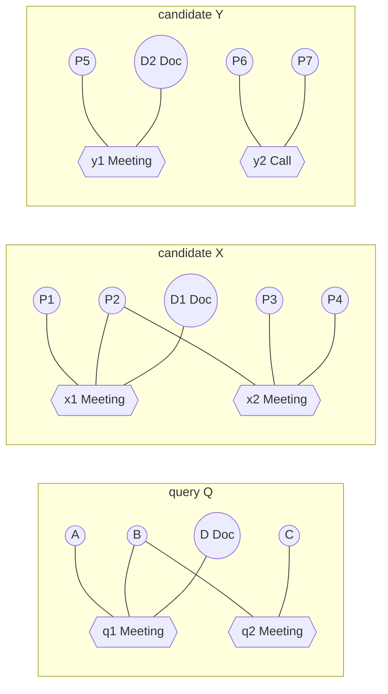
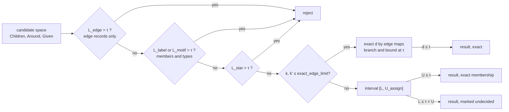

# Hypergraph similarity search

Status: proposal. The proposal this page answers: given a query hypergraph, retrieve structurally and semantically
similar subhypergraphs; combine node-attribute similarity, role compatibility, membership overlap and topology
agreement; use cheap fingerprints to generate candidates, then expensive matching or edit-distance scoring on the
shortlist; best for analogous episodes, similar world states and reusable interaction patterns.

The proposal names the pipeline (fingerprint, shortlist, verify) but leaves open the choices that decide whether it
returns correct answers. This page makes them.

| Left open by the proposal | Decision here |
|---|---|
| what a candidate is | one of four explicit candidate spaces; "every subhypergraph" is not searchable ([candidates](#candidate-spaces)) |
| which distance | hypergraph edit distance with incidence edits, unit structural costs, plus non-negative soft costs for attributes, roles and embeddings ([distance](#distance)) |
| which fingerprints | only quantities that give a proven lower bound on that distance; then a threshold query stays exact ([lower bounds](#lower-bounds)) |
| "combine" four similarities | the four are not on one scale. Topology and labels are the hard part of the edit cost and carry the bounds; attributes, roles and embeddings are soft substitution costs added on top, which keeps every bound valid |
| "membership overlap" | a second, cheaper problem: similarity of the same atoms, solved exactly in polynomial time ([identity mode](#identity-mode-membership-overlap)) |
| expensive matching on a shortlist | exact verification is exponential in the number of edges; above a size limit the search returns distance intervals and says so ([approximate ranking](#approximate-ranking)) |

## What is established and what is ours

| Part | Source | Status |
|---|---|---|
| graph edit distance (GED) is NP-hard; `λ ≥ ||E1| - |E2|| + ||V1| - |V2||`; a star-based lower bound `L_m` in `Θ(n³)`; filtering a graph database with such bounds | Z. Zeng, A. K. H. Tung, J. Wang, J. Feng, L. Zhou, *Comparing Stars: On Approximating Graph Edit Distance*, PVLDB 2(1), 2009, pp. 25 to 36, [doi:10.14778/1687627.1687631](https://doi.org/10.14778/1687627.1687631) (Lemma 2.1, Lemma 2.3, Lemma 4.2) | established |
| exact GED algorithms by pruning the search space | D. B. Blumenthal, J. Gamper, *On the exact computation of the graph edit distance*, Pattern Recognition Letters 134, 2020, pp. 46 to 57, [doi:10.1016/j.patrec.2018.05.002](https://doi.org/10.1016/j.patrec.2018.05.002) | established; cited for the landscape, not used directly |
| GED heuristics (linear sum assignment with error correction, local search, linear programming) that bound the distance from above or below | D. B. Blumenthal, N. Boria, J. Gamper, S. Bougleux, L. Brun, *Comparing heuristics for graph edit distance computation*, The VLDB Journal 29, 2020, pp. 419 to 458, [doi:10.1007/s00778-019-00544-1](https://doi.org/10.1007/s00778-019-00544-1) | established; I read the abstract, not the full text |
| hypergraph edit distance with "immutable" edges (an edge maps only where its vertices map) | H. Bunke, P. Dickinson, M. Kraetzl, M. Neuhaus, M. Stettler, *Matching of Hypergraphs: Algorithms, Applications, and Experiments*, Studies in Computational Intelligence 91, Springer, 2008, pp. 131 to 154, [doi:10.1007/978-3-540-76831-9_6](https://doi.org/10.1007/978-3-540-76831-9_6) | established; not read beyond its definition as summarised in the talk below |
| hypergraph edit distance with incidence edits ("individual edits") | H. Qin, R.-H. Li, Y. Yuan, G. Wang, Y. Dai, *Explainable Hyperlink Prediction: A Hypergraph Edit Distance-Based Approach*, ICDE 2023, pp. 245 to 257, [doi:10.1109/ICDE55515.2023.00386](https://doi.org/10.1109/ICDE55515.2023.00386) | established; I verified the record and abstract only |
| the two formulations side by side; the incidence-edit cost of a mapping equals the GED cost on the bipartite incidence graph; both are NP-hard | E. Purvine (with A. Myers, C. Joslyn, PNNL), *Hypergraph edit distance: theory, algorithms, and applications*, ICERM talk, 29 June 2026, [slides](https://app.icerm.brown.edu/assets/613/11183/11183_6259_Purvine_062920261130_Slides.pdf) | a talk, not a paper; I found no preprint. Used for definitions only |
| edge signatures as an edge-side star | [HGMatch](hypergraph-structure-first-matching.md) slot 47 | HStore design |
| soft scores for attributes, roles, embeddings | [role-time-aware-scoring.md](role-time-aware-scoring.md) | reused, not redefined |
| candidate spaces, the reduction of the exact distance to one linear assignment per edge map, the bounds `L_label` and `L_motif`, the identity mode, the interval answers | | ours; the bounds come with proofs below, none is taken from a paper |

## Two meanings of "similar"

| | Identity overlap | Structural analogy |
|---|---|---|
| question | does this episode involve the same people and things as that one? | does this episode have the same shape as that one, with any participants? |
| node map | fixed: an atom maps to itself | free: any label-respecting or label-changing map |
| distance | exact in polynomial time | NP-hard |
| existing support | `NEIGHBORS OF e`, `OVERLAP JOIN`, `OVERLAP_TOP_K` views, `TreeAlgebra.jaccard` | none |
| this page | [identity mode](#identity-mode-membership-overlap) | the rest of the page |

The proposal's "membership overlap" belongs to the first column and its "topology agreement" to the second. An
identity map is one particular node map, which makes the identity distance an upper bound on the structural
distance. That is the only connection between the two.

## Problem

### Query

A query `Q` is a small typed hypergraph: nodes with a type and optionally properties, a text or a vector; edges with
a type, optionally properties; incidences optionally with a role set. It is built with the HGMatch query builder, or
taken from data by example (the child edges of a known container, or an explicit edge set). A query edge that is a
member of another query edge is treated as a node labelled with its edge type, the HGMatch convention.

### Candidate spaces

A candidate `C` is a set of data edges `S` together with all their members: the edge-induced subhypergraph. An edge is
never cut, because a partial edge is not an edge in the data.

```java
sealed interface CandidateSpace {
    record Children(int containerType) implements CandidateSpace {}
    record Around(long anchorEdge, int maxEdges, Set<Integer> edgeTypes) implements CandidateSpace {}
    record Given(List<long[]> edgeSets) implements CandidateSpace {}
    record Seeded(String text, int seeds, int maxEdges) implements CandidateSpace {}
}
```

| Space | Candidates | Size of the space | Exact? |
|---|---|---|---|
| `Children(T)` | for every container edge of type `T`, the set of its child edges | `|E_T|` | yes |
| `Around(e, m, types)` | connected edge sets of at most `m` edges that contain `e`, edges restricted to `types` | at most `(m - 1)! · Δ^(m - 1)` where `Δ` bounds `|N(f)|` | yes, within the budget |
| `Given(sets)` | caller-supplied, for example the output of RCHR or a motif retrieval | the list | yes |
| `Seeded(text, s, m)` | `Around` spaces anchored on the incident edges of the `s` atoms nearest to `text` in the semantic plane | `s` times `Around` | no: HNSW recall is not 1 |

`Children` is the natural space for "analogous episodes" in HStore: an episode modelled as a container edge whose
members are its interactions (`Investigation` containing `Claim` edges, see
[hierarchical retrieval](hierarchical-hyperedge-retrieval.md)). It needs no enumeration.

`Around` is where the proposal's "subhypergraph" leads, and its size is the problem. The bound counts the ways to grow
a connected set one edge at a time from a frontier of at most `iΔ` edges. With the coauth-DBLP average of about 101
neighbours per edge (Lee et al., PVLDB 2020, Table 2: `2|∧| / |E|`, see
[motif retrieval](hypergraph-motif-retrieval.md#what-one-membership-change-does)) that is about 20,000 sequences for
`m = 3` and 6 million for `m = 4`. The type restriction and the monotone bounds below cut this; the budget caps it.

### Distance

The distance is hypergraph edit distance with incidence edits (Qin et al.'s formulation, "individual edits" in
Purvine's slides). An edit path turns `Q` into a hypergraph isomorphic to `C`.

| Edit | Structural cost |
|---|---|
| insert or delete a node (deleting requires removing its incidences first) | 1 |
| insert or delete an edge (deleting requires removing its incidences first) | 1 |
| change a node's type, change an edge's type | 1 |
| add or remove one incidence `(v, e)` | 1 |

`HGED(Q, C)` is the minimum structural cost over all edit paths. A cheapest path is described by a partial injection
of nodes `fV` and of edges `fE`, and its cost depends only on those two maps. Purvine's slides state the property that
makes the bounds below work: for given maps, this cost equals the GED cost on the bipartite incidence graphs `B(Q)` and
`B(C)` (nodes and edges become vertices, incidences become edges) under the combined map. HGED with immutable edges
(Bunke et al.) is the other formulation; it forces an edge with one changed member to be deleted and inserted whole,
which ranks "the same meeting minus one attendee" as far as a different meeting. It is not used.

Purvine's talk states that both formulations are NP-hard to compute exactly, and the slides relate this to
subhypergraph isomorphism, the same kind of reduction Zeng et al. use for GED (Lemma 2.3). I have not seen a written
proof for the incidence-edit formulation; this page relies on the claim only to justify not looking for a polynomial
exact algorithm.

Soft costs are added on top. With weights `λ ≥ 0` and similarities in `[0, 1]`:

| Soft cost | Charged on | Similarity used | From |
|---|---|---|---|
| `λ_a · (1 - attr(v, u))` | each mapped node pair | `S_attributes` of RTHR with the query node's properties as targets; a missing property scores 0 | [RTHR](role-time-aware-scoring.md#the-five-components) |
| `λ_r · (1 - ρ(R_q, R_c))` | each preserved incidence | RTHR's `ρ`: 1 if the query role set is empty or intersects the data role set | RTHR |
| `λ_s · (1 - (1 + cos(v, u)) / 2)` | each mapped node pair where the query node has text or a vector | cosine of embeddings; 0 similarity when the data node has no vector of that model | semantic plane |
| `λ_e · (1 - attr(e, f))` | each mapped edge pair | `S_attributes` over edge properties | RTHR |

```
d(Q, C) = min over (fV, fE) of [ structural cost(fV, fE) + soft cost(fV, fE) ]
```

Every soft term is non-negative, so any lower bound on the structural part is a lower bound on `d`. That is why the
soft parts are costs added to the edit path and not a separate score mixed in afterwards: a linear mix of a distance
and similarities has no lower bound that a filter could use. With all `λ = 0`, `d = HGED`, which is a metric under the
cost assumptions in Purvine's slides. The soft part is directional (RTHR's `ρ` reads the query's roles as
requirements), so `d` with soft costs is a query-to-candidate cost, not a metric.

## Running example

```
Q    q1 Meeting {A:Person, B:Person, D:Doc}      q2 Meeting {B:Person, C:Person}
X    x1 Meeting {P1, P2, D1}                     x2 Meeting {P2, P3, P4}                     P* Person, D1 Doc
Y    y1 Meeting {P5, D2}                         y2 Call {P6, P7}                            P* Person, D2 Doc
Z    z1 Call {P9, P10}   z2 Call {P10, P11}   z3 Call {P11, P12}                             P* Person
```



`X`, `Y` and `Z` are the children of three container edges: the space is `Children`. All soft weights are 0 in this
example.

## Exact distance for a fixed edge map

For fixed `fE`, the best node map is one linear assignment. Attribute every incidence to its node. A node `v` of `Q`
mapped to `u` of `C` keeps the incidences `(v, e)` with `fE(e)` defined and `u ∈ fE(e)`; call their number
`kept(v, u)`. Its other incidences are removed and the incidences of `u` not kept are added:

```
sub(v, u) = [type(v) != type(u)] + deg_Q(v) + deg_C(u) - 2 · kept(v, u)  + soft node and role costs of (v, u)
del(v)    = 1 + deg_Q(v)
ins(u)    = 1 + deg_C(u)
edges(fE) = Σ over e -> f [type(e) != type(f)] + soft edge cost  +  (|E_Q| - |fE|) + (|E_C| - |fE|)
```

Each incidence is counted exactly once, by its node, and every term depends on one node pair given `fE`, including
the role cost, which is a sum over the kept incidences of that pair. So

```
d(Q, C) = min over fE of [ edges(fE) + LSAPE(sub, del, ins) ]
```

where `LSAPE` is the linear sum assignment with deletion and insertion, solved exactly by the Hungarian method on the
usual `(n_Q + n_C)` square expansion in `O((n_Q + n_C)³)`. Only the edge maps are enumerated: the number of partial
injections between `k` and `k'` edges is `Σ_j C(k, j) · C(k', j) · j!`.

| `k = k'` | 3 | 4 | 5 | 6 | 8 |
|---|---|---|---|---|---|
| edge maps | 34 | 209 | 1,546 | 13,327 | 1,441,729 |

```java
record Shape(int[] nodeTypes, int[] edgeTypes, int[][] members) {
    int degree(int node) {
        return (int) Arrays.stream(members).filter(edge -> Arrays.stream(edge).anyMatch(m -> m == node)).count();
    }
}

record Costs(double attribute, double role, double semantic, double edge, PairScores scores) {}

interface PairScores {
    double node(int queryNode, int candidateNode);
    double role(int queryEdge, int queryNode, int candidateEdge, int candidateNode);
    double edge(int queryEdge, int candidateEdge);
}

final class EditDistance {
    static double withEdgeMap(Shape q, Shape c, int[] edgeMap, Costs costs) {
        int n = q.nodeTypes().length;
        int m = c.nodeTypes().length;
        double[][] matrix = new double[n + m][n + m];
        for (double[] row : matrix) {
            Arrays.fill(row, Double.POSITIVE_INFINITY);
        }
        for (int v = 0; v < n; v++) {
            for (int u = 0; u < m; u++) {
                matrix[v][u] = substitution(q, c, edgeMap, costs, v, u);
            }
            matrix[v][m + v] = 1 + q.degree(v);
        }
        for (int u = 0; u < m; u++) {
            matrix[n + u][u] = 1 + c.degree(u);
            for (int w = 0; w < n; w++) {
                matrix[n + u][m + w] = 0;
            }
        }
        return edgeCost(q, c, edgeMap, costs) + Assignment.minimum(matrix);
    }

    private static double substitution(Shape q, Shape c, int[] edgeMap, Costs costs, int v, int u) {
        int kept = 0;
        double roles = 0;
        for (int e = 0; e < edgeMap.length; e++) {
            int f = edgeMap[e];
            if (f >= 0 && contains(q.members()[e], v) && contains(c.members()[f], u)) {
                kept++;
                roles += costs.role() * (1 - costs.scores().role(e, v, f, u));
            }
        }
        double relabel = q.nodeTypes()[v] == c.nodeTypes()[u] ? 0 : 1;
        double soft = (costs.attribute() + costs.semantic()) == 0 ? 0 : costs.scores().node(v, u);
        return relabel + q.degree(v) + c.degree(u) - 2.0 * kept + roles + soft;
    }

    private static double edgeCost(Shape q, Shape c, int[] edgeMap, Costs costs) {
        long mapped = Arrays.stream(edgeMap).filter(f -> f >= 0).count();
        double pairs = IntStream.range(0, edgeMap.length).filter(e -> edgeMap[e] >= 0)
                .mapToDouble(e -> (q.edgeTypes()[e] == c.edgeTypes()[edgeMap[e]] ? 0 : 1)
                        + costs.edge() * (1 - costs.scores().edge(e, edgeMap[e])))
                .sum();
        return pairs + (q.edgeTypes().length - mapped) + (c.edgeTypes().length - mapped);
    }

    private static boolean contains(int[] members, int node) {
        return Arrays.stream(members).anyMatch(m -> m == node);
    }
}
```

`PairScores.node` returns the already weighted soft node cost (`λ_a` and `λ_s` terms); the matrix holds one number
per pair. `Assignment.minimum` is a Hungarian solver over `double[][]`; HStore has none yet. A branch-and-bound over
`fE` stops a branch when its edge cost alone reaches the threshold or the best distance found.

Exact verification is limited to `exact_edge_limit = 5` edges per side by default (1,546 edge maps, each an
assignment over at most `n_Q + n_C` nodes). The number is a placeholder until it is measured.

## Lower bounds

Write `Ψ` for a multiset of types, `|A ∩ B|` for multiset intersection, `I` for the number of incidences, and
`sorted_L1(a, b)` for the L1 distance between two non-negative integer lists, each sorted descending and padded with
zeros to the same length.

| Bound | Value | Reads | Cost |
|---|---|---|---|
| `L_size` | `||V_Q| - |V_C|| + ||E_Q| - |E_C|| + |I_Q - I_C|` | counts | `O(|S|)` |
| `L_edge` | `max(|E_Q|, |E_C|) - |Ψ_E(Q) ∩ Ψ_E(C)|  +  sorted_L1(arities)` | edge records only: type and `View.cardinality` | `O(|S| log N)`, no member reads |
| `L_label` | `L_V + L_E + L_I`, with `L_V = max(|V_Q|, |V_C|) - |Ψ_V(Q) ∩ Ψ_V(C)|`, `L_E` as above, `L_I = max(sorted_L1(arities), sorted_L1(degrees))` | members and member types | `O(Σ a(e) + n log n)` |
| `L_motif` | `‖P(Q) - P(C)‖₁ / (2 · C(k - 1, 2))` with `k = max(|E_Q|, |E_C|) ≥ 3`, `P` the h-motif counts | members | `O(C(k, 3) · a log a)` |
| `L_star` | Zeng et al.'s `L_m = µ / max(4, δ + 1)` on `B(Q)` and `B(C)`, `δ` the largest degree in either | stars of both incidence graphs | `Θ(n³)`, `n = |V| + |E|` |

Every bound holds for every pair of maps, hence for the minimum.

`L_V`: at most `min(|V_Q|, |V_C|)` node pairs are mapped and at most `|Ψ_V(Q) ∩ Ψ_V(C)|` of them have equal types. Every
unmapped node costs an insertion or deletion and every mapped pair with different types a type change, which adds up
to at least `max - |∩|`. `L_E` is the same argument on edges.

`L_I`: every incidence edit adds or removes one incidence of one edge. A mapped pair `e -> f` needs at least
`||e| - |f||` of them, a deleted edge `|e|` and an inserted edge `|f|`. The cheapest assignment of edges under the cost
`|a - b|`, with unmatched edges matched to a zero, is the sorted order, which gives `sorted_L1(arities)`. The same
argument on nodes and degrees gives `sorted_L1(degrees)`. Both count the same incidence edits and combine with
`max`, not a sum. Node, edge and incidence edits are disjoint kinds, and `L_V`, `L_E` and `L_I` add.

`L_motif`: reorder any edit path as removals of incidences, edge and node deletions, type changes, insertions, then
additions of incidences. The cost is unchanged, and no intermediate hypergraph has more than `k` edges. Type changes,
isolated nodes and empty edges do not change the unlabelled h-motif counts (an empty edge is in no connected triple).
One incidence edit on edge `e` changes only triples containing `e`, at most `C(k - 1, 2)` of them, and each moves the
L1 distance by at most 2. The path must end at counts `P(C)`. So the incidence edits number at least the stated value,
and `max(L_I, ⌈L_motif⌉)` is also valid in place of `L_I`. It is weak (for `k = 5` the divisor is 12), and it is zero
for fewer than three edges. Its use is as a ranking feature with a guarantee, not as the main filter.

`L_star`: an incidence-edit path of cost `c` is a GED path of cost `c` on the incidence graphs (incidence edits are edge
edits of `B`, type changes are relabels, deleting an emptied edge or node is deleting an isolated vertex), so
`GED(B(Q), B(C)) ≤ HGED(Q, C)`, and Zeng et al. prove `L_m ≤ GED` (Lemma 4.2). The edge-side stars of `B(C)` are
exactly HGMatch signatures (edge type plus member label multiset), which slot 47 stores. `δ` includes the largest
arity, so `L_m` is loose for wide edges. It is the last filter, on the shortlist only.

`L_edge ≤ L_label` and `L_size ≤ L_label`: the tiers only get tighter. Each tier is run only on candidates the
previous tier did not reject.

### What HStore's fingerprints can and cannot do

| Fingerprint | Defined as | Can | Cannot |
|---|---|---|---|
| member tree `Summary.fingerprint` (SET mode) | `Σ Incidence.contentHash` mod `2^64`, where `contentHash = Hashing.of(member, roleSet, weight, validFrom, validTo, dataRef, qualifier)` (`FingerprintMode.SET`, `Summary.Builder.entry`, `Incidence.contentHash`) | prove two member trees different; suggest equal (confirmed by `TreeAlgebra.equal`); test one hypothesis "A is B plus incidence x" by checking `fp(A) - fp(B) = contentHash(x)` | give any distance: the difference of two sums of mixed hashes carries no size information; it is also keyed on atom ids, so two episodes of identical shape with different participants have unrelated fingerprints |
| catalog record `contentHash` of an edge | includes `members.count` and `members.fingerprint` (`docs/storage/topology.md`) | the same, for whole edge records | the same |
| slot 47 `Signature` (HGMatch proposal) | edge type plus sorted member label multiset | an isomorphism-invariant edge star: `L_edge`'s arity term, `L_star`'s edge stars, and "is there an edge of this exact shape" | node-side information; a candidate's node multiset is not the sum of its edges' signatures, because nodes are shared |
| h-motif counts | [motif retrieval](hypergraph-motif-retrieval.md) | `L_motif`; a structural feature that ignores sizes | much: two very different hypergraphs can have equal counts |

Candidate sets that a space produces twice (two anchors in `Around`, overlapping `Seeded` seeds) are deduplicated by
sorted edge-id arrays, not by fingerprints. Fingerprints have one job here: edges of one candidate with the same type,
equal fingerprints and counts, confirmed by `TreeAlgebra.equal` (and equal properties when `λ_e > 0`), are
interchangeable, and the edge-map enumeration tries only one order of them.

## Upper bounds

Any concrete pair of maps gives an upper bound. Two are cheap:

| Upper bound | Map | Cost |
|---|---|---|
| `U_assign` | `fE` from a linear assignment of edges with cost `[type differs] + ||e| - |f||` (deletion `1 + |e|`, insertion `1 + |f|`), then the exact node assignment for that `fE` | `O((k + k')³ + (n_Q + n_C)³)` |
| `U_identity` | when `Q` was taken from data: the identity on shared atoms ([identity mode](#identity-mode-membership-overlap)) | polynomial, exact for that map |

`U_assign` is a linear-sum-assignment heuristic in the family the Blumenthal et al. survey compares, adapted to
incidence edits. It is ours as stated; I have not compared it with their methods.

## Search

### Threshold query (exact)

`within(Q, space, τ)` returns every candidate in the space with `d(Q, C) ≤ τ`.



The result is exact whenever every surviving candidate reaches the exact verifier or has `U ≤ τ`. Candidates that end
as "undecided" are returned with their interval and the result says it is not exact.

### Top-k (exact)

The pattern of `nearest` in [branch retrieval](branch-retrieval.md#nearest): compute the cheap bound for every
candidate, order by it ascending, verify in that order, and stop when the next lower bound is at least the `k`-th best
exact distance. Ties are broken by the smallest edge id in the candidate, which makes results deterministic.

### Approximate ranking

When candidates exceed the exact limit, each gets the interval `[L, U]` with `L` the best lower bound and `U = U_assign`.
Two things remain provable:

| Claim | Why |
|---|---|
| a candidate with `L >` the `k`-th smallest `U` is not in the top `k`, and can be dropped | at least `k` candidates are known to be closer |
| a returned candidate with `L = U` has an exact distance | both bounds meet |

The order among the rest is by `U`, and it is a heuristic order. The result lists both bounds, which shows a caller how
much is uncertain instead of hiding it in a single number. The `Seeded` space is approximate for a different reason (the
candidates themselves come from HNSW) and is always marked so.

### Trace of the running example

Threshold `τ = 3`:

| Candidate | `L_edge` | `L_V` | `sorted_L1(arities)` | `sorted_L1(degrees)` | `L_label` | exact `d` | result |
|---|---|---|---|---|---|---|---|
| `X` | `0 + 1 = 1` | 1 | `[3,2]` vs `[3,3]`: 1 | `[2,1,1,1,0]` vs `[2,1,1,1,1]`: 1 | 2 | 2 | in |
| `Y` | `1 + 1 = 2` | 0 | `[3,2]` vs `[2,2]`: 1 | `[2,1,1,1]` vs `[1,1,1,1]`: 1 | 2 | 2 | in |
| `Z` | `3 + 3 = 6` | | | | | | rejected at tier 1, no member read |

`Z`: three `Call` edges against two `Meeting` edges gives `max(2, 3) - 0 = 3`, and arities `[3,2,0]` against `[2,2,2]`
give 3.

Exact distances, from the edge map `q1 -> x1, q2 -> x2` and `q1 -> y1, q2 -> y2`:

```
X:  A->P1, B->P2, C->P3, D->D1      insert P4 (1), add incidence (P4, x2) (1)                 d = 2
Y:  A->P5, B->P6, C->P7, D->D2      change y2 Call -> Meeting (1), remove (B, q1) (1)          d = 2
```

`Y` keeps `q2`'s two people and `q1`'s person and document, but the two edges of `Y` share nobody, so `B`'s
incidence in `q1` has no image. A brute-force check over all node and edge maps gives the same distances, 2, 2 and
7.

Top-1: the bounds order `X` (2), `Y` (2), `Z` (6). `X` is verified at 2. `Y`'s bound 2 is not below 2, so the search
stops and returns `X`; `Y` ties and would need `k = 2`. On this toy example `L_label` is tight; on larger candidates
it is not, which is what the tiers and the interval answers are for.

## Identity mode (membership overlap)

When `Q` is a set of data edges and the question is "same participants", fix `fV` to the identity on shared atoms.
Then nothing depends on a node assignment, and the incidence cost moves to the edges:

```
node cost  = |V_Q Δ V_C|
sub(e, f)  = [type(e) != type(f)] + |e Δ f|  = [type(e) != type(f)] + |e| + |f| - 2 · |e ∩ f|
del(e)     = 1 + |e|        ins(f) = 1 + |f|
d_id(Q, C) = node cost + LSAPE over edges
```

`|e ∩ f|` is `TreeAlgebra.countIntersect` on the two membership trees, and `|e|` is the root count. This is exact,
polynomial (`O(k · k')` intersections plus one assignment), and, as one admissible map, an upper bound on
`HGED(Q, C)`.

Candidates for identity mode come from the reverse index: the edges `⋃_{v ∈ V_Q} I(v)`, then their containers for
`Children` (bottom-up through `I(edge)`, as in hierarchical retrieval), or `Around` anchored on them. It is the
`OVERLAP JOIN` index nested loop with a different score. For whole-branch comparisons, the symmetric difference used
by [branch retrieval](branch-retrieval.md#nearest) is the same idea with no edge map at all.

## Implementation in HStore

### What carries over and what does not

| Literature assumption | HStore | What we do |
|---|---|---|
| a database of separate small graphs, each a candidate | one large hypergraph | candidates are defined by a space; `Children` uses container edges as the graph boundary |
| vertex labels | `AtomRecord.type`; a nested edge member is labelled with its edge type | HGMatch's labelling |
| edges are pairs | edges have any arity, roles per incidence | incidence edits; roles are soft costs on preserved incidences |
| unit costs | attributes, embeddings, roles matter to users | unit structural costs carry the bounds, soft costs are non-negative additions |
| similarity in one plane | embeddings live in a separate, approximate index | used only as a soft cost and for `Seeded` |

### Candidate generation

`Children(T)`: containers from `View.typeTree(reader.tenant(), T)`; child edges from slot 56 if the hierarchical
proposal lands, otherwise a scan of the container's members with a catalog check per member. Tier 1 reads only the
child edges' records (type and root count). Tier 2 reads their member trees (inline for small edges,
`docs/storage/topology.md`) and member types through a per-query label cache, as HGMatch does.

`Around(e, m, types)`: breadth-first growth of connected edge sets from the anchor through `I(v)` for members `v` of the
set, deduplicated by sorted edge-id arrays. Three conditions are monotone under adding an edge. A partial set that
violates one is never extended:

| Condition | Why monotone and valid |
|---|---|
| `|S| > |E_Q| + τ` | `||E_Q| - |E_C|| ≤ L_size ≤ d` and `|S|` only grows |
| `|S| - |Ψ_E(S) ∩ Ψ_E(Q)| > τ` | adding an edge raises `|S|` by 1 and the intersection by at most 1; the left side is a lower bound on `L_E` of every superset |
| `I_S - I_Q > τ` | incidences only grow; `|I_Q - I_C| ≤ L_size` |

`Given(sets)`: each set is checked with `reader.owns` per edge before anything else.

`Seeded(text, s, m)`: `Reader.similar(text, s, FRESH)` returns the `s` nearest visible atoms; their incident edges
(`Reader.incident`) become anchors of `Around` spaces.

### Semantic plane

| Use | Justified? |
|---|---|
| soft node cost `λ_s` | yes, when the query node has text or a vector and the application embeds its nodes; vectors are read with `Reader.embedding`, which checks visibility |
| candidate seeding (`Seeded`) | yes, as an explicitly approximate space |
| lower bounds | no: cosine distance has no relation to edit cost |
| edge vectors | rarely. `EdgeRecord` has no `embeddingRef`, but slot 36 is keyed by atom id and `Writer.embed` does not check the kind (`database/.../Writer.java`, `embed`), so an edge can carry a vector. Nothing updates it when the edge's members change; it is only as current as the application keeps it. It can feed `λ_e` as an edge attribute; it is never used structurally |

### Tenant isolation

| Step | Rule |
|---|---|
| query by example, anchors, `Given` sets | `reader.require` or `reader.owns` on every id before `reader.view()` is used with it |
| containers | from the tenant-scoped type index |
| child and neighbour edges from postings | `reader.owns` per edge, or `Reader.incident` / `Reader.forEachIncidentEdge`, which only return the tenant's edges |
| members of an admitted edge | writers only add visible members; in old databases a member that is not visible is left out of the candidate, as hierarchical retrieval drops such leaves |
| semantic seeds and vectors | `Reader.similar` and `Reader.embedding` filter by `visible` |

### Budgets

A `Budget.Meter` per call: each candidate generated charges 1 row, each exact verification charges the number of edge
maps it explored. Page reads count against the statement's `IoTrace` page budget. When the meter refuses, a threshold
query returns what it has verified and marks the result incomplete; a top-`k` returns its current heap with the
smallest unverified lower bound, which tells the caller how far from exact it is.

### Parallel execution

Bounding and verification are independent per candidate. They run as `CountedCompleter` tasks over rank ranges of the
container type on the HGMatch `match_threads` pool; the top-`k` threshold is a shared `AtomicLong` holding the bits of
the current `k`-th distance. Exact verification of one candidate can split its edge-map enumeration by the first query
edge's image.

### Slots

None. Slot 66 was considered for a per-container sketch (edge type multiset, arity list, node type multiset) so that
tier 1 and tier 2 bounds could be read without opening children. A change to any member of a child edge would have to
update the sketch of every container that holds the child, found through `I(child)`. The write cost is the child's
container count times `O(log n)` per membership change, paid by every write to edges that are children. That is
reasonable only if `Children` searches over large container types turn out to be the main workload; it is deferred
until measurements say so. Slots 66 to 68 stay free.

## Complexity

Notation: `k = |E_Q|`, `k' = |E_C|`, `n_Q`, `n_C` nodes, `a` arity, `Δ` neighbours per edge, `N` catalog size.

| Step | Cost |
|---|---|
| `Children` generation | `O(|E_T| · log N)` plus child discovery per container |
| `Around` generation | at most `(m - 1)! · Δ^(m - 1)` sets before pruning |
| `L_edge` | `O(k' log N + (k + k') log(k + k'))`, no member reads |
| `L_label` | `O(Σ a(e) + (n_Q + n_C) log(n_Q + n_C))` plus member type lookups |
| `L_motif` | `O(C(k', 3) · a log a)` |
| `L_star` | `Θ(n³)`, `n = n_C + k'` (Zeng et al., Sec. 4.2) |
| `U_assign` | `O((k + k')³ + (n_Q + n_C)³)` |
| exact `d` | `O(Σ_j C(k, j) C(k', j) j! · (n_Q + n_C)³)`, less with branch and bound |
| identity mode | `O(k · k' · a · log a + (k + k')³)` |
| top-`k` | bounds for all candidates, `O(c log c)` to order, exact verifications until the stop |

## Limits of the first version

| Not supported | Reason | Instead |
|---|---|---|
| unrestricted subhypergraph search | the candidate space is exponential in the subhypergraph size | the four spaces |
| exact distance above `exact_edge_limit` edges | edge maps grow as in the table above | intervals `[L, U]` |
| graded type similarity (a `Call` is half a `Meeting`) | type changes cost exactly 1, which the bounds rely on; a graded cost below 1 would break `L_V` and `L_E` | put graded preferences in soft costs |
| HGED with immutable edges | ranks one changed member as a whole new edge | |
| ordered edges compared as sequences | positions are not part of the edit model | compared as sets |
| validity-aware distance | membership validity is not an edit dimension here | filter candidates with `VALID AT` first |
| candidates from another branch or tenant | branch comparison is [branch retrieval](branch-retrieval.md); tenants never mix | |
