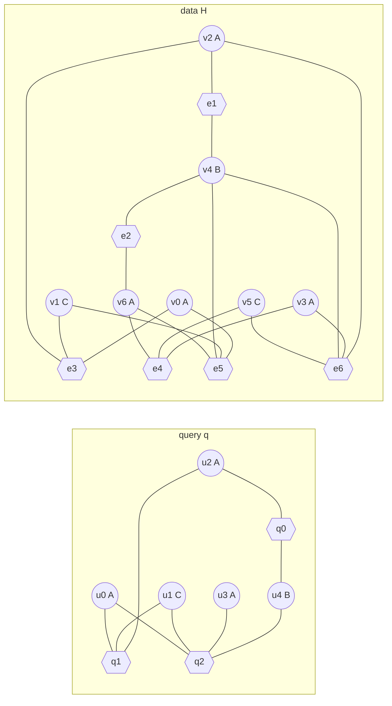
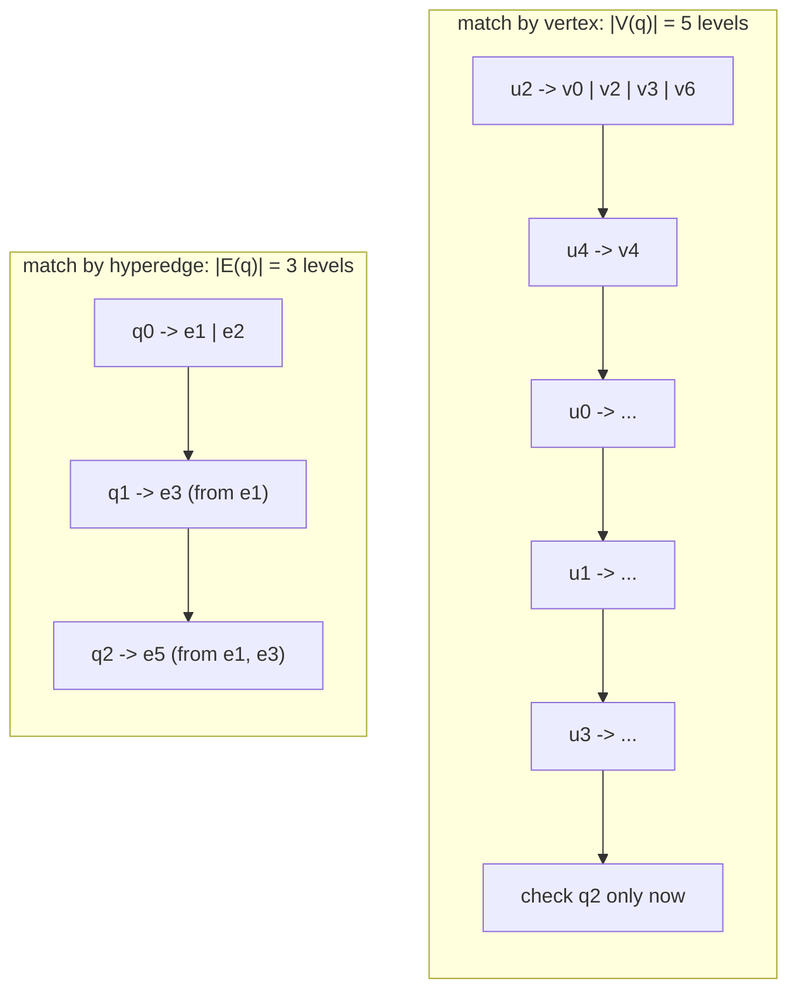
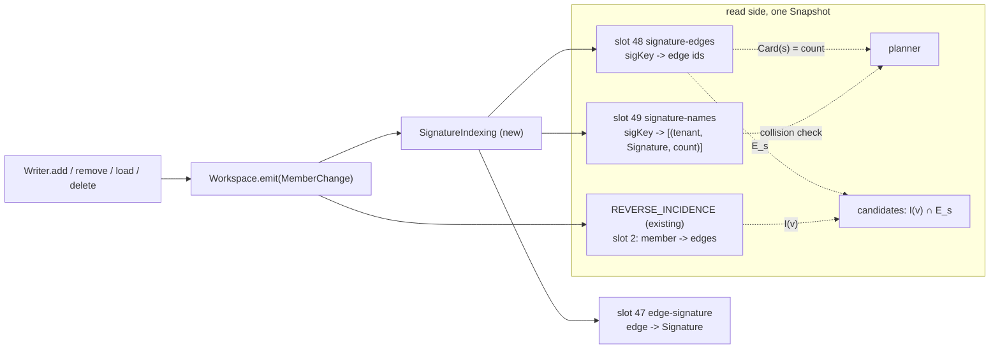
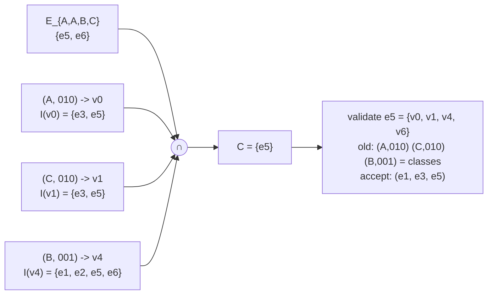
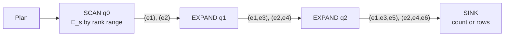
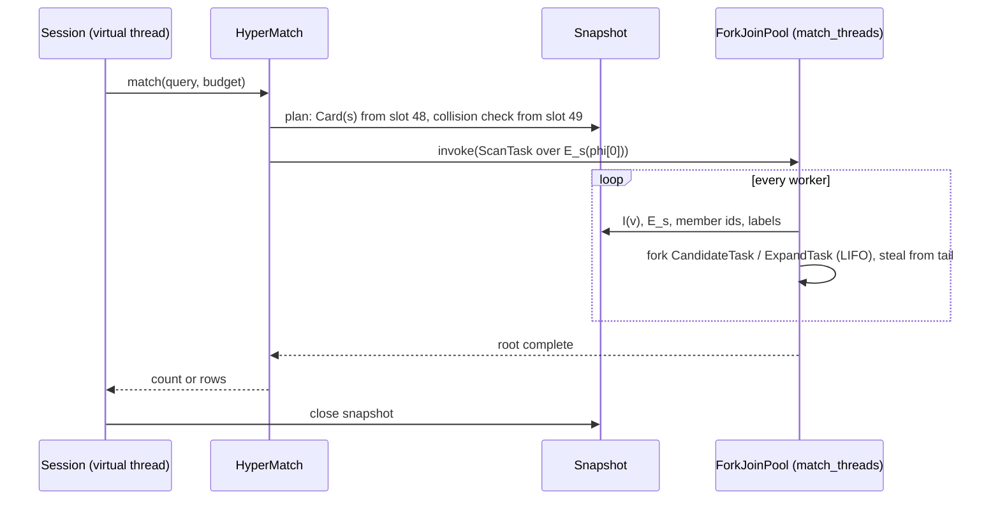
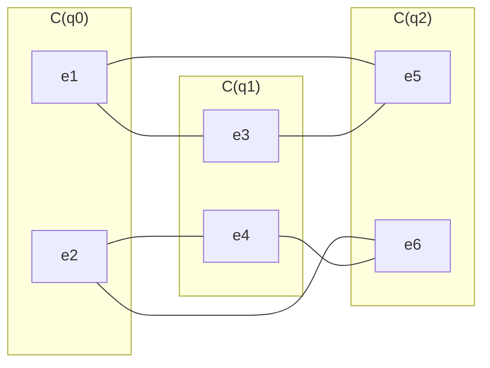
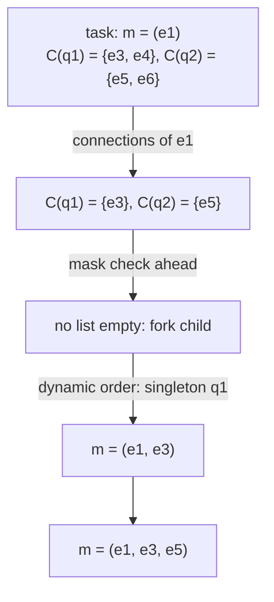

# Hypergraph-structure-first matching (HGMatch)

Source: Z. Yang, W. Zhang, X. Lin, Y. Zhang, S. Li, *HGMatch: A Match-by-Hyperedge Approach for Subgraph Matching on
Hypergraphs*, ICDE 2023, [arXiv:2302.06119](https://arxiv.org/abs/2302.06119).

Follow-up: S. Song, W. Shin, K. Park, G. F. Italiano, Z. Yang, W. Zhang, *Efficient Hypergraph Pattern Matching via
Match-and-Filter and Intersection Constraint* (MaCH), [arXiv:2512.10621](https://arxiv.org/abs/2512.10621).

This page describes the algorithm, how it maps onto HStore's storage, the places where our implementation has to
differ from the paper and why, and what it costs. Section and algorithm numbers (Alg. 2 to 5, Obs. V.1 to V.5,
Thm. V.2, VI.1) refer to the HGMatch paper unless they are marked MaCH. The MaCH additions are in
[match-and-filter pruning](#match-and-filter-pruning-mach).

## Problem

Given a query hypergraph `q` and a data hypergraph `H`, both with labelled vertices, find every
**subhypergraph isomorphism embedding**: an injective map `f : V(q) -> V(H)` that keeps labels and sends every query
hyperedge `{u1..uk}` to a data hyperedge that is exactly `{f(u1)..f(uk)}`.

Two things in that definition drive everything below:

| Property | Consequence |
|---|---|
| exact member set | a query hyperedge of arity 3 matches only data hyperedges of arity 3, never a larger edge that contains those three vertices |
| injective on vertices | two query vertices never share a data vertex, so two query hyperedges that do not touch in `q` must not touch in `H` |

An embedding is reported as a tuple of data hyperedges `m = (f(eq1), .., f(eqn))`, one per query hyperedge in matching
order. That is the paper's output and it is what `COUNT` counts. Vertex bindings are derived from it on request
([vertex bindings](#vertex-bindings)).

### Running example

The paper's Fig. 1, which the rest of this page uses.

```
 Query q                                   Data H
 u0:A  u1:C  u2:A  u3:A  u4:B              v0:A  v1:C  v2:A  v3:A  v4:B  v5:C  v6:A

 q0 = {u2, u4}            (A,B)            e1 = {v2, v4}           e2 = {v4, v6}          (A,B)
 q1 = {u0, u1, u2}        (A,A,C)          e3 = {v0, v1, v2}       e4 = {v3, v5, v6}      (A,A,C)
 q2 = {u0, u1, u3, u4}    (A,A,B,C)        e5 = {v0, v1, v4, v6}   e6 = {v2, v3, v4, v5}  (A,A,B,C)
```



There are two embeddings: `(e1, e3, e5)` and `(e2, e4, e6)`.

## Why match by hyperedge

The older approach extends vertex-at-a-time backtracking (Ullmann, CFL, DAF, CECI) to hypergraphs. A query vertex is
bound at each level, and hyperedges are only checked once all of their vertices happen to be bound. The search tree
is as deep as `|V(q)|`, and most of the branches it opens die late, when a hyperedge check finally fails.

HGMatch binds one whole hyperedge per level. The search tree is `|E(q)|` deep, every level already satisfies the
hyperedge constraint, and candidates come from set operations on an inverted index instead of from recursive calls.



The paper reports 5 to 7 orders of magnitude over the extended CFL, DAF, CECI and RapidMatch on its ten datasets, with
the largest gaps on hypergraphs with high average arity.

## The algorithm

### Overview (Alg. 2)

```
phi  <- ComputeMatchingOrder(q, H)                       Alg. 3
M    <- { (e) : e in H, S(e) = S(phi[0]) }               SCAN
for k in 1 .. |E(q)|-1:
    M' <- {}
    parallel for m in M:                                  EXPAND
        for c in GenerateHyperedgeCandidates(q, H, phi, phi[k], m):    Alg. 4
            if IsValidEmbedding(phi[0..k], m + c):        Alg. 5
                M' <- M' + (m + c)
    M <- M'
return M                                                  SINK
```

The breadth-first form is only for presentation. Execution is depth-first per worker with work stealing
([parallel execution](#parallel-execution)).

### Hyperedge signature (Def. IV.1)

`S(e)` is the multiset of the labels of `e`'s vertices. `S({v0, v1, v2}) = {A, A, C}`. A data hyperedge can only
match a query hyperedge with the same signature (Obs. V.1), so the paper stores `H` as one table per signature plus
one inverted index per table, `he(v, s)` = the hyperedges with signature `s` that contain `v`:

| `S` | hyperedges | `he(v, S)` |
|---|---|---|
| `{A,B}` | `e1 = {v2,v4}`, `e2 = {v4,v6}` | `v2 -> [e1]`, `v4 -> [e1,e2]`, `v6 -> [e2]` |
| `{A,A,C}` | `e3 = {v0,v1,v2}`, `e4 = {v3,v5,v6}` | `v0,v1,v2 -> [e3]`, `v3,v5,v6 -> [e4]` |
| `{A,A,B,C}` | `e5 = {v0,v1,v4,v6}`, `e6 = {v2,v3,v4,v5}` | `v0,v1,v6 -> [e5]`, `v4 -> [e5,e6]`, `v2,v3,v5 -> [e6]` |

`Card(e, H)`, the number of data hyperedges with signature `S(e)`, is the row count of that table.

### Matching order (Alg. 3)

1. Start with the query hyperedge of smallest `Card`.
2. Repeatedly append the unmatched query hyperedge `e` that touches the matched part and minimises
   `Card(e, H) / |V_phi ∩ e|`, where `V_phi` is the set of query vertices matched so far.

Any connected order is correct; this one just matches rare and well connected hyperedges early. The paper does not
specify ties. We break them by smaller arity, then by position in the query text, so plans are deterministic.

For the example all three signatures have `Card = 2`. `q0` wins on arity. `q1` and `q2` both share one vertex with
`{u2, u4}`, so arity decides again: `phi = (q0, q1, q2)`, the order used in the paper.

### Candidate generation (Alg. 4)

When extending a partial embedding `m` (matching `phi[0..k-1]`) by `eq = phi[k]`, a data hyperedge `c` can only be
`f(eq)` if:

| Rule | Statement |
|---|---|
| Obs. V.1 signature | `S(c) = S(eq)` |
| Obs. V.2 adjacency | for every matched `e` adjacent to `eq`, `c` shares a vertex with `f(e)` |
| Obs. V.3 non-adjacency | for every matched `e` not adjacent to `eq`, `c` shares no vertex with `f(e)` |
| Obs. V.4 labels and degree | the shared vertex that plays `u` has `u`'s label and the same degree inside `m` as `u` has inside `q'` |

Alg. 4 turns that into set algebra. For every query vertex `u` that `eq` shares with the matched part:

```
V_incdt(u) = { v in V(m) : l(v) = l(u), deg_m(v) = deg_q'(u), v not in any f(e) with e non-adjacent to eq }
C(eq)      = ⋂_u  ⋃_{v in V_incdt(u)}  he(v, S(eq))
```

Each `u` has to be inside `f(eq)`, so each `u` contributes one union and the candidate set is their intersection.

### Embedding validation (Alg. 5)

Candidate generation admits false positives: `c` may contain an extra matched vertex, or the right vertices in the
wrong roles. Validation rejects them without backtracking over vertex assignments:

1. Obs. V.5: `|V(H_m')| = |V(q')|` after adding `c`.
2. Thm. V.2: define the **vertex profile** `P(v) = (l(v), {matched hyperedges containing v})`, and for a query vertex
   `P(u) = (l(u), {f(e) : e in q', u in e})`. The extension is valid iff the multiset of profiles of `eq`'s vertices
   equals the multiset of profiles of `c`'s vertices.

Equal multisets mean a bijection between `eq` and `c` that keeps labels and incidence to every matched hyperedge
exists: pair each query vertex with any data vertex of the same profile.

## Implementation in HStore

### What carries over and what does not

The paper assumes a static, in-memory, simple hypergraph with only vertex labels. HStore is a transactional,
paged, multi-tenant store. The table lists every point where that matters.

| Paper assumption | HStore reality | What we do |
|---|---|---|
| vertex label | every atom has a `TypeDef` id (`AtomRecord.type`) | label = member atom's type id; a member that is itself a hyperedge is labelled with its edge type |
| hyperedges carry no label | edges are typed (`EdgeRecord.type`) | signature = `(edge type, member label multiset)`, the paper's footnote 2 extension |
| `E ⊆ P(V)`, no duplicate edges | two `Meeting` edges may have identical members | candidates must also differ by **edge id** from every edge already in `m`; this check is required, not defensive |
| index built once, offline | members are added and removed one commit at a time | signature index maintained by a derivation, `O(log n)` per member change regardless of arity ([below](#why-not-the-per-signature-inverted-index)) |
| `he(v, s)` is a direct array lookup | the reverse index `I(v)` already exists, keyed by member | `he(v, s) = I(v) ∩ E_s`, computed by leapfrog over two sorted id sets |
| `l(v)` is an array read | type lookup is a catalog read | labels resolved once per vertex when it enters an embedding, cached per query |
| single tenant | edges and their keys are tenant-scoped | signature keys include the tenant; `E_s` belongs to one tenant, so `I(v) ∩ E_s` drops other tenants' edges |
| set profiles | `|E(q)|` is small | profiles become `(label, bitmask)`; validation is an array compare ([below](#bitmask-profiles)) |
| connected query | users write anything | disconnected queries and queries with isolated vertices are rejected; `PatternMatcher` still serves them |

### Storage: three derived slots

All three are database extension slots maintained by one derivation, `SignatureIndexing`, registered next to
`PropertyIndexing` in `HypergraphDatabase.extensionSlots()`. They live in the generation's root vector like every
other slot, so matching works unchanged on branches and on `readAt` historical snapshots.

| Slot | Kind | Schema | Key | Value |
|---|---|---|---|---|
| 47 `edge-signature` | derived | 84 | edge id | `Signature(edgeType, labels[], counts[])`, labels sorted |
| 48 `signature-edges` | derived | 85/86 | `signatureKey(tenant, signature)` | `PostingIndex<Marker>`: the edge ids with that signature |
| 49 `signature-names` | derived | 87 | `signatureKey(tenant, signature)` | list of `(tenant, Signature, edgeCount)` sharing the key |

```
signatureKey(tenant, s) = Hashing.of(tenant, s.edgeType(), Hashing.of(canonical bytes of s))
canonical bytes          = varint edgeType | varint n { varint label | varint count }*
```

The key is a 64-bit hash, the same pattern as `EngineSlots.canonicalKey`. `signature-names` plays the role that
`CanonicalName` plays for the canonical index: it lets the planner check that the key really belongs to the query's
signature and tenant. Normally the list has one entry. If it has more, the key collided, and the planner marks that
step as unverified, which makes every candidate of that step go through an explicit tenant and signature check. Results
stay exact either way.



On `MemberChange.Added(edge, incidence)` the derivation reads the member's type from the workspace catalog, loads the
edge's current `Signature`, increments that label, and moves the edge from the old signature key to the new one in
slots 48 and 49. `Removed` does the reverse. When the last member leaves, the edge drops out of slots 47 to 49.
`Updated` changes roles, weight or validity, none of which are part of the signature, so it is ignored. Deleting an
atom (`Op.DeleteAtom`) detaches it from every containing edge before its own catalog record is removed, and
derivations run synchronously inside `emit`, so the member's type is still readable when its `Removed` event arrives.

Atom types never change after creation, so a member's label is fixed when it joins an edge. If types ever become
mutable, this derivation also has to listen to `CATALOG` changes.

Adding the slots is a storage format change. Existing data directories need a one-time pass over all edges to fill
them, `O(Σ a(e) · log n)`.

#### Why not the per-signature inverted index

The paper's index is `(signature, vertex) -> edges`. Each edge `e` appears `a(e)` times in it, once per member. In a
static graph that is free. In HStore the signature of an edge changes every time a member is added, and every one of
its `a(e)` postings would move to the new signature. Building an edge of `n` members one `Writer.add` at a time would
cost `O(n²)` posting moves.

The layout above keeps one posting per edge (slot 48) and reuses the reverse index that HStore already maintains. A
member change costs a constant number of tree updates. What we give up is that `he(v, s)` is no longer a stored list:
it is the intersection `I(v) ∩ E_s`, and its cost is bounded by the smaller of the two sets times a seek, not by
`|he(v, s)|`. The case that hurts is a hub vertex in a common signature, where both sets are large and the
intersection is small. A query step usually intersects several `I(v)` at once, and leapfrog is driven by the smallest
of them, so a single hub vertex does not dominate. If profiling shows it does, the per-signature index can be added
as a fourth slot for edges up to a size limit without changing the matcher.

```
paper                                        HStore
(s, v) -> [edges with signature s ∋ v]       v -> [all edges ∋ v]            slot 2, exists
                                             s -> [all edges with sig s]     slot 48, new
he(v, s): one lookup                         he(v, s) = I(v) ∩ E_s: leapfrog
index size O(Σ a(e))                         extra size O(|E|)
cost of one member change: O(a(e))           cost of one member change: O(log n)
```

### Plan

`MatchPlanner` turns the query into an immutable `Plan`. All per-step work that depends only on `q` is done here,
once.

```java
record Signature(int edgeType, int[] labels, int[] counts) {}

record Profile(int label, long mask) {}

record Step(int position, long signatureKey, boolean verified, Signature signature,
            Profile[] sharedClasses, int[] sharedMultiplicity) {}

record Plan(Step[] steps, int vertexCount, int[] vertexLabels, long[] finalMasks) {}
```

For step `k`, `sharedClasses` is the set of distinct `(label, priorMask)` over the query vertices that `phi[k]`
shares with `phi[0..k-1]`, where `priorMask` has bit `i` set iff the vertex belongs to `phi[i]`, `i < k`.
`sharedMultiplicity` is how many shared vertices fall in each class. Ordering (Alg. 3) needs `Card` for each query
hyperedge, which is `PostingIndex.count` on slot 48: one directory lookup each.

For the example:

| `k` | `phi[k]` | signature | shared vertices | `sharedClasses` |
|---|---|---|---|---|
| 0 | `q0 = {u2,u4}` | `{A,B}` | none | none |
| 1 | `q1 = {u0,u1,u2}` | `{A,A,C}` | `u2` | `(A, 001)` ×1 |
| 2 | `q2 = {u0,u1,u3,u4}` | `{A,A,B,C}` | `u0, u1, u4` | `(A, 010)` ×1, `(C, 010)` ×1, `(B, 001)` ×1 |

### Bitmask profiles

The paper's profile is a label plus a set of matched hyperedges. Since every matched hyperedge has a fixed position in
`phi`, the set is a bitmask over positions. We cap `|E(q)|` at 64 so one `long` holds it.

```
position:        2   1   0
                 q2  q1  q0
u0  (A)          1   1   0      mask 110
u1  (C)          1   1   0      mask 110
u2  (A)          0   1   1      mask 011
u3  (A)          1   0   0      mask 100
u4  (B)          1   0   1      mask 101
```

A data vertex's mask is computed the same way from the hyperedges in `m`. This changes two things.

For the candidate filter, instead of the paper's `l(v) = l(u)`, equal degree, and not in any non-adjacent image, we require
`l(v) = l(u)` and `mask_m(v) = priorMask(u)`. It is a sound filter: in any valid embedding, `v = f(u)` lies in
`m[i] = f(phi[i])` exactly when `u` lies in `phi[i]`, so the masks must be equal. Equal masks imply equal degree
(`popcount`), and a vertex inside a non-adjacent image has a bit that `u` cannot have, so it subsumes all three of
the paper's conditions and is never weaker.

For validation: every vertex of `c` gets bit `k`, so that bit carries no information and can be dropped. The new vertices
of `c` (mask 0) and of `eq` must then match on labels, which already holds: `S(c) = S(eq)` and the old parts agree
on labels. Their counts agree too, because `|c| = |eq|`. Thm. V.2 and Obs. V.5 together reduce to:

```
valid(m, c) <=> c not in m
            and multiset{ (l(v), mask_m(v)) : v in c, v in V(m) } = multiset over sharedClasses with sharedMultiplicity
```

That is one pass over `c`'s members with a lookup in `m`'s vertex table, then a check that every class count went to
zero.

MaCH reaches the same test from a different direction. It calls the mask an incident hyperedge bitmap, groups
vertices with equal bitmaps into cells, and proves that a hyperedge mapping is an embedding iff every cell has the
same label multiset on both sides (MaCH Thm. 3), and that a new pair only changes the cells inside the new hyperedge
(MaCH Thm. 4). Its check (MaCH Alg. 4) runs in `O(|e|)`, against `O(a_q · |E(q)|)` for HGMatch's set profiles. MaCH
measured HGMatch spending 94.1% to 96.9% of query time on profile checks on its slower datasets, and its own check
more than 100 times faster on AR (MaCH Sec. VII-B, Fig. 8). The derivation above lets us also drop the new vertices
from the comparison, because the exact signature already accounts for their labels. The step must be `verified`; for an unverified (collided) key, `c`'s edge type, tenant and full signature are
checked first.

### Embedding

```java
record Embedding(long[] edges, long[] vertices, int[] labels, long[] masks) {}
```

`edges[i]` is `f(phi[i])`. `vertices` is sorted so membership is a binary search; `labels` and `masks` are parallel to
it. At most `|V(q)|` vertices and `|E(q)|` edges, so an embedding is a few hundred bytes. Extending copies the
arrays and is never done in place, so a task can hand its embedding to other threads without locking.

Labels of newly added vertices come from the catalog through a per-query `LabelCache` shared by the workers. When the
new vertices of `c` all have the same label (common for signatures like `{A, A, A}`), no lookup is needed.

### Candidate generation in HStore

```
C(phi[k] | m) = E_s  ∩  ⋂_{class (l, mask) in sharedClasses}  ⋃_{v in m, l(v) = l, mask_m(v) = mask}  I(v)
```

Every set in that expression is a sorted run of edge ids: `E_s` from slot 48, `I(v)` from slot 2, either inline in
the directory entry (up to 48 postings) or a promoted subtree. The intersection is a leapfrog over seekable cursors,
the same strategy as `TreeAlgebra.intersectKeys`, but on a small `SortedIds` cursor interface that reads inline
postings as a `long[]` and promoted ones through `TreeCursor.seek`. That avoids `PostingIndex.tree`, which builds a
temporary tree for every inline posting list. A union of several `I(v)` is a k-way merge cursor whose `seek` moves
each input.

Step 2 of the example from `m = (e1, e3)`:



The full trace:

| Step | `m` before | candidates | accepted | vertex table after (label, mask) |
|---|---|---|---|---|
| SCAN `q0` | `()` | `E_{A,B} = {e1, e2}` | `(e1)`, `(e2)` | `v2 (A,001) v4 (B,001)` / `v4 (B,001) v6 (A,001)` |
| EXPAND `q1` | `(e1)` | `{e3,e4} ∩ I(v2) = {e3}` | `(e1,e3)` | `v0 (A,010) v1 (C,010) v2 (A,011) v4 (B,001)` |
| EXPAND `q1` | `(e2)` | `{e3,e4} ∩ I(v6) = {e4}` | `(e2,e4)` | `v3 (A,010) v4 (B,001) v5 (C,010) v6 (A,011)` |
| EXPAND `q2` | `(e1,e3)` | `{e5,e6} ∩ I(v0) ∩ I(v1) ∩ I(v4) = {e5}` | `(e1,e3,e5)` | |
| EXPAND `q2` | `(e2,e4)` | `{e5,e6} ∩ I(v3) ∩ I(v5) ∩ I(v4) = {e6}` | `(e2,e4,e6)` | |

#### A rejected candidate

The paper's Fig. 4. Three query hyperedges at positions 0, 1, 2 with `phi[2] = {u2, u3, u4}`, all labelled `A`. The
data candidate for position 2 is `c = {v1, v2, v3}`.

| query vertex | prior mask | | data vertex | prior mask |
|---|---|---|---|---|
| `u2` | `01` | | `v1` | `01` |
| `u3` | `10` | | `v2` | `01` |
| `u4` | `10` | | `v3` | `10` |

`sharedClasses` = `(A,01)` ×1, `(A,10)` ×2. Candidate generation lets `c` through: it contains a vertex of class
`(A,01)` and one of class `(A,10)`. Validation counts `(A,01)` twice and `(A,10)` once, the counts do not match, and
`c` is rejected. No assignment of `u`s to `v`s was ever tried.

### Parallel execution

The paper's engine has three operators, `SCAN -> EXPAND* -> SINK`, executed as tasks with per-thread LIFO deques and
work stealing from the other end. That is the scheduling discipline of `java.util.concurrent.ForkJoinPool` in its
default (non-async) mode: a worker pushes and pops forked tasks at the head of its own deque, and idle workers steal the
oldest task from the tail. The oldest tasks are the ones closest to the root of the search, which hold the most work,
so a single steal moves a large share. The paper's "steal half" is not needed.



| Task | Input | Work | Splits when |
|---|---|---|---|
| `ScanTask` | rank range `[lo, hi)` of `E_s` | `Tree.at(lo)` then iterate; each edge becomes a one-edge `Embedding` and an `ExpandTask` | `hi - lo > B`: fork the halves |
| `ExpandTask` | `Embedding`, step `k` | build `C(phi[k] \| m)` into a `long[]`, hand it to a `CandidateTask` | never |
| `CandidateTask` | `Embedding`, `long[]`, `[lo, hi)` | validate each candidate, fork an `ExpandTask` per accepted extension, or sink it at the last step | `hi - lo > B`: fork the halves |

Slot 48 postings are counted B+-trees, so a range of ranks splits in `O(log n)` without reading the edges in between.
`B` (batch) defaults to 64.

All tasks are `CountedCompleter`s, so a parent never blocks in `join()` and the root completes when the last
descendant finishes. The pool is a dedicated `ForkJoinPool` of `match_threads` workers (default: available
processors), not the common pool. The calling session runs on a virtual thread (`Server` uses
`newVirtualThreadPerTaskExecutor`) and just waits on the root.

```
worker 1 deque                          worker 2 deque (idle, steals from the tail of worker 1)
head -> Expand q2 (e1,e3)               head -> Scan [E_s ranks 4096..8192)  <- stolen
        Candidate (e1) [32..64)
        Scan [E_s ranks 2048..4096)
tail -> Scan [E_s ranks 4096..8192)  ---^
```



The Snapshot is opened once and shared by every worker, so all of them read the same generation. It must stay open
until the root task completes. Tree pages are immutable and the node cache memoises decoded leaves with a CAS, which
is what makes concurrent reads safe. Before this lands, `View` and `Reader` still need an audit for other unguarded
mutable state (`Reader.onlyDefaultTenant` is a benign race, since every thread computes the same value).

`Budget.Meter` counts rows with an `AtomicLong` and checks a deadline, so one meter is shared by all tasks. Each
accepted extension charges 1. When the meter refuses, or `LIMIT` rows have been emitted, a shared `cancelled` flag is
set and every task returns at its first check. In `COUNT` mode the sink is a `LongAdder`. In row mode it is a
concurrent queue capped by `budget.maxRows`. Rows come out in no particular order. With `match_threads = 1` they come
in plan order with edge ids ascending at each level.

### Vertex bindings

An edge tuple fixes which data vertices are used but not always which query vertex each one plays. Query vertices
with the same label and the same final mask (the same incident query hyperedges) are interchangeable, and so are their
images. Every permutation inside such a class is a valid vertex mapping.

```
bindings per edge tuple = Π over classes (label, finalMask) of (class size)!
```

In the running example all five query vertices have distinct `(label, finalMask)`, so each tuple has exactly one
binding. A query `{a:A, b:A}` with one hyperedge has one class of size 2 and two bindings per matching edge. Bindings
are produced lazily from the tuple, so `COUNT` of tuples never pays for them.

Role, weight, validity and property predicates on incidences or vertices are not part of the signature or the
profile. They are checked on the expanded bindings, after matching, because they break the interchangeability that the
class argument relies on.

### Anchored queries

Database queries usually pin a vertex to a known atom (`p = @Patient:'ines-duarte'`). An anchor on query vertex `u`
becomes a pseudo-hyperedge `{u}` at position 0 with `Card = 1`, matched to `{a}` after checking that `a` is visible and
has `u`'s label. From then on it is ordinary: `u` carries bit 0, the first real hyperedge through `u` gets candidates
`E_s ∩ I(a)`, and validation checks that `a` is in the candidate with the right mask. No special case is needed in
the matcher.

### API

```java
HyperQuery query = HyperQuery.builder()
        .vertex("u0", "A").vertex("u1", "C").vertex("u2", "A").vertex("u3", "A").vertex("u4", "B")
        .edge("q0", "R", "u2", "u4")
        .edge("q1", "R", "u0", "u1", "u2")
        .edge("q2", "R", "u0", "u1", "u3", "u4")
        .build();

long count = HyperMatch.on(reader).count(query, Budget.DEFAULT);
Stream<long[]> tuples = HyperMatch.on(reader).tuples(query, Budget.DEFAULT);
Stream<Map<String, Long>> bindings = HyperMatch.on(reader).bindings(query, Budget.DEFAULT);
```

The package is `io.hstore.db.retrieve`: `HyperQuery`, `Signature`, `SignatureSlots`, `SignatureIndexing`,
`MatchPlanner`, `Plan`, `SortedIds`, `Embedding`, `LabelCache`, `MatchTasks`, `HyperMatch`. The HQL statement that
calls it will be specified with the grammar, not here.

### Relation to `PATTERN`

`PatternMatcher` (`hora/PatternMatcher.java`) answers a different question and stays as it is.

| | `PATTERN` | HGMatch |
|---|---|---|
| unit of binding | one variable (node or edge) per level | one hyperedge per level |
| hyperedge semantics | open: `e CONTAINS v` allows other members | closed: exact member set |
| vertex mapping | not injective unless `a != b` is written | injective |
| constraints | roles, `SHARED`, `SUBSET`, `CARD`, `VALID AT` | structure and types; the rest as post filters |
| execution | breadth-first, every level fully materialised | depth-first per worker, work stealing |
| parallel | no | yes |

## Match-and-filter pruning (MaCH)

HGMatch generates candidates for a query hyperedge only when the search reaches it, and only checks them against the
hyperedges matched so far. A partial embedding that cannot be completed is discovered late, at the level where some
later hyperedge has no candidates. MaCH adds three things on top of match-by-hyperedge.

| MaCH technique | Statement | Status in HStore |
|---|---|---|
| intersection constraint (MaCH Thm. 1, 3, 4) | cell label multisets agree on both sides | already our validation ([bitmask profiles](#bitmask-profiles)) |
| connectivity constraint (MaCH Lemma 2) | adjacent `e, e'` may map to `f, f'` only if `Sig(e ∩ e') = Sig(f ∩ f')` | implied by our validation at the step that matches `e'`; MaCH's gain is applying it early, below |
| candidate hyperedge space, CHS (MaCH Def. 5) | `C(e)` for every query hyperedge plus "connections" between compatible candidates of adjacent query hyperedges | new, optional, built per query |
| filtering before matching (MaCH Alg. 2) | drop `f ∈ C(e)` that has no connection to any candidate of some adjacent `e'`, propagate until stable | new, with the CHS |
| match-and-filter (MaCH Alg. 3) | after each new pair, shrink the candidate sets of all unmapped query hyperedges with both constraints; backtrack when one becomes empty | new, with the CHS |
| dynamic order (MaCH Sec. VI) | next: a hyperedge with one candidate left; else most unmapped neighbours; ties to fewest candidates | replaces Alg. 3 when a CHS exists |

The paper reports up to 99.3% of candidates removed by the connectivity filter, up to 20 times faster matching with
filtering than without, and on SA with 15 query hyperedges more than 4,000 times faster than HGMatch (MaCH
Sec. I and VII-B). It also reports the cost: on the smallest queries the initial filtering took 89.8% of query time
on average, and it ran slower than OHMiner on some small and unlabelled cases. MaCH is single-threaded C++ that
mutates the CHS during depth-first search.

### CHS on the running example

```
query pair    shared       Sig        data pairs and Sig(f ∩ f')                   connected
q0 - q1       {u2}         {A}        e1∩e3 = {v2} {A}   e2∩e4 = {v6} {A}          e1-e3, e2-e4
                                      e1∩e4 = ∅          e2∩e3 = ∅
q0 - q2       {u4}         {B}        e1∩e5 = {v4} {B}   e2∩e6 = {v4} {B}          e1-e5, e2-e6
                                      e1∩e6 = {v2,v4} {A,B}   e2∩e5 = {v4,v6} {A,B}
q1 - q2       {u0,u1}      {A,C}      e3∩e5 = {v0,v1} {A,C}   e4∩e6 = {v3,v5} {A,C}  e3-e5, e4-e6
                                      e3∩e6 = {v2} {A}   e4∩e5 = {v6} {A}
```



Pre-filtering removes nothing here, since every candidate keeps a connection on every side. The gain shows at the
first step: after `q0 -> e1`, forward checking leaves `C(q1) = {e3}` and `C(q2) = {e5}`. Both are singletons, the
dynamic order takes them next, and the embedding is found with no candidate that fails validation.

### Building the CHS in HStore

`C(e)` starts as `E_s` for `s = S(e)`, which is slot 48. A connection between `f ∈ C(e)` and `f' ∈ C(e')` needs
`f ∩ f' ≠ ∅` with the right signature. We find the partners of `f` through the reverse index instead of comparing all
pairs:

```
for each adjacent query pair (e, e') with shared signature σ = Sig(e ∩ e'):
    for f in C(e):
        partners = ⋃_{v in f, l(v) in σ}  I(v) ∩ E_{S(e')}
        for f' in partners:
            if Sig(f ∩ f') = σ: connect(f, f')
```

The CHS is held in memory for the duration of the query: candidate ids as a sorted `long[]` per query hyperedge, and
connections in CSR form (`int[] offsets`, `int[] targets` of candidate indexes) per ordered pair of adjacent query
hyperedges. Pre-filtering is MaCH Alg. 2 over those arrays: a queue of query hyperedge pairs, removal marks in a
`BitSet` per `C(e)`.

The CHS has `Σ_e |C(e)|` candidates, and in the worst case `|E(q)|² · |E(H)|²` connections (MaCH Sec. V-A). In a
large store a common signature can have millions of edges, and reading every one of them and their partners before
the first result is the wrong trade for a small query. So the CHS is optional:

| Condition (checked at plan time from slot 48 counts) | Mode |
|---|---|
| `Σ_e Card(e) > chs_candidate_limit` | HGMatch on the fly, static order (Alg. 3) |
| the query has an anchored vertex | HGMatch on the fly; `I(a) ∩ E_s` is already small |
| `|E(q)| ≤ 2` | HGMatch on the fly; nothing to filter ahead |
| otherwise | CHS, pre-filter, match-and-filter, dynamic order |

`chs_candidate_limit` starts at 2^20 candidates. That number is a placeholder until benchmarks on our own data set
it. Building the CHS counts against the query page budget like any other read.

### Forward checking with parallel tasks

MaCH shrinks candidate sets in place and restores them on backtrack. Our tasks are stolen by other threads, so a task
cannot share mutable candidate sets with its parent. Each `ExpandTask` instead carries, for every unmapped query
hyperedge, its current candidate list as a sorted `int[]` of CHS indexes. Accepting `(e', f')` builds the child's
lists:

1. For each unmapped `e` adjacent to `e'`: intersect `e`'s list with the connection list of `f'` towards `e`
   (sorted merge, no I/O).
2. For each unmapped `e` touched in step 1: drop every remaining `f` that fails the mask check against the extended
   embedding. That is the same function as validation, applied ahead of time (MaCH Alg. 4).
3. If any list is empty, the child is never forked.

Lists of query hyperedges that were not touched are shared with the parent, not copied. The next hyperedge is
chosen per task by the dynamic order, so different branches of the search may match hyperedges in different orders.
That is safe because the validity of a partial embedding does not depend on the order it was built in. It does mean
mask bits must be indexed by query hyperedge id rather than by position in a fixed order, and the per-step
`sharedClasses` of the plan are computed per task from the set of hyperedges mapped so far: `O(a(e))` per step, by masking each
query vertex's precomputed incidence bits with the mapped set.



## Complexity

Notation: `n = |E(H)|`, `a_q` = average query arity, `p` = worker threads, `B` = task batch size, `d_e` = number of
distinct labels in edge `e`.

| Part | Paper | HStore |
|---|---|---|
| index space | `O(a_H · n)` | `O(n + Σ_e d_e + #signatures)` on top of the existing reverse index |
| index build | `O(a_H · n)` offline | one-time rebuild `O(Σ a(e) · log n)`; then maintained online |
| one member change | not supported | `O(log n + d_e)` |
| matching order (Alg. 3) | `O(|E(q)|²)` | `O(|E(q)|² + |E(q)| · log n)` |
| candidates for one partial embedding (Alg. 4) | `O(|V(q)| · n)` | `O(|V(q)| · n · log n)` worst case; leapfrog is `O(k · min_j |X_j| · log n)` for `k` input sets `X_j` |
| validation of one candidate (Alg. 5) | `O(a_q · |E(q)|)` | `O(a(eq) · log |V(q)|)` plus reading the candidate's member ids |
| memory (Thm. VI.1) | `O(a_q · |E(q)|² · n)` | `O(p · |E(q)| · (n + B · (|V(q)| + |E(q)|)))` |
| total | exponential in `|E(q)|` in the worst case (the problem is NP-hard), output sensitive | same |
| CHS build (MaCH mode) | MaCH: not stated separately | `O(Σ_e |C(e)| · a_max · log n)` index seeks, plus one `Sig(f ∩ f')` per partner pair |
| pre-filtering (MaCH Alg. 2) | `O((Σ_e |C(e)|)²)` (MaCH Thm. 2) | same, over in-memory arrays |
| forward check per new pair (MaCH Alg. 3) | `O(1)` per candidate for connectivity, `O(|e|)` for intersection (MaCH Thm. 5) | same, plus the sorted merge of two `int[]` |
| CHS memory | MaCH: candidates `O(|E(q)| · |E(H)|)`, connections `O(|E(q)|² · |E(H)|²)` worst case | same, bounded in practice by `chs_candidate_limit` |

Where the bounds come from:

- Candidates: each shared class contributes the union of `I(v)` over its vertices, at most `|V(q)|` lists of at most
  `n` ids, and seeks in B+-trees and inline arrays add the `log n`. In practice a step intersects several small sets,
  and the leapfrog is driven by the smallest one.
- Validation: profiles are a label and a `long`, so comparing two is `O(1)` instead of comparing sets of up to
  `|E(q)|` hyperedges. That removes the `|E(q)|` factor. Each member of `c` costs one binary search in the vertex
  table. A small edge (at most 32 members that fit in about 100 bytes) keeps its member list inline in the catalog
  record, so reading it costs no page beyond the catalog leaf.
- Memory: a worker's call chain is at most `|E(q)|` levels deep. Each level holds one candidate array (at most `n`
  ids) and at most `B` forked children, each with its own embedding of `O(|V(q)| + |E(q)|)` words. The pending range
  halves share their parent's embedding and array instead of copying them. The paper's bound is larger because each
  queued task there carries its own full partial embedding.

## Limits of the first version

| Not supported | Reason | Today |
|---|---|---|
| disconnected queries | Alg. 3 needs a connected order; joining components needs cross-component injectivity checks | rejected |
| untyped query vertices or wildcard labels | a signature needs every label | rejected; an untyped query edge is allowed and becomes a union over edge types with that member multiset |
| a query hyperedge used as a member of another query hyperedge | not part of the paper's model | rejected |
| more than 64 query hyperedges | one `long` mask | rejected |
| membership valid at a time `t` | the signature indexes all members regardless of validity | `PATTERN ... VALID AT` |
| ordered edges with positional constraints | profiles carry no positions | ordered edges match as sets; positions can be checked on bindings |

Symmetric queries (two query hyperedges with the same type and the same member variables) produce every embedding
once per permutation of those hyperedges. This matches the definition, since tuples are ordered, and the paper counts
them the same way.
