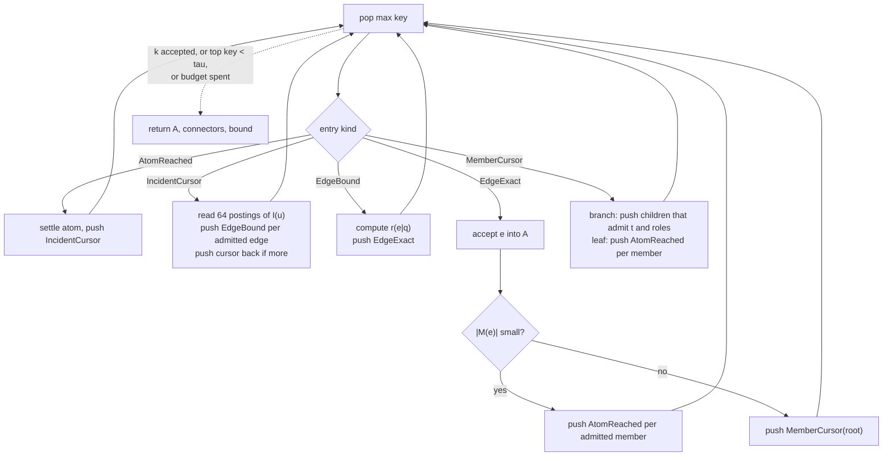
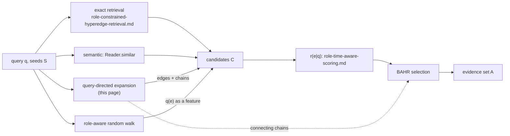

# Query-directed expansion

Status: proposed. Nothing on this page is implemented yet.

This page specifies a best-first expansion from seed atoms or hyperedges through selected memberships. It returns a
connected set of hyperedges, each with the chain of memberships that led to it, ranked by one explicit score. The
proposal asked for "relevance, novelty and marginal information gain" in one ranking and for beam search. The page
explains why we keep the expansion score per hyperedge and per path, which gives an exact top-k with a stopping bound,
and move novelty and marginal gain into the set selection of
[budgeted-associative-retrieval.md](budgeted-associative-retrieval.md).

| Page | Question it answers | Score |
|---|---|---|
| [role-aware-random-walk.md](role-aware-random-walk.md) | which atoms and hyperedges are associated with the seeds, counting every path | sum over all walks |
| this page | which hyperedges are reachable from the seeds through one strong, explainable chain | maximum over single paths |
| [budgeted-associative-retrieval.md](budgeted-associative-retrieval.md) | which set of hyperedges to hand to an agent under a budget | set objective over candidates |

The relevance score is defined in [role-time-aware-scoring.md](role-time-aware-scoring.md) (RTHR), and exact retrieval
by members, roles and validity in [role-constrained-hyperedge-retrieval.md](role-constrained-hyperedge-retrieval.md)
(RCHR). This page writes `r(e|q)` for RTHR's `S(q, e)` and `ub(e)` for its bound `U(e)`, and calls them through the
`Scorer` interface of RCHR's scoring hook: `bound(query, Evidence.Catalog(edge, type, summary))` reads only the
`EdgeRecord` and the root `Summary`, and `score(query, Evidence.Full(edge, hyperedge))` reads the members. Both are in
`[0, 1]` and `score <= bound`. The expansion reaches hyperedges that do not match the query hyperedge at all (a Staffing
edge that links a provider to a hospital), so it scores with RTHR's formula and ignores the `required` flag of slots;
hard constraints belong to candidate generation, not to evidence chains.

## Problem

### Output

Given seeds `S` (atoms or hyperedges of the reader's tenant, each with a weight in `(0, 1]`), a query `q` and a budget,
return an evidence tree:

| Part | Content |
|---|---|
| `A` | at most `k` hyperedges, each with its value, its relevance `r(e|q)`, the atom it was entered through and the hyperedge or seed that atom was reached from |
| connectors | the atoms that link consecutive hyperedges (one per hyperedge, plus the seeds) |
| `bound` | an upper bound on the value of every hyperedge that was not returned |
| `stop` | why the run ended: result size, no useful candidate, budget, frontier exhausted |

The hyperedges in `A` together with the connector atoms form a tree rooted at the seeds: every hyperedge shares its
connector atom with its parent hyperedge, or the connector is a seed. That is the "compact, connected evidence
subhypergraph" of the proposal, made precise. The members of each returned hyperedge come with it, but only connector
atoms are guaranteed to be shared.

### Value of a hyperedge

Each step of a chain gets a factor in `[0, 1]`, and the value of a chain is the product of its factors. The value of a
hyperedge is the value of its best chain.

```
value(seed s)           = w(s)
value(e via v)          = value(v) * sigma_in(v, e) * gate(r(e|q))
value(u via e)          = value(e) * sigma_out(e, u)
value(e)                = max over chains

sigma_in(v, e)  = rho_out(R(v, e)) * omega'(e) * deg(v)^(-beta_v)
sigma_out(e, u) = rho_in(R(u, e)) * gamma_e(u) / gammaMax(e) * |M(e)|^(-beta_e)
gate(r)         = lambda + (1 - lambda) * r
```

| Symbol | Meaning | Source in HStore |
|---|---|---|
| `rho_out`, `rho_in` | role factors, normalized to `[0, 1]` | query; role sets from `IncidentEdge.roleSet` and `Incidence.roleSet` |
| `omega'(e)` | per-type factor, normalized to `[0, 1]` | query, edge type from `EdgeRecord.type` |
| `deg(v)^(-beta_v)` | damping of hub atoms: an atom in 10,000 hyperedges says little about any one of them | `View.degree`, `O(1)` |
| `gamma_e(u) / gammaMax(e)` | incidence weight relative to the largest in the hyperedge | `Incidence.weight`, root `Summary.weightMax` |
| `|M(e)|^(-beta_e)` | damping of huge hyperedges | `EdgeRecord.cardinality()`, `O(1)` |
| `gate` | relevance of the hyperedge itself; `lambda > 0` lets a weakly relevant hyperedge still connect two relevant ones | RTHR `S(q, e)` |

Admission (tenant, edge types, validity at `t`, positive factors) is the same as in the random walk and uses the same
`Transitions` code ([role-aware-random-walk.md](role-aware-random-walk.md#transition-probabilities)). The value is the
max-product counterpart of that walk. With `beta_v = beta_e = 1`, unit weights and role factors, `gate = 1` and nothing
filtered, `sigma_in * sigma_out` is the walk's transition probability `P_VE(v, e) * P_EV(e, u)`, and the value of an
atom is the probability of its single most likely walk path (restart left aside). Personalized PageRank adds up all
paths; this page keeps the best one.
The factors here are not renormalized after filtering, because the normalizer of a huge hyperedge would require reading
all its members, which is exactly what the lazy expansion below avoids.

"Useful" means `value(e) >= tau` for a threshold `tau` given by the caller (0 by default). "No useful candidate
remains" means that no hyperedge that has not been returned can reach `tau`, which the frontier proves with its top key.

### What the guarantee is

Because every factor is at most 1, a chain's value never increases as it gets longer. Best-first search in that
setting is Dijkstra's algorithm on `-log(value)`, with A*-style upper bounds for the parts not yet computed. The
consequences:

| Property | Holds when |
|---|---|
| hyperedges are returned in non-increasing order of value | always |
| `A` is exactly the top `|A|` hyperedges by value (ties by id) | the frontier was never truncated |
| the result is connected through connector atoms | always: a hyperedge is reached only from an atom that was reached from a returned hyperedge or a seed |
| every hyperedge not returned has value `<= bound` | always |
| result is exact above `droppedBound` | the frontier was truncated to its memory cap ([below](#bounded-frontier)) |

What it does not give: any statement about the set as a whole. Two returned hyperedges can carry the same evidence
(two claims with the same members); the expansion returns both if both have high value. Novelty and marginal
information gain depend on what is already selected; they are not a property of a single chain. With a gain that
depends on the selected set, the order in which hyperedges come out of the frontier is no longer the order of their
contribution, and none of the properties above survive. That is why set-dependent gains live in
[budgeted-associative-retrieval.md](budgeted-associative-retrieval.md), which uses this expansion as one of its
candidate generators and as its source of connecting chains.

## Literature

E. W. Dijkstra, *A note on two problems in connexion with graphs*, Numerische Mathematik 1959
([doi:10.1007/BF01386390](https://doi.org/10.1007/BF01386390)), and P. E. Hart, N. J. Nilsson, B. Raphael, *A Formal
Basis for the Heuristic Determination of Minimum Cost Paths*, IEEE Transactions on Systems Science and Cybernetics 1968
([doi:10.1109/TSSC.1968.300136](https://doi.org/10.1109/TSSC.1968.300136)): best-first search with non-negative
step costs settles nodes in order of distance, and with an admissible heuristic (one that never overestimates the
remaining cost; in our terms, a key that never underestimates the value still reachable) the first goal reached is
optimal. Products of factors in `[0, 1]` are sums of non-negative costs after `-log`.

R. Fagin, A. Lotem, M. Naor, *Optimal Aggregation Algorithms for Middleware*, PODS 2001
([doi:10.1145/375551.375567](https://doi.org/10.1145/375551.375567)), journal version JCSS 2003
([doi:10.1016/S0022-0000(03)00026-6](https://doi.org/10.1016/S0022-0000(03)00026-6)): the threshold algorithm for top-k
stops once `k` objects score at least as much as the best score any unseen object could still reach. Our stopping rule
is the same idea with the frontier's top key as the threshold, and our lazy evaluation of `r(e|q)` (rank by `ub(e)`,
compute the exact score when the entry reaches the top) is the same trick CELF uses for marginal gains
([budgeted-associative-retrieval.md](budgeted-associative-retrieval.md#literature)).

G. Bhalotia, A. Hulgeri, C. Nakhe, S. Chakrabarti, S. Sudarshan, *Keyword Searching and Browsing in Databases using
BANKS*, ICDE 2002 ([doi:10.1109/ICDE.2002.994756](https://doi.org/10.1109/ICDE.2002.994756)), and H. He, H. Wang,
J. Yang, P. S. Yu, *BLINKS: Ranked Keyword Searches on Graphs*, SIGMOD 2007
([doi:10.1145/1247480.1247516](https://doi.org/10.1145/1247480.1247516)), return rooted trees that connect nodes
matching each keyword. BANKS finds them with a heuristic backward expansion from the keyword nodes; the optimal
connecting tree is a Steiner tree problem. Our output is also a rooted connecting tree, but the problem is easier
because we do not require the tree to reach given targets: we rank everything reachable from the seeds, which is a
shortest-path problem, not a Steiner problem. When targets are required (connect these three entities), the problem
becomes group Steiner tree; [budgeted-associative-retrieval.md](budgeted-associative-retrieval.md#connectivity) covers
what is known.

Beam search keeps the `b` best partial states per level and discards the rest. We cite no specific source for it; the
comparison below uses the generic definition.

## The algorithm

### Frontier entries

The frontier is a priority queue of entries. Every entry carries a key that is an upper bound on the value of anything
that can still be derived from it. Five kinds:

| Entry | Key | When popped |
|---|---|---|
| `AtomReached(u, via e)` | `value(u)` (exact) | settle `u`: record its best value and parent; push `IncidentCursor(u)` |
| `IncidentCursor(u)` | `value(u) * deg(u)^(-beta_v) * maxRhoOut * maxOmega'` | read the next chunk of `I(u)` (64 postings), push an `EdgeBound` for each admitted hyperedge, push the cursor back if postings remain |
| `EdgeBound(e, via v)` | `value(v) * sigma_in(v, e) * gate(ub(e))` | compute `r(e|q)` (once per hyperedge: it does not depend on the chain, so it is cached); push `EdgeExact` with the exact value |
| `EdgeExact(e, via v)` | `value(e)` (exact) | accept `e` into `A`; push its members (small hyperedge) or a `MemberCursor` over its root (large hyperedge) |
| `MemberCursor(e, subtree)` | `value(e) * maxRhoIn * subtree.weightMax / gammaMax(e) * |M(e)|^(-beta_e)` | a branch: push one `MemberCursor` per child whose summary admits `t` and the role mask; a leaf: push `AtomReached` for each admitted member |

An entry for an atom or hyperedge that is already settled is skipped when popped (lazy deletion instead of
decrease-key). Ties are broken by key, then exact before bound, then ascending id, which makes the run deterministic for one
snapshot.



### Why the cursors

The proposal says "use beam or best-first search instead of exploring every neighbor". Best-first alone does not avoid
reading every neighbor: when an atom is settled, its incident hyperedges have to be bounded before they can be ranked,
and when a hyperedge is accepted, its members have to be valued. For a hub atom with 10^5 incident hyperedges or a
hyperedge with 10^6 members, that read is the whole cost. Beam search has the same problem: to keep the best `b`
successors it has to score all of them.

The cursors defer those reads until the frontier says they are needed:

- An `IncidentCursor` stands for all of `I(u)` with one key. Until that key is the largest in the frontier, nothing in
  `I(u)` is read. Hub damping `deg(u)^(-beta_v)` makes that key small for hubs, so a hub is read only when nothing
  better is left. When it is read, it is read 64 postings at a time, and the cursor goes back with the same key.
- A `MemberCursor` stands for a subtree of a large membership tree. Its key uses the subtree's own `Summary.weightMax`,
  so a subtree of low-weight members waits, and a subtree whose summary rules out `t` or the requested roles
  (`Summary.mayBeValidAt`, `Summary.mayHaveRoles`) is never read. This is a best-first descent through the B+-tree using
  the summaries the tree already maintains.

Small hyperedges (the inline ones, at most 32 members) are expanded directly; a cursor would cost more than the read.

### Stopping

The loop stops at the first of:

| Condition | `stop` | Meaning of `bound` |
|---|---|---|
| `|A| = k` | `RESULT_SIZE` | top key of the frontier |
| top key `< tau` | `NO_USEFUL_CANDIDATE` | top key, below `tau` |
| meter, deadline or soft page budget | `BUDGET` | top key; everything returned is still exact |
| frontier empty | `FRONTIER_EXHAUSTED` | 0: everything reachable under the filters was seen |

Stopping on budget does not weaken the result. Because hyperedges come out in order, what was returned is the true
top `|A|`; the budget only decides how many there are.

### Bounded frontier

The frontier can grow with the number of postings and members read. With a memory cap `F`, when the frontier exceeds
`F` entries, the lowest-keyed entries are dropped and the largest dropped key is kept as `droppedBound`. Every
hyperedge returned with value above `droppedBound` is still exact. Below it, a hyperedge might be missing, and the
result says so. This is the honest version of beam search's pruning: the same memory saving, with the loss measured.

### Best-first against beam search

| | best-first with cursors (this page) | beam search, width `b` per level | breadth-first to depth `d` |
|---|---|---|---|
| order of results | non-increasing value, exact | none guaranteed | none |
| recall | complete unless the frontier is capped, and then measured by `droppedBound` | anything whose only good chain passes through a pruned state is lost, unmeasured | complete within depth `d` |
| connectivity | by construction | by construction, as long as each returned hyperedge keeps its parent; lost if results are re-ranked and filtered afterwards | by construction |
| neighbor reads at a hub | only when its cursor reaches the top, 64 at a time | all, to choose the best `b` | all |
| memory | frontier, capped at `F` | `b` per level | one level |
| deterministic | yes | yes with tie-breaking | yes |

Beam search loses connectivity in one common way: the beam is used to discover candidates, then the candidates are
re-ranked by relevance and the top `k` returned. A hyperedge whose parent did not make the cut is then returned
without the chain that explains it. Our result never drops a parent, because a parent always has a value at least as
large as its child's and is returned first.

### Relation to the random walk and to BAHR

| | random walk | expansion | BAHR |
|---|---|---|---|
| score of a hyperedge | probability mass through `e`, all paths | best single chain | contribution to a set objective |
| finds | indirect association through many weak paths (two providers who share many patients) | explainable chains (patient, claim, drug, other claim) | a compact set that covers the query without repeating itself |
| connectivity | not required | by construction | optional constraint |
| guarantee | L1 certificate `‖r‖₁` | exact top-k above `droppedBound`, stopping bound | depends on the objective ([budgeted-associative-retrieval.md](budgeted-associative-retrieval.md)) |
| cost driver | `(2 - alpha) / (alpha epsilon)` incidence reads | entries popped | candidates times marginal evaluations |



## Worked example

The hypergraph of [role-aware-random-walk.md](role-aware-random-walk.md#running-example): patient ines (1), providers
ada (2) and clara (4), metformin (3), st-olaf (5); hyperedges `c1` Claim {ines, ada, metformin (weight 2)}, `v1` Visit
{ines, ada}, `s1` Staffing {ada, clara (expired at `t`), st-olaf (role `site`)}, `c2` Claim {clara, metformin}.

Parameters: seed ines with weight 1, `beta_v = beta_e = 0.5`, `lambda = 0.2`, `rho_in(site) = 0.5`, all other factors
1, `t = 2026-06-01`, `k = 3`. Assume the scoring page gives `r(c1|q) = 0.9`, `r(v1|q) = 0.3`, `r(c2|q) = 0.8`,
`r(s1|q) = 0.2` and a trivial upper bound `ub = 1`. All hyperedges are small and their members are pushed directly. Every
incident cursor is read in one chunk, and its pop is folded into the row of the atom it belongs to.

| # | pop | key | action |
|---|---|---|---|
| 1 | atom ines | 1.0 | settle; bound `c1` and `v1` at `1.0 * 2^-0.5 = 0.707` |
| 2 | `EdgeBound c1` | 0.707 | `r = 0.9`, exact `0.707 * gate(0.9) = 0.707 * 0.92 = 0.651` |
| 3 | `EdgeBound v1` | 0.707 | `r = 0.3`, exact `0.707 * 0.44 = 0.311` |
| 4 | `EdgeExact c1` | 0.651 | accept 1st. Members: ada `0.651 * (1/2) * 3^-0.5 = 0.188`, metformin `0.651 * (2/2) * 3^-0.5 = 0.376` |
| 5 | atom metformin | 0.376 | settle via `c1`; bound `c2` at `0.376 * 2^-0.5 = 0.266` |
| 6 | `EdgeExact v1` | 0.311 | accept 2nd. Member ada `0.311 * 2^-0.5 = 0.220`, better than 0.188 |
| 7 | `EdgeBound c2` | 0.266 | `r = 0.8`, exact `0.266 * 0.84 = 0.223` |
| 8 | `EdgeExact c2` | 0.223 | accept 3rd; `k` reached |

The top of the frontier is then atom ada at 0.220, so every hyperedge that was not returned has value at most 0.220
(`s1` would be `0.220 * 3^-0.5 * gate(0.2) = 0.046`). The evidence tree:

```
ines ──patient── c1 Claim (0.651) ──item── metformin ──item── c2 Claim (0.223)
  └───patient─── v1 Visit (0.311)
```

`c2` is in the result because its chain runs through metformin, not because it contains ines. With `tau = 0.25` the run
returns `c1` and `v1` only: after step 7 the top key is 0.223 (`c2`'s exact value), below `tau`, so it stops with
`NO_USEFUL_CANDIDATE` without reading ada's incident hyperedges.

The walk on the same graph ranks the hyperedges `c1 > v1 > c2 > s1` by `q(e)`
([role-aware-random-walk.md](role-aware-random-walk.md#worked-example)); here the order of the top three is the same.
They differ in general: the walk rewards a hyperedge reached through many paths, the expansion one reached through a
single strong path.

## Implementation in HStore

### What carries over and what does not

| Assumption in the literature | HStore reality | What we do |
|---|---|---|
| node successors are an array | successors of an atom are a posting list in slot 2, of a hyperedge a membership tree | cursors read them lazily, in chunks or by subtree |
| successor costs are known when a node is expanded | `r(e|q)` may need a member scan of `e` | rank by `ub(e)`, compute `r(e|q)` only when the entry reaches the top |
| one graph | snapshots, branches | the expansion runs on one `Reader` |
| one tenant | postings can name other tenants' hyperedges | the record check of the random walk; members are checked when they are settled ([below](#tenant-isolation)) |
| a node has one label | roles per incidence, weights per incidence, validity per incidence | role factors, weight ratio, admission at `t`, as in `Transitions` |
| nodes are vertices | a member can itself be a hyperedge | it is settled as an atom and leaves through `I(u)`; descending into its members is `EXPAND`'s job |

### Storage: no new slots

The expansion reads slot 1 (catalog), slot 2 (reverse postings) and the membership trees. Nothing it computes outlives
the query. The only engine change it needs is a way to walk a membership tree subtree by subtree with each subtree's
`Summary`. `Tree` keeps the summaries on every child `Ref`, and `Tree.at(rank)` and `Tree.summarize` already descend by
them, but no public method returns the children. A `Tree.children()` that returns one `Tree` per child `Ref` of the root
(empty for a leaf) is enough; each child's `summary()` is then its `Ref` summary. It does not change the storage format.

### Tenant isolation

| Point | Rule |
|---|---|
| seeds | checked with `Reader.require`; semantic seeds are filtered by `Reader.visible` already |
| settling an atom | `Reader.owns(u)` before its `IncidentCursor` touches `View.incident(u)`; an atom that fails is dropped and never returned |
| incident hyperedges | `EdgeRecord.tenant()` must equal `Reader.tenant()` before an `EdgeBound` is created |
| members | not checked when pushed (one catalog read per member would defeat the cursors); checked when settled |
| output | only settled atoms and accepted hyperedges, all checked |

This is the same rule set as the random walk, implemented by the shared `Transitions` class.

### Budgets

| Budget | Charged | On exhaustion |
|---|---|---|
| `Budget.Meter` rows | one per entry popped, or the number of postings or members a cursor reads | stop with `BUDGET`, return what is accepted |
| `Budget.maxTime` | through the meter | same |
| `IoTrace` page budget | by the engine on every page visit | today it throws; with the accessor proposed in [role-aware-random-walk.md](role-aware-random-walk.md#budgets) the expansion stops at 90% of it |
| frontier cap `F` | entries in the queue | drop lowest keys, report `droppedBound` |
| `Budget.maxDepth` | chain length in hyperedges | entries deeper than the limit are not pushed; this also bounds the length of the explanation |

### API

```java
public record ExpansionParams(int k, double tau, double lambda, double betaAtom, double betaEdge,
                              int frontierCap, int chunk) {}

public record EvidenceEdge(long edge, double value, double relevance, long viaAtom, long parent) {}

public enum Stop { RESULT_SIZE, NO_USEFUL_CANDIDATE, BUDGET, FRONTIER_EXHAUSTED }

public record Expansion(List<EvidenceEdge> edges, List<Long> connectors, double bound, double droppedBound, Stop stop) {}

Expansion evidence = QueryExpansion.on(reader, scorer)
        .run(Map.of(ines, 1.0), model, new ExpansionParams(20, 0.0, 0.2, 0.5, 0.5, 100_000, 64), Budget.DEFAULT);
```

`parent` is the id of the hyperedge the connector atom was reached from, or 0 when the connector is a seed. `scorer` is
RCHR's `Scorer` bound to the query (`bound` on `Evidence.Catalog`, `score` on `Evidence.Full`), and `model` is the
`TransitionModel` of the random walk.

The core loop:

```java
final class QueryExpansion {

    sealed interface Entry permits AtomReached, IncidentCursor, EdgeBound, EdgeExact, MemberCursor {
        double key();
        long id();
        int rank();
    }

    record AtomReached(long id, double key, long viaEdge) implements Entry {
        public int rank() { return 0; }
    }

    record EdgeExact(long id, double key, long viaAtom, double relevance) implements Entry {
        public int rank() { return 0; }
    }

    record EdgeBound(long id, double key, long viaAtom, double pathValue) implements Entry {
        public int rank() { return 1; }
    }

    record IncidentCursor(long id, double key, double value, Iterator<IncidentEdge> rest) implements Entry {
        public int rank() { return 1; }
    }

    record MemberCursor(long id, double key, double value, Tree<Incidence> subtree) implements Entry {
        public int rank() { return 1; }
    }

    private static final Comparator<Entry> ORDER = Comparator.comparingDouble(Entry::key).reversed()
            .thenComparingInt(Entry::rank)
            .thenComparingLong(Entry::id);

    Expansion run(Budget.Meter meter) {
        while (!frontier.isEmpty()) {
            Entry top = frontier.peek();
            if (accepted.size() == params.k()) {
                return result(Stop.RESULT_SIZE);
            }
            if (top.key() < params.tau()) {
                return result(Stop.NO_USEFUL_CANDIDATE);
            }
            if (!meter.tryConsume(work(top)) || pagesNearlySpent()) {
                return result(Stop.BUDGET);
            }
            frontier.poll();
            switch (top) {
                case AtomReached(long atom, double value, long via) when settle(atom, value, via) ->
                        offer(new IncidentCursor(atom, value * hubDamping(atom) * maxExit, value, incident(atom)));
                case AtomReached _ -> { }
                case IncidentCursor(long atom, double key, double value, Iterator<IncidentEdge> rest) -> {
                    for (int i = 0; i < params.chunk() && rest.hasNext(); i++) {
                        IncidentEdge posting = rest.next();
                        transitions.enter(view, reader.tenant(), atom, posting).ifPresent(step -> {
                            double path = value * hubDamping(atom) * step.factor();
                            offer(new EdgeBound(posting.edge(), path * gate(scorer.bound(query, step.catalog())), atom, path));
                        });
                    }
                    if (rest.hasNext()) {
                        offer(new IncidentCursor(atom, key, value, rest));
                    }
                }
                case EdgeBound(long edge, double _, long via, double path) when !acceptedIds.contains(edge) -> {
                    double relevance = scores.computeIfAbsent(edge,
                            id -> scorer.score(query, transitions.full(view, reader.tenant(), id)));
                    offer(new EdgeExact(edge, path * gate(relevance), via, relevance));
                }
                case EdgeBound _ -> { }
                case EdgeExact(long edge, double value, long via, double relevance) when !acceptedIds.contains(edge) -> {
                    acceptedIds.add(edge);
                    accepted.add(new EvidenceEdge(edge, value, relevance, via, parentOf(via)));
                    expandMembers(edge, value, transitions.full(view, reader.tenant(), edge).hyperedge());
                }
                case EdgeExact _ -> { }
                case MemberCursor(long edge, double _, double value, Tree<Incidence> subtree) ->
                        descend(edge, value, subtree);
            }
        }
        return result(Stop.FRONTIER_EXHAUSTED);
    }
}
```

`work` is the chunk size for an `IncidentCursor`, the node size for a `MemberCursor` and 1 otherwise, so the meter
counts postings and members read. `settle` returns false when the atom was settled before or fails `Reader.owns`. `offer` drops the lowest entries and
raises `droppedBound` when the frontier passes its cap. `expandMembers` pushes `AtomReached` entries directly for an
inline membership tree and a single `MemberCursor` over the root otherwise; `descend` pushes one `MemberCursor` per
admitted child from `Tree.children()` or, at a leaf, one `AtomReached` per admitted incidence.

### Execution and parallelism

The pop order is sequential by definition. What can run in parallel without changing the result is the expensive,
pure part: computing `r(e|q)`. When the top `B` entries of the frontier are all `EdgeBound`, their scores can be
computed concurrently (one virtual thread each) before any of them is popped. The scores are the same whichever thread
computes them. The pop order and the result do not change; only the latency does. Scores computed for entries that
are never popped are wasted, at most `B - 1` per batch. The page budget lives in a `ScopedValue` inside `IoTrace`;
`StructuredTaskScope`, which would propagate it, is still a preview API in Java 25 and the build does not enable
preview features, so each task re-binds the caller's trace with `IoTrace.call`. That needs the same accessor that
returns the current trace.

## Complexity

Notation: `P` = entries popped, `F` = frontier cap, `c` = chunk size, `h` = height of a membership tree, `N` = atoms in
the catalog, `T_r` = cost of one `r(e|q)`.

| Part | Literature | HStore |
|---|---|---|
| one pop | `O(log F)` heap | `O(log F)` plus the work of the entry |
| `IncidentCursor` | all successors at once | `c` postings, each one catalog read `O(log_B N)`, plus `O(h)` per posting with a validity filter |
| `MemberCursor` | | one node of the membership tree: `O(B)` children or members |
| `EdgeBound` | | `T_r` |
| total | Dijkstra `O(E log V)` on the explored graph | `O(P log F + P c log_B N + (#EdgeBound) T_r)` |
| exactness | optimal with admissible bounds | exact top-k above `droppedBound` |
| memory | whole frontier | `min(F, P * c)` entries |

`P` is not bounded by the size of the graph region in a useful way: it depends on how fast values fall. With hub and
size damping it falls at least geometrically along a chain when `beta_v, beta_e > 0` and degrees are above 1, which
is what keeps the expansion local. The benchmark has to show that.

## Limits of the first version

| Not supported | Reason | Today |
|---|---|---|
| novelty or marginal gain inside the expansion | breaks the order of results and every guarantee above | BAHR's connected greedy |
| required targets (connect these entities) | group Steiner tree, NP-hard | BAHR with connectivity, or one expansion per target and a join |
| renormalized transition probabilities | needs full reads of huge hyperedges | fixed damping exponents |
| descending into nested hyperedges | same as the random walk | `EXPAND` |
| beam search mode | strictly weaker than a capped best-first frontier | `frontierCap` |
| parallel pops | changes the result | parallel scoring only |

### What has to be measured before this ships

| Question | Measure |
|---|---|
| locality | entries popped and pages visited as `k` grows, on a dataset with hubs and huge hyperedges |
| cursors | reads with and without lazy cursors on hub atoms (degree above 10^4) and hyperedges above 10^5 members |
| effect of `beta_v`, `beta_e`, `lambda` | overlap of the top `k` with the random walk's top `k`, and with a labelled set once one exists |
| frontier cap | how often `droppedBound` is above the `k`-th value at caps of 10^4 and 10^5 |
| parallel scoring | latency gain against wasted `r(e|q)` evaluations, per batch size `B` |
