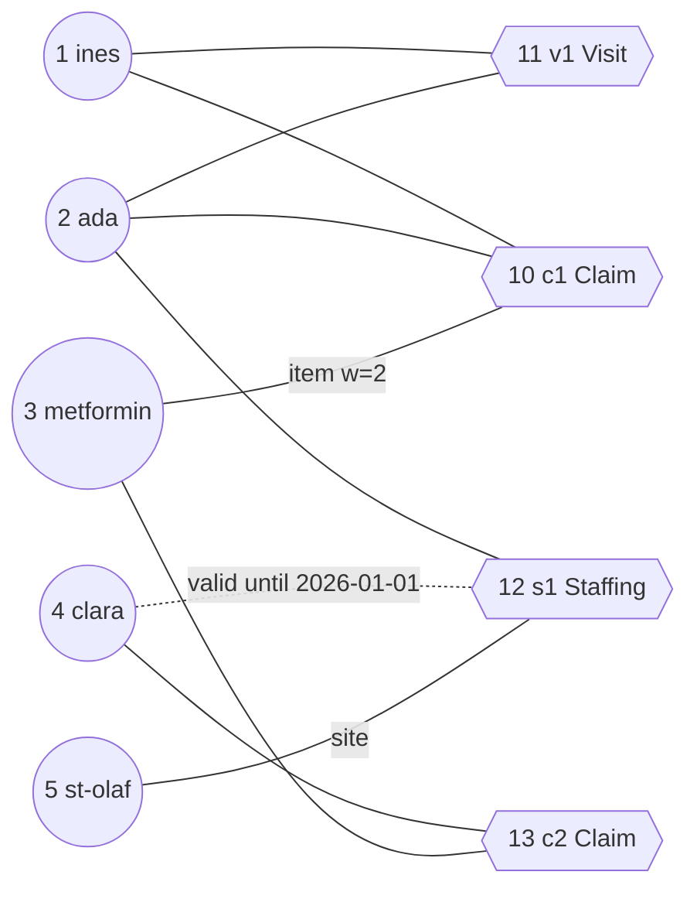
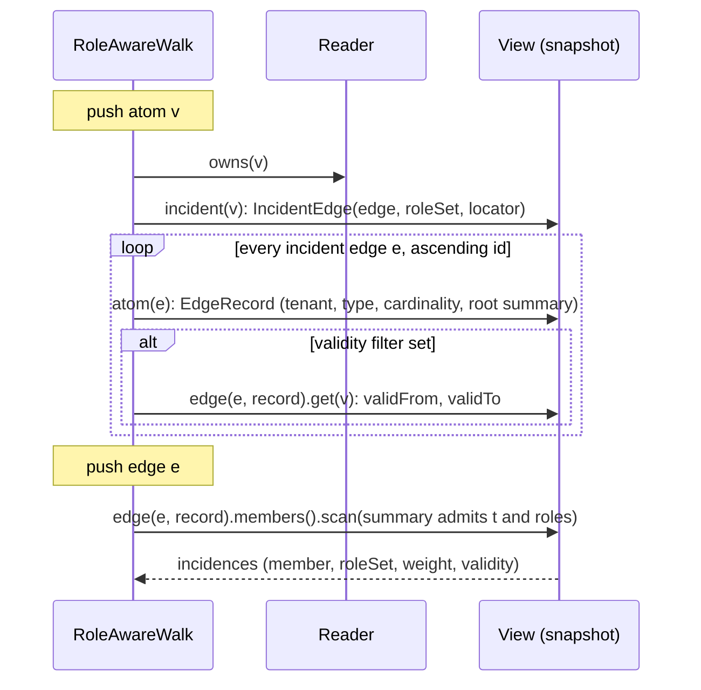

# Role-aware random walk with restart

Status: proposed. Nothing on this page is implemented yet.

This page specifies a personalized PageRank over HStore hyperedges in which the step from an atom to a hyperedge and
the step from a hyperedge to a member depend on the member's roles, the incidence weight, validity at a time `t`,
the reader's tenant and a cheap query factor. It covers the walk itself, the literature it rests on, a local push
algorithm that does not pay `|M(e)|` for every push into a huge hyperedge, its error certificate and work bound, how
it reads HStore's trees, and what it costs.

It is one of three related retrieval pages:

| Page | Question it answers | Score |
|---|---|---|
| this page | which atoms and hyperedges are associated with the seeds, counting every path | sum over all walks (personalized PageRank) |
| [query-directed-expansion.md](query-directed-expansion.md) | which hyperedges are reachable from the seeds through one strong, explainable chain | maximum over single paths |
| [budgeted-associative-retrieval.md](budgeted-associative-retrieval.md) | which set of hyperedges to hand to an agent under a size or cost budget | set objective over candidates |

The relevance score `r(e|q)` used by all three is RTHR's `S(q, e)` from
[role-time-aware-scoring.md](role-time-aware-scoring.md), with its bound `U(e)`, called through the `Scorer` interface
of [role-constrained-hyperedge-retrieval.md](role-constrained-hyperedge-retrieval.md) (RCHR), which also does exact
retrieval by members, roles and validity. Both pages are written in parallel with this one and are treated here as
interfaces.

## Problem

### The proposal, made precise

The proposal reads: walk alternating between entities and hyperedges, with transition probabilities conditioned on
role, edge weight, temporal validity and query relevance, ranked with personalized PageRank or a restart-based walk.
The table maps each phrase to a concrete element of the model below.

| Phrase in the proposal | Element of the model |
|---|---|
| alternating between entities and hyperedges | a Markov chain on atoms, one step = atom -> containing hyperedge -> member |
| conditioned on role | factors `rho_out(R)` on leaving an atom that plays role set `R` in `e`, `rho_in(R)` on entering a member that plays `R` |
| conditioned on edge weight | `omega(e)` for the hyperedge, `gamma_e(u)` = incidence weight of `u` in `e` |
| conditioned on temporal validity | only incidences valid at `t` take part; the chain is the walk on the hypergraph as it stood at `t` |
| conditioned on query relevance | the restart vector `s` (seeds weighted by relevance) and a cheap factor `phi(e)`; full `r(e|q)` is applied after the walk, not inside it ([below](#query-relevance-inside-or-outside-the-walk)) |
| personalized PageRank or restart | `pi = alpha * s + (1 - alpha) * pi * P`, restart probability `alpha` per atom visit |

### Transition probabilities

For an atom `v` and a hyperedge `e` that contains it, and for a member `u` of `e`:

```
a(v, e) = omega(e) * rho_out(R(v, e)) * phi(e)        if e is admitted from v, else 0
b(e, u) = max(gamma_e(u), 0) * rho_in(R(u, e))         if u is admitted from e, else 0

P_VE(v, e) = a(v, e) / Σ_f a(v, f)
P_EV(e, u) = b(e, u) / Σ_w b(e, w)
P(v, u)    = Σ_e P_VE(v, e) * P_EV(e, u)
```

`R(v, e)` is the incidence's role set (`Incidence.roleSet`), and a role-set factor is the largest factor of the roles
it contains. Admission is where validity, types and the tenant enter:

| Step | `e` (or `u`) is admitted when |
|---|---|
| atom `v` -> edge `e` | `e` belongs to the reader's tenant, its type is in the query's edge types (all by default), `v`'s incidence in `e` is valid at `t`, and `a(v, e) > 0` |
| edge `e` -> member `u` | `u`'s incidence in `e` is valid at `t` and `b(e, u) > 0` |
| arriving at atom `u` | `u` belongs to the reader's tenant; otherwise `u` is treated as dangling ([below](#tenant-isolation)) |

The member `u` may be `v` itself. Both papers this model comes from allow that self-loop, and it is what makes edge
aggregation exact ([below](#why-aggregating-on-the-edge-is-exact)).

The personalized PageRank vector over atoms with restart distribution `s` is

```
pi = alpha * Σ_{k >= 0} (1 - alpha)^k * s * P^k          (row vectors)
```

`pi(x)` is the probability that a walk started from `s`, which stops at each atom visit with probability `alpha`,
stops at `x`. The vector sums to 1 when `P` is stochastic. Hyperedges get the score

```
pi_E(e) = (1 - alpha) * Σ_v pi(v) * P_VE(v, e)
```

`pi_E(e) / alpha` is the expected number of times the walk passes through `e` before it stops. `pi_E` sums to
`1 - alpha`.

### Dangling atoms and edges

After filtering, an atom can have no admitted hyperedge (every incidence expired, or every edge of another tenant),
and a hyperedge can have no admitted member. Its row of `P` would be zero and the chain would leak probability. We
send that mass back to the restart distribution: a dangling row is replaced by `s`. That keeps `P` stochastic for
every choice of filters: `pi` still sums to 1 and the error certificate below stays exact. The alternative,
absorbing the mass, makes scores depend on how much mass leaked, which changes rankings in ways that are hard to
explain to a caller.

### Running example

Five atoms and four hyperedges. Ids are chosen so that tie-breaking by id is easy to follow.

```
 atoms                                     hyperedges (member: role, weight)
 1  ines       Patient                     10 c1 Claim     {1: patient 1, 2: provider 1, 3: item 2}
 2  ada        Provider                    11 v1 Visit     {1: patient 1, 2: provider 1}
 3  metformin  Drug                        12 s1 Staffing  {2: staff 1, 4: staff 1 valid [2025-01-01, 2026-01-01), 5: site 1}
 4  clara      Provider                    13 c2 Claim     {4: provider 1, 3: item 1}
 5  st-olaf    Hospital
```



Query: seed `ines`, `alpha = 0.2`, `t = 2026-06-01`, `omega = 1`, `rho_in(site) = 0.5`, all other role factors 1.
At `t`, clara's Staffing incidence has expired, so from `s1` only ada and st-olaf are admitted, and clara can leave
only through `c2`. The resulting rows of `P`:

| from | ines | ada | metformin | clara | st-olaf |
|---|---|---|---|---|---|
| ines | 0.375 | 0.375 | 0.25 | | |
| ada | 0.25 | 0.472 | 0.167 | | 0.111 |
| metformin | 0.125 | 0.125 | 0.5 | 0.25 | |
| clara | | | 0.5 | 0.5 | |
| st-olaf | | 0.667 | | | 0.333 |

Row ines: `I(ines) = {c1, v1}`, each with probability 1/2. `c1` sends 1/4 to ines, 1/4 to ada and 2/4 to metformin
(weight 2); `v1` sends 1/2 each to ines and ada. So `P(ines, ines) = 1/8 + 1/4 = 0.375`. The `site` factor gives
st-olaf weight `1 * 0.5` in `s1`, and `s1` sends 2/3 to ada and 1/3 to st-olaf.

## Literature

### Hypergraph random walks

D. Zhou, J. Huang, B. Schölkopf, *Learning with Hypergraphs: Clustering, Classification, and Embedding*, NIPS 2006
([proceedings](https://proceedings.neurips.cc/paper/2006/hash/dff8e9c2ac33381546d96deea9922999-Abstract.html)).
Section 4 defines the walk this page starts from: from `u`, choose a hyperedge `e` incident to `u` with probability
proportional to `w(e)`, then choose `v` in `e` uniformly; their Eq. (3) is
`p(u, v) = Σ_e w(e) h(u, e) h(v, e) / (d(u) δ(e))`.

U. Chitra, B. J. Raphael, *Random Walks on Hypergraphs with Edge-Dependent Vertex Weights*, ICML 2019,
[arXiv:1905.08287](https://arxiv.org/abs/1905.08287). They replace the uniform member choice with a per-edge vertex
weight `γ_e(v)`. Definition 2: `p(v, w) = Σ_{e ∈ E(v)} (ω(e)/d(v)) (γ_e(w)/δ(e))` with `d(v) = Σ_{e ∋ v} ω(e)`
and `δ(e) = Σ_{v ∈ e} γ_e(v)`, in matrix form `P = D_V^-1 W D_E^-1 R`. The results that matter here:

| Result | Statement (paper's numbering) | Consequence for HStore |
|---|---|---|
| Theorem 4 | with edge-independent vertex weights the walk is equivalent to a walk on the clique graph with some edge weights; the proof uses time-reversibility | a walk that ignores incidence weights and roles carries no information beyond pairwise co-membership |
| Theorem 5 | there are hypergraphs with edge-dependent weights whose walk is not equivalent to any weighted clique-graph walk | weights and roles per incidence give a genuinely higher-order chain; it is also non-reversible in general |
| Section 3 | self-loops are allowed (`p_{v,v} > 0`), so the walk is lazy; they also mention the walk with restart | our `u = v` self-loop is the paper's model, not an artefact |
| Theorem 8 | a mixing-time bound in terms of a Cheeger constant | not used: restart makes mixing irrelevant for ranking |

HStore incidences carry exactly the data this model needs: `Incidence.weight` is `γ_e(v)` and `Incidence.roleSet`
is a per-incidence label. `γ_e(v) * rho(R(v, e))` is therefore still an edge-dependent vertex weight, and Theorem 5 applies
to the role-aware walk. The paper does not use role labels; using them as a multiplicative factor on `γ` is our
choice. K. Hayashi, S. G. Aksoy, C. H. Park, H. Park, *Hypergraph Random Walks, Laplacians, and Clustering*, CIKM 2020
([doi:10.1145/3340531.3412034](https://doi.org/10.1145/3340531.3412034)) builds Laplacians and clustering on the
same edge-dependent model; we only checked its title and venue.

Y. Takai, A. Miyauchi, M. Ikeda, Y. Yoshida, *Hypergraph Clustering Based on PageRank*, KDD 2020,
[arXiv:2006.08302](https://arxiv.org/abs/2006.08302). Their personalized PageRank comes from the nonlinear hypergraph
Laplacian of Li and Milenkovic: for each hyperedge only the members with the largest and smallest value of the current
vector interact (their Eq. 2), and the PageRank is the stationary point of a differential inclusion that they simulate
with the Euler method. It captures cuts better than a linear walk, but it is not linear in the starting vector, so the
push decomposition below (which needs `pr(x + y) = pr(x) + pr(y)`) does not apply, and roles have no place in it. We do
not adopt it.

### Personalized PageRank and local push

G. Jeh, J. Widom, *Scaling Personalized Web Search*, WWW 2003
([doi:10.1145/775152.775191](https://doi.org/10.1145/775152.775191)), and T. H. Haveliwala, *Topic-Sensitive
PageRank*, WWW 2002 ([doi:10.1145/511446.511513](https://doi.org/10.1145/511446.511513)), personalize PageRank through
the restart vector. Biasing the restart vector toward what the query is about is the standard way to make the walk
query-aware without touching the transition matrix, and it is what we do with `s`.

R. Andersen, F. Chung, K. Lang, *Local Graph Partitioning using PageRank Vectors*, FOCS 2006
([doi:10.1109/FOCS.2006.44](https://doi.org/10.1109/FOCS.2006.44)). We read the authors' full version, *Using
PageRank to Locally Partition a Graph*; the numbering below is from it. On an undirected graph with the lazy walk
`W = (I + D^-1 A) / 2` and `pr_α(s) = α s + (1 - α) pr_α(s) W`:

| Item | Statement |
|---|---|
| invariant | the algorithm keeps `p = pr_α(s - r)` with `r >= 0`; each `push(u)` moves `α r(u)` into `p(u)` and spreads the rest by one lazy step (Lemma 1) |
| stopping rule | push only vertices with `r(u) >= ε d(u)`; at the end `r(u) < ε d(u)` everywhere (an ε-approximate PageRank vector, Definition 1) |
| Theorem 1 | running time `O(1 / (ε α))`, and `vol(Supp(p)) <= 2 / ((1 - α) ε)`, independent of the graph size |
| proof of Theorem 1 | each push at a vertex of degree `d_i` removes at least `α ε d_i` from `‖r‖₁`, which starts at most 1, so `Σ d_i <= 1 / α` |
| queue | a FIFO queue; the paper attributes a `log n` overhead in Jeh and Widom's and Berkhin's versions to their use of a heap |

The invariant and the work argument only need a stochastic matrix, and that is what our derivation reuses. ACL also
bound the error on a vertex set `S` in terms of `ε` and `vol(S)` (their Section 5), for the undirected walk; we did not
check whether that argument survives a non-reversible walk, so we do not claim it.

### Monte Carlo and combined estimators

D. Fogaras, B. Rácz, K. Csalogány, T. Sarlós, *Towards Scaling Fully Personalized PageRank: Algorithms, Lower Bounds,
and Experiments*, Internet Mathematics 2005
([doi:10.1080/15427951.2005.10129104](https://doi.org/10.1080/15427951.2005.10129104)): Monte Carlo estimation of
personalized PageRank from sampled walks.

S. Wang, R. Yang, X. Xiao, Z. Wei, Y. Yang, *FORA: Simple and Effective Approximate Single-Source Personalized
PageRank*, KDD 2017 ([doi:10.1145/3097983.3098072](https://doi.org/10.1145/3097983.3098072)); extended version
[arXiv:1908.10583](https://arxiv.org/abs/1908.10583), which is what we read. FORA runs forward push until
`r(s, v) / |N_out(v)| <= r_max`, then starts random walks from the residuals. Its guarantee (Definition 2.1) is a
relative error `ε` for every node with `π(s, v) > δ`, with probability at least `1 - p_f`. The number of walks is
`ω = r_sum (2ε/3 + 2) log(2/p_f) / (ε² δ)`, split over nodes in proportion to their residual, and the overall cost is
`O(min{ sqrt(m log(2/p_f)) / (ε sqrt(δ)), log(2/p_f) / (ε² δ) })` for `m` edges. The invariant it builds on,
`π(s, t) = p(s, t) + Σ_v r(s, v) π(v, t)`, is the one from Andersen et al.

P. Lofgren, S. Banerjee, A. Goel, C. Seshadhri, *FAST-PPR: Scaling Personalized PageRank Estimation for Large
Graphs*, KDD 2014 ([doi:10.1145/2623330.2623745](https://doi.org/10.1145/2623330.2623745)), estimates a single pair
`π(s, t)` above a threshold `δ` in average time `O(sqrt(d / δ))` on directed graphs with average in-degree `d`.
Bidirectional estimators of this kind answer "how related is `t` to `s`" for a given `t`. Retrieval asks for the top
targets without knowing them. Pairwise estimators can re-check a short candidate list; they cannot produce it.

## The algorithm

### State space: atoms and hyperedge nodes

We run the push on the star expansion: one node per atom and one node per hyperedge. Restart happens only at atom
nodes. A hyperedge node keeps no estimate; it only collects residual and passes it on.

```
          a(v,e)/Σa                    b(e,u)/Σb
 atom v ─────────────────> edge e ─────────────────> atom u
   │  keeps alpha * r(v)      keeps nothing             │
   └── restart: stop with probability alpha at every atom visit
```

| Node | Residual | Push cost | Push threshold |
|---|---|---|---|
| atom `v` | `r_V(v)` | one pass over `I(v)` | `r_V(v) >= epsilon * deg(v)` |
| edge `e` | `r_E(e)` | one pass over `M(e)` | `r_E(e) >= epsilon * |M(e)|` |

`deg(v)` and `|M(e)|` here are the raw counts that HStore keeps in `O(1)`: `View.degree` (the reverse posting count)
and `EdgeRecord.cardinality()`. They count incidences that filters will reject, which is right for a threshold whose job
is to pay for the pass that reads them. They are never used as normalizers: the normalizers `Σ a` and `Σ b` are summed
over the admitted incidences during the pass.

### Why aggregating on the edge is exact

The step `e -> u` does not depend on which atom the walker entered `e` from. Mass that reaches `e` from ten different
atoms can therefore be added into one `r_E(e)` and pushed out in one pass of `M(e)`, and the result equals ten separate
passes. A huge hyperedge is read only when it has collected at least `epsilon * |M(e)|` of mass, and its cost is paid
for by the mass it moves, exactly as ACL's threshold pays for a high-degree vertex.

This breaks if the exit factor depends on the entry. A role-pair factor `rho(R_entry, R_exit)` (for example "from a
patient go preferably to the provider") makes `e -> u` depend on how the walker arrived. The fix is to split the edge
node by entry role set: state `(e, R_entry)`. Aggregation is exact again per state, and the cost is one pass of `M(e)`
per distinct entry role set that collects enough mass. Edge types declare few roles (`TypeDef.roles`), which keeps the number of
states per edge small. Factorized factors `rho_out * rho_in` are the default because they keep one state per edge.

### Push rules

```
init:   r_V = s on atoms, r_E = s on hyperedges, p = 0, A = 0

push atom v (m = r_V(v)):
    p(v) += alpha * m ;  r_V(v) = 0
    if v is not in the tenant:      restart((1 - alpha) * m)                    (dangling)
    else
        X = admitted hyperedges of v with a(v, e)
        if Σ a = 0:                  restart((1 - alpha) * m)                    (dangling)
        else for e in X:  d = (1 - alpha) * m * a(v, e) / Σ a ;  r_E(e) += d ;  A(e) += d

push edge e (m = r_E(e)):
    r_E(e) = 0
    Y = admitted members of e with b(e, u)
    if Σ b = 0:                      restart(m)                                  (dangling)
    else for u in Y:  r_V(u) += m * b(e, u) / Σ b

restart(d):  add d * s(x) to the residual of every seed x, atom or hyperedge

repeat while some node is over its threshold and the budget allows
result:  atom estimates p,  hyperedge estimates q(e) = alpha * A(e)
```

`A(e)` is the total mass that ever arrived at `e`. Since `p(v) = alpha * (mass pushed out of v)`, the mass that
arrived at `e` is `Σ_v (p(v) / alpha) (1 - alpha) P_VE(v, e)`, so `alpha * A(e) = (1 - alpha) Σ_v p(v) P_VE(v, e)`, the
same formula as `pi_E` with `p` in place of `pi`.

### Order of pushes and determinism

Any order of pushes gives a valid result. We use a priority queue keyed by `r(x) / (epsilon * cost(x))`: the node
that is most overdue is pushed first, which moves the most mass per incidence read when a budget cuts the run short.
ACL use a FIFO queue to save the `log` factor; with a budget we prefer moving mass early. Ties are broken by atoms
before hyperedges, then by ascending id. Incident edges are visited in posting order (ascending edge id) and members in
membership-tree order, and every floating point sum is accumulated in the same order. For one snapshot and one set of
parameters the result is bit-for-bit reproducible.

### Error certificate

Let `pr(x) = alpha * Σ_k (1 - alpha)^k x P^k`, where mass on a hyperedge node is first mapped through `P_EV`. Because
`P` is stochastic (dangling rows go to `s`), `pr` is linear and `‖pr(x)‖₁ = ‖x‖₁` for `x >= 0`. Each push keeps the
invariant

```
pi = p + pr(r_V) + pr(r_E P_EV)
```

which is ACL's Lemma 1 with one walk step split into its two halves. Every term on the right is non-negative. At
any point of the run, finished or cut off by a budget:

| Quantity | Bound |
|---|---|
| any atom `x` | `p(x) <= pi(x) <= p(x) + ‖r_V‖₁ + ‖r_E‖₁` |
| all atoms | `‖pi - p‖₁ = ‖r_V‖₁ + ‖r_E‖₁` exactly |
| all hyperedges | `‖pi_E - q‖₁ = (1 - alpha) * (‖r_V‖₁ + ‖r_E‖₁)`, with `q <= pi_E` |

The residual sum is known at every moment, and the result carries it as its own L1 error. That is the only guarantee we
state. Per-vertex or per-set bounds in terms of `epsilon` and degrees are proved for undirected graphs, and Chitra and
Raphael's Theorem 5 says our walk is in general not reversible, so we do not rely on them. For a single ranking the
certificate is often loose; when it is not enough, the FORA step below turns it into a relative error with a failure
probability.

### Work bound

The derivation follows ACL's proof of Theorem 1.

1. `‖r_V‖₁ + ‖r_E‖₁` starts at 1 and never grows. An atom push of mass `m` removes `alpha * m` from it, at least
   `alpha * epsilon * deg(v)`. Dangling mass goes back to the seeds: it is not removed, but it is not created
   either. Hence `Σ deg(v_i) <= 1 / (alpha * epsilon)` over all atom pushes, and the total mass pushed out of atoms is
   at most `1 / alpha`.
2. An edge push removes nothing, but every unit of mass it moves arrived from an atom push, so all edge pushes together
   move at most `(1 - alpha) / alpha`. Each one moves at least `epsilon * |M(e)|`, so
   `Σ |M(e_j)| <= (1 - alpha) / (alpha * epsilon)`.
3. Together: at most `(2 - alpha) / (alpha * epsilon)` incidence reads for seeds on atoms. Seeds placed on hyperedges
   add at most `‖s_E‖₁ / epsilon`.

| `alpha` | `epsilon` | incidence reads, at most |
|---|---|---|
| 0.15 | `1e-3` | 12,333 |
| 0.15 | `1e-4` | 123,333 |
| 0.2 | `1e-4` | 90,000 |
| 0.5 | `1e-4` | 30,000 |

The number of distinct nodes that ever hold mass is bounded by the same quantity, which bounds the memory.

### Huge hyperedges

The threshold `epsilon * |M(e)|` already stops a hyperedge of a million members from being read for small amounts of
mass. Its residual then simply stays in `r_E(e)` and shows up in the certificate. Two situations still need care.

When a budget is about to run out and the most overdue node is a huge hyperedge, reading it would spend the remaining
budget on one node. The queue order handles the common case (a big edge with a small overdue ratio waits). We do not
add a special rule.

When the certificate is dominated by residual stuck on huge hyperedges, an unbiased alternative to a full pass is to
sample. Draw `K` members with probability proportional to `b(e, u)` and give each `r_E(e) / K`. Without role factors and
validity filters, and when `Summary.weightMin >= 0`, sampling by weight is a descent through the membership tree using
each child's `Summary.weightSum`, `O(height)` per sample, the same descent `Tree.at(rank)` does with counts. With
filters, sample by weight and reject members that are not admitted; the acceptance rate is unknown in advance and the
number of trials needs a cap. Sampling makes the result random (seeded, so still reproducible) and replaces the exact
certificate with a probabilistic one, which is FORA's trade. It is not part of the first version.

### FORA completion

If a caller needs FORA's guarantee (relative error `epsilon_r` for every atom with `pi(x) > delta`, probability
`1 - p_f`), the push above is FORA's first phase, and the second phase starts
`omega = r_sum (2 epsilon_r / 3 + 2) log(2 / p_f) / (epsilon_r² delta)` walks from the residuals. One HStore walk step from
an atom has to sample an incident edge by `a(v, e)`, which needs the edge records of `I(v)`; caching the cumulative
`a` per visited atom for the duration of the query makes repeated steps from hubs cheap. This is specified for
completeness and is not part of the first version.

### Query relevance inside or outside the walk

The proposal puts query relevance into the transition probabilities. Doing that with the full score `r(e|q)` from
RTHR would mean scoring every incident hyperedge of every pushed atom, because the normalizer
`Σ_f a(v, f)` needs all of them. If the member component of the score reads `M(e)`, an atom push costs
`Σ_{e ∈ I(v)} |M(e)|` instead of `|I(v)|`, and the work bound above is gone.

We split relevance three ways:

| Where | What | Cost |
|---|---|---|
| restart vector `s` | seeds weighted by their relevance (topic-sensitive PageRank) | none during the walk |
| `phi(e)` in `a(v, e)` | RTHR's bound `U(e)` from `Scorer.bound(query, Evidence.Catalog(edge, type, summary))`: only the `EdgeRecord` and the root `Summary` (type, validity envelope, role bits, cardinality); components that need postings are taken as 1 | one catalog read, already paid for the tenant check |
| after the walk | full `r(e|q)` on the top hyperedges, combined with `q(e)` by the caller ([budgeted-associative-retrieval.md](budgeted-associative-retrieval.md)) | only for the returned candidates |

Using an upper bound as a transition factor is a heuristic: it only damps hyperedges that certainly score low.

### Higher-order hyperedges

A member can itself be a hyperedge. When the walk lands on such a member `u`, it is an atom like any other: it leaves
through `I(u)`, the hyperedges that contain it. The walk does not descend into `M(u)`. A "descend" step with its own
probability is easy to add (one more transition type), but its probability would be one more parameter without a
principled default. It is left out. `EXPAND` (`Hora.expand`) already unfolds nested hyperedges when a caller wants
that.

## Worked example

The running example with `epsilon = 0.02`. Push thresholds are `epsilon * deg(v)` for atoms (ines 0.04, ada 0.06,
metformin 0.04, clara 0.04, st-olaf 0.02) and `epsilon * |M(e)|` for hyperedges (c1 0.06, v1 0.04, s1 0.06, c2 0.04).
`s1` counts 3 members although only 2 are admitted at `t`. The first eight pushes:

| # | push | mass | `p` after | `r_V` after | `r_E` after |
|---|---|---|---|---|---|
| 1 | ines | 1.0 | ines 0.2 | | c1 0.4, v1 0.4 |
| 2 | v1 | 0.4 | | ines 0.2, ada 0.2 | c1 0.4 |
| 3 | c1 | 0.4 | | ines 0.3, ada 0.3, metformin 0.2 | |
| 4 | ines | 0.3 | ines 0.26 | ada 0.3, metformin 0.2 | c1 0.12, v1 0.12 |
| 5 | ada | 0.3 | ada 0.06 | metformin 0.2 | c1 0.2, v1 0.2, s1 0.08 |
| 6 | metformin | 0.2 | metformin 0.04 | | c1 0.28, v1 0.2, s1 0.08, c2 0.08 |
| 7 | v1 | 0.2 | | ines 0.1, ada 0.1 | c1 0.28, s1 0.08, c2 0.08 |
| 8 | c1 | 0.28 | | ines 0.17, ada 0.17, metformin 0.14 | s1 0.08, c2 0.08 |

Step 2 pushes `v1` before `c1`: both hold 0.4, but `v1`'s ratio is `0.4 / 0.04 = 10` against `0.4 / 0.06`. Step 5 is a
tie between ada and metformin (ratio 5 each), broken by id. In step 5, ada's mass goes to `c1`, `v1` and `s1` in equal
parts (`omega = 1`, role factors 1). In step 8, `c1` pushes the 0.28 it collected from ines (step 4), ada (step 5) and
metformin (step 6) in one pass of its three members; that is the aggregation at work.

The run stops after 51 pushes and 115 incidence reads (the bound is `(2 - 0.2) / (0.2 * 0.02) = 450`). The table
compares it with smaller `epsilon` and with the exact solution of `pi = 0.2 s + 0.8 pi P` (dense solve, 5 atoms):

| `epsilon` | pushes | reads | `‖r‖₁` | ines | ada | metformin | clara | st-olaf |
|---|---|---|---|---|---|---|---|---|
| 0.05 | 15 | 35 | 0.514 | 0.294 | 0.094 | 0.099 | 0 | 0 |
| 0.02 | 51 | 115 | 0.214 | 0.350 | 0.186 | 0.180 | 0.050 | 0.021 |
| 0.005 | 106 | 239 | 0.056 | 0.384 | 0.238 | 0.224 | 0.070 | 0.028 |
| 0.001 | 171 | 386 | 0.012 | 0.391 | 0.251 | 0.238 | 0.079 | 0.030 |
| exact | | | 0 | 0.393 | 0.255 | 0.241 | 0.080 | 0.031 |

Every estimate is below the exact value and within `‖r‖₁` of it, as the certificate says. At `epsilon = 0.02` the
ranking of atoms is already the exact ranking. At `0.05` it is not (metformin is above ada, clara and st-olaf are
missing), and the certificate of 0.514 says so. The hyperedge scores `q` at `epsilon = 0.001` are c1 0.318, v1 0.223,
c2 0.158, s1 0.091, against exact values 0.322, 0.225, 0.161, 0.093.

The example also shows what validity does: at `t` clara is related to ines only through metformin and `c2`. Without
the time filter `s1` also connects her through ada, and her exact score rises from 0.080 to 0.123.

## Implementation in HStore

### What carries over and what does not

| Assumption in the literature | HStore reality | What we do |
|---|---|---|
| graph in memory, adjacency as arrays | `I(v)` is a posting list in slot 2 (`REVERSE`), `M(e)` a membership tree inline in the catalog record or in its own pages | one atom push = one posting scan plus one catalog read per incident edge; one edge push = one membership scan |
| degree is the normalizer | `View.degree` and `EdgeRecord.cardinality()` are `O(1)` but count everything; filters reject some incidences | raw counts for thresholds, filtered sums for normalizers ([state space](#state-space-atoms-and-hyperedge-nodes)) |
| non-negative edge weights | `Weight.of` accepts negative values | `gamma = max(weight, 0)`; a negative incidence weight means "never step here" |
| hyperedges have a weight `ω(e)` | `EdgeRecord` has no weight field | `omega(e)` = per-type factor from the query, optionally times a numeric property of `e` (one `PROPERTIES` lookup per edge, cached per query); default 1 |
| one static graph | snapshots, branches, `readAt` | the walk runs on one `Reader`; everything it reads comes from that snapshot |
| one tenant | edges and members are tenant-scoped; postings can name other tenants' edges | tenant checks on both steps ([below](#tenant-isolation)) |
| roles are vertex labels, if any | roles are per incidence, a role set per member per edge | `rho_out`, `rho_in` keyed by role-set id, resolved once per query |
| static validity | half-open `[validFrom, validTo)` per incidence, indexed in the membership summaries | validity at `t` is an admission rule; member scans prune subtrees with `Summary.mayBeValidAt(t)` |

### Reading one push



The role set of `v` in `e` comes from the reverse posting (`IncidentEdge.roleSet`). The exit factor needs no read
of `e`'s members. The validity of `v`'s incidence is not in the posting (the `REVERSE_INCIDENCE` derivation ignores
weight and validity updates, [topology](../docs/storage/topology.md#the-reverse-incidence-index)), so with a time filter
each incident edge costs one more lookup in its membership tree. For the common small edge that tree is inline in the
catalog record, which the tenant check has already read.

Role factors are resolved per role-set id the first time one is seen, through `Dictionary.roles(roleSet)` (cached in
the dictionary) and the query's role-name table. `Dictionary.roleSetsContaining(role)` scans the whole symbols slot and
is not used.

### Storage: no new slots

Every quantity the walk needs is already stored: postings with role sets in slot 2, edge records with cardinality and
summaries in slot 1, incidences in the membership trees. The candidates for a new slot would be precomputed
normalizers or a precomputed PageRank, and neither survives contact with the query:

| Possible slot | Why not |
|---|---|
| per-atom `Σ ω(e)` | depends on the edge types, roles, `t` and tenant of each query |
| per-edge `Σ γ` | already in `Summary.weightSum` for the unfiltered case; filtered sums depend on the query |
| precomputed PPR per hub | invalidated by every membership change near the hub, and specific to one parameter set |

Each would cost `O(log n)` tree updates per membership change for a value most queries cannot use.

### Tenant isolation

| Point | Rule |
|---|---|
| seeds | given by the caller as ids, checked with `Reader.require`; seeds from semantic search are already filtered by `Reader.visible` |
| atom push | `Reader.owns(v)` before `View.incident(v)`; in a single-tenant database `owns` is free, otherwise it is one catalog read |
| incident edges | the edge's `EdgeRecord.tenant()` must equal `Reader.tenant()`; postings can name another tenant's edges, and this check is not optional |
| members | members of an owned edge are not checked during the edge push, because that would cost a catalog read per member; a member that is not owned is caught when it is pushed and treated as dangling, so its incident edges are never read and it never appears in the result |
| cost of an unchecked atom | the push threshold of an atom that has not yet been checked uses cost 1; `View.degree` is called only after `owns` succeeds |
| output | only atoms that passed `owns` at push time and edges that passed the record check carry scores |

Writers can no longer add another tenant's atom to an edge (`Writer.incidence`). Unowned members only exist in
databases written before that check ([security](../docs/database/security.md)). The walk handles them anyway.

### Budgets

| Budget | Charged | When exhausted |
|---|---|---|
| `Budget.Meter` rows | one per incidence read (a push charges its raw cost before reading) | stop, return estimates with the current certificate and `exhausted = true` |
| `Budget.maxTime` | checked by the meter | same |
| `IoTrace` page budget | every page visit, by the engine | `IoTrace` throws `ABORTED_RESOURCE_LIMIT`; the run is lost |

The page budget is a hard limit today. An anytime algorithm needs to see it coming. We propose a small accessor on
`IoTrace` that reports the visits so far of the trace bound to the current thread. With it, the walk stops at, say,
90% of the page budget and returns a partial result. This is a code change, not a format change.

### API

The package is `io.hstore.db.retrieve`. Names are provisional.

```java
public record RoleFactors(Map<String, Double> exit, Map<String, Double> entry) {}

public record TransitionModel(Set<String> edgeTypes, Map<String, Double> typeWeight, Optional<String> weightProperty,
                              RoleFactors roles, OptionalLong validAt, boolean rolePairs) {}

public record WalkParams(double alpha, double epsilon, int topAtoms, int topEdges) {}

public sealed interface WalkNode permits WalkNode.AtomNode, WalkNode.EdgeNode {
    record AtomNode(long atom) implements WalkNode {}
    record EdgeNode(long edge, int entryRoleSet) implements WalkNode {}
}

public record Scored(long id, double estimate, double upper) {}

public record WalkResult(List<Scored> atoms, List<Scored> edges, double residual, long reads, boolean exhausted) {}

WalkResult result = RoleAwareWalk.on(reader)
        .run(Map.of(new WalkNode.AtomNode(ines), 1.0), model, new WalkParams(0.2, 1e-4, 50, 50), Budget.DEFAULT);
```

`Scored.upper` is `estimate + residual` for atoms and `estimate + (1 - alpha) * residual` for hyperedges.

The core of the push loop:

```java
final class RoleAwareWalk {

    private record Due(WalkNode node, double ratio) {}

    private static final Comparator<Due> ORDER = Comparator.comparingDouble(Due::ratio).reversed()
            .thenComparingInt(due -> due.node() instanceof WalkNode.EdgeNode ? 1 : 0)
            .thenComparingLong(due -> switch (due.node()) {
                case WalkNode.AtomNode(long atom) -> atom;
                case WalkNode.EdgeNode(long edge, int _) -> edge;
            });

    private final Reader reader;
    private final View view;
    private final Transitions transitions;
    private final WalkParams params;
    private final Map<WalkNode, Double> seeds;
    private final Map<WalkNode, Double> residual = new HashMap<>();
    private final Map<WalkNode, Long> cost = new HashMap<>();
    private final Map<Long, Double> estimate = new HashMap<>();
    private final Map<Long, Double> arrived = new HashMap<>();
    private final PriorityQueue<Due> queue = new PriorityQueue<>(ORDER);

    WalkResult run(Budget.Meter meter) {
        seeds.forEach((node, share) -> {
            if (node instanceof WalkNode.EdgeNode(long edge, int _)) {
                cost.put(node, Math.max(1, reader.cardinality(edge)));
            }
            add(node, share);
        });
        while (!queue.isEmpty()) {
            WalkNode node = queue.poll().node();
            double mass = residual.getOrDefault(node, 0.0);
            long reads = cost.getOrDefault(node, 1L);
            if (mass < params.epsilon() * reads) {
                continue;
            }
            if (!meter.tryConsume(reads)) {
                return result(true);
            }
            residual.remove(node);
            switch (node) {
                case WalkNode.AtomNode(long atom) -> pushAtom(atom, mass);
                case WalkNode.EdgeNode(long edge, int entry) -> pushEdge(edge, entry, mass);
            }
        }
        return result(false);
    }

    private void pushAtom(long atom, double mass) {
        if (!reader.owns(atom)) {
            restart(mass * (1 - params.alpha()));
            return;
        }
        WalkNode self = new WalkNode.AtomNode(atom);
        long degree = Math.max(1, view.degree(atom));
        if (cost.getOrDefault(self, 1L) != degree) {
            cost.put(self, degree);
            add(self, mass);
            return;
        }
        estimate.merge(atom, params.alpha() * mass, Double::sum);
        List<Transitions.Exit> exits = transitions.exits(view, reader.tenant(), atom);
        double total = exits.stream().mapToDouble(Transitions.Exit::weight).sum();
        double moving = (1 - params.alpha()) * mass;
        if (total <= 0) {
            restart(moving);
            return;
        }
        for (Transitions.Exit exit : exits) {
            double share = moving * exit.weight() / total;
            WalkNode target = new WalkNode.EdgeNode(exit.edge(), exit.entryRoleSet());
            cost.putIfAbsent(target, exit.cardinality());
            arrived.merge(exit.edge(), share, Double::sum);
            add(target, share);
        }
    }

    private void pushEdge(long edge, int entryRoleSet, double mass) {
        List<Transitions.Step> steps = transitions.members(view, reader.tenant(), edge, entryRoleSet);
        double total = steps.stream().mapToDouble(Transitions.Step::weight).sum();
        if (total <= 0) {
            restart(mass);
            return;
        }
        steps.forEach(step -> add(new WalkNode.AtomNode(step.member()), mass * step.weight() / total));
    }

    private void restart(double mass) {
        seeds.forEach((seed, share) -> add(seed, mass * share));
    }

    private void add(WalkNode node, double mass) {
        double now = residual.merge(node, mass, Double::sum);
        queue.add(new Due(node, now / (params.epsilon() * cost.getOrDefault(node, 1L))));
    }
}
```

Stale queue entries are skipped by the threshold check after `poll`. The atom branch handles the cost-1 placeholder:
the first time an atom is popped and `owns` succeeds, its real degree is recorded and it goes back into the queue, so
the next pop compares its mass with `epsilon * deg(v)` and charges the meter `deg(v)`. That adds at most one queue
operation and one read per distinct atom, which the work bound already covers. `Transitions` holds the admission rules and factors and is shared with
[query-directed-expansion.md](query-directed-expansion.md):

```java
final class Transitions {

    record Exit(long edge, int entryRoleSet, double weight, long cardinality) {}

    record Step(long member, int roleSet, double weight) {}

    List<Exit> exits(View view, int tenant, long atom) {
        List<Exit> exits = new ArrayList<>();
        view.incident(atom).forEach(incident -> ownedEdge(view, tenant, incident.edge())
                .filter(this::admitsType)
                .filter(record -> validAt.stream().allMatch(t -> view.edge(incident.edge(), record).get(atom)
                        .map(found -> found.validAt(t)).orElse(false)))
                .ifPresent(record -> {
                    double weight = omega(record) * exitFactor(incident.roleSet()) * queryFactor(record);
                    if (weight > 0) {
                        exits.add(new Exit(incident.edge(), entryKey(incident.roleSet()), weight, record.cardinality()));
                    }
                }));
        return exits;
    }

    List<Step> members(View view, int tenant, long edge, int entryRoleSet) {
        return ownedEdge(view, tenant, edge)
                .map(record -> view.edge(edge, record).members()
                        .scan(summary -> validAt.stream().allMatch(summary::mayBeValidAt))
                        .map(Entry::value)
                        .filter(incidence -> validAt.stream().allMatch(incidence::validAt))
                        .map(incidence -> new Step(incidence.member(), incidence.roleSet(),
                                Math.max(incidence.weightValue(), 0) * entryFactor(entryRoleSet, incidence.roleSet())))
                        .filter(step -> step.weight() > 0)
                        .toList())
                .orElse(List.of());
    }

    static Optional<EdgeRecord> ownedEdge(View view, int tenant, long id) {
        return view.atom(id).flatMap(record -> record instanceof EdgeRecord edge && edge.tenant() == tenant
                ? Optional.of(edge)
                : Optional.empty());
    }
}
```

`entryKey` returns 0 unless role pairs are enabled, in which case it returns the entry role set and the hyperedge node
is split by it. `entryFactor(entry, exit)` is `rho_in(exit)` in factorized mode and `rho(entry, exit)` in pair mode.

### Execution and parallelism

The first version is single-threaded. A push reads residuals that the previous push wrote, and pushes do not
parallelize without changing the result, and the reproducibility above matters more for a database query than a
constant factor. A run is bounded by `(2 - alpha) / (alpha * epsilon)` incidence reads, which keeps one query on one
virtual thread (the server runs sessions on `newVirtualThreadPerTaskExecutor`) short. Two parallel forms are known and
are left for later: synchronous rounds, where all nodes over threshold push from the same residual vector and the
contributions are summed in a fixed order (deterministic, more total work), and the FORA walk phase, where walks are
independent and their hit counts are integers, so any summation order gives the same result.

## Complexity

Notation: `N` = atoms in the catalog, `deg(v)` and `|M(e)|` raw counts, `h` = height of a membership tree, `Q` =
queue size.

| Part | Literature | HStore |
|---|---|---|
| total pushed incidences | `O(1 / (epsilon alpha))` (ACL Theorem 1, undirected graph) | at most `(2 - alpha) / (alpha epsilon)`, any stochastic walk (derived above) |
| one incidence on the atom side | `O(1)` array read | one posting read plus one catalog read `O(log_B N)`; plus `O(h)` for validity |
| one incidence on the edge side | `O(1)` | amortized `O(1)` in a membership scan, subtrees pruned by `Summary` |
| queue | FIFO `O(1)` | heap `O(log Q)` |
| memory | `vol(Supp(p)) <= 2 / ((1 - alpha) epsilon)` | `O((2 - alpha) / (alpha epsilon))` map entries |
| error | `r(u) < epsilon d(u)`; per-vertex accuracy by symmetry | `‖pi - p‖₁ = ‖r‖₁`, reported; no per-atom bound beyond it |
| relative error w.h.p. | FORA: `O(min{ sqrt(m log(2/p_f)) / (eps sqrt(delta)), log(2/p_f) / (eps² delta) })` | same structure; not in the first version |

## Limits of the first version

| Not supported | Reason | Today |
|---|---|---|
| full `r(e|q)` inside the transition | destroys the locality bound ([above](#query-relevance-inside-or-outside-the-walk)) | restart vector, cheap `phi(e)`, re-ranking after the walk |
| per-atom error bound | the walk is not reversible | L1 certificate |
| sampled pushes on huge hyperedges, FORA walks | randomness and a probabilistic guarantee need their own tests | residual stays in the certificate |
| descending into nested hyperedges | no principled default probability | `EXPAND` |
| ordered hyperedges with positional transitions | positions ignored; an ordered edge is walked as a set | |
| parallel push | changes the result or adds work | single-threaded |
| nonlinear (Takai et al.) PageRank | not linear in the seeds, no push decomposition | |

### What has to be measured before this ships

The benchmark dataset (`benchmarks/src/main/java/io/hstore/bench/Dataset.java`) has no roles, weights or validity and
caps cardinality at 32. It cannot exercise most of this page. It needs an extension with role sets, incidence
weights, validity intervals and a few hyperedges of 10^5 members or more. Then:

| Question | Measure |
|---|---|
| does the work bound hold in practice | incidence reads and page visits per query against `(2 - alpha) / (alpha epsilon)` |
| how loose is the certificate | `‖r‖₁` against the true L1 error (power iteration on a small dataset) |
| top-k quality | overlap of the top 50 with the exact top 50, per `epsilon` |
| cost of the validity filter | reads and latency with and without `t` |
| multi-tenant overhead | latency with `owns` checks in a database with several tenants, against a single-tenant one |
| huge hyperedges | share of the residual stuck on edges above 10^4 members |
