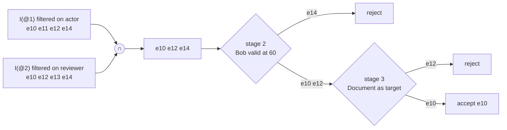
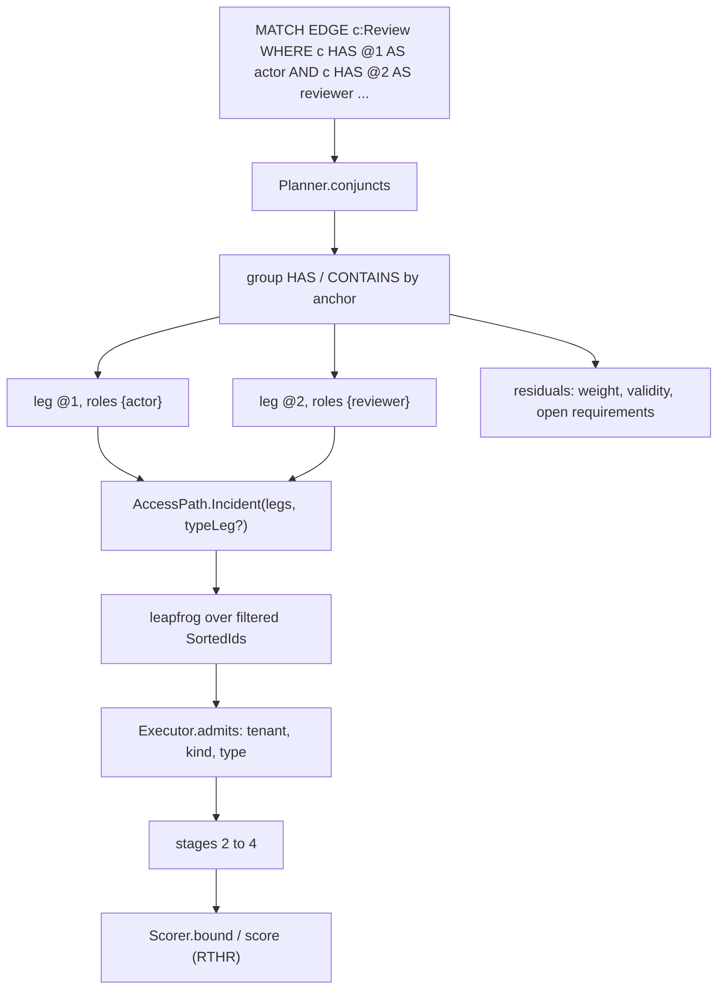

# Role-constrained hyperedge retrieval (RCHR)

Status: the planner part is built (merged legs, role checks on posting values, the incremental role-set index:
`engine/.../index/PostingCursor.java`, `AccessPath.Incident`, `Dictionary.roleSetsWithAll`). The slot 2 summary
change and slot 50 are not. This page says which building blocks exist, where they were slow or inexact, and what
had to change. Scoring is specified separately in `role-time-aware-scoring.md` (RTHR). Here it is only an
interface with upper bounds, and this page is about producing the exact candidate set and filtering it cheaply.

The proposal this page answers: retrieve hyperedges by required members, participant roles, membership weights,
properties and temporal validity, using posting lists and sorted-set intersections to eliminate impossible candidates
before scoring. Example: find groups containing Alice as actor, Bob as reviewer and a document as target.

## Problem

A query `q` names an optional edge type `T`, a list of member requirements `R1..Rn`, edge-level predicates `P` and
optionally a scoring function. A requirement is

```
R = (subject, roles, weight range, validity, multiplicity)
subject      = anchor a          (a known atom, e.g. @Person:'alice')
             | open x:Type       (some member of that atom type, e.g. "a document")
roles        = set of role names, all required            (may be empty)
weight range = [lo, hi] on the membership weight          (default: any)
validity     = AT t | OVERLAPS [f, u)                     (default: any)
multiplicity = at least m distinct members (open only)    (default 1)
```

A hyperedge `e` of type `T` matches when every requirement is satisfied by some incidence of `e`:

| Rule | Statement |
|---|---|
| role | "member plays `r`" means `r ∈ roles(roleSet)`. An incidence with role set `{actor, reviewer}` satisfies a requirement for `actor`, for `reviewer` and for both |
| anchored | the incidence of `a` in `e` exists and satisfies roles, weight and validity |
| open | at least `m` distinct members `v` of `e` with `type(v) = Type` have incidences that satisfy roles, weight and validity |
| non-injective by default | two requirements may be satisfied by the same member, as in `PATTERN`; `DISTINCT` asks for an injective assignment |
| edge predicates | properties of `e`, cardinality and edge-level validity hold |

The output is the set of matching edge ids in ascending order, or the top `k` of them under `score(q, e)`.

The "open with a type" case is what makes this more than an intersection: "a document as target" names no atom, so
there is no posting list to intersect for it.

### Running example

One edge type `Review` with roles `actor`, `reviewer`, `target`. Atoms: Alice `@1`, Bob `@2` (Person), documents
`@3`, `@4` (Document), Carol `@5` (Person). Role names and role sets are symbols; suppose the dictionary assigned:

| symbol id | symbol | `roleBit` |
|---|---|---|
| 4, 5, 6 | role names `actor`, `reviewer`, `target` | |
| 7 | role set `{actor}` | `1 << 7` |
| 8 | role set `{reviewer}` | `1 << 8` |
| 9 | role set `{target}` | `1 << 9` |
| 12 | role set `{actor, reviewer}` | `1 << 12` |

```
e10 = { @1 actor,          @2 reviewer,             @3 target }
e11 = { @1 actor|reviewer, @2 actor,                @4 target }
e12 = { @1 actor,          @2 reviewer,             @5 target }        target is a Person
e13 = { @1 reviewer,       @2 reviewer,             @3 target }
e14 = { @1 actor,          @2 reviewer [0, 50),     @4 target }        Bob left at 50
```

Query: Alice as actor, Bob as reviewer valid at `t = 60`, some Document as target. The answer is `{e10}`. `e11` has
Bob in the wrong role, `e12` has a Person as target, `e13` has Alice in the wrong role, and Bob's membership in `e14`
ended before 60.

## What exists today

| Need | How it is answered today | Exact? | Where it is slow or wrong |
|---|---|---|---|
| `e` contains `a1..an` | `MATCH EDGE e WHERE e CONTAINS (a1..an)`: `AccessPath.Incident`, leapfrog over `View.incidentTree(ai)` (`query/AccessPath.java`) | yes | nothing; this is the base case |
| `a` plays `r` in `e` | `e HAS a AS r`: the same `Incident` leg, then `Evaluator.test` re-reads the incidence (`view().incidence(e, a)`) and checks `roles(roleSet).contains(r)` | the plan is marked inexact (`Planner.exact`) | one catalog lookup and one member lookup per candidate, although the role set is already in the posting |
| several role requirements | each `HAS` conjunct makes its own single-atom `Incident` candidate; one drives, the others become residual filters (`Planner.plan`) | yes, through residuals | no multi-way leapfrog; `Intersection` only combines exact parts, and `HAS … AS` is never exact, so it cannot join one |
| "some member in role `r`", no anchor | not expressible in `MATCH`; `PATTERN (e: EDGE T, d: NODE Document) WHERE e HAS d AS target` binds `e` by type scan, then `d` from `M(e)` (`hora/PatternMatcher.java`) | yes | `O(|T| · |M|)`, all partial bindings materialised breadth-first |
| membership weight | `MEMBERS OF e WEIGHT BETWEEN` for one known edge (`Hyperedge.weightedBetween`) | yes | no per-member weight predicate in `MATCH` or `PATTERN` |
| membership validity | `MATCH … e VALID AT t` means "some member of `e` is valid at `t`" (`Evaluator.validAt`); `PATTERN … e VALID AT t` also restricts the `CONTAINS`/`HAS` checks on `e` to incidences valid at `t` (`PatternMatcher.incidence`) | yes | the two statements disagree on what `VALID AT` constrains; neither can say "Bob's membership is valid at `t`" in `MATCH` |
| edge properties | `IndexRange` on an `INDEXED` edge property; joins an `Intersection` with exact parts | yes | cannot be intersected with a `HAS … AS` leg (inexact) |
| role names to role sets | `Dictionary.roleSetsContaining(role)` (`engine/.../Dictionary.java`) | yes | scans the whole `symbols` slot on every call, opening a MAIN snapshot |

### The role filter can be exact without reading edges

The planner documentation says `HAS r AS role` is inexact "because the incidence tree only says that `r` is a member,
not in which role". That is true of the way `Incident.scan` uses the tree (it only takes keys), but not of the
tree. The reverse index is `PostingIndex<Incident>` (`EngineSlots.REVERSE_INDEX`), and every posting's value is
`IndexValues.Incident(int roleSet, long locator)`. `EngineDerivations.REVERSE_INCIDENCE` maintains it:

| Member change | Effect on the posting `(member -> edge)` |
|---|---|
| `Added(edge, incidence, locator)` | `add` with `Incident(incidence.roleSet(), locator)` |
| `Updated(…)` where `before.roleSet() != after.roleSet()` or the locator moved | overwrite with `Incident(after.roleSet(), locatorAfter)` |
| `Updated(…)` that changes only weight, validity, data or qualifier | nothing (the role set did not change) |
| `Removed` | `remove` |

Derivations run inside `Workspace.emit`, so the posting is updated in the same transaction as the membership, and a
`Transaction` view sees its own changes. In every view the posting's `roleSet` therefore equals the incidence's
`roleSet`. It follows that

```
e HAS a AS r   <=>   posting (a -> e) exists  and  r ∈ roles(posting.roleSet)
```

and the role check can run on the posting value during the leapfrog, without touching `e`'s catalog record. The
plan becomes exact for roles. Weight and validity are not in the posting, so those still need the incidence.

## Background

| Idea | Source | Status here |
|---|---|---|
| answer conjunctive containment queries by intersecting sorted posting lists, cost driven by the shortest list | standard inverted-index practice; survey and measurements in J. S. Culpepper, A. Moffat, *Efficient set intersection for inverted indexing*, ACM TOIS 29(1), 2010, [doi:10.1145/1877766.1877767](https://doi.org/10.1145/1877766.1877767) | established; HStore already does it |
| leapfrog join: each cursor `seek`s to the current maximum until all agree | T. L. Veldhuizen, *Leapfrog Triejoin: a worst-case optimal join algorithm*, [arXiv:1210.0481](https://arxiv.org/abs/1210.0481) | established; `TreeAlgebra.Leapfrog` is the one-variable case |
| a hashed bit mask that proves absence but not presence | B. H. Bloom, *Space/time trade-offs in hash coding with allowable errors*, CACM 13(7), 1970, [doi:10.1145/362686.362692](https://doi.org/10.1145/362686.362692) | `Summary.roleBits` is a one-hash, 64-bit instance |
| n-ary facts whose participants carry roles or positions | B. Fatemi et al., *Knowledge Hypergraphs: Prediction Beyond Binary Relations*, [arXiv:1906.00137](https://arxiv.org/abs/1906.00137); M. Galkin et al., *Message Passing for Hyper-Relational Knowledge Graphs*, [arXiv:2009.10847](https://arxiv.org/abs/2009.10847) | these are learning papers; they share the data shape (role-labelled n-ary facts), not a retrieval algorithm |
| skip full evaluation of a candidate whose score upper bound cannot reach the current top `k` | R. Fagin, A. Lotem, M. Naor, *Optimal aggregation algorithms for middleware*, JCSS 66(4), 2003, [doi:10.1016/S0022-0000(03)00026-6](https://doi.org/10.1016/S0022-0000(03)00026-6); A. Z. Broder et al., *Efficient query evaluation using a two-level retrieval process* (WAND), CIKM 2003, [doi:10.1145/956863.956944](https://doi.org/10.1145/956863.956944) | used only as the shape of the scoring hook; see the caveat under [scoring](#scoring-hook) |

Role-filtered posting cursors, role pruning through posting-tree summaries and the role-edge index below are HStore
design, not taken from a paper.

## The algorithm

### Requirement classes

The planner sorts requirements into three classes, because each has a different cheapest test:

| Class | Example | Candidate source | Exact test |
|---|---|---|---|
| anchored | Alice as actor | `I_ρ(a)`: postings of `a` whose role set contains every role in `ρ` | weight and validity read from the incidence |
| open, indexed | some member as reviewer | `RE(T, r)`: edges of `T` with at least one member in role `r` (optional slot 50, [below](#role-edge-index-slot-50)) | type, weight and validity of the qualifying members |
| open, residual | some Document as target, no index | none | pruned member scan `Hyperedge.withRoleSets` plus a catalog type check |

### Candidate generation

```
C(q) = E_T  ∩  ⋂_{anchored (a, ρ)} I_ρ(a)  ∩  ⋂_{open indexed (r, m)} RE_m(T, r)  ∩  X_P
```

Every term is a sorted run of edge ids:

| Term | Source | Notes |
|---|---|---|
| `E_T` | type index, slot 3, key `typeKey(tenant, T)` | tenant-scoped and type-exact; added only when it helps (see the plan) |
| `I_ρ(a)` | reverse index, slot 2, key `a`, filtered on the posting value | inline up to 48 postings, otherwise a promoted postings tree |
| `RE_m(T, r)` | slot 50 postings whose count is at least `m` | optional |
| `X_P` | an exact `IndexRange` on an edge property, scanned into a sorted `long[]` | only if it is selective |

All of them go into one leapfrog, driven by the smallest. Requirements with the same anchor merge into one leg whose
role predicate requires every role any of them names (`Alice as actor` and `Alice as reviewer` is one leg that needs
both).

### Verification

Each candidate then goes through stages in order of cost. A stage that rejects stops the work for that candidate.

| Stage | Reads | Checks |
|---|---|---|
| 0 leapfrog | posting values only | roles of anchored requirements, open role counts (slot 50) |
| 1 record | `reader.atom(e)` (catalog leaf) | tenant, kind, type (skipped when `E_T` was a leg); cardinality from the member tree's root `Summary`; that summary's `timeMin`/`timeMax` also reject edges with no member valid at the asked time, though passing it proves nothing |
| 2 anchors | `Hyperedge.get(a)` for each anchor with a weight or validity constraint | weight range, validity |
| 3 open | `Hyperedge.withRoleSets(sets)` pruned by `roleBits`, then `reader.atom(v)` for each qualifying member `v` | member type, weight, validity, multiplicity, `DISTINCT` |
| 4 properties | the property bag | non-indexed edge predicates |

Stages 2 and 3 are nearly free after stage 1 for small edges: a hyperedge of up to 32 members that fits in 108 bytes
keeps its member tree inside the catalog record (`Ref.Inline`, see `docs/storage/persistent-tree.md`), so they read no
page beyond the catalog leaf that stage 1 already loaded.

`DISTINCT` needs an injective assignment of open requirements to members. With the qualifying members of each
requirement listed in stage 3, that is bipartite matching between at most `n` requirements and the members that
qualify for any of them; `n` is small, so simple augmenting paths are enough.

### Scoring hook

RTHR owns the score. RCHR needs only this from it:

```java
sealed interface Evidence permits Evidence.Postings, Evidence.Catalog, Evidence.Full {
    record Postings(long edge, int[] anchorRoleSets) implements Evidence {}
    record Catalog(long edge, int type, Summary members) implements Evidence {}
    record Full(long edge, Hyperedge hyperedge) implements Evidence {}
}

interface Scorer {
    double bound(Query query, Evidence evidence);
    double score(Query query, Evidence.Full evidence);
}
```

The contract is monotone: `score(full) ≤ bound(catalog) ≤ bound(postings)` for the same edge. With a min-heap of the
best `k` exact scores and threshold `θ` (the `k`-th score), a candidate is dropped after stage 0 or 1 when its bound
is at most `θ`, and only survivors pay for stages 2 to 4.
`role-time-aware-scoring.md` goes one step further on the same stream: it bounds every candidate first and fully
scores them in descending bound order, stopping when the next bound falls below `θ`. RCHR supplies the candidates and
the evidence either way.

This is the "skip work below the threshold" half of TA and WAND, not their early termination. Both stop reading once
no unseen item can beat `θ`, which needs lists sorted by score or per-list score maxima. HStore's postings are sorted
by edge id so that they can be intersected, and nothing bounds the score of an edge the leapfrog has not reached.
RCHR top-`k` therefore still enumerates every candidate in `C(q)`; it saves verification, not enumeration. Score-ordered
access would need impact-ordered postings, which would break the leapfrog. That trade is not made here.

### Trace of the running example

```
roleSetsContaining(actor)    = {7, 12}
roleSetsContaining(reviewer) = {8, 12}
I(@1) = e10:7  e11:12  e12:7  e13:8  e14:7
I(@2) = e10:8  e11:7   e12:8  e13:8  e14:8
```

| Step | Leg `I_actor(@1)` | Leg `I_reviewer(@2)` | Result |
|---|---|---|---|
| filter | `e10, e11, e12, e14` (`e13` has 8) | `e10, e12, e13, e14` (`e11` has 7) | |
| leapfrog | | | `e10, e12, e14` |
| stage 2 for `e10` | | Bob `[*, *)` valid at 60 | pass |
| stage 3 for `e10` | | `withRoleSets({9})` gives `@3`, type Document | accept |
| stage 2 for `e12` | | Bob valid | pass |
| stage 3 for `e12` | | `@5` is a Person | reject |
| stage 2 for `e14` | | Bob `[0, 50)` not valid at 60 | reject |



Today the same query (written as `PATTERN`, since `MATCH` cannot express the open requirement) binds every `Review`
edge, then every member of each. As `MATCH … HAS @1 AS actor AND HAS @2 AS reviewer`, which drops the document, it
drives from `I(@1)` with five candidates and re-reads two incidences of each from the edge.

## Implementation in HStore

### What carries over and what does not

| Textbook assumption | HStore | What we do |
|---|---|---|
| one posting list per term, values are ids | reverse-index postings carry `Incident(roleSet, locator)` | the role filter reads the value inside the cursor |
| a role is an atomic label | a role set is a symbol `Group(ROLE_SET, sorted role ids)` interned in slot 5; one incidence can hold several roles | `r` matches any role set that contains it; the planner turns each role predicate into the set of matching role-set ids |
| the index answers set membership exactly | `Summary.roleBits` is `1L << (roleSet & 63)`, one bit per role set id, OR-ed up the tree | use it only to prune; it says "no role set from this bucket below", never "role present" |
| static lists | lists change every commit; promoted lists are copy-on-write B+-trees | cursors read one snapshot; no locking |
| one tenant | postings of an atom can name edges of another tenant in databases written before membership checks existed | stage 1 checks the tenant, or `E_T` (tenant-scoped) is a leg |
| role vocabulary per relation | `TypeDef.allowsRole` accepts any role when the type declares none | role names are not used to narrow edge types |

### Role predicates

A role requirement becomes an `IntPredicate` over role-set ids, built once per query:

```java
record RolePredicate(long mask, BitSet accepted, boolean any) implements IntPredicate {
    static final RolePredicate ANY = new RolePredicate(-1L, new BitSet(), true);

    static RolePredicate of(Set<String> required, RoleSets index) {
        BitSet accepted = required.stream()
                .map(index::containing)
                .reduce((a, b) -> { BitSet both = (BitSet) a.clone(); both.and(b); return both; })
                .orElseGet(BitSet::new);
        long mask = accepted.stream().mapToLong(Incidence::roleBit).reduce(0, (a, b) -> a | b);
        return new RolePredicate(mask, accepted, false);
    }

    public boolean test(int roleSet) {
        return any || accepted.get(roleSet);
    }
}
```

`RoleSets` replaces the per-call scan in `Dictionary.roleSetsContaining`. Symbols are append-only and ids grow, so
it keeps `role id -> BitSet of role-set ids` plus the highest symbol id it has read, and on each request scans only
symbols above that watermark. A role set interned after the query's snapshot cannot appear in that snapshot's
postings, so a predicate built from a newer MAIN snapshot is still exact for an older or branch snapshot.

`mask` is the role pruning mask. It loses its value when the role occurs in many role sets: each role set takes the
bucket `id & 63`, and once a role appears in a few dozen distinct role sets the mask covers most of the 64 buckets.
Role sets are interned for the whole database, so busy dictionaries saturate sooner.

### Role-filtered posting cursors

HGMatch introduces `SortedIds`, a seekable cursor over inline postings (`long[]`) and promoted ones
(`TreeCursor.seek`) that avoids `PostingIndex.tree`, which builds a temporary tree for every inline list. RCHR adds
a value filter to it:

```java
sealed interface SortedIds permits InlineIds, TreeIds {
    boolean seek(long target);

    long key();
}

final class InlineIds implements SortedIds {
    private final long[] keys;
    private final List<Incident> values;
    private final IntPredicate roles;
    private int position;

    InlineIds(Postings.Inline<Incident> postings, RolePredicate roles) {
        this.keys = postings.keys();
        this.values = postings.values();
        this.roles = roles;
    }

    public boolean seek(long target) {
        int found = Arrays.binarySearch(keys, position, keys.length, target);
        position = found >= 0 ? found : -found - 1;
        while (position < keys.length && !roles.test(values.get(position).roleSet())) {
            position++;
        }
        return position < keys.length;
    }

    public long key() {
        return keys[position];
    }
}

final class TreeIds implements SortedIds {
    private final TreeCursor<Incident> cursor;
    private final IntPredicate roles;

    TreeIds(Tree<Incident> postings, RolePredicate roles) {
        this.cursor = postings.cursor(summary -> summary.mayHaveRoles(roles.mask()), false);
        this.roles = roles;
    }

    public boolean seek(long target) {
        boolean found = cursor.seek(target);
        while (found && !roles.test(cursor.value().roleSet())) {
            cursor.advance();
            found = cursor.hasNext();
        }
        return found;
    }

    public long key() {
        return cursor.key();
    }
}
```

A leg without a role predicate uses `RolePredicate.ANY`: its `test` accepts every role set and its mask is `-1L`, so
`mayHaveRoles` admits every subtree and neither the filter nor the pruning removes anything. Positions only move
forward, which is what the leapfrog's one-pass argument needs.

The built version (`PostingCursor`) moves the filter out of `seek`, after a review found the cost of the code above.
Filtering inside `seek` steps one posting at a time past every rejected posting: `HAS @hub AS rare AND CONTAINS
(@leaf)`, with a million promoted postings on `@hub` and the rare role only on its newest edge, decodes the whole
hub list, where the old plan scanned `@leaf`'s two edges and verified two incidences. So `seek` moves on keys only,
and when every leg agrees on a key, each leg with roles tests the role set of its posting for that key. The work is
then at most the old scan-and-verify plan's: one role check per key in the unfiltered intersection. A leg without
roles never decodes values. With role summaries in the postings trees (below), the filter can return to the seek
for subtrees the summary rules out, because skipping a subtree costs nothing per posting.

### Pruning promoted postings by role

The pruning predicate above does nothing today. The postings schema #6 is built by `PostingIndex.of` with
`EntryMeasure.keyed(hash)`, which only calls `entry(key, hash)`, so every postings-tree summary has `roleBits = 0`
(and empty time bounds). A filtered seek in Alice's promoted list therefore decodes every leaf between two matches.

The change is to give `REVERSE_INDEX` a measure that also feeds roles:

```java
EntryMeasure<Incident> measure = (edge, incident, into) -> into
        .entry(edge, incident.hash())
        .roles(Incidence.roleBit(incident.roleSet()));
```

| Cost | Amount |
|---|---|
| extra writes | none: the role set is already in the value, the summary is computed from it |
| bytes | none on leaves; `roleBits` is already a field of every encoded summary (`Summary.writeTo` writes 8 bytes) |
| format | stored summaries of existing postings trees have `roleBits = 0`, which with the new predicate would prune every subtree. Slot 2 must be rebuilt once (`O(Σ a(e) · log n)`), and the role predicate is enabled only after a marker in the `settings` slot says so |

The temporal design (`temporal-hypergraph-retrieval.md`) proposes adding validity to the same postings. If both
land, they share one rebuild.

The benefit depends on the data. Pruning helps when an atom's postings are mostly in roles other than the one asked
for and those roles fall in different buckets, for example a person who reviews a lot but is rarely an actor. For an
atom that is always an actor, there is nothing to skip.

### Role-edge index (slot 50)

Anchored requirements need no new index. The open requirement "some member in role `r`" has no candidate source
except the edge type. Slot 50 would provide one.

| Slot | Kind | Schemas | Key | Postings |
|---|---|---|---|---|
| 50 `role-edges` | derived | 88 directory, 89 postings | `Hashing.of(tenant, edgeType, role)` | edge id -> `RoleCount(tenant, edgeType, role, count)` |

`count` is the number of members of the edge whose role set contains `role`. It makes `RE_m` (at least `m` members
in role `r`) a value test and lets removals know when the last such member leaves. The full identity in the value
plays the part that `CanonicalName` plays in the canonical index: a posting whose `(tenant, edgeType, role)` differs
from the query's is a hash collision and is skipped. Two roles of the same edge type colliding on one key would want
two values for one edge id; the derivation detects that on write and stores both in a two-element value, which is
the only reason `RoleCount` would ever hold a list.

Maintenance, a derivation `RoleIndexing` registered next to `PropertyIndexing` in `HypergraphDatabase`:

| Member change | Work |
|---|---|
| `Added` with `roleSet != 0` | read the edge's `(tenant, type)` from the workspace catalog; for each role in `roles(roleSet)`: increment |
| `Updated` with a changed role set | decrement the roles that left, increment the ones that arrived |
| `Removed` with `roleSet != 0` | decrement; remove the posting at zero |
| changes with `roleSet == 0` | nothing |

Each increment or decrement is a `PostingIndex.add` on slot 50, `O(log n)`, so a membership with `j` roles costs `j`
extra posting updates; one with no roles costs nothing. That is about the same order as the reverse-index update the
same change already makes. `PostingIndex.count` on a key gives "how many `T` edges have someone in role `r`" in
`O(log n)`, which the planner uses as the estimate.

Decision: the first version does not add slot 50. It pays off only for open role requirements without a selective
anchor, and stage 3 handles open requirements on the candidates of an anchored query at a cost of one pruned scan of
a usually inline member tree. Slot 50 is the right structure if anchorless role queries on large edge types show up;
it does not change anything else in this design.

An index on `(role, member type)` for "a Document as target" was considered and rejected. The member type needs a
catalog read for every membership change, the key space multiplies by the number of member types, and stage 3 already
answers it on the candidates.

### Plan

The planner change has three parts.

1. Collect every `CONTAINS` and `HAS … [AS r]` conjunct on the match variable into one `Incident` path with one leg
   per distinct anchor. Today each `HAS` makes its own single-atom candidate.
2. Give each leg its role predicate and mark the path exact for the role part. Conjuncts that also carry weight or
   validity stay as residuals, cost class 2, evaluated by the new per-anchor checks of stage 2.
3. Add `E_T` as a leg when the plan has no weight, validity or open requirement and no residual that needs the edge
   record. Then the result is exact from indexes alone. Every id in `E_T` belongs to the tenant and has type `T`,
   so `Executor.admits` can skip such a path as it already skips `TypeScan`, and `COUNT(*)` reads postings and
   nothing else.

```java
record Leg(long anchor, Optional<RolePredicate> roles) {}

record Incident(List<Leg> legs, Optional<TypeDef> typeLeg) implements AccessPath {
    public LongStream scan(Reader reader) {
        if (!legs.stream().allMatch(leg -> reader.visible(leg.anchor()))) {
            return LongStream.empty();
        }
        List<SortedIds> cursors = Stream.concat(
                legs.stream().map(leg -> SortedIds.reverse(reader.view(), leg.anchor(), leg.roles())),
                typeLeg.stream().map(type -> SortedIds.typeIndex(reader.view(), reader.tenant(), type.id()))).toList();
        return Leapfrog.of(cursors).stream();
    }
}
```

Estimate: `d_i` sorted ascending, the leg with role predicate counted as `d_i` (an upper bound; the fraction in the
role is unknown without reading postings), and the existing independence formula on top. Cardinality feedback per
path kind (`Statistics.observe`) corrects it. Planner cost classes stay as they are.

EXPLAIN of the running example (without the open requirement, which needs syntax this page does not define) would
read as below. The numbers are the existing cost formula from `docs/database/planner.md` applied to the example: both
degrees are 5, the tenant has 5 edges, the leg estimate is `5 · min(1, 5/5) = 5`, and the one residual (Bob's
validity) has cost class 2, so the cost is `4 · (5/128 + 3) + 0.01 · 5 + 0.05 · 5 · 2 ≈ 12.7`. The type scan keeps
both `HAS` conjuncts as residuals, `2 + 2`, for `≈ 13.2`.

```
IncidentIntersection[@1 AS actor, @2 AS reviewer]  rows≈5  cost≈13
  -> Verify(c HAS @2 VALID AT 60)
  -> Project(c)
  rejected TypeScan(Review) rows≈5 cost≈13
```

The two costs are close only because the example is tiny. With a `Review` type of a million edges, the type scan's
row count is a million and its cost grows with it, while the leg estimate stays at the smaller degree.

`MATCH`'s `e VALID AT t` keeps its meaning ("some member valid"). A requirement-level validity is new syntax
attached to `HAS` and is evaluated like `PATTERN`'s restriction, on that member's incidence only. The grammar is left
to the HQL spec.



### Tenant isolation

| Point | Rule |
|---|---|
| anchors | each anchor goes through `reader.visible` before its postings are read; an invisible anchor makes the result empty, as `Incident.scan` does today |
| postings | the reverse index is keyed by member, not tenant, so a posting can name another tenant's edge in old databases; every candidate passes `Executor.admits` (`reader.atom`, which filters by tenant) before any `reader.view()` call that uses its id, or `E_T` from the tenant-scoped type index is a leg |
| members found in stage 3 | come from an edge already admitted; writers only add visible members (`Writer.incidence`), and `reader.atom(v)` is used for the type check, so a cross-tenant member of an old edge has no type and fails the requirement |
| slot 50 | the tenant is part of the key and of the value |
| estimates | degrees come from `reader.degree`, which counts only the tenant's edges unless the database holds a single tenant |

### Budgets

The scan runs inside `Executor.query`'s `IoTrace` with the statement's page budget, as every access path does.
Filtered seeks that skip postings decode leaves and are charged like any other page visit. Stage 3 member scans are
charged to the same trace. A `Budget.Meter` is needed only where a statement already uses one (`PATTERN`).

### Parallel execution

Not in the first version. When it is needed, the leapfrog splits by edge-id window: worker `i` seeks every cursor to
`lo_i` and stops at `hi_i`. Window bounds come from rank splits of the smallest leg (`Tree.at` on a promoted
postings tree). The pool and `CountedCompleter` scheme are the ones in `hypergraph-structure-first-matching.md`.

## Complexity

Notation: `d_i = |I(a_i)|`, `d_min` the smallest leg, `c = |C(q)|` the candidates after the leapfrog, `B` the fanout,
`n` the size of the tree being searched, `a(e)` the arity of `e`, `j` the number of roles in a role set.

| Part | Inverted index, textbook | HStore today | HStore with RCHR |
|---|---|---|---|
| role-set resolution | n/a | `O(#symbols)` per call | `O(1)` amortised after the first call per role |
| candidates, anchored only | `O(d_min · Σ_i log d_i)` probing the shortest list into the others | one leg drives, `O(d_1)`; other `HAS` are residual lookups `O(d_1 · log_B n)` each | `O(k · c' · log_B d)` seeks over `k` legs, `c'` = candidates surviving all role filters, plus skipped postings |
| role filter | n/a | per candidate: catalog lookup and member lookup | on posting values; with role summaries, subtrees without the role bucket are skipped |
| verification | n/a | `O(c · (log_B N + log a))` | stages 1 to 3: `O(c · log_B N)` for the record, `O(log a(e))` per anchor, `O(a(e))` worst case per open requirement |
| exact `COUNT` with only anchored role requirements | `O(intersection)` | not exact, verified per candidate | postings only, no catalog reads |
| slot 50 maintenance per membership change | n/a | n/a | `O(j · log n)`, zero for memberships without roles |
| role summary maintenance | n/a | n/a | zero extra writes; one-time rebuild of slot 2 |

The leapfrog cost bound is the one in `docs/storage/persistent-tree.md`: each cursor moves forward only, so the
whole intersection is one forward pass of each cursor, and each seek costs `O(log_B n)` at worst and amortised
`O(1)` when the target is in the current leaf.

## Limits of the first version

| Not supported | Reason | Today |
|---|---|---|
| open role requirements as an access path | slot 50 is deferred | verified on candidates (stage 3), or `PATTERN` |
| top-`k` that stops before enumerating all candidates | postings are in edge-id order, not score order | full enumeration, bounded verification |
| positional requirements on ordered edges ("first member is the actor") | the posting's `locator` is an order label, not a position; a position needs `Hyperedge.positionOfLocator` | residual check after the leapfrog |
| a role predicate that is a negation ("Alice in any role except reviewer") | `roleBits` cannot prove presence, so the mask cannot prune for it | value filter without pruning |
| weight or validity inside the leapfrog | not in the posting value; adding validity is the temporal proposal, weight is not proposed | stage 2 |
| requirements on members of members | that is hierarchical retrieval | `hierarchical-hyperedge-retrieval.md` |
