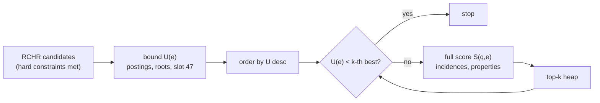

# Role- and time-aware scoring (RTHR)

This page defines how a candidate hyperedge is scored against a query hyperedge, and how the top `k` candidates are
found without scoring all of them. It is a shared piece: [role-constrained retrieval](role-constrained-hyperedge-retrieval.md)
produces candidates that satisfy the hard constraints, and [query-directed expansion](query-directed-expansion.md) and
[budgeted associative retrieval](budgeted-associative-retrieval.md) use this score as `r(e | q)`.

## What is established and what is ours

| Part | Status |
|---|---|
| a weighted linear combination of feature scores | standard in IR ranking; weights trained to optimise a ranking metric as in Metzler and Croft, *Linear feature-based models for information retrieval*, Information Retrieval 10(3), 2007, [doi:10.1007/s10791-006-9019-z](https://doi.org/10.1007/s10791-006-9019-z) |
| top-k by upper bounds on a monotone aggregate | Fagin, Lotem, Naor, *Optimal aggregation algorithms for middleware*, JCSS 66, 2003, [doi:10.1016/S0022-0000(03)00026-6](https://doi.org/10.1016/S0022-0000(03)00026-6) ([arXiv:cs/0204046](https://arxiv.org/abs/cs/0204046)); max-score pruning, Turtle and Flood, *Query evaluation: strategies and optimizations*, IP&M 31(6), 1995; WAND, Broder et al., CIKM 2003, [doi:10.1145/956863.956944](https://doi.org/10.1145/956863.956944) |
| role assignment as a bipartite matching | textbook (maximum weight bipartite matching) |
| the five components, their definitions, and the bounds read from HStore's posting values and tree summaries | ours; a proposal that needs relevance judgements before the default weights mean anything |

Two points from the original proposal change here.

The proposal says each component "must be normalized and query-dependent". Components are query-dependent, but they
must not be normalised over the candidate set (min-max or z-scores per query). A per-query normalisation needs every
candidate scored before any score is known, which rules out early termination, and it makes scores incomparable
across queries. Every component below has a fixed meaning on `[0, 1]` instead.

Missing required roles are hard constraints, as the proposal says. They never reach the scorer: a candidate that
fails a hard constraint is not a candidate. Scores rank only what is admissible.

## Query and candidate

```java
sealed interface SlotTarget {
    record Atom(long id) implements SlotTarget {}
    record OfType(int type) implements SlotTarget {}
}

record Slot(SlotTarget target, Set<Integer> roles, double weight, boolean required) {}

sealed interface TimeSpec {
    record At(long instant, long tau) implements TimeSpec {}
    record During(long from, long to) implements TimeSpec {}
}

record Soft(int propertyKey, Value target, double scale, double weight) {}

record ScoreQuery(OptionalInt edgeType, List<Slot> slots, Optional<TimeSpec> time, List<Soft> attributes,
                  int targetCardinality, Weights alpha) {}

record Weights(double members, double roles, double attributes, double time, double topology) {}
```

A query hyperedge is a list of **slots**. A slot asks for a specific atom or for any atom of a type, optionally in
one of a set of roles, with an importance `w_i > 0`. `required` slots are hard: they go to candidate generation and
also count in the score. `roles` empty means any role is fine.

The candidate is a hyperedge `e` that already passed the hard constraints, read through a tenant-scoped `Reader`.

## The five components

Let `π` be an assignment of slots to incidences of `e` (some slots may stay unassigned), `m(i, x) ∈ {0, 1}` whether
incidence `x` satisfies slot `i`'s target, and `ρ(i, x) ∈ {0, 1}` whether its role set intersects slot `i`'s roles
(1 when the slot has no roles). `π` is chosen to maximise `Σ_i w_i · m(i, π(i)) · (1 + ρ(i, π(i)))`: as many slots
filled as possible, and among those as many in the right role. Whether two slots may share one incidence follows the
query, as in [RCHR](role-constrained-hyperedge-retrieval.md#problem): shared by default, distinct under `DISTINCT`.
With `W = Σ_i w_i`:

| Component | Definition | Meaning of 1 | Meaning of 0 |
|---|---|---|---|
| `S_members` | `Σ_i w_i · m(i, π(i)) / W` | every slot filled | no slot filled |
| `S_roles` | `Σ_i w_i · m(i, π(i)) · ρ(i, π(i)) / W` | every slot filled in an accepted role | no slot filled in an accepted role |
| `S_attributes` | `Σ_j v_j · sim_j(e) / Σ_j v_j` over the soft predicates | every predicate at its target | none met, or the properties are missing |
| `S_time` | weighted mean of `τ(π(i))` over filled slots, see below | every filled incidence valid at the query time | none overlaps, or nothing filled |
| `S_topology` | `min(|M(e)|, k*) / max(|M(e)|, k*)`, `k*` = `targetCardinality` | exactly the intended size | (never for non-empty edges) |

```
S(q, e) = α_m · S_members + α_r · S_roles + α_a · S_attributes + α_t · S_time + α_g · S_topology
          with α ≥ 0, Σ α = 1, so S ∈ [0, 1]
```

A full score returns the components and the per-slot outcome of the assignment, which
[BAHR](budgeted-associative-retrieval.md) needs for coverage:

```java
record EdgeScore(long edge, double score, Components components, double[] slotCover) {}

record Components(double members, double roles, double attributes, double time, double topology) {}
```

`slotCover[i] = m(i, π(i)) · (1 + ρ(i, π(i))) / 2`: 1 when slot `i` is filled in an accepted role, 1/2 when filled in
another role, 0 when unfilled.

`S_roles ≤ S_members` by construction: a slot cannot be in the right role without being filled. The two are
correlated on purpose. `S_members` alone answers "are the right participants there", `S_roles` adds "in the right
capacity", and a query that cares only about participants sets `α_r = 0`.

Attribute similarity per soft predicate `j`: equality for strings and booleans (1 or 0), `max(0, 1 − |x − target| /
scale)` for numbers and timestamps. A missing property scores 0, not a neutral value, so absent data never ranks above
present data.

Time similarity per filled incidence `x` with validity `[a, b)`:

| `TimeSpec` | `τ(x)` |
|---|---|
| `At(t, tau)` | 1 if `a ≤ t < b`, otherwise `exp(−d / tau)` with `d` the distance from `t` to `[a, b − 1]`, the last instant still valid; 0 when `tau = 0` |
| `During(from, to)` | `|[a, b) ∩ [from, to)| / (to − from)`, the fraction of the query window the incidence covers |

`During` requires a finite window. A component the query does not use (no `TimeSpec`, no soft predicates, no target
cardinality) gets weight 0, and the remaining weights are scaled back to a sum of 1.

Semantic text similarity enters in two places. `Writer.embed` accepts any atom and stores the vector in slot 36
(`Embedding.EMBEDDINGS`), which the semantic plane indexes and `Reader.embedding(atom)` reads; only the
`embeddingRef` shortcut on the catalog record is node-only. So an edge that was embedded can carry a soft attribute
`sim_j(e)` = cosine similarity of its embedding to the query text, mapped to `[0, 1]`, and 0 when the edge has no
embedding. A slot target may also carry a text, and `m(i, x)` becomes the same similarity for the member's
embedding. Both keep every formula above unchanged because the values stay in `[0, 1]`.

### Computing the assignment

Fixed-atom slots have at most one possible incidence (the member appears once per edge), found with
`View.incidence(edge, member)` in `O(log |M(e)|)`. Typed slots need members of a type, which means scanning the
membership tree. Without `DISTINCT` every slot independently takes its best incidence and there is nothing to match.
Under `DISTINCT` the assignment is a maximum weight bipartite matching between `k` slots and the relevant
incidences. A typed slot never needs more than `k` alternatives per (type, role-match) class, because at most `k − 1`
of them can be taken by other slots, so the scan keeps at most `k` per class and the matching runs on at most `k²`
incidences: `O(k³)` with the Hungarian method. Queries have a handful of slots; we cap `k` at 16.

## Upper bounds without reading the edge

Full scoring reads incidences and properties. Most candidates can be ruled out with bounds read from data that
candidate generation already touched. The scorer implements the `Scorer` interface defined in
[RCHR](role-constrained-hyperedge-retrieval.md#scoring-hook): `bound(query, evidence)` takes whatever evidence is at
hand (postings only, or the catalog record and root summary, or the full edge) and uses the rows below that the
evidence allows, treating every other component as 1.

| Component | Upper bound `U_c(e)` | Source | Cost |
|---|---|---|---|
| `S_members`, fixed-atom slots | exact: is `e` in `I(a)` | the leapfrog over reverse-index postings that produced `e` | free |
| `S_roles`, fixed-atom slots | exact: the posting's `Incident.roleSet` | `IndexValues.Incident(roleSet, locator)`, the value of every reverse-index posting | free |
| `S_members`, typed slots | `min(1, count of members of that type)` per slot | slot 47 `edge-signature` (per-type member counts, see [HGMatch](hypergraph-structure-first-matching.md#storage-three-derived-slots)); 1 without it | `O(log n)` |
| `S_roles`, typed slots | 0 if no role set containing an accepted role has its bit in the edge root's `roleBits`, else 1 | membership root `Summary.roleBits` | `O(1)` |
| `S_time` | 1 if the root `[timeMin, timeMax]` admits the query time, otherwise `exp(−d / tau)` with `d` to that range | membership root `Summary` | `O(1)` |
| `S_topology` | exact | `|M(e)|`, the membership root count | `O(1)` |
| `S_attributes` | 1 | | free |

`roleBits` is built from `Incidence.roleBit(roleSet) = 1L << (roleSet & 63)`: a 64-bit hash of role-set ids. A clear
bit proves no incidence in the subtree has that role set. A set bit proves nothing. So it can only lower the bound to
0, never confirm a role. "Has role r" means any role set containing `r`, so the test ORs the bits of every interned
role set that contains an accepted role (`Dictionary` namespace `ROLE_SET`).

Every bound is at least the true component value, and `S` is a non-negative linear combination, so
`U(e) = Σ_c α_c U_c(e) ≥ S(q, e)`. That is all the threshold argument needs.

## Top-k

Candidates arrive from [role-constrained retrieval](role-constrained-hyperedge-retrieval.md) as a stream in edge-id
order, each with its anchored postings. The scorer runs two phases:

1. Bound every candidate (cheap, no edge reads) and order by `U(e)` descending, ties by edge id.
2. Pop candidates in that order and score them fully, keeping a min-heap of the best `k`. Stop at the first
   candidate with `U(e) < ` the heap minimum: nothing after it can enter.



This is Fagin's threshold idea specialised to one sorted list of bounds, the same shape as max-score: the bound is
computed per candidate rather than per list. Phase 1 still touches every candidate, which is fine because a bound
costs no page beyond what generation read (or one slot 47 lookup). When the candidate stream is very large, phase 1
runs over a bounded buffer and phase 2 interleaves with it, at the price of the stop test only applying within the
buffer; the result is still exact because no candidate is dropped without either a full score or a bound below the
final threshold.

## Worked example

Query: reviews with Alice as actor (required), Bob as reviewer, a Document as target, valid at `t = 100`
(`tau = 100`), `status = 'approved'`, intended size 3. Weights `α = (members 0.3, roles 0.2, attributes 0.2,
time 0.2, topology 0.1)`, all slot weights 1, `k = 1`.

```
e1 Review status=approved   Alice actor [0,∞)   Bob reviewer [0,50)   D1:Document target [0,∞)
e2 Review status=draft      Alice actor [0,∞)   Bob actor    [0,∞)    D2:Document target [0,∞)
e3 Review status=approved   Alice actor [0,∞)   Carol reviewer [0,∞)  D3:Document target [0,∞)   Dave observer [0,∞)
```

All three contain Alice as actor, so all three are candidates. Bounds, from postings of Alice and Bob and the roots:

| | Bob in `e`? (posting) | Bob's role (posting) | `U_members` | `U_roles` | `U_time` | `U_topology` | `U_attributes` | `U(e)` |
|---|---|---|---|---|---|---|---|---|
| e1 | yes | reviewer | 1 | 1 | 1 | 1 | 1 | 1.000 |
| e2 | yes | actor | 1 | 2/3 | 1 | 1 | 1 | 0.933 |
| e3 | no | | 2/3 | 2/3 | 1 | 3/4 | 1 | 0.808 |

Full score of e1: every slot filled in the right role. Bob's incidence `[0, 50)` was last valid at 49, 51 before
`t = 100`, so `τ = exp(−0.51) = 0.600`, and `S_time = (1 + 0.600 + 1) / 3 = 0.867`.

```
S(e1) = 0.3·1 + 0.2·1 + 0.2·1 + 0.2·0.867 + 0.1·1 = 0.973
```

The heap holds e1 at 0.973. The next bound is e2's 0.933 < 0.973, so the scan stops. e2 and e3 are never read past
their postings. For reference, their full scores would be 0.733 (e2: Bob in the wrong role, status draft) and 0.808
(e3: Bob absent, four members), so the order e1, e3, e2 is what an exhaustive scorer returns too.

## Cost

Notation: `C` candidates, `k` slots, `p` soft predicates, `n = |E|`.

| Step | Time | Pages |
|---|---|---|
| bound one candidate | `O(k)`, plus `O(log n)` when slot 47 is used | none beyond generation, or one slot 47 leaf |
| full score, fixed-atom slots only | `O(k log |M(e)| + p)` | membership pages on the path to each member, one property bag |
| full score with typed slots | `O(|M(e)|)` scan pruned by `roleBits` per subtree, plus `O(k³)` matching | the membership tree |
| top-k | `O(C log C)` to order bounds, plus full scores until the stop | |

The number of full scores depends on how tight the bounds are. Fixed-atom slots and their roles are exact, so queries
anchored on known atoms usually stop after a few full scores. Typed slots without slot 47 and soft attributes carry
loose bounds of 1, and a query made only of those degenerates to scoring everything.

## Tenancy, snapshots, budgets

Candidates come from a tenant-scoped generator; fixed-atom slot targets are resolved with `Reader.require`, so a slot
cannot name another tenant's atom. Typed-slot scans read members of an edge the reader owns. Members of another
tenant can only appear if cross-tenant membership exists; they are skipped with `Reader.owns` before they count. The
whole scoring runs on the query's snapshot. Each full score charges one row to the `Budget.Meter`, and page reads go
through the query's `IoTrace` budget.

## Weights

Default `α = (0.3, 0.2, 0.2, 0.2, 0.1)` is a starting point with no evidence behind it. The plan is to collect
judged queries per workload and fit `α` with coordinate ascent on NDCG@k (Metzler and Croft 2007), constrained to
`α ≥ 0, Σ α = 1` so the upper bounds stay valid. Learned non-linear scorers are out of scope: they break the
monotone aggregate that the stop rule depends on.

## Limits of the first version

| Not supported | Reason |
|---|---|
| more than 16 slots | assignment cost `O(k³)` per full score |
| per-query normalisation | breaks early termination and comparability, see above |
| role hierarchies (`reviewer` partially satisfies `approver`) | `ρ` is binary; graded role similarity is a later change to `ρ` that keeps every bound valid if `ρ ≤ 1` |
| a tight bound on semantic similarity | the bound is 1 until the vector is read; only edges and members that were embedded score above 0 |
| ordered positions in slots | position is not part of `m`; checked as a hard constraint in RCHR if needed |

## As built

`RANK` ([`docs/database/ranking.md`](../docs/database/ranking.md)) implements this page with these choices:

| Point | Built |
|---|---|
| syntax | `RANK EDGE e:T LIKE (slot, ...) [VALID AT t [TAU d] \| VALID DURING [f, u)] [PREFER ...] [SIZE n] [WEIGHTS (...)] TOP k`; a slot's roles are written `AS r1 OR r2` and mean any of them |
| candidates | the intersection of the postings of `REQUIRED` named slots, role-filtered; without one, every hyperedge of the type, so the result stays exact |
| bounds | named slots exact through one incidence lookup each instead of values carried from the leapfrog; typed slots and soft predicates 1, since slot 47 does not exist yet |
| `DISTINCT` | not built; slots may share a member |
| budgets | candidates, full scores and member reads for typed slots each take a row; exceeding the budget fails the statement |
| tests | the worked example above, and 300 random queries checking `U(e) ≥ S(e)` for every edge and that the early stop returns exactly what scoring every edge returns |

