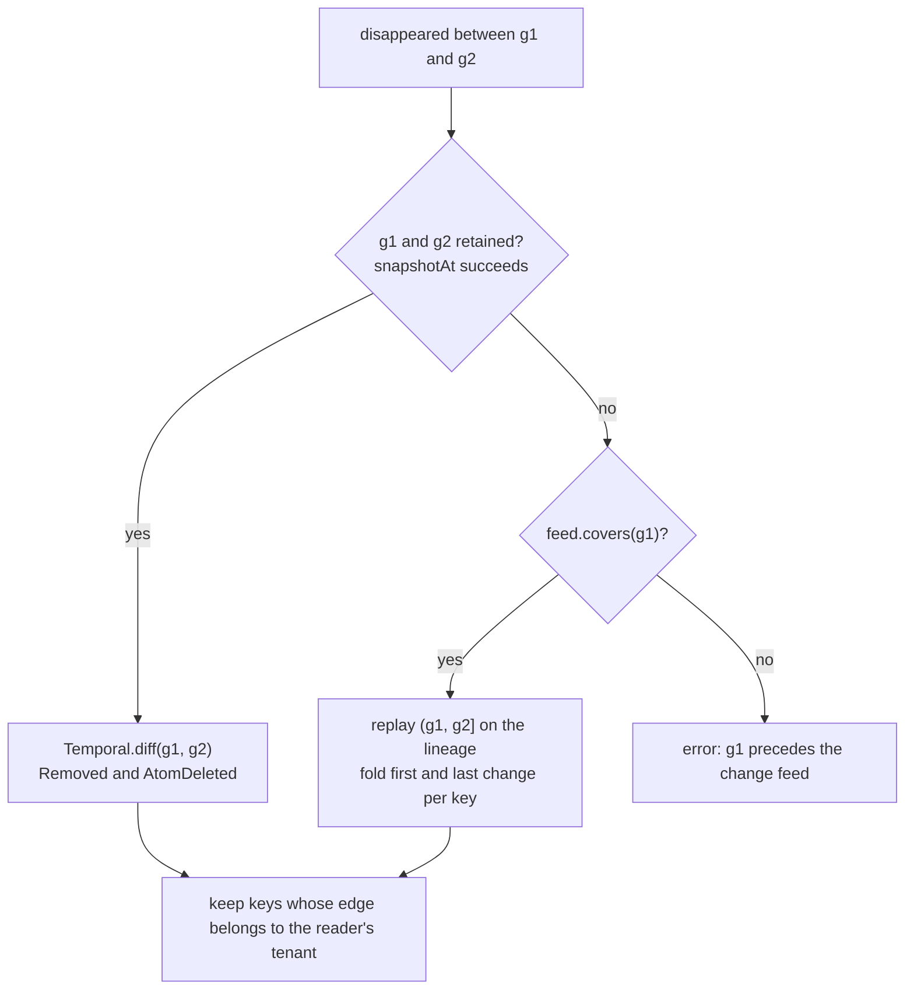
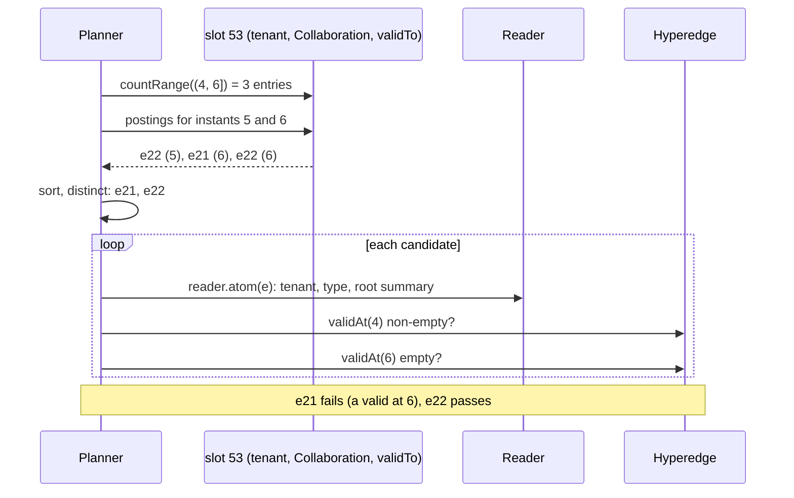

# Temporal hypergraph retrieval

Status: proposal. HStore already answers "valid at `t`" and "as of generation `g`". This page pins down what the
temporal queries in the proposal mean in each of HStore's two time dimensions, which of them are possible at all
given how history is retained, and which index changes make them cheap.

The proposal this page answers: retrieve states and interactions valid at a requested time or interval, support
queries such as "find interactions that existed before event X but disappeared afterward", and use interval indexes,
snapshot selection and transition indexes to avoid scanning historical versions.

## Two time dimensions

From `docs/database/evidence-and-temporal.md`:

| | Generation time | Validity time |
|---|---|---|
| meaning | when a fact was committed | when a fact holds in the modelled world |
| carried by | the generation chain; `Generation.wallTime` | `validFrom`/`validTo` on incidences, on property values, on state bindings; half-open `[from, to)` |
| who sets it | the commit | the writer (`MemberSpec.withValidity`, `SET … VALID`, `STATE … VALID`) |
| how far back | `history_limit` generations (default 64) as full snapshots, in memory only; the change feed keeps per-commit deltas for `feed_retention_generations` (default 100,000) on disk | forever: intervals are data |
| queried with | `AT GENERATION g`, `AS OF t`, `DIFF GENERATION a AND b`, `HISTORY` | `VALID AT t`, `MEMBERS … VALID AT`, `INCIDENT … VALID AT`, `state(x, t)`, `Reader.property(atom, name, t)` |
| what "disappeared" means | a membership or edge present in generation `g1` is absent in `g2`: it was removed or deleted | a membership valid at `t1` is not valid at `t2`: its interval ended |

The two answer different questions. A membership closed by setting `validTo = 5` is still stored and appears in
every later generation; it has disappeared in validity time only. A membership removed with `Writer.remove` has
disappeared in generation time and has no validity at all afterwards. A query that does not say which dimension it
means is ambiguous, and the API below makes the caller choose.

Validity covers less than the proposal's "states" suggests. A property bag holds one value per key, and
`SET … VALID` replaces it (`docs/database/data-model.md`, validity intervals). A state binding is one record per atom,
replaced by every `bind` (`temporal/StateBindings.java`, slot 39). So `state(x, t)` and `Reader.property(atom, name, t)`
only say whether the current value's interval contains `t`. Earlier values are not in validity time at all; they exist
only in older generations and in the change feed. Membership is the only thing whose validity history is stored.

## Problem

An interaction is a hyperedge. Write `present(i, t)` for an incidence `i = (e, v, [f, u))` when `f ≤ t < u`, and
`active(e, t)` when some incidence of `e` is present at `t`. That is the meaning `MATCH … e VALID AT t` already has
(`Evaluator.validAt`).

| Query | Validity time | Generation time |
|---|---|---|
| Q1 snapshot | incidences present at `t`, or edges active at `t` | the graph as of generation `g` |
| Q2 window | incidences whose interval overlaps `[a, b)` | changes committed in `(g1, g2]` |
| Q3 disappeared | `present(i, t1) ∧ ¬present(i, t2)`, or `active(e, t1) ∧ ¬active(e, t2)`, with `t1 < t2` | in `g1` and not in `g2`, `g1 < g2` |
| Q4 appeared | `¬present(i, t1) ∧ present(i, t2)` | not in `g1`, in `g2` |

"Existed before event X but disappeared afterward" is Q3 with `t1` just before X and `t2` just after it (or after a
grace period). X fixes the two instants and nothing else. In validity time X's instant comes from data (an incidence's
`validFrom`, a `TIME` property). In generation time it is a generation: given directly, or found from a wall time.

### Running example (validity time)

Edge type `Collaboration`, members `a`, `b`, `c`, `d`. X happens at `5`; `t1 = 4`, `t2 = 6`.

```
time       0    1    2    3    4    5    6    7    8    9    10
           |    |    |    |    |    |    |    |    |    |    |
e20  a          [============================================)      [1, 10)
     b          [============================================)      [1, 10)
e21  a          [===============================================    [1, *)
     c                    [==============)                          [3, 6)
e22  b               [==============)                               [2, 5)
     c               [===================)                          [2, 6)
e23  d                                        [=========)           [7, 9)
e24  a, b ======================================================    [*, *)
                               t1   X    t2
```

| | present at 4 | present at 6 | incidence disappeared | edge active at 4 | edge active at 6 | edge disappeared |
|---|---|---|---|---|---|---|
| `e20` | a, b | a, b | none | yes | yes | no |
| `e21` | a, c | a | `c` | yes | yes | no |
| `e22` | b, c | none | `b`, `c` | yes | no | yes |
| `e23` | none | none | none | no | no | no |
| `e24` | a, b | a, b | none | yes | yes | no |

## What exists today

| Need | Today | Cost |
|---|---|---|
| members of one edge valid at `t` | `Hyperedge.validAt(t)`: scan pruned by `Summary.mayBeValidAt` (`timeMin ≤ t < timeMax`) | `O(log_B a + r)` when intervals cluster by member id, `O(a)` worst case |
| edges of atom `x` with `x` valid at `t` | `Temporal.activeEdges` / `INCIDENT TO x VALID AT t`: every posting of `x`, then `view().incidence(e, x)` | `O(deg(x))` catalog lookups plus member lookups; the reverse index has no time |
| edges of type `T` active at `t` | `MATCH EDGE e:T WHERE e VALID AT t`: type scan, residual `validAt` per edge | `O(|T|)` catalog reads, plus a pruned member scan per edge |
| disappeared in validity time | `… WHERE e VALID AT t1 AND NOT e VALID AT t2`, as above twice | `O(|T|)`; no index on endpoints |
| graph at generation `g` | `AT GENERATION g` / `AS OF t` (`Session`, `Database.readAt`) | same as the present, if `g` is retained |
| changes between two generations | `DIFF GENERATION a AND b` (`Temporal.diff`, `TreeDiff`) | `O(changes · log n)`; both generations must be retained; engine-wide statement, global admin only (`Executor.engineWide`, `Principal.requireGlobal`) and not tenant-filtered |
| disappeared in generation time | `DIFF`, filtered by hand | as above; nothing for tenant users |

Two gaps stand out. Validity queries without an anchor scan the type, and no query in generation time reaches past
the 64 retained generations, although the change feed holds 100,000 generations of deltas on disk.

### What retention makes impossible

| Question | Possible? | Why |
|---|---|---|
| full snapshot at a generation older than the retained window, or older than the checkpoint the process restarted from | no | history is in memory only (`TransactionManager.history`); a checkpoint writes one generation (`docs/storage/catalog-and-generations.md`) |
| which memberships or edges disappeared (or appeared) between an old generation and now | yes, while the feed covers it | each `MemberChange` and each primary-slot `SlotChange` is in the feed with its before and after values |
| the value a property or state binding had at an old generation | only if it changed inside the feed window; the old value is the `before` of the first change | slots 34 and 39 are primary, so their changes are in the feed |
| anything older than the feed's first retained event | no | `ChangeFeed.retain` deletes whole segments below `current − feed_retention_generations` unless a hold keeps them |
| the validity interval of a property value that was later replaced | only through the generation route above | properties keep one value per key |

## Background

| Topic | Source | Use here |
|---|---|---|
| interval relations | J. F. Allen, *Maintaining knowledge about temporal intervals*, CACM 26(11), 1983, [doi:10.1145/182.358434](https://doi.org/10.1145/182.358434) | vocabulary only; the Q3 condition below is a statement about where an interval ends |
| interval tree mapped onto ordinary B+-trees | H.-P. Kriegel, M. Pötke, T. Seidl, *Managing Intervals Efficiently in Object-Relational Databases*, VLDB 2000, pp. 407 to 418 | evaluated as design D below |
| event list plus periodic checkpoints for temporal tables | M. Kaufmann et al., *Timeline Index: A Unified Data Structure for Processing Queries on Temporal Data in SAP HANA*, SIGMOD 2013, [doi:10.1145/2463676.2465293](https://doi.org/10.1145/2463676.2465293) | evaluated as design F; the endpoint index below is its event list without checkpoints |
| main-memory interval index | G. Christodoulou, P. Bouros, N. Mamoulis, *HINT: A Hierarchical Index for Intervals in Main Memory*, SIGMOD 2022, [arXiv:2104.10939](https://arxiv.org/abs/2104.10939) | not applicable as is: built for memory, not copy-on-write pages |
| multiversion B-tree for transaction time | B. Becker et al., *An asymptotically optimal multiversion B-tree*, VLDB Journal 5(4), 1996, [doi:10.1007/s007780050028](https://doi.org/10.1007/s007780050028) | not needed: copy-on-write generations already give every retained version its own root |
| snapshot retrieval over historical graphs from stored deltas | U. Khurana, A. Deshpande, *Efficient Snapshot Retrieval over Historical Graph Data*, ICDE 2013, [arXiv:1207.5777](https://arxiv.org/abs/1207.5777) | the idea behind rebuilding old states from the feed; not proposed (see limits) |
| per-block min/max to skip data | G. Moerkotte, *Small Materialized Aggregates: A Light Weight Index Structure for Data Warehousing*, VLDB 1998, pp. 476 to 487 | `Summary.timeMin`/`timeMax` are this, kept per subtree |
| temporal hypergraphs as a data model | G. Lee, K. Shin, *THyMe+: Temporal Hypergraph Motifs and Fast Algorithms for Exact Counting*, ICDM 2021, [arXiv:2109.08341](https://arxiv.org/abs/2109.08341) | shows the model (hyperedges with timestamps); it is about motif counting, not retrieval |

I found no published index for validity-time retrieval over hypergraphs specifically. The designs below are standard
interval techniques adapted to HStore's trees; the reduction of Q3 to an endpoint range and the feed fold are argued
on this page, not taken from a paper.

## Algorithms

### Q3 in validity time reduces to an endpoint range

For one incidence with interval `[f, u)` and `t1 < t2`:

```
present(i, t1) ∧ ¬present(i, t2)
  =  f ≤ t1 < u  ∧  ¬(f ≤ t2 < u)
  =  f ≤ t1 < u  ∧  u ≤ t2                 since f ≤ t1 < t2 gives f ≤ t2
  =  f ≤ t1  ∧  u ∈ (t1, t2]
```

So the incidences that disappeared are exactly those whose `validTo` lies in `(t1, t2]` and whose `validFrom` is at
most `t1`. Symmetrically, the incidences that appeared are those with `validFrom ∈ (t1, t2]` and `validTo > t2`.

For edges the condition is not local to one incidence, but the endpoint range still gives a complete candidate set.
If `e` is active at `t1` and not at `t2`, pick an incidence `i` present at `t1`. It is not present at `t2` (otherwise
`e` would be active), so by the derivation above its `validTo` is in `(t1, t2]`. Every edge that disappeared
therefore has an incidence ending in `(t1, t2]`. The converse fails (`e21`: `c` ends at 6 but `a` keeps the edge
active), so each candidate is verified with two pruned scans, `validAt(t1)` non-empty and `validAt(t2)` empty. The
same argument run backwards covers appearance: an edge inactive at `t1` and active at `t2` has an incidence present
at `t2` and not at `t1`, whose `validFrom` lies in `(t1, t2]`.

An incidence with the default interval `[*, *)` never ends, so it never disappears, and it keeps its edge active at
every instant. Leaving such incidences out of an endpoint index loses nothing for Q3 and Q4.

### Q3 in generation time is a fold over the change feed

For a membership key `(e, v)` look at its changes in `(g1, g2]` on the branch's lineage, in commit order. A
`MemberChange.Added` is only emitted when the member was absent, `Removed` and `Updated` only when it was present
(set edges reject duplicates and ordered edges index each member once in the order tree, see
`docs/storage/topology.md`). Therefore

```
present at g1  <=>  the first change is Removed or Updated
present at g2  <=>  the last change is Added or Updated
no change      =>   same state at g1 and g2
```

and "disappeared" is `first ∈ {Removed, Updated} ∧ last = Removed`. Edges work the same way with catalog
`SlotChange`s: present before means `before().isPresent()` on the first change, present after means
`after().isPresent()` on the last. A membership added and removed inside the window, or removed and added back, is
correctly not reported.

When both `g1` and `g2` are still retained, `Temporal.diff` gives the same answer from the trees: `Removed` member
changes and `AtomDeleted` deltas are exactly the memberships and edges present in `g1` and absent in `g2`. It costs
`O(changes · log n)` regardless of how many commits lie between, because `TreeDiff` skips shared subtrees. The feed
fold is the fallback for windows beyond the retained history and costs one pass over every event in the window.



#### Trace

Main branch, events after `g100`:

| Generation | Event |
|---|---|
| 101 | `Added(e30, a)`; `Updated(e32, c)` (weight changed) |
| 102 | `Removed(e31, b)` |
| 103 | `Added(e31, b)`; `Removed(e32, c)` |
| 104 | `Removed(e30, a)`; catalog `e33` deleted (before = `EdgeRecord(tenant 3, …)`), `Removed(e33, d)`, `Removed(e33, f)` |

| Key | First | Last | In g100 | In g104 | Reported for `(100, 104]` |
|---|---|---|---|---|---|
| `(e30, a)` | Added | Removed | no | no | no, it came and went |
| `(e31, b)` | Removed | Added | yes | yes | no, it came back |
| `(e32, c)` | Updated | Removed | yes | no | yes |
| `(e33, d)`, `(e33, f)` | Removed | Removed | yes | no | yes, if tenant 3 is the reader's |
| edge `e33` | catalog before present | catalog after empty | yes | no | yes, if tenant 3 |

### Q1 in validity time

Anchored (`INCIDENT TO x VALID AT t`, `Temporal.activeEdges`, `PATTERN … VALID AT`): with design B below, the
postings of `x` carry each membership's interval and the postings tree's summaries carry `timeMin`/`timeMax`, so the
scan reads only postings and skips subtrees with `!(timeMin ≤ t < timeMax)`.

Unanchored (`MATCH EDGE e:T WHERE e VALID AT t`): the type scan stays. For each edge, the catalog record holds the
member tree's root reference, and its summary rejects the edge when `!(timeMin ≤ t < timeMax)` before any member page
is read. Only edges that pass get a `validAt(t)` scan. That check is cheap but does not change the `O(|T|)` scan; see
the design table for why no general interval index is proposed.

## Implementation in HStore

### What carries over and what does not

| Assumption in the interval literature | HStore | Consequence |
|---|---|---|
| one interval per row, rows have ids | intervals live on incidences, keyed by `(edge, member)`; edges, not incidences, are the output | indexes post edge ids and keep a count per edge so that removals stay exact |
| composite keys such as `(node, lower, id)` | every tree key is one signed `long` | composite orders need nested trees: directory, then per-group tree, then postings, as the property index does (`property/PropertySlots.java`) |
| a dedicated structure per index | every structure is the same counted B+-tree with a `Summary` per subtree, and `timeMin`/`timeMax` are already in it | prefer feeding time into summaries of trees that already exist over adding trees |
| transaction time needs a multiversion index | generations share pages copy-on-write; any retained generation has its own roots | nothing to index for retained history; the limit is retention, not access |
| intervals in a global table | data is tenant-scoped and type-scoped | every key includes the tenant |

### Interval index designs

| Design | Serves | Extra write cost per membership change | Read cost | Verdict |
|---|---|---|---|---|
| A. today: reverse index without time, then the incidence | anchored Q1 | none | `O(deg(x))` incidence reads | baseline |
| B. validity in reverse-index postings, time in postings-tree summaries | anchored Q1, Q2 | a validity-only `Updated` now rewrites one posting, `O(log n)`; 1 byte per posting for default intervals | postings only; subtrees outside `t` skipped | proposed |
| C. per-member endpoint index | anchored Q3, Q4 | 2 posting updates on another slot for every non-default incidence | `O(log n + r)` | not proposed; B answers anchored Q3 and Q4 with the same pruned posting scan (keep subtrees that may be valid at `t1`, then filter on the posting's interval), which is not output-sensitive but adds no writes beyond B's |
| D. RI-tree per `(tenant, type)` | unanchored Q1, Q2 | 2 inserts into nested trees; the fork node adds a fourth level of nesting | `O(h · log n + r)`, `h` the virtual tree height | not proposed in v1; needs a fork-node level that no existing slot has, and Q1 without anchor is not the case the proposal targets |
| E. per-`(tenant, type)` endpoint index | unanchored Q3, Q4 | up to 2 posting updates for each non-default incidence; zero for `[*, *)` | `O(log n + r)` candidates, then verification | proposed as slot 53 |
| F. timeline index with checkpoints | unanchored Q1 at any `t` | E plus periodic checkpoint bitmaps of active edges, rewritten as data changes | checkpoint plus events since it | not proposed; checkpoints are snapshots of an append-only table and do not fit edits of old intervals |

Design E is the "transition index" of the proposal for validity time. For generation time the change feed already is
the transition log, ordered by generation and written by every commit; a second structure written by every commit
would duplicate it, so none is proposed.

### Design B: time in the reverse index

Today `IndexValues.Incident(int roleSet, long locator)` and the postings schema #6 uses `EntryMeasure.keyed(hash)`,
so postings-tree summaries have `timeMin = Long.MAX_VALUE`, `timeMax = Long.MIN_VALUE` and say nothing about time.

```java
public record Incident(int roleSet, long locator, long validFrom, long validTo) {
    public long hash() {
        return Hashing.of(roleSet, locator, validFrom, validTo);
    }
}

static final EntryMeasure<Incident> MEASURE = (edge, incident, into) -> into
        .entry(edge, incident.hash())
        .validity(incident.validFrom(), incident.validTo())
        .roles(Incidence.roleBit(incident.roleSet()));
```

The `.roles` line is the change proposed in `role-constrained-hyperedge-retrieval.md`; both go into one format change.

| Part | Change |
|---|---|
| codec `IndexValues.INCIDENT` | `varint roleSet, svarlong locator, u8 flags, [svarlong validFrom], [svarlong validTo]`; flag bits mark non-default endpoints, so a `[*, *)` membership costs one byte more than today |
| `EngineDerivations.REVERSE_INCIDENCE` | the `Updated` case also fires when `validFrom` or `validTo` changed |
| `IncidentEdge`, `Views.incident` | carry the interval |
| `Temporal.activeEdges` | filter on the posting value; open the postings cursor with `summary -> summary.mayBeValidAt(t)` |
| format | slot 2 is rebuilt once, `O(Σ a(e) · log n)`, shared with the RCHR role-summary change |

The inline limit of 48 postings stays; the `maxValueBytes / 2` size limit promotes a list somewhat earlier when many
of its memberships have explicit intervals (up to 20 more bytes each).

Pruning works when edge ids correlate with validity time, which is common for event-like data because edge ids are
allocated in commit order (`TransactionManager.allocateAtom`). For data loaded out of time order, no subtree is skipped
and the scan reads every posting of `x`. That is still cheaper than today, which reads every edge record.

In a database with more than one tenant the gain is smaller than it looks. `Reader.owns` is free only when the
database holds a single tenant; otherwise every edge taken from a posting costs a catalog lookup for the tenant check
(see [tenant isolation](#tenant-isolation)). Design B then saves the member-tree read and skips edges pruned by time,
but not the catalog read of the edges that survive.

### Design E: slot 53, validity endpoints per edge type

| Slot | Kind | Schemas | Directory key | Middle tree | Postings |
|---|---|---|---|---|---|
| 53 `validity-endpoints` | derived | 96 directory, 97 time tree, 98 postings | `endpointKey(tenant, edgeType, side) = (tenant << 40) \| (edgeType << 8) \| side`, side 0 = `validFrom`, 1 = `validTo` | key = the endpoint instant | edge id -> count of incidences of that edge with this endpoint |

The layout is the property index's: a directory of `IndexRoot`s, each the root of a `PostingIndex` keyed by an
ordered value whose postings are owner ids (`PropertySlots`, `PropertyIndex.candidates`). The same bit packing
assumes tenant ids below `2^24` and type ids below `2^32`, as `PropertySlots.directoryKey` already does.

The derivation `ValidityIndexing`, registered with the other database derivations in `HypergraphDatabase`:

| Member change | Work |
|---|---|
| `Added` | read the edge's `(tenant, type)` from the workspace catalog; for each non-default endpoint, increment `(side, instant, edge)` |
| `Updated` with a changed interval | decrement the old non-default endpoints, increment the new ones |
| `Removed` | decrement; drop the posting at zero, the instant at no postings |
| interval `[*, *)` | nothing |

Each increment or decrement is one update through three tree levels, `O(log n)`. A membership with both endpoints
set costs two; closing an open interval (`[f, *)` to `[f, u)`) costs one. The middle tree's measure sets the weight
to the number of postings under each instant, so `PostingIndex.countRange` over `(t1, t2]` gives the number of
candidate entries from summaries alone. The planner uses it as the estimate.



On the running example: the `validTo` side holds `5 -> {e22}`, `6 -> {e21, e22}`, `9 -> {e23}`, `10 -> {e20 ×2}`; `e21.a`
and `e24` are open-ended and not indexed. The range `(4, 6]` yields `e21, e22`, and verification keeps `e22`. For the
incidence-level variant the verification step instead lists the members with `validTo ∈ (4, 6]` and
`validFrom ≤ 4`: `e21.c`, `e22.b`, `e22.c`.

### Plan

`MATCH` already accepts `VALID AT` and `NOT`, so Q3 and Q4 need no new syntax:

```sql
MATCH EDGE c:Collaboration WHERE c VALID AT 4 AND NOT c VALID AT 6 RETURN c;
MATCH EDGE c:Collaboration WHERE NOT c VALID AT 4 AND c VALID AT 6 RETURN c;
```

The planner recognises the pair (two top-level conjuncts on the match variable, one negated, literal instants with
`t1 < t2`) and adds a candidate:

```java
record ValidityTransition(TypeDef type, long t1, long t2, Direction direction) implements AccessPath {
    enum Direction { DISAPPEARED, APPEARED }

    public String kind() {
        return "validity-transition";
    }

    public LongStream scan(Reader reader) {
        int side = direction == Direction.DISAPPEARED ? 1 : 0;
        return ValidityIndex.edges(reader.view(), reader.tenant(), type.id(), side, t1, t2)
                .sorted()
                .distinct();
    }
}
```

It is not exact: both conjuncts stay as residual filters, which is how candidates are verified. The edge type is
required, because the directory key needs it; an untyped match keeps the type scan. Without slot 53 the plan is the
one `MATCH` uses today, so the slot can be added without changing results.

For generation time a separate statement is needed, since `MATCH` runs on one snapshot. Its Java form:

```java
sealed interface Change permits Change.Membership, Change.Edge {
    record Membership(long edge, long member) implements Change {}
    record Edge(long edge) implements Change {}
}

record Span(boolean before, boolean after) {
    Span then(Span next) {
        return new Span(before, next.after());
    }
}

static Map<Change, Span> fold(Stream<CommitEvent> events, Lineage lineage, long through) {
    Map<Change, Span> seen = new LinkedHashMap<>();
    events.takeWhile(event -> event.generation() <= through)
            .filter(event -> lineage.includes(event.branch(), event.generation()))
            .forEach(event -> {
                event.members().forEach(change -> seen.merge(new Change.Membership(change.edge(), change.member()),
                        new Span(!(change instanceof MemberChange.Added), !(change instanceof MemberChange.Removed)), Span::then));
                event.slots().stream()
                        .filter(change -> change.slot() == EngineSlots.CATALOG)
                        .forEach(change -> seen.merge(new Change.Edge(change.key()),
                                new Span(change.before().isPresent(), change.after().isPresent()), Span::then));
            });
    return seen;
}
```

`Lineage` answers which events belong to a branch's history: the branch's own events after its `baseGeneration`,
and before that the parent's, recursively (`catalog/Branch.java`). Generations are global across branches and the feed
interleaves them, so the filter is needed even on main when branches exist. `Change.Edge` also collects nodes, since
the catalog holds both; the caller keeps keys whose record is an `EdgeRecord`.

The feed is appended just after a generation becomes current (`docs/storage/change-feed.md`), so a reader whose
snapshot is `g2` can find `feed.lastGeneration()` still at `g2 - 1`. The operator replays only up to
`min(g2, feed.lastGeneration())` and, if that is short of `g2`, waits for the feed's next append before folding.
`SemanticPlane` and `MaterializedViews.refresh` handle the same race by replaying up to that minimum and taking the
rest from the next event; a one-shot query has no next event, so it waits.

An instant `X` given as wall time maps to a generation with `TransactionManager.generationAsOf` while it is retained.
Beyond that, the fold scans the feed from its first event and takes the last event with `wallTime ≤ X`. Wall times
come from `System.currentTimeMillis()` at commit, so they are close to monotone but not guaranteed to be, and the
result is "the last commit stamped at or before X". Passing a generation avoids the question.

### Tenant isolation

| Path | How it stays inside the tenant |
|---|---|
| design B, anchored scans | the anchor goes through `reader.visible` first; every edge id from its postings passes `reader.owns` before it is returned or passed to `reader.view()`. In a single-tenant database `owns` is free; otherwise it is a catalog lookup. Skipping it would need proof that no cross-tenant membership exists (`hstore check` reports them), which is a security decision and is not part of this design |
| slot 53 | the tenant is in the directory key; the derivation stamps the edge's own tenant at write time, and a record's tenant does not change. Candidates still go through `Executor.admits` (`reader.atom`) for kind and type |
| `Temporal.diff` path | `Temporal.diff` itself is not tenant-filtered, which is why `DIFF` is engine-wide. The new operator keeps a membership change only when the edge's record in `g2` (or in `g1`, for a deleted edge) has the reader's tenant, and a catalog delta only when its record does |
| feed path | events are global. A key is kept only when its edge's tenant is known to be the reader's. A record's tenant never changes, so any record of the edge will do: the current snapshot's if the edge still exists, otherwise the `before` record of its deletion, which the feed holds because an edge with changes after `g1` was deleted after `g1`. Member ids from events are never handed to `reader.view()` before that |
| side channels | the feed path reads and decodes every tenant's events in the window, so its running time depends on other tenants' write volume. It returns nothing of theirs, but a tenant can observe the duration. The budget below caps the work |

Unlike `DIFF` and `HISTORY`, the new statement is tenant-scoped and can be open to READER principals.

### Budgets

Validity-time paths run under the statement's `IoTrace` page budget like any `MATCH`. The feed path is not paged
through the node cache, so it uses a `Budget.Meter`: one row per decoded event, plus the deadline. A window that
exceeds the budget fails with `ABORTED_RESOURCE_LIMIT` rather than returning a partial answer, because a partial fold
would report wrong first and last changes.

## Complexity

Notation: `n` tree size, `B` fanout, `deg(x)` postings of `x`, `r` results, `c` candidates, `|T|` edges of the type,
`a(e)` arity, `E` events in the feed window, `Δ` changed entries between two generations.

| Operation | Literature | HStore today | Proposed |
|---|---|---|---|
| anchored Q1 (edges of `x` valid at `t`) | interval tree `O(log n + r)` | `O(deg(x) · log_B n)` catalog and member reads | design B: `O(deg'(x))` posting reads, `deg'` the postings in subtrees not pruned by time, plus `O(r · log_B n)` tenant checks when the database has several tenants |
| unanchored Q1 | interval tree `O(log n + r)`; RI-tree `O(h · log_B n + r)` | `O(|T| · log_B n)` | unchanged, plus a root-summary reject before member reads |
| unanchored Q3 / Q4 | event list range `O(log n + r)` (timeline index) | `O(|T| · a)` | slot 53: `O(log_B n + c · log c)` for candidates, `O(c · (log_B n + a(e)))` to verify |
| membership change, non-default interval | `O(log n)` per endpoint | slot 2: `O(log n)` only on role or locator changes | slot 2: also on interval changes; slot 53: `O(log n)` per non-default endpoint |
| generation Q3, both retained | n/a; an MVBT answers timeslices, not differences | `O(Δ · log_B n)` via `TreeDiff` | same, tenant-filtered |
| generation Q3, beyond retention | DeltaGraph rebuilds from deltas | impossible | `O(E)` feed fold while the feed covers `g1`; impossible beyond |
| snapshot at an unretained generation | rebuild from deltas | impossible | still impossible (not proposed) |

## Limits of the first version

| Not supported | Reason | Instead |
|---|---|---|
| a full snapshot at an unretained generation | would need an undo overlay built from the feed (every event since that generation, all tenants) and recomputation of derived slots | `AT GENERATION` within `history_limit`; Q3 and Q4 through the feed |
| unanchored Q1 through an index | design D needs a fourth level of tree nesting and its write cost is not justified by a query the planner can already answer with a type scan | type scan with root-summary rejects |
| validity history of property values and state bindings | one value per key; replacing it loses the old interval | model the history as memberships with intervals, or read old values from the feed |
| untyped Q3 / Q4 | slot 53 is keyed by edge type | type scan |
| instants that are not literals (`VALID AT x.time`) | the planner needs the window to pick postings | residual evaluation |
