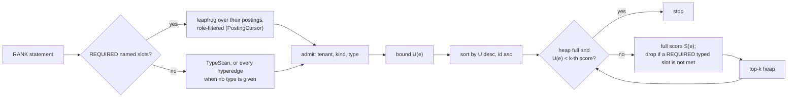

# Ranking hyperedges (`RANK`)

This page describes how `RANK` ([HQL](hql.md#rank)) scores hyperedges against a query hyperedge and returns the best
`k`: `retrieve/RankQuery.java`, `retrieve/RoleTimeScorer.java`, `retrieve/Ranking.java` and `Executor.rank`.

## Query and score

A query is a list of slots, each a named atom or "any atom of type `T`", with accepted roles, a weight `w_i > 0` and
a `REQUIRED` flag; optional `VALID AT` or `VALID DURING`, `PREFER` predicates, a target `SIZE`, component weights
and `TOP k`.

For a hyperedge `e`, every slot picks its best incidence of `e`: a named atom has at most one; a typed slot looks at
every member of that type. "Best" means filled in an accepted role over filled in another role over empty, and among
equals the one with the higher time score. Two slots may pick the same member. With `W = Σ w_i`:

| Part | Value |
|---|---|
| `members` | `Σ w_i` over filled slots, divided by `W` |
| `roles` | `Σ w_i` over slots filled in an accepted role, divided by `W` |
| `time` | weighted mean of `τ` over filled slots, 0 if none is filled |
| `attributes` | weighted mean of the `PREFER` similarities; a missing property scores 0 |
| `topology` | `min(|M(e)|, SIZE) / max(|M(e)|, SIZE)` |

`τ` for an incidence valid on `[a, b)`: under `VALID AT t TAU d`, 1 if `a ≤ t < b`, otherwise `exp(-dist / d)` where
`dist` is the distance from `t` to `[a, b - 1]` (0 without `TAU`); under `VALID DURING [f, u)`, the fraction of
`[f, u)` that `[a, b)` covers.

The score is `Σ α_c · part_c` with the effective weights `α`: the given or default weights, with the parts the query
does not use set to 0, scaled to add up to 1. So every score is between 0 and 1 and means the same thing in every
query. Parts are never normalised over the candidates, which would need every candidate scored before any score is
known.

## Candidates

Required named slots drive the candidates: their reverse-index postings are intersected with the same cursors as
`MATCH` ([planner](planner.md#incidence-intersection-contains-has)), a slot with roles accepting any role set that
contains one of them. Without a required named slot every hyperedge of the type is a candidate, because an edge
that shares no named member can still score above zero. That is exact but reads the whole type, so a query over a
large type should mark its main participant `REQUIRED`. Every candidate passes the tenant, kind and type check of
`Reader.atom` before anything else reads it.

## Bounds and early stop

Each candidate first gets an upper bound `U(e) ≥ S(e)`:

| Part | In the bound |
|---|---|
| named slots | exact: one `View.incidence(e, a)` lookup per slot |
| typed slots | assumed filled in an accepted role with `τ = 1` |
| `attributes` | 1 |
| `time` | exact over named slots, typed slots counted at `τ = 1`; a weighted mean only grows when terms of 1 are added |
| `topology` | exact, from the membership count |

Candidates are then scored in descending bound order, keeping the best `k` in a heap. The scan stops at the first
candidate whose bound is below the `k`-th score: no later candidate can enter. A candidate whose bound equals that
score is still scored, so ties are broken by id exactly as an exhaustive scorer would. This is the threshold idea of
Fagin, Lotem and Naor applied to one list of per-candidate bounds.

Named slots are exact in the bound, so queries built from known participants usually stop after a few full scores.
Typed slots and preferences have a bound of 1, and a query made only of those scores every candidate.

## Costs

`C` candidates, `s` slots, `p` preferences, `|M(e)|` the size of a scored hyperedge.

| Step | Time |
|---|---|
| candidates from required slots | the leapfrog cost of the planner page |
| bound | `O(s · log |M(e)|)` per candidate |
| order | `O(C log C)` |
| full score | `O(s · log |M(e)| + p)`, plus `O(|M(e)|)` member reads when a slot is typed |

Each candidate, each full score and each member read for a typed slot takes one row of a `Budget.DEFAULT` meter
(1,000,000 rows, 30 s), and page reads are charged to the statement's page budget. Member types are cached for up
to 65,536 members per query. A query that exceeds either fails with
`ABORTED_RESOURCE_LIMIT`; it never returns a partial ranking as if it were complete.

## Tenancy

Named atoms are resolved with `Reader.require`, so naming another tenant's atom fails as if it did not exist. Typed
slots only count members whose catalog record `Reader.atom` returns, which are the reader's own. Candidates from
postings are checked with `Reader.atom` before their incidences or properties are read. `topology` uses the
hyperedge's member count, like `card()`: in a database written before memberships were checked, a hyperedge may
still count a member of another tenant.

## Limits

| Not supported | Reason |
|---|---|
| distinct members per slot (`DISTINCT`) | needs an assignment problem per hyperedge; slots may share a member |
| graded role similarity | the role part is 0 or 1 per slot |
| ordered positions in slots | position is not part of a slot |
| a tight bound for typed slots | needs the edge-signature index proposed for structural matching |
