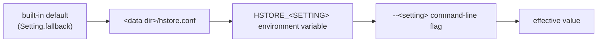

# Configuration

Every runtime knob of the `hstore` server is a *setting*. Settings are declared once, in
[`Setting.java`](../../server/src/main/java/io/hstore/server/Setting.java), and resolved by
[`ServerConfig.java`](../../server/src/main/java/io/hstore/server/ServerConfig.java) into
`EngineOptions`, `DatabaseOptions`, the wire-protocol `Server.Policy`, the Studio options and the logging
configuration.

## Sources and precedence

A setting can come from four places. Later sources override earlier ones:



| Source | Syntax | Example |
|---|---|---|
| default | compiled into the binary | `port` = `7432` |
| file | `java.util.Properties` file `hstore.conf` in the data directory; `key = value`, `#` comments | `port = 9000` |
| environment | `HSTORE_` + upper-cased key | `HSTORE_PORT=9100` |
| command line | `--key value` (dashes or underscores both accepted in the key) | `--port 9200` |

Rules enforced by `ServerConfig.load`:

* Keys are case-insensitive and `-` is normalised to `_` (`--log-statement all` equals `--log_statement all`).
* An unknown key in `hstore.conf` is a startup error (`unknown setting 'x'`).
* Unknown command-line flags are ignored by the setting resolver, because the same flag map also carries
  command options such as `--superuser`, `--password`, `--user`, `-c` and `--if-not-exists`.
* Unknown `HSTORE_*` variables are ignored. Only variables whose name matches a setting are read. `HSTORE_USER`, `HSTORE_PASSWORD`,
  `HSTORE_PASSWORD_FILE` and `HSTORE_DATA` are consumed by the CLI and the Docker entrypoint, not by the resolver.
* Boolean settings accept `on|true|yes|1` and `off|false|no|0`.

`hstore init` writes a fully commented `hstore.conf` template into the new data directory. Every setting
appears with its description. Settings passed to `init` as flags are written uncommented; all others are
written commented out with their default:

```
$ hstore init /srv/hstore --page_size 8192 --durability async
$ grep -v '^#' /srv/hstore/hstore.conf | grep -v '^$'
page_size = 8192
durability = async
```

`serve` logs every non-default value and where it came from, so a running server always records its effective
configuration:

```
LOG:  [main] configuration: port=27500 (command line), max_connections=2 (command line), page_size=8192 (file), durability=async (file)
```

`hstore config [<dir>]` prints the effective value of every setting without opening the database:

```
$ HSTORE_PORT=7600 hstore config /srv/hstore --port 7700 | head -3
listen_address           = 127.0.0.1
port                     = 7700
max_connections          = 200
```

`embedding_api_key` is always printed and logged as `***`.

## Reference

### Network and sessions

| Key | Environment | Default | Description |
|---|---|---|---|
| `listen_address` | `HSTORE_LISTEN_ADDRESS` | `127.0.0.1` | Interface for both the wire protocol and Studio. The Docker image sets `0.0.0.0`. |
| `port` | `HSTORE_PORT` | `7432` | TCP port of the [HQL wire protocol](wire-protocol.md). |
| `max_connections` | `HSTORE_MAX_CONNECTIONS` | `200` | Open wire connections allowed. Connection *n+1* receives `error [ABORTED_RESOURCE_LIMIT]: too many connections` and is closed. Studio sessions are not counted. |
| `authentication` | `HSTORE_AUTHENTICATION` | `auto` | `auto` requires `AUTHENTICATE` once at least one user exists; until then only clients on the server's own host are served. `on` always requires it. `off` never requires it, and every connection, from any host, runs as the built-in `system` ADMIN principal. Applies to the wire protocol and to Studio. |
| `idle_timeout_seconds` | `HSTORE_IDLE_TIMEOUT_SECONDS` | `0` | Wire connections with no request for this long are closed (the socket read timeout). `0` disables the timeout. |
| `authentication_timeout_seconds` | `HSTORE_AUTHENTICATION_TIMEOUT_SECONDS` | `30` | Wire connections that still have to authenticate are closed after this long. `0` disables the timeout. |
| `authentication_failure_delay_ms` | `HSTORE_AUTHENTICATION_FAILURE_DELAY_MS` | `500` | Pause before the wire protocol or Studio answers a failed sign-in, from 0 to 10000. Successful sign-ins are not delayed. |
| `max_message_mb` | `HSTORE_MAX_MESSAGE_MB` | `64` | Largest request an authenticated client may send. Clients that have not authenticated are limited to 64 KiB. |
| `tls` | `HSTORE_TLS` | `off` | `on` serves the wire protocol over TLS and Studio over HTTPS, with the same certificate. Startup fails if the certificate or key is missing or unreadable. |
| `tls_certificate_file` | `HSTORE_TLS_CERTIFICATE_FILE` | *(empty)* | PEM certificate chain the server presents, leaf first. |
| `tls_key_file` | `HSTORE_TLS_KEY_FILE` | *(empty)* | Unencrypted PKCS#8 PEM private key (`BEGIN PRIVATE KEY`), EC, RSA or Ed25519. Convert other formats with `openssl pkcs8 -topk8 -nocrypt`. |
| `tls_ca_file` | `HSTORE_TLS_CA_FILE` | *(empty)* | Client side: certificates `hstore connect` and `hstore ping` trust when `tls = on`. Falls back to `tls_certificate_file` (handy for self-signed setups), then the system trust store. |
| `studio` | `HSTORE_STUDIO` | `on` | Serve [HStore Studio](studio.md). |
| `studio_port` | `HSTORE_STUDIO_PORT` | `7480` | HTTP port of Studio. |
| `studio_session_minutes` | `HSTORE_STUDIO_SESSION_MINUTES` | `60` | Idle minutes before a Studio session is closed and its HQL session released. |
| `studio_assets` | `HSTORE_STUDIO_ASSETS` | *(empty)* | Serve Studio's HTML/CSS/JS from this directory instead of from the binary, re-read on every request. For [Studio development](../development.md#working-on-studio) only. |

### Storage engine

| Key | Environment | Default | Description |
|---|---|---|---|
| `page_size` | `HSTORE_PAGE_SIZE` | `16384` | Page size in bytes. Must be a power of two from 1 KiB to 1 MiB. It is recorded in `<data>/FORMAT` at creation, and opening with a different value fails with `database uses N byte pages, options request M`. |
| `durability` | `HSTORE_DURABILITY` | `sync` | `sync`: a commit is acknowledged after the group-commit barrier has `fsync`ed it. `async`: acknowledged once appended, so a crash can lose a suffix of acknowledged commits but never corrupts the database. |
| `wal_mode` | `HSTORE_WAL_MODE` | `references` | Applies to the pages a commit writes itself: spilled pages of bulk loads and trees that changed in more than 4,096 places. `references`: the WAL logs `PageRef(pageId, address, length, crc32c)` records and those pages are synced before the WAL. `images`: the WAL logs their full images. Ordinary commits log only the keys they changed, and pages written at checkpoints are not logged in either mode. See [WAL and recovery](../transactions/wal-and-recovery.md). |
| `node_cache_mb` | `HSTORE_NODE_CACHE_MB` | `256` | Megabytes of Java heap for decoded tree nodes, each counted at an estimate of the memory it takes. |
| `max_open_segment_files` | `HSTORE_MAX_OPEN_SEGMENT_FILES` | `256` | Segment files kept open at once. A segment file is opened when a page in it is written or read without its memory map, and once the limit is reached the least recently used file that no thread is using is closed to make room, after its unsynced writes are forced to disk. Must be between 1 and 2,147,483,647. |
| `checkpoint_wal_mb` | `HSTORE_CHECKPOINT_WAL_MB` | `auto` | WAL volume, or volume of pages written, since the last checkpoint that triggers a background checkpoint. `auto` sizes it from the store: a quarter of the live bytes in the data segments, at least 2 MiB and at most 256 MiB. A number is megabytes, between 1 and 16,777,216. A threshold stored with `CHECKPOINT AT` overrides this setting. |
| `write_buffer_mb` | `HSTORE_WRITE_BUFFER_MB` | `64` | Megabytes of Java heap held by committed tree nodes that no checkpoint has written yet. A background checkpoint starts once more than half of it is in use; a commit that finds it full waits for a checkpoint, for at most 30 seconds. Must be between 1 and 16,777,216. |
| `history_limit` | `HSTORE_HISTORY_LIMIT` | `64` | Committed generations kept addressable for `AT GENERATION`, `AS OF`, `HISTORY` and the Studio time slider. History is kept in memory only: after a restart it holds the checkpointed generation and the generations replayed from the WAL after it. |
| `compaction_live_ratio` | `HSTORE_COMPACTION_LIVE_RATIO` | `0.5` | Sealed segments whose live bytes fall below this fraction of their allocated bytes are emptied by compaction, which moves their live pages to the active segment: one segment (the emptiest) per background pass whenever one is below the ratio, or all of them with `COMPACT`. Pages count as free once nothing refers to them and no retained generation or open reader can reach them; a checkpoint releases them. Time-travel history is preserved. Emptied segments are deleted after the next checkpoint, once no reader that started before the move is still open. Must satisfy 0 < r < 1; other values fail at startup. |
| `feed_retention_generations` | `HSTORE_FEED_RETENTION_GENERATIONS` | `100000` | Committed generations kept in the [change feed](../storage/change-feed.md) for `HISTORY`, `DIFF` and subscribers. After every checkpoint, whole feed segments that lie entirely below `current − N` are deleted. *Holds* lower that floor: the semantic index's last persisted generation and the generation of each continuous materialised view. Feed segments roll at the WAL segment size (`EngineOptions.walSegmentBytes`, 64 MiB). Must be ≥ 1. |

### Resource budgets

| Key | Environment | Default | Description |
|---|---|---|---|
| `query_page_budget` | `HSTORE_QUERY_PAGE_BUDGET` | `2000000` | Page visits allowed per query before it is aborted with `ABORTED_RESOURCE_LIMIT`. A tenant quota (`query_pages`) can lower it per tenant. |
| `transaction_page_budget` | `HSTORE_TRANSACTION_PAGE_BUDGET` | `0` | Pages one transaction may add: the tree nodes it created that will need a page of their own (small member trees kept inline don't count), plus the pages it spills. Most of them are written by the next checkpoint rather than by the commit. `0` or a negative value means unlimited. A tenant quota (`transaction_pages`) can lower it per tenant. |

### Semantic plane

| Key | Environment | Default | Description |
|---|---|---|---|
| `embedding_provider` | `HSTORE_EMBEDDING_PROVIDER` | `hashing` | `hashing` uses the built-in deterministic feature-hashing encoder. `openai` POSTs `{"model","input"}` and reads `$.data[0].embedding[*]`. `ollama` POSTs `{"model","prompt"}` and reads `$.embedding[*]`. |
| `embedding_url` | `HSTORE_EMBEDDING_URL` | *(empty)* | Endpoint URL. Required for `openai` and `ollama`. |
| `embedding_model` | `HSTORE_EMBEDDING_MODEL` | *(empty)* | Model name sent in the request. Required for `openai` and `ollama`. |
| `embedding_dimensions` | `HSTORE_EMBEDDING_DIMENSIONS` | `256` | Vector width. A response of any other width is rejected. |
| `embedding_api_key` | `HSTORE_EMBEDDING_API_KEY` | *(empty)* | Sent as `Authorization: Bearer <key>`. Masked in all output. |

The HTTP encoder makes three attempts with exponential back-off (400 ms, 800 ms, 1.6 s). It retries on I/O
errors, `429` and `5xx`, and fails immediately on any other `4xx`.

### Logging

| Key | Environment | Default | Description |
|---|---|---|---|
| `log_level` | `HSTORE_LOG_LEVEL` | `info` | `debug`, `info`, `warning` or `error`. |
| `log_statement` | `HSTORE_LOG_STATEMENT` | `none` | `none`, `ddl`, `mod` (DDL and writes) or `all`. |
| `log_min_duration_ms` | `HSTORE_LOG_MIN_DURATION_MS` | `-1` | Log every statement that takes at least this many ms, whatever `log_statement` says. `-1` disables this, and `0` logs everything. |
| `log_connections` | `HSTORE_LOG_CONNECTIONS` | `on` | Log connection, authorisation and disconnection events. |
| `log_directory` | `HSTORE_LOG_DIRECTORY` | *(empty)* | Also write logs to `<dir>/hstore-%g.log`, rotating by size. |
| `log_rotation_mb` | `HSTORE_LOG_ROTATION_MB` | `64` | Size of one log file. |
| `log_file_count` | `HSTORE_LOG_FILE_COUNT` | `8` | Rotated files kept. |

See [logging](logging.md) for the line format and the full message catalogue.

## Tuning

**Page size.** Pages are the unit of copy-on-write, of checksum verification and of cache residency. Larger
pages fit more entries per leaf, which means shallower trees and fewer page visits per lookup. The cost is
higher write amplification per commit, because each commit rewrites one root-to-leaf path per touched tree.
16 KiB suits mixed workloads. Use 4–8 KiB for update-heavy workloads with small hyperedges, and 32–64 KiB
for analytics over giant hyperedges. The value cannot be changed after `init`.

**`node_cache_mb`.** This is the only cache HStore sizes itself, and it holds *decoded* nodes on the Java heap.
Raw pages are cached by the operating system like any other file data, in memory the OS can take back when it
needs to. Each node is counted at an estimate of its size on the heap, worked out from its entry count and the
encoded size of its values, so the setting is close to the heap the cache really takes. Measured against the
heap it was 10 to 40% low, never above. A decoded node is three to six times the size of its page, so a cache
counted in page bytes would have used several times its setting. The default of 256 is about the heap the earlier
default of 64 really used when nodes were counted at their page size.

The server binary uses the serial collector, and every full collection walks everything this cache holds, so a
bigger cache means longer pauses. Size it for what every lookup touches: the interior nodes, about 2% of the data,
plus the leaves you read all the time. The Dashboard *Cache hit rate* tile and `STATS;` show whether it is big
enough.

The value must be between 1 and 16,777,216 (16 TiB). Two older names are refused at startup, whether they come from `hstore.conf`, the environment or a flag:
`cache_mb`, the name this setting had before it was released, and `cache_nodes`, a node count. Both messages name
`node_cache_mb`.

**`max_open_segment_files`.** Each open segment file holds one file descriptor. Reads from sealed segments go
through a read-only memory map, and a map stays valid after its file is closed, so in steady state only the
segment being written and the ones written or remapped recently are open. Closing a file costs an `fsync` if it
has unsynced writes, and opening it again costs one `open` call. The write-ahead log, the change feed,
`pages.dir`, `pages.ref` and client connections need descriptors too, so keep the process limit (`ulimit -n`)
well above this value.

**`checkpoint_wal_mb`.** A checkpoint writes the tree nodes that commits left in memory, publishes the catalog
image of the generation it wrote, and truncates WAL segments before the checkpoint LSN. Lower values shorten recovery, since recovery replays WAL after the last checkpoint,
at the cost of more frequent catalog writes. Recovery time scales roughly linearly with WAL volume since the
last checkpoint. The same volume of page writes also triggers a checkpoint, which is what releases dead pages
during a bulk load.

With `auto` (the default) the threshold follows the store. A store with 12 MiB of live data checkpoints every
3 MiB of log, one with 512 MiB every 128 MiB, and one of 1 GiB or more every 256 MiB, the fixed default before
`auto`. The rule is in [maintenance](../storage/maintenance.md#checkpoints).

The threshold in use is decided in this order:

1. a value stored in the database with `CHECKPOINT AT <size>` ([HQL](../database/hql.md#maintenance)), which
   persists across restarts and crashes and is removed with `CHECKPOINT AT AUTO`;
2. a number given for `checkpoint_wal_mb` (`EngineOptions.withCheckpointWalBytes` for embedded use);
3. the automatic rule.

`STATS` and the Studio dashboard show the value in use and which of the three set it. Changing it with
`CHECKPOINT AT` takes effect on the next maintenance pass, without a restart.

**`write_buffer_mb`.** Commits keep their new tree nodes on the heap until a checkpoint writes them, and this
setting bounds that heap. A key that many commits change is written once per checkpoint, so a larger buffer means
fewer page writes for hot data and fewer checkpoints. The cost is heap, which the collector has to walk like the
node cache, and a longer replay after a crash, since recovery replays every commit since the last checkpoint. If
commits outrun checkpoints and the buffer fills, commits wait for room; one that waits 30 seconds logs a warning
and commits anyway.

**`durability` × `wal_mode`.**

| Combination | Commit cost | Crash guarantee |
|---|---|---|
| `sync` + `references` (default) | WAL `fsync` per group-commit batch, plus a data `fsync` when a commit in the batch wrote pages | Every acknowledged commit survives. |
| `sync` + `images` | WAL `fsync` per batch; the WAL carries full images of the pages commits write themselves | Every acknowledged commit survives. Data pages need not be synced first. |
| `async` + either | no `fsync` on the commit path | Recovery yields a *prefix* of the commit history. A suffix of acknowledged commits may be lost. Never a torn or mixed state. |

Group commit amortises the `fsync` over concurrent committers. The Dashboard reports the observed average
batch size (*transactions per fsync*).

**`feed_retention_generations`.** The feed is the only on-disk record of per-generation changes older than
the retained catalog history. Raise it if `HISTORY` or branch diffs must reach further back. Lower it to bound
disk usage on write-heavy systems. Space is reclaimed a segment at a time, so the feed may hold up to one
segment more than the limit.

**Budgets.** `query_page_budget` bounds the damage of an accidental full scan in a shared deployment. Use
`EXPLAIN` to see the chosen access path and `TRACE` to see the pages it read. Tenants may get tighter limits
through `ALTER TENANT name QUOTA (query_pages N, transaction_pages N)`; see
[tenancy, users and quotas](../database/security.md).
