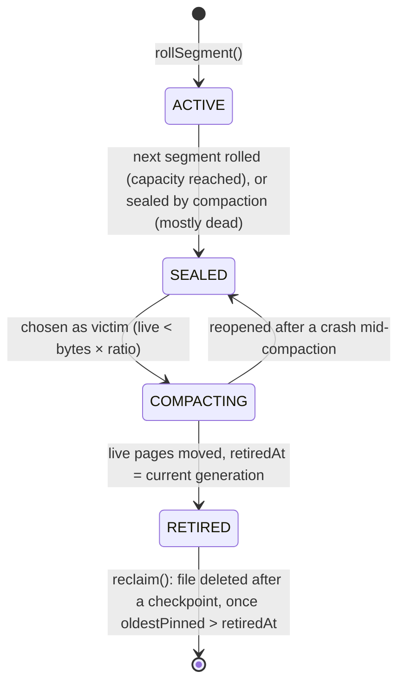

# Maintenance: checkpoints, compaction and verification

Copy-on-write storage never overwrites data, so three background concerns replace in-place update:

* **Checkpoints** write the trees commits left in memory to pages, and bound recovery time, WAL size and the
  memory those trees take.
* **Reference counting and compaction** find the node images nothing can reach any more and return their space to
  the file system.
* **Verification** proves that what is on disk is internally consistent.

Sources are under `engine/src/main/java/io/hstore/engine/maintenance/`, plus `StorageEngine.java`, `txn/TransactionManager.java` (the write buffer), `page/PageStore.java`, `page/ReferenceCounts.java`, `tree/Materializer.java`, `tree/TreeWalker.java` and `tree/TreeVerifier.java`.

## Who runs what

| Trigger | Action | Code |
|---|---|---|
| Engine open, after recovery | checkpoint, then reclaim | `StorageEngine` constructor |
| `hstore-maintenance` virtual thread, every `maintenanceInterval` (default 500 ms) or when a commit wakes it because the write buffer is full or the checkpoint threshold was passed (skipped when the `maintenance` lock is busy) | checkpoint if the write buffer holds more than half of `write_buffer_mb`, more than the checkpoint threshold of WAL or of pages were written since the last one, or more than 1 048 576 counts changed; compact one segment if any is below `compaction_live_ratio`, sealing the active one first if it is at least a quarter full and that far below (followed by a checkpoint); then reclaim | `StorageEngine.maintain` |
| `CHECKPOINT;` (HQL), `StorageEngine.checkpoint()` | checkpoint | `timedCheckpoint` |
| `COMPACT;` (HQL), `StorageEngine.compact()` | checkpoint, compact, checkpoint, reclaim | `StorageEngine.compact` |
| Every checkpoint | count references between the previous checkpointed generation and the new one | `ReferenceCounter.checkpointed` |
| `hstore-references` platform thread, when a transaction gives up pages it spilled | mark those pages dead | `ReferenceCounter` |
| `StorageEngine.verifyReferences()`, `hstore check` | checkpoint, then compare the counts | `verifyReferences` |
| `StorageEngine.close()` | final checkpoint, then shutdown | `close` |

Checkpoint and compaction are serialized by `StorageEngine.maintenance`, a `ReentrantLock`. Background compaction plays the role of PostgreSQL's autovacuum. It runs whenever a sealed segment's live bytes fall below `compaction_live_ratio` of its allocated bytes, which the reference counts keep up to date, and it empties one segment per pass, the emptiest. `COMPACT;` empties every such segment on demand.

Every checkpoint is logged, and then the checkpoint listeners run. The database registers `SemanticPlane.persist`, which saves the HNSW index alongside the catalog. A sample log line:

```text
2026-10-04 06:25:10.429 IST [23683] LOG:  [engine] checkpoint complete: generation 198, lsn 203,200, 1 wal segments retained, 25 ms
```

## Checkpoints

An ordinary commit doesn't write tree pages. It logs the keys it changed ([wal-and-recovery.md](../transactions/wal-and-recovery.md#the-changes-payload)) and publishes a generation whose roots point at in-memory nodes. The checkpoint is what writes those nodes to pages, once for all the commits since the previous checkpoint. Only a tree that changed in more than 4,096 places in one commit, such as one a bulk load built, is written by the commit itself.

`Checkpointer.checkpoint()` (`maintenance/Checkpointer.java`) works on `g`, the published current generation when it starts. Commits keep running during the whole checkpoint except one short step (step 9).

1. It walks every branch's roots in `g` with a `Materializer` and writes each pending node: allocate, `pages.write`, admit the frozen node to the node cache. Each in-memory node is stamped with its stored reference and the checkpoint's `Epoch`. A node stamped by the last published epoch already has a page and is not written again ([persistent-tree.md](persistent-tree.md#materialization)).
2. `pages.checkpoint()` fsyncs every dirty segment file and forces the page directory. A failure up to here hands the pages written so far to the reference counter, which marks them dead.
3. It pauses the reference counter (`ReferenceCounter.pause`) and applies the previous checkpoint's journal if that was never done.
4. It takes `lsn`, the WAL position just after `g`'s `Commit` record (`TransactionManager.commitEnd`). Commits published after `g` stay above it.
5. It counts references from the previously checkpointed generation to the one it just wrote (see [Reference counts](#reference-counts)) and releases the pages that died before the oldest generation anyone can still read (see [Releasing pages](#releasing-pages)).
6. `pages.checkpoint()` again, then `pages.journal(lsn)` writes every count changed since the last checkpoint, and every directory entry released, to `pages.ref.journal`, and fsyncs it.
7. `feed.sync()` fsyncs the active feed segment.
8. `catalog.publish(new CatalogImage(g, List.of(), pages.segments(), lsn, feed.size()))` writes the image durably and atomically ([catalog-and-generations.md](catalog-and-generations.md#catalog-images-checkpoints)). The image holds the written `g` and every segment's `(id, state, pages, units, retiredAt)`. Retained history is not written.
9. `TransactionManager.checkpointed` publishes the epoch. Then, under the commit lock and with the group committer drained, it swaps the written pages into the head generation (`Materializer.rebound`), so later commits build on stored references instead of in-memory nodes. It recounts the write buffer and wakes commits that were waiting for it.
10. It appends a `WalRecord.Checkpoint(0, g, lsn)`, calls `wal.sync()`, and `wal.truncateBefore(lsn)` deletes WAL segment files that end before the checkpoint LSN. The catalog image now covers them.
11. `pages.applyJournal()` writes the journaled counts into `pages.ref` and clears the released directory entries, forces both files, and empties the journal. It remembers `lastLsn = lsn` and resumes the counter.

If a step after the catalog is published fails and the engine keeps running, the journal on disk still belongs to the published catalog. The next checkpoint applies that journal before it writes its own, so the file never falls more than one checkpoint behind the catalog. If publishing the catalog itself fails, it isn't known whether the new catalog reached the disk, so `pages.ref` is marked for rebuilding and the next open recounts. The full ordering, and what a crash at each step leaves behind, is in [wal-and-recovery.md](../transactions/wal-and-recovery.md#9-checkpoints).

**Trigger threshold.** `walSinceCheckpoint() = wal.end() − lastLsn` is compared with the checkpoint threshold, and so is the volume of pages written since the last checkpoint. `StorageEngine.checkpointThreshold()` resolves the threshold on every maintenance pass ([`CheckpointThreshold`](../../engine/src/main/java/io/hstore/engine/CheckpointThreshold.java)):

1. a value stored with `CHECKPOINT AT <size>` (`StorageEngine.checkpointAt`) wins;
2. otherwise a fixed `checkpoint_wal_mb` (`EngineOptions.checkpointWalBytes`);
3. otherwise, with `checkpoint_wal_mb = auto` (the default, `EngineOptions.AUTOMATIC_CHECKPOINTS`), a quarter of the live bytes in the data segments, held between 2 MiB and 256 MiB.

| Live data | Automatic threshold |
|---|---|
| up to 8 MiB | 2 MiB |
| 12 MiB | 3 MiB |
| 64 MiB | 16 MiB |
| 512 MiB | 128 MiB |
| 1 GiB and more | 256 MiB |

The rule weighs what recovery has to redo against what a checkpoint costs. Recovery replays every commit logged since the last checkpoint and then writes every page those commits changed, so the replayed log should stay small next to the store. A checkpoint writes the pages changed since the previous one, which is at most the whole store (the write buffer trigger also starts one once unwritten nodes pass half of `write_buffer_mb`). Checkpointing once the log reaches a quarter of the live data keeps replay to a quarter of the store's size, and keeps page writes from checkpoints to at most about four bytes per byte of log even when every checkpoint rewrites the whole store. The 2 MiB floor keeps a nearly empty store from paying the fixed cost of a checkpoint (a catalog image, a reference journal and several fsyncs) every few hundred kilobytes of log, while a store being loaded from empty still checkpoints within its first few megabytes. The ceiling is the fixed 256 MiB threshold used before.

**Waking on commit.** The maintenance thread also looks at the threshold right after a commit passes it, not only every `maintenanceInterval`. At the end of each maintenance pass `StorageEngine.armWake` turns the threshold into two marks: the WAL byte count and the page byte count at which it will be passed. `TransactionManager` runs `StorageEngine.wakeIfDue` after every commit, which compares `wal.bytesAppended()` and `pages.bytesWritten()` with the marks and unparks the maintenance thread when either is passed. The checkpoint still runs on the maintenance thread. The first commit to pass a mark sets a flag that the next maintenance pass clears, so the commits that follow while that checkpoint is pending or running don't wake the thread again.

The stored value lives in the engine slot `settings` (slot 8, key 1), written by a system transaction on main like interned symbols, so it is logged, checkpointed and replayed with everything else. The slot has no root until a value is stored, so a store that never ran `CHECKPOINT AT` is unchanged on disk. A build from before the slot existed cannot open a store that has a stored value: it fails with `no slot registered with id 8`. `CHECKPOINT AT AUTO` deletes the key.

**What recovery gains.** Recovery loads the newest valid catalog image and replays only the commits logged after `checkpointLsn` ([wal-and-recovery.md](../transactions/wal-and-recovery.md)). Its segment table restores the allocator position (`units`) and the compaction state machine. History is not in the image, so time travel after a restart reaches only the generations recovery rebuilt ([catalog-and-generations.md](catalog-and-generations.md#history-retention-and-time-travel)).

### The write buffer

Until a checkpoint writes them, the nodes commits created live on the heap. `TransactionManager.recountUnwritten` measures them: the heap estimate of every pending node reachable from the head generation that has not been written by a published checkpoint or by its own commit, nested trees included. `write_buffer_mb` (default 64, `EngineOptions.writeBufferBytes`) bounds it:

* The maintenance thread checks it on every pass and checkpoints once it passes half the limit.
* A commit that finds it over the limit, before taking the commit lock, wakes the maintenance thread and waits for a checkpoint to make room. It checks again every 50 ms. After 30 seconds it logs `the write buffer stayed full for 30 s; committing anyway` and commits.
* Each commit adds the heap of the nodes it created to a running total, so the check is cheap. The total is recounted exactly on every maintenance pass, after every checkpoint, and when a commit finds it over the limit.

A larger buffer means fewer checkpoints and fewer page writes for keys that change often, at the cost of heap and of a longer replay after a crash, since every commit since the last checkpoint is replayed.

## Space reclamation

### Why space needs reclaiming

Each checkpoint writes fresh node images for every path changed since the previous one and references all unchanged subtrees from the previous checkpoint's pages ([persistent-tree.md](persistent-tree.md#update-algorithm)). The images it replaced stay on disk. They are still *reachable* while a retained generation references them, which is what makes time travel possible. Once the generations that reference them leave history, they are garbage.

Segments are append-only extents ([pages.md](pages.md#segment-files)), so garbage is never reused piecemeal. It is reclaimed one whole segment at a time:

1. count, for every page, how many pages and branch roots point at it, and note when that number reaches zero;
2. once no reader can reach such a page any more, release it and take its bytes off its segment's live total;
3. copy the remaining pages out of mostly-dead segments, byte for byte, and point their entries in the page
   directory at the copies;
4. delete the files once a checkpoint has made the new entries durable and no reader can still be using an old
   address.

No tree is rewritten and no generation is committed. Pages keep their numbers when they move
([pages.md](pages.md#page-numbers-and-the-page-directory)), so every node that points at a moved page, in every
generation and branch, still points at it.

### Segment state machine



`SegmentState.canTransitionTo` allows only the next state, plus `COMPACTING → SEALED`. `SegmentInfo.withState` throws on anything else. `PageStore.open` turns a `COMPACTING` segment back into `SEALED`, so a compaction cut short by a crash leaves the segment a candidate for the next pass. Only one segment is `ACTIVE` at a time: the one `PageStore.allocate` appends to. It is never chosen as a victim, but a compaction pass can seal it first (see [Compaction](#compaction)), and the next allocation then rolls to a new segment.

### Reference counts

Every page number has a count in `data/segments/pages.ref` ([pages.md](pages.md#reference-counts)): the number of
places that point at it in the last checkpointed generation. A place is a branch's root for a slot, a child
reference in a branch node, or a nested tree's root inside a leaf value, such as an edge's member tree in the
catalog. A page that two branches share through one parent is counted once for that parent, not once per branch.

A small member or order tree kept inline in its edge record ([persistent-tree.md](persistent-tree.md#inline-trees))
is not a place: it has no page, and its entries hold no references, so the counter never sees it. `TreeWalker`
reports only `Ref.Stored` references, and a catalog leaf whose edges are all inline doesn't set `REFERS_TO_PAGES`,
so the counter doesn't even decode it. When an edge grows past the inline limit, the next checkpoint writes its tree as
a new page and the new catalog leaf points at it, which adds one like any new page. When it shrinks back, the new catalog
leaf no longer points at that page, which takes one away like any other change. Neither case needs special code.

**At each checkpoint.** Counting happens only between two generations whose trees are fully written: the one
the previous checkpoint wrote and the one the current checkpoint just wrote. `ReferenceCounter.checkpointed` runs
on the checkpointing thread while counting is paused, before the journal is written. Generations published in
between are never counted. Their new nodes are in memory and have no pages, and every page they reach was either
counted by the previous checkpoint, which keeps that count until this one, or is provisional (below). For each branch whose roots changed the counter
compares the two root vectors and then:

1. Adds one to every new root. A page whose count goes up from zero is new: written by this checkpoint, spilled by a
   bulk load, or written by a commit that logged its tree by reference. The pages it points at get one more as
   well, and so on down.
2. Takes one from every old root. A page whose count reaches zero is dead, so the pages it pointed at lose one too.

Step 1 runs to the end before step 2 starts, and its additions are collected in a small map first. When a node is
replaced, the new copy adds one to each child and the old one takes it away again, so those children cancel out
and their counts are never touched. What the counter really writes is the few pages that changed between the two
checkpoints, however many commits there were in between. Reading a node's references needs the node, which almost
always comes from the node cache since the checkpoint just wrote it or a commit read it. A leaf below a branch node
is never read when its tree's values hold no references, since the branch already says its children are leaves.
Other leaves are read only as far as the header when they aren't cached: a header flag
(`PageHeader.REFERS_TO_PAGES`) says whether any value in the leaf points at another page, and most leaves, such as
catalog leaves holding nodes and index leaves with inline postings, don't.

A page that dies is marked with the generation of the checkpoint that found it dead. Older generations can still
reach it, so its bytes stay where they are until no one can read those generations (see below).

**Provisional pages.** Some pages exist before any checkpoint has counted them: pages `Transaction.load` spills
before its transaction commits, and pages a commit writes for a tree it logs by reference. When the commit is
published they are recorded as provisional for its generation (`ReferenceTracker.provisional`). The checkpoint that
covers that generation counts the ones its trees reach and marks the rest dead. If the transaction aborts, fails
with a conflict or a page budget error, or turns out to repeat a request that already committed, its spilled pages
are handed to the `hstore-references` thread instead, which marks them dead straight away. Pages written by a
transaction that a crash cut short are found on the next open (see below).

**Between checkpoints** the changes live in a map in memory (`ReferenceCounts.changed`) and `pages.ref` itself is
not touched. A checkpoint journals them and then applies them (steps 6 and 11 above), so a crash at any point leaves
the file as of one checkpoint or the next, never a mix. The background thread checkpoints early when more than
1 048 576 counts have changed, which keeps that map to a few tens of megabytes. It also checkpoints after every
checkpoint threshold's worth of pages written, because a bulk load writes many pages for little WAL and its dead pages would
otherwise wait a long time to be released.

**On open**, `PageStore.open` applies `pages.ref.journal` if it was written by the checkpoint the catalog points at
and ignores it otherwise. A `pages.ref` that is missing while the directory already has pages is marked for
rebuilding. The counts then describe the checkpointed generation; the generations recovery replays from the WAL are
in memory and are counted by the checkpoint at the end of the open. Last, `ReferenceCounter.recover` makes one pass
over `pages.dir` and `pages.ref` (`PageStore.scan`), which:

* collects every page that has an address but a count of zero and isn't marked dead. Such a page was written after
  the last checkpoint: spilled, written by a commit, written by a checkpoint that never published, or written by a
  transaction that never committed. Its entry is kept, and the pages are handed to the first checkpoint as
  provisional, which counts the ones it reaches and marks the others dead;
* adds up the live bytes of each segment;
* collects the dead pages that are still waiting, in order of the generation they died in.

**If counting fails**, for example on a page that can't be read, the counter stops, logs an error and marks
`pages.ref` for rebuilding. It releases nothing more until the engine restarts, so the worst case is space that
isn't reclaimed. The next open sees the mark and recounts from the checkpointed generation and any history its
catalog image holds: every page reachable from the checkpointed generation gets its exact count, and every page
only older generations reach is marked dead as of the checkpointed generation. That walk reads every node of every
tree it covers, so it takes as long as `hstore check`. The rebuild writes `pages.ref` directly but leaves the mark
in place until the checkpoint at the end of the open has published its catalog. A crash in between rebuilds again.
A thread error such as running out of memory is handled the same way as a failed count.

### Releasing pages

A page that died in generation `g` can only be reached from generations older than `g`. The checkpoint computes the
oldest generation anyone can still read, `TransactionManager.oldestReadable()`: the oldest retained generation or the
oldest pinned one, whichever is smaller. Every waiting page that died at or before that generation is released: its
count goes to zero, its directory entry is cleared, and its bytes come off the live total of the segment it sits in.
Those live totals are what compaction chooses victims by.

Readers pin their generation and then check that it is still retained, and `trimHistory` puts a generation back if
it finds a pin on it after removing it. Between the two, a reader can't end up holding a generation whose pages were
released.

Releases only happen inside a checkpoint, and the checkpoint journals the cleared directory entries with the counts.
A release therefore never reaches the disk before the catalog that justifies it, and a crash can't bring back an old
generation whose pages are gone.

`StorageEngine.liveness()` returns the live bytes of each segment, and the Studio dashboard shows them next to
`SegmentInfo.pages` and `bytes()`. Dead pages that are still waiting count as live, since they still have to be
moved if their segment is compacted.

### Compaction

`Compactor.compact(liveThreshold)` (default threshold `compaction_live_ratio = 0.5`):

1. **Seal a mostly dead active segment.** If the active segment's live bytes are below `allocated bytes × threshold`, the pass seals it (`PageStore.sealActive`) so it can be chosen in the next step. `COMPACT` does this at any size; the background pass only once the segment holds at least a quarter of a segment's capacity. A database whose writes never fill the active segment would otherwise never get that dead space back.
2. **Choose victims.** A victim is a `SEALED` segment, not the active one, with `live bytes < allocated bytes ×
   threshold`, so the ratio is *live bytes / bytes written*. Every page allocated in it must also have been written
   (`PageStore.settled`); a commit or a spill allocates its pages before it logs them and writes them right after,
   so a segment can be sealed while a few of its pages are still on their way. Candidates are ordered from emptiest to
   fullest. The background pass takes only the first one (`compact(threshold, 1)`); `COMPACT` takes all of them.
3. Mark the victims `COMPACTING`.
4. **Move.** `PageStore.evacuate` reads through the victim one 64-byte unit at a time. Where a page header starts and
   the directory entry for that header's page number points at exactly this spot, the page is live: it is checked
   with `PageHeader.verify` and its bytes are written to the active segment. Anything else, such as a released page
   or the old copy of a page that has already moved, is skipped. The header holds the page number, not
   the address, so neither the header nor the checksum changes. Every 4 MiB of copies, the segments are synced and
   only then are the directory entries pointed at the copies, so an entry never reaches the disk pointing at bytes
   that aren't there yet. Afterwards the victim's live total has to be zero. If it isn't, some page the directory
   points at couldn't be read where it should be, and the victim goes back to `SEALED` instead of being retired, so
   its file is kept.
5. Mark the victims `RETIRED` with `retiredAt` set to the current generation.

The work is proportional to the size of the victims, not of the database, and the only memory it needs is a short
list of the pages moved in the current 4 MiB. `StorageEngine.compact()` checkpoints before compacting, so pages
that died since the last checkpoint are released and counted as free, and again afterwards, which forces the page
directory and persists the segment states. Then it calls `reclaim()`.

Compaction only ever moves whole pages, and an inline member tree is part of its catalog page's bytes, so it moves
with that page and needs no handling of its own. Since most edges are inline, a compaction of a typical database
has far fewer member pages to move than it used to.

Nothing here takes the commit lock and nothing commits. Commits carry on while pages move, readers keep using the
node cache, whose entries are keyed by page number and stay valid, and retained history keeps working because old
generations reach the moved pages through the same directory.

Moves are not written to the WAL. If the engine crashes before the checkpoint that follows a compaction, recovery replays the commits since the previous checkpoint and writes their original addresses back into the directory. Those addresses are in the victims, which are only deleted after that checkpoint, so they still hold the same bytes. The copies made before the crash become unreferenced space in the active segment, and the victims are picked again by a later pass. `CompactionTest` crashes at `COMPACTION_MOVE` and `COMPACTION_RETIRE`, with and without losing the directory writes made since the last checkpoint, and checks the data after reopening and after another compaction.

#### Interaction with running transactions

Compaction doesn't change any root, so transactions that started before it commit exactly as they would have without it, on the fast path or by rebasing.

That includes bulk loads. Pages that `Transaction.load` writes before commit already have directory entries, so a
victim's scan finds and moves them like any other page, and the transaction commits normally afterwards.

### Reclaim

`Compactor.reclaim()` deletes the file and catalog entry of every `RETIRED` segment, but only when both of these hold:

* a checkpoint has completed since the segment was retired (`Checkpointer.completed()`), so the new directory entries are durable and the WAL no longer holds commits whose addresses point into it; and
* no generation is pinned, or `oldestPinned() > retiredAt`.

Retained history no longer holds a segment back. Old generations reach moved pages through the directory like everything else, so `AT GENERATION` and `AS OF` keep working after the victims are gone.

**Why it must wait for readers.** A reader looks up a page's address and then reads the page. One that started before the move may have looked up an old address and not read it yet. Every reader and writer pins its generation, and anyone pinned at `retiredAt` or earlier may have started before the moves finished. Deleting the file early would turn that reader's next read into `segment does not exist`. Pins are reference counts per generation (the reader count of each `Retained` entry in `TransactionManager.history`). Every `Snapshot.close()` and transaction end decrements them, and the maintenance thread retries `reclaim` on every pass (`maintenanceInterval`, 500 ms by default). A retired segment therefore disappears within one interval of its last reader closing.

### History retention and pins

`TransactionManager.trimHistory` keeps at most `history_limit` generations (default 64). The current generation and every pinned generation are always kept. An unpinned old generation is dropped even when a newer pinned one exists, so one long-running snapshot keeps its own generation alive without holding back trimming of the generations before it.

History is kept in memory only. The catalog image no longer stores it, so after a restart the history holds the checkpointed generation and the generations recovery replayed after it.

History and pins are also what hold dead pages back. A page waits until every generation older than the one it died in has been trimmed and unpinned, so a long-running snapshot delays the release of everything that died after it began, and a larger `history_limit` keeps more dead pages on disk.

## The change feed on open

`ChangeFeed.open` validates the feed segments frame by frame and truncates the file at the first incomplete or corrupt frame ([catalog-and-generations.md](catalog-and-generations.md#file-format)). Frame headers and bodies are read with loops that continue until the requested bytes have arrived or end of file is reached. A short read in the middle of the file is therefore never mistaken for a torn tail. Recovery then rewrites any missing frames from the WAL's `Feed` records and truncates frames past the recovered generation. After each checkpoint, `feed.retain(current − feedRetention)` deletes whole segments that are no longer needed; see [change-feed.md](change-feed.md).

## Verification (`hstore check`)

`hstore check <dir>` (`server/src/main/java/io/hstore/server/Check.java`) opens the engine (running recovery) and calls `TreeVerifier.verify(root, schema)` on every slot root of every active branch. The verifier ([persistent-tree.md](persistent-tree.md#verification)) decodes every reachable image, which checks:

* magic, format, page identity and CRC-32C (`PageHeader.verify`);
* the schema id against the tree being read (`NodeCodec.decode`);
* strictly ascending keys in leaves;
* for a packed leaf, that the header's refers-to-pages flag matches its records once all of them are decoded. Loading a packed leaf skips that comparison, because it would decode every record;
* separators that route each child;
* uniform height (balance);
* every stored child summary equal to its recomputed contents;
* every node summary equal to its entries;
* the root reference's summary equal to the tree.

Nested trees are verified recursively and shared images only once. Inline trees are checked like any other
nested tree, keys and summary included, but they are not pages, so they add to `nested trees` and not to `pages`.

It then calls `StorageEngine.verifyReferences()`. That runs a checkpoint first, so that the counts describe a fully
written generation, then counts the references in the last checkpointed generation again from scratch and compares
every entry of `pages.ref` with the result. It also walks the retained history, following stored references through
any in-memory nodes, and checks that every page an old generation can reach still has an address, is counted or
provisional, and isn't due to be released while that generation is kept.

`StorageEngine.verifyChangeLog()` (`maintenance/ChangeLogCheck.java`) checks the log instead of the pages. It reads
the WAL from the start, and for every commit whose generation and predecessor are both still in memory it applies
the commit's `Changes` record to the predecessor's roots and compares the result with the generation the commit
published, entry by entry and through nested trees. The engine and database test suites run it after random
workloads; `hstore check` does not.

Output from a database loaded with `examples/clinical-claims.hql` (16 KiB maximum node size, packed extents):

```text
generation 157, recovered 0 commits from the log
branch main
  property-index          162 entries        9 pages      8 nested trees  height 1
  properties              122 entries        1 pages      0 nested trees  height 1
  ...
  catalog                 458 entries        1 pages     85 nested trees  height 1
verified 20 pages: checksums, ordering, balance and summaries are consistent
reference counts match the trees: 20 pages in use, 423 waiting for older readers
tenant isolation: no hyperedge on any branch has a member from another tenant
```

The last line comes from a scan of every hyperedge on every active branch that compares each member's tenant with
the edge's. If some differ, it prints them as `REMOVE @member FROM @edge` statements for the edge's tenant to run,
prefixed with `USE BRANCH <name>;` for branches other than main (up to 50 of them). Such memberships can only exist in databases written before `QUALIFY` checked its member
([security](../database/security.md#tenants)). They don't make the command fail.

A failure names the page, for example `HStoreException.corrupt(pageId, "checksum mismatch")` or `"separator does not route child 3 in atoms#1"`, and the command exits non-zero.

## Operations summary

| Setting | Default | Effect |
|---|---|---|
| `checkpoint_wal_mb` | auto | WAL or page volume since the last checkpoint that triggers a background checkpoint. `auto` is a quarter of the live data, between 2 MiB and 256 MiB; `CHECKPOINT AT` overrides it |
| `write_buffer_mb` | 64 | Heap held by nodes no checkpoint has written yet. A background checkpoint starts above half of it; commits wait while it is over the limit |
| `history_limit` | 64 | Generations kept for time travel (more while pinned) |
| `compaction_live_ratio` | 0.5 | A sealed segment is compacted when fewer than this fraction of its images are live |
| `page_size` | 16384 | Maximum node image size; fixed at `init` |

New segments start at 8 MiB and double as the store grows, up to `EngineOptions.pagesPerSegment × pageSize`, by default 16 384 × 16 KiB = 256 MiB and never more than 1 GiB because of the 24-bit unit offset ([pages.md](pages.md#segment-files)). Small stores therefore have many small segments that compaction can empty one at a time.

```sql
CHECKPOINT;
COMPACT;
STATS;
```

See [operations/](../operations/) for logging, the Studio dashboard's segment view and configuration layering.
