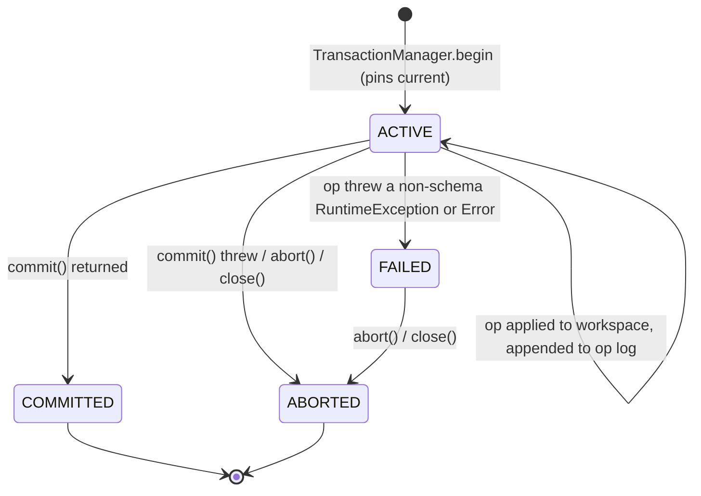
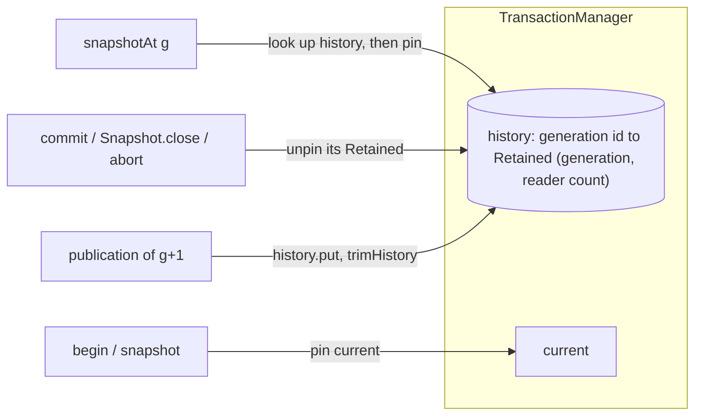
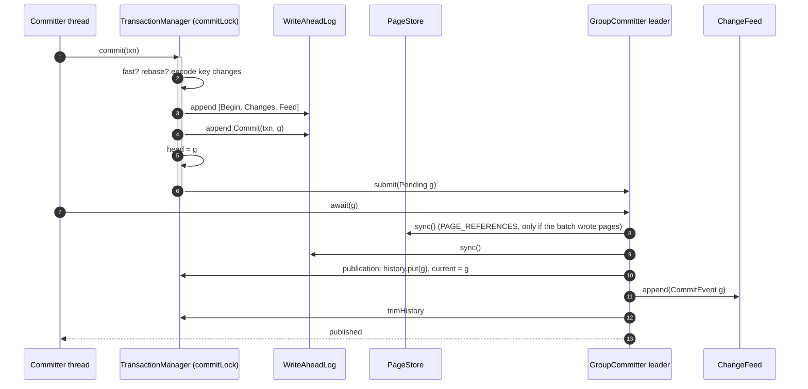
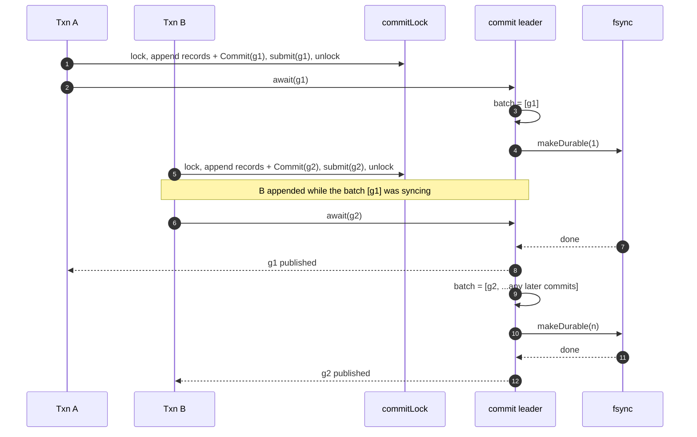
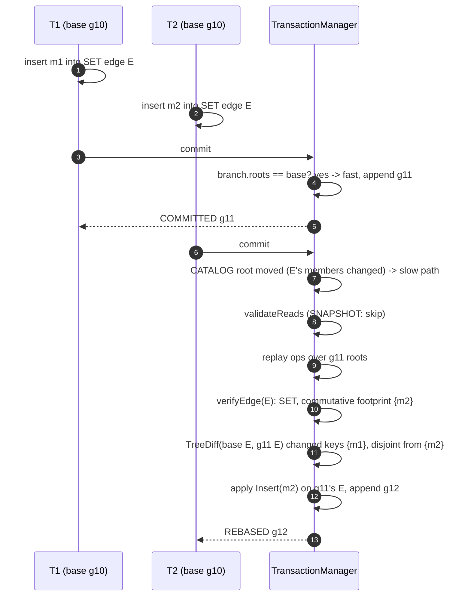

# Transactions

This document describes the transaction model of the storage engine from `begin` to the moment a commit becomes visible: workspaces, the operation log, the fast and slow commit paths, conflict detection, isolation levels, the commit lock, and the group-commit pipeline that turns many concurrent commits into one durability barrier.

Source of truth:

| Concern | File |
|---|---|
| Transaction handle, op log, footprints, read sets | `engine/src/main/java/io/hstore/engine/txn/Transaction.java` |
| Mutable per-transaction tree overlay | `engine/src/main/java/io/hstore/engine/txn/Workspace.java` |
| Logged operations | `engine/src/main/java/io/hstore/engine/txn/Op.java`, `EdgeAction.java` |
| Commit lock, append, publication, pinning, write buffer | `engine/src/main/java/io/hstore/engine/txn/TransactionManager.java` |
| Key changes a commit logs | `engine/src/main/java/io/hstore/engine/txn/ChangeLog.java` |
| Durability batching | `engine/src/main/java/io/hstore/engine/txn/GroupCommitter.java` |
| Options and results | `TxnOptions.java`, `Isolation.java`, `CommitResult.java` |
| Read-only views | `Snapshot.java`, `View.java` |
| Retry loop | `engine/src/main/java/io/hstore/engine/StorageEngine.java` (`write`) |

Related: [WAL and recovery](wal-and-recovery.md), [change feed](../storage/change-feed.md), [catalog and generations](../storage/catalog-and-generations.md), [persistent tree](../storage/persistent-tree.md), [topology](../storage/topology.md), [architecture overview](../architecture/overview.md).

## 1. Vocabulary

| Term | Meaning |
|---|---|
| Generation | Immutable record `Generation(id, wallTime, txnId, nextAtom, nextTxn, branches)`. Every successful write produces exactly one new generation whose `id` is the predecessor's `id + 1` (`Generation.successor`). |
| Branch | `Branch(id, name, parent, baseGeneration, createdAt, state, roots)`. `Branch.MAIN == 0`. A generation maps branch ids to branches; a commit replaces one branch. |
| Root vector | `RootVector`: slot id → `Ref` (root of one persistent tree). All state of a branch is its root vector. |
| Slot | A named keyed tree (`Slot<V>`). *Primary* slots are written by operations; *derived* slots (for example `EngineSlots.REVERSE`, `EngineSlots.CANONICAL`) are maintained by `Derivation`s and cannot be written directly (`Op.SlotWrite` rejects them). |
| `head` | `TransactionManager.head`: the latest generation whose records were **appended** to the WAL. Only touched under the commit lock. Base for the next commit. |
| `current` | `TransactionManager.current`: the latest generation that is **durable and published**. New snapshots and new transactions start here. |

`head` runs ahead of `current` by exactly the commits that are queued in the group committer. Readers never observe `head`.

## 2. Lifecycle



`Transaction.State` has exactly these four values. Two details matter:

* `execute(Op)` lets `HStoreException.InvalidSchema` and `HStoreException.ResourceLimit` propagate **without** failing the transaction: a rejected operation (duplicate canonical key, wrong atom kind, over quota) leaves the workspace untouched because the operation threw before any tree was replaced, and the caller may continue. Any other exception moves the transaction to `FAILED`.
* `commit()` always unpins the snapshot generation in a `finally` block, whether it succeeds or throws. `abort()` acts only from `ACTIVE` or `FAILED`: it unpins and, if the transaction spilled pages, appends `WalRecord.Abort(txnId)` through `TransactionManager.logAbort` (section 3).

`Transaction` implements `AutoCloseable`; `close()` is `abort()`. `StorageEngine.write` wraps a transaction in try-with-resources and retries `HStoreException.Conflict` up to `MAX_ATTEMPTS = 8` times with a randomised sleep of `1 .. 2^min(attempt, 6)` milliseconds.

## 3. Workspace and op log

A transaction is two structures kept in lockstep:

1. **The workspace** (`Workspace`): a map `slot id → Tree<?>` over the base root vector. `tree(slot)` lazily creates a tree rooted at `base.get(slot)`; each write replaces the map entry with a new copy-on-write tree produced under the transaction's `WriteScope` (ownership token, see [persistent tree](../storage/persistent-tree.md)). Every write to a primary slot is recorded as a `SlotChange(slot, key, before, after)` and fanned out to every `Derivation.onSlot`; every membership change is recorded as a `MemberChange` and fanned out to `Derivation.onMember`. Derivations write derived slots through the same workspace, so derived indexes are always consistent with primary data inside one workspace.
2. **The op log** (`Transaction.ops`): every successfully applied `Op` is appended. Ops are *intent*, not effect:

| `Op` | Effect when applied to a workspace |
|---|---|
| `CreateAtom(id, record)` | Fails with a conflict if `id` exists; checks canonical-key uniqueness through `Views.resolve` on `EngineSlots.CANONICAL`; edges must be created empty. |
| `UpdateAtom(id, change)` | Applies a function to the current `AtomRecord`; kind and edge type are immutable; topology may not change through this path. |
| `DeleteAtom(id)` | Removes the atom from every incident hyperedge (via the reverse index), emits `Removed` for an edge's own members, clears the record. |
| `EdgeOp(edge, action)` | Applies an `EdgeAction` (`Insert`, `Upsert`, `Replace`, `Remove`, `InsertAt`, `RemoveAt`, `UpdateAt`, `Load`) to the edge's member/order trees. |
| `SlotWrite(slot, key, precondition, change)` | Tests `precondition` against the current value, then writes `change(current)`. |
| `Apply(description, action)` | Arbitrary workspace action (used by higher layers). |

Because ops are functions of the state they are applied to, the same op log can be re-applied to a *different* base. This is the basis of rebase (section 5).

Keyed writes through the public API record their expectation:

* `Transaction.update(slot, key, change)` reads `expected = workspace.get(slot, key)` and logs `SlotWrite(slot, key, current -> current.equals(expected), change)`. Replaying it over a base where the key changed fails the precondition.
* `Transaction.merge(slot, key, precondition, change)` logs a caller-supplied precondition. A commutative counter passes `_ -> true` (or a bound check) so that concurrent increments rebase instead of conflicting. The database layer uses this for tenant usage accounting.

During replay (`Workspace.replaying() == true`) a failed precondition, a duplicate canonical key or a missing atom raise `HStoreException.conflict(...)` (code `RETRYABLE_CONFLICT`). Outside replay the same conditions raise `HStoreException.invalid(...)` (`INVALID_SCHEMA`, not retryable): the caller's own request is wrong, not racing.

### Spilling large workspaces

`Transaction` constructs its `WriteScope` with a `PageSink` that calls `TransactionManager.spill`. Only `BulkBuilder` spills (every `SPILL_BATCH = 32` leaves during `Hyperedge.build`, used by `Transaction.load`), so very large bulk loads do not have to hold every new leaf in memory. `spill` materializes the subtree, **writes the page images to their data segments first**, then appends the matching `Page`/`PageRef` WAL records under the transaction id (before the transaction commits), and returns a `Ref.Stored`. Writing data before logging means that by the time a checkpoint can observe an LSN past the spill records, the pages are already in the page cache, so the checkpoint's `pages.checkpoint()` makes them durable before the records are truncated. Until the records are appended, the pages still count as unwritten for their segment, so compaction can't move them before the log says where they were written. The spilled pages count against the transaction's page budget (`spilledPages`).

If a transaction that spilled is aborted (explicitly, or by `close()` without commit), `abort()` appends `WalRecord.Abort(txnId)`; recovery then drops its buffered records instead of reporting them as an unfinished transaction. A transaction that spilled and then crashed before `Commit` or `Abort` still appears in `Outcome.discardedTransactions`. In both cases the spilled pages are unreachable garbage reclaimed by compaction (see [maintenance](../storage/maintenance.md)). A commit that throws marks the transaction `ABORTED` directly and does not log `Abort`.

## 4. Snapshots, pinning and history



Each entry of `history` is a `Retained`: the `Generation`, an `AtomicInteger` count of the readers and writers pinned on it, and a `dropped` flag. `current` points at the `Retained` of the current generation, and a `Snapshot` or `Transaction` keeps the `Retained` it pinned, so pinning and unpinning touch only that counter and allocate nothing.

* `snapshot(branch)` and `begin(options)` call `pinCurrent()`: read `current`, increment its count, then check its `dropped` flag. If a trim dropped it in between, it decrements and tries again with the new `current`. Publication puts a generation into `history` before it makes it `current`, so this only loops when a reader races a trim.
* `snapshotAt(g, branch)` looks `g` up in `history` and pins it the same way. If `g` is gone or was dropped, it throws `INVALID_SCHEMA` (`"generation g is no longer retained"`).
* `trimHistory()` (run during publication) computes `excess = history.size() - historyLimit` and walks the history oldest first, removing every generation that is neither pinned nor `current` until `excess` reaches 0. To remove one it sets `dropped` and then reads the count again; if a reader pinned it in the meantime it clears `dropped` and skips it. A reader increments before it reads `dropped` and the trim sets `dropped` before it reads the count, so at least one of them sees the other. Pinned generations are **skipped**, not barriers: a long-running snapshot on an old generation keeps exactly that generation, while newer unpinned ones are still trimmed, so the history size stays bounded by `historyLimit + number of distinct pinned generations`.
* `oldestPinned()` walks the history oldest first and returns the first generation with readers, so that compaction never deletes a segment a pinned snapshot may still read. `oldestReadable()`, the smaller of that and the oldest retained generation, tells a checkpoint which dead pages it may release ([maintenance](../storage/maintenance.md#releasing-pages)).
* `generationAsOf(wallTime)` returns the newest retained generation with `wallTime <= t` (used by `AS OF` time travel).

A `Snapshot` is a `View` whose trees are rooted at the pinned branch's root vector; `Snapshot.close()` unpins once (a `closed` flag set by compare-and-set). Retention defaults: `EngineOptions.historyLimit = 64`. History is kept in memory only; after a restart it starts again from the generations recovery rebuilt ([catalog and generations](../storage/catalog-and-generations.md#history-retention-and-time-travel)).

## 5. Commit

`Transaction.commit()` delegates to `TransactionManager.commit(txn)`:

```text
commit(txn):
  if txn.ops is empty                  -> READ_ONLY (no lock, no I/O)
  awaitRoom()                                                    -- wait while the write buffer is full
  lock(commitLock)
    latest  = head
    branch  = latest.branch(txn.branch)
    if txn has requestId and REQUESTS[hash(id)] exists -> DUPLICATE (prior txn id, prior generation)
    fast = branch.roots sameAs txn.baseRoots
        || (requestsStable && workspace.untouchedSince(branch.roots, isolation == SERIALIZABLE))
    if txn.compactionsAtStart < compactions and txn carries Load ops -> Conflict
    if fast: workspace = txn.workspace
    else:    txn.validateReads(branch.roots); workspace = txn.replay(branch.roots)
    if requestId: workspace.write(REQUESTS, hash(id), RequestRecord(id, txn.id, latest.id + 1))
    merged = fast ? workspace.rebasedOnto(branch.roots) : workspace.roots()
    appended = append(latest, branch.withRoots(merged), ...)      -- WAL records, head = next
  unlock(commitLock)
  committer.await(appended.pending)                              -- durability + publication
  -> COMMITTED (fast) or REBASED (slow)
```

### 5.1 Fast path: per-slot merge

`Workspace.untouchedSince(latest, includingReads)` is true when every slot the transaction **changed** still has the same root in `latest` as in its base (`Ref.same`). A slot counts as changed when its tree root differs from the base root, or when the transaction wrote to it at all: every keyed write (`put`, `delete`, `update`, `merge`) carries a precondition (for `put`, `delete` and `update`, that the key still holds what the transaction saw), and a write that leaves the value as it was does not change the root. Such a slot is recorded by `Workspace.guard`, so when it moved the commit replays and checks the precondition against the latest state. Without that, a `merge` used only as a guard (`current -> current` with a precondition on another user's record, as the last-admin check does) would be skipped whenever the transaction's other writes went to slots that had not moved. Slots that were only read are ignored for `SNAPSHOT` transactions. For `SERIALIZABLE` transactions they are included, because the fast path skips `validateReads`. When the check passes, the commit takes the latest root vector and overlays only the changed slots (`rebasedOnto`). A concurrent commit to a slot this transaction merely read is therefore kept, and commits that write disjoint slots never replay, however many other commits landed in between.

`requestsStable` handles idempotency keys: if the transaction carries a request id, the `REQUESTS` slot is written inside the commit lock, so the fast path additionally requires that `REQUESTS` itself has not moved since the base.

A checkpoint can finish while a transaction is open. It swaps the in-memory nodes of the head generation for the pages it wrote them to, so the latest roots may be stored references where the transaction's base still holds the pending nodes. `Ref.same` treats a pending node as the same tree as the stored or inline reference it was written as once that checkpoint's epoch is published, and treats two small leaves that would be stored inline as the same when their entries are equal. A finished checkpoint therefore doesn't push a transaction off the fast path or make it see a conflict.

### 5.2 Slow path: validation and replay

If any touched slot moved, the commit re-executes the op log against the latest roots:

1. `validateReads(latest)` (no-op under `SNAPSHOT`, see section 6).
2. `replay(latest)` builds a new workspace over `latest` with `replaying = true` and an `EdgeGuard` that calls `verifyEdge` the first time each hyperedge is touched, then applies every op in log order.

`verifyEdge` uses the per-edge `Footprint(base, existed, members, commutative)` that `Transaction.edgeAction` recorded at first touch:

| Latest state of the edge | Result |
|---|---|
| Deleted, and it existed at the base | Conflict: `hyperedge e was deleted concurrently` |
| Member root `Ref.same` as base | OK, nothing happened to the edge. For a small edge whose members are inline this compares the members themselves, so an edge that was changed and then changed back counts as untouched |
| Changed, and footprint not commutative or edge is not a `SET` edge | Conflict: `hyperedge e root changed since the transaction began` |
| Changed, `SET` edge, commutative footprint | Diff base vs latest member trees with `TreeDiff.diff`; conflict only if any changed member key is one this transaction touched |

A footprint is *commutative* iff the edge was a `SET` edge at the base and every action on it named a member (`EdgeAction.member()` is present for `Insert`, `Upsert`, `Replace`, `Remove`; empty for positional actions and `Load`). This is the **commutative SET rebase**: two transactions that add or remove *different* members of the same set hyperedge both commit; the second one replays its member actions on top of the first. Ordered edges and bulk loads are positional and always conflict when the edge moved.

`TreeDiff.diff` uses the frontier algorithm over shared subtrees ([persistent tree](../storage/persistent-tree.md)), so the cost of the overlap check is proportional to the changed region, not the edge cardinality.

### 5.3 Compaction and spilled pages

Compaction moves pages without changing any root, so it doesn't affect commits. That holds for bulk loads too. The pages a load spills before commit already have page numbers and directory entries, and compaction finds pages by reading through the victim segment and checking each one against the directory, so a spilled page is moved like any other and the transaction commits normally ([maintenance](../storage/maintenance.md#interaction-with-running-transactions)).

The transaction keeps the numbers of the pages it spilled. If it aborts, its commit fails with a conflict or a page budget error, or its request id turns out to have committed already, it hands them to the reference counter, which marks them dead so the next checkpoint releases them. If it commits, its spilled pages are provisional until the checkpoint that covers its generation counts them; any the committed trees don't reach are marked dead then.

### 5.4 Page budget

`append` counts the nodes the transaction created that will have to be written: pending nodes owned by its `WriteScope` and reachable from the new roots, nested trees included but not the small ones that will be kept inline in their edge record (`Materializer.unwritten`). It rejects the commit with `HStoreException.limit` (`ABORTED_RESOURCE_LIMIT`, not retryable) if that count exceeds `txn.options().maxPages() - txn.spilledPages()`. Nodes the transaction reached but did not create, such as unwritten nodes of earlier commits, are not counted. The check runs before anything is encoded, so a rejected commit allocates no segment space and does no WAL or data I/O.

The same walk adds up the heap those nodes take, which the commit adds to the write buffer once it is appended ([maintenance](../storage/maintenance.md#the-write-buffer)).

### 5.5 Outcomes

`CommitResult(txnId, generation, outcome, pagesWritten, walBytes, memberChanges, slotChanges)` with `Outcome`:

| Outcome | When |
|---|---|
| `COMMITTED` | Fast path. |
| `REBASED` | Slow path, replay succeeded. |
| `DUPLICATE` | `TxnOptions.requestId` already recorded in `EngineSlots.REQUESTS`; returns the original transaction id and generation, writes nothing. A hash collision between two different request ids raises `INVALID_SCHEMA`. |
| `READ_ONLY` | Empty op log; no lock taken. |

## 6. Isolation

`TxnOptions(branch, isolation, requestId, maxPages)`; defaults are `Branch.MAIN`, `Isolation.SNAPSHOT`, no request id, `Long.MAX_VALUE` pages.

**SNAPSHOT.** Reads come from the pinned base generation plus the transaction's own writes. Write-write conflicts are detected by replay (section 5.2). Read-write anomalies (write skew, and phantoms where a commit rests on a predicate that a concurrent commit changed) are possible, as in any snapshot-isolation system.

**SERIALIZABLE.** The transaction records what it read and, on the slow path, `validateReads(latest)` checks every recorded read against the latest roots under the commit lock. A read is valid when the latest committed state still gives the value the transaction saw in its base snapshot. If every read is valid the transaction can be placed at its commit point in a serial order, so the serial order is the commit order. Recording goes through hooks on `View` (`observeAtom`, `observeKey`, `observeRange`, `observeSlot`). They are empty methods on `Snapshot`, and `Transaction` returns from them at once unless the isolation is `SERIALIZABLE` and no unrecorded scope is open, so `SNAPSHOT` transactions and snapshots don't pay for them.

Each read is recorded once, on first observation, with the value from the **base** roots (`snapshotValue`), not the value the transaction saw through its own writes. Validation compares that base value with the latest committed value, so a transaction's own writes never invalidate its own reads; replay then applies its writes on top of the latest roots.

| Read on `View` | Recorded as | Valid at commit when |
|---|---|---|
| `atom`, `exists`, `edge`, `requireEdge`, `contains`, `incidence`, `cardinality` | atom read (`atomReads`) of the atom | presence is unchanged and the record is equal, or both are `EdgeRecord`s with the same member root (`Ref.same`) |
| `get(slot, key)` | key read (`keyReads`) of `(slot, key)` | the value has the same content (below) |
| `incident`, `forEachIncidentEdge`, `incidentTree`, `degree` | key read of `REVERSE` at the atom, which is the atom's whole incidence posting list | the posting list has the same content |
| `atomsOfType`, `typeTree`, `countOfType` | key read of `TYPES` at `typeKey(tenant, type)`, the posting list of that type in that tenant | the posting list has the same content |
| `resolve(tenant, type, key)` | key read of `CANONICAL` at `canonicalKey(tenant, type, key)` | the posting list of that hash is unchanged, so a lookup that found nothing fails once the key is inserted, and one that found an atom fails once it is deleted or renamed |
| `nested(slot, key, low, high)` | range read (`rangeReads`) | the trees nested in the value at `key` have the same entries between `low` and `high`; an absent value counts as empty nested trees |
| `scan(slot)`, `atoms()` | slot read (`slotReads`) of the whole slot | the slot has the same content |

The database module reads the property index through `nested`: `Reader.range` passes the directory key `directoryKey(tenant, property, tag)` of `PROPERTY_INDEX` and the order-key range `[lowKey, highKey]` of the predicate. `MATCH NODE n:Account WHERE n.oncall = true` therefore depends on the `true` bucket of `oncall` only, and a commit that changes some other account's `oncall` from `true` to `false` invalidates it, while a commit that only adds `oncall = false` accounts does not.

A property name that no transaction has used yet has no dictionary key, and no property record holds it. `Reader.property` still reads the atom's property record in that case, and `Reader.range` reads the type's posting list and the property record of each atom of the type, but only when `View.recordsReads()` is true, so `SNAPSHOT` transactions skip that work. `MATCH NODE n:Account WHERE n.flag = true` therefore conflicts with a concurrent `SET @Account:'x'.flag = true` even when `flag` is not declared.

Same content means `TreeDiff.sameValue` for values and `TreeDiff.sameContent` for trees. Equal values are the same. Values that hold nested trees (`Postings.Promoted`, the property index's `IndexRoot`, edge records) are the same when their other fields are equal and each nested tree holds the same entries. Inline posting lists compare by their keys and values. Tree comparison walks `TreeDiff.diff`, which skips subtrees that are `Ref.same`, so it costs time proportional to the changed region, and a range read prunes subtrees whose summary lies outside the range. Because `Ref.same` treats a pending node as the same tree as the stored reference a published checkpoint wrote it as, a checkpoint that finishes between a read and the commit doesn't cause a conflict, for inline and promoted posting lists alike.

The fast path never needs read validation: it is only taken when every touched slot, including every slot that was only read, has the same root as at the base. Validation is therefore at the granularity above when slots moved and free when they did not.

**Granularity and false positives.** Validation never accepts a transaction whose recorded reads changed, but it can reject transactions that a finer check would accept. Such conflicts are retryable like any other.

* Posting lists are validated whole. Any change to an atom's incidence list invalidates `incident(atom)`, including an edge that a role filter or tenant filter would have skipped; any new atom of a type invalidates a scan of that type, even if a residual predicate would have rejected it.
* Canonical keys are validated per hash bucket of `(tenant, type, key)`.
* `scan(slot)` and `atoms()` are validated per slot, so any change to the slot conflicts. Database code that scans whole slots (schema listings, tenant and user listings, materialized view data, signals, exact semantic search) is protected at that granularity.
* Promotion bounds the read set, in the spirit of predicate-lock promotion in PostgreSQL's serializable snapshot isolation: when a transaction records more than `Transaction.PROMOTE_AFTER` (8192) key and range reads in one slot, or that many atom reads, they are replaced by one read of the whole slot (`CATALOG` for atoms). After that, any commit that writes the slot, in any tenant, invalidates the transaction, so a long `SERIALIZABLE` transaction under a steady write load can fail on every retry. Split such work into shorter transactions, or run it under `SNAPSHOT` when it doesn't depend on predicate reads.
* Validation fixes the serial order to the commit order. A transaction that read something a concurrent transaction changed and committed first fails, even when the opposite order would have been serial, for example after reading that a key is absent while the other transaction inserts it.
* A value that a concurrent commit changed and changed back counts as unchanged.

A read-only transaction commits with `READ_ONLY` and validates nothing. Its reads come from one committed generation, which is a prefix of the commit order, so it is serializable as it stands.

**Unrecorded reads.** `View.unrecorded()` opens a scope in which the transaction records nothing:

```java
try (View.Unrecorded _ = view.unrecorded()) {
    estimate = reader.countOfType(type);
}
```

`Snapshot` and `SNAPSHOT` transactions return one shared no-op handle, so the call allocates nothing. A `SERIALIZABLE` transaction counts open scopes, so scopes nest, and returns a handle it allocated when it began. Reads inside a scope still touch their slots, so they can push a commit onto the slow path, but they never cause a conflict. The scope is for reads whose value cannot change a result. It is used in these places and nowhere else:

| Place | Reads | Why it doesn't affect results |
|---|---|---|
| `Planner.plan` and `Planner.estimate` (database) | population, type counts, degrees, cardinalities, `PropertyIndex.estimate` | they only rank access paths; the chosen path reads its rows with recording on |
| `PatternMatcher.typeDomain` (database) | type counts | they only order the variables of a pattern |
| `Reader.onlyDefaultTenant` (database) | the last key of `TYPES` | it only decides whether tenant filtering can be skipped; any atom of another tenant that a reader can reach shows up in a posting list or record that the reader did record. Recorded, it would make every `SERIALIZABLE` transaction a reader of the whole `TYPES` slot |
| `Security.charge` (database) | the tenant's usage counter | it only fails early when a quota would be exceeded; the commutative `merge` on `USAGE` checks the quota again at commit. Recorded, it would make any two `SERIALIZABLE` transactions that insert in one tenant conflict |

The same methods called anywhere else are recorded: an HQL `degree()` or `count(*)` over a type scan, or the access path a query runs, is validated. `Statistics` reads through its own `Snapshot`, so it records nothing.

| Anomaly | `SNAPSHOT` | `SERIALIZABLE` |
|---|---|---|
| Dirty read | prevented: reads see committed generations and the transaction's own writes only | prevented |
| Non-repeatable read | prevented: every read in a transaction comes from the same pinned generation | prevented |
| Lost update | prevented for slot writes: `put`, `update` and `delete(slot, key)` replay only if the value is still the one the transaction saw, and HQL `SET` and `UNSET` use a `merge` whose precondition requires the property to be unchanged; edge actions follow section 5.2 | prevented |
| Write skew | allowed | prevented: one of the transactions fails at commit with `RETRYABLE_CONFLICT` |
| Phantom (a predicate result changed by a concurrent insert, update or member change) | allowed: repeated reads in the transaction see the same snapshot, but a commit based on a stale predicate result is accepted | prevented for predicates evaluated through the recorded reads above |

Write skew rejected under `SERIALIZABLE` (this is `EngineTest.serializableReadsDetectWriteSkew`):

```text
setup: SET edges A, B; node p
L (SERIALIZABLE): if !contains(B, p) insert p into A     -- observes atom B
R (SERIALIZABLE): if !contains(A, p) insert p into B     -- observes atom A
L.commit()  -> fast path, generation g+1 (A's member root changed)
R.commit()  -> CATALOG root moved -> slow path -> validateReads:
               A's EdgeRecord now has a different member root -> Conflict (RETRYABLE_CONFLICT)
```

Under `SNAPSHOT` both commits succeed (R replays `Insert(p)` into B, which L never touched), leaving p in both edges.

## 7. Errors

`HStoreException.Code`:

| Code | Class | Retryable | Raised by |
|---|---|---|---|
| `RETRYABLE_CONFLICT` | `Conflict` | yes | replay preconditions, `verifyEdge`, `validateReads`, concurrent atom id/canonical key |
| `RETRYABLE_IO` | `TransientIo` | yes | WAL/page/feed I/O failures; a broken commit pipeline (`"the commit pipeline stopped after a durability failure; restart the engine"`) |
| `ABORTED_RESOURCE_LIMIT` | `ResourceLimit` | no | page budget, quotas |
| `INVALID_SCHEMA` | `InvalidSchema` | no | caller errors |
| `CORRUPT_PAGE` | `CorruptPage` | no | checksum/identity failures on read |
| `CORRUPT_LOG` | `CorruptLog` | no | a damaged WAL frame in a segment that is not the tail (see [WAL and recovery](wal-and-recovery.md#3-segments-and-frames)) |

`StorageEngine.write` retries only `Conflict`. A broken pipeline reports `RETRYABLE_IO` but every subsequent commit fails the same way until the engine is reopened, because `GroupCommitter.failure` is sticky.

## 8. The commit lock

`TransactionManager.commitLock` is a single `ReentrantLock`. Holding it serialises the decisions that must be totally ordered; everything else happens outside it.

| Inside the commit lock | Outside the commit lock |
|---|---|
| Read `head`, duplicate-request check | Executing the transaction's operations (concurrent, lock-free) |
| Page budget check | Waiting for room in the write buffer |
| Fast/slow decision, read validation, replay | Spilling bulk-loaded subtrees |
| Encoding the key changes (`ChangeLog.encode`), and writing pages for a tree past 4,096 changes | `fsync` of data segments and WAL (`GroupCommitter` leader) |
| WAL append of `Begin`, `Page`/`PageRef`, `Changes`, `BranchMeta`, `Feed` records | Publication: `history.put`, `current.set`, feed append |
| Data page writes into the OS page cache, for those pages only | Waking the committing thread |
| WAL append of `Commit`, `head.set(next)`, `committer.submit(pending)` | Checkpoints writing pages, counting references and publishing the catalog |

The same lock guards `system(...)` (internal writes such as the dictionary), `createBranch` and `closeBranch`. `exclusive(action)` takes the lock **and** drains the committer, so `current == head` and every appended commit is durable and published while the action runs. A checkpoint uses it for one short step, swapping the pages it wrote into the head generation; it writes pages, syncs, counts and publishes the catalog image without the lock ([WAL and recovery](wal-and-recovery.md#9-checkpoints)). `verifyReferences` and `verifyChangeLog` use it as well.

Because the lock is released before waiting for durability, the next committer can append while the previous batch is being synced. This pipelining is what lets group commit amortise `fsync`.

## 9. Group commit

`GroupCommitter` has no thread of its own. It keeps a FIFO `Deque<Pending>`, and the committers waiting on it take turns leading.

```text
Pending(generation, publication: Runnable, wrotePages: boolean, published: boolean)
Barrier.makeDurable(batchSize, wrotePages)    -- TransactionManager.makeDurable
```

Protocol:

1. `submit(pending)` (called inside the commit lock, so queue order equals WAL commit order) appends to the queue.
2. `await(pending)` loops until its own `published` flag is set. If another committer is leading, it waits (uninterruptibly) on `progressed`. Otherwise it becomes the **leader**: it copies **the whole queue** as the batch, releases the lock, and calls `barrier.makeDurable(batch.size(), wrotePages)` once, where `wrotePages` is true if any commit in the batch wrote pages.
3. The leader then runs each batch member's `publication` in order: `history.put`, `current.set(next)`, the commit's written pages to the reference counter as provisional, then `feed.append(event)` for non-empty events, `trimHistory()`, and `CrashPoint.CATALOG_PUBLISH`. Making the generation current **before** appending to the feed means a subscriber can always read the commit it is told about (see [change feed](../storage/change-feed.md#2-when-events-are-written)).
4. It retakes the lock, marks the batch `published`, pops it from the queue, updates `batches`/`flushedCommits`, stops leading, and `signalAll`s `progressed`. A waiter whose commit wasn't in that batch becomes the next leader.

A lone committer therefore finishes on its own thread, with no hand-off to another thread. Committers that arrive while a leader is syncing queue up and are published together by the next leader, sharing one `fsync`. Only one leader runs at a time, so publication stays in generation order. The durability step runs on the committing thread, which in the server is usually a virtual thread; the JDK compensates for virtual threads blocked in file I/O by adding a carrier thread temporarily.

`makeDurable` for `Durability.SYNC`: if `walMode == PAGE_REFERENCES` and a commit in the batch wrote pages (it spilled, or logged a tree by reference), `pages.sync()` (force every dirty data segment); reach `DATA_SYNC`; `wal.sync()`; reach `WAL_SYNC`. For `Durability.ASYNC` it returns immediately: the leader still publishes in order, but nothing is forced. Most commits write no pages, so most batches force only the WAL. A single `wal.sync()` covers every commit record appended so far, including records appended after the batch was copied; those commits are simply published in the next batch.

Failure handling: any `Throwable` from the barrier or a publication is stored in `failure`, logged at `ERROR`, and `progressed` is signalled. The leader rethrows it, and every waiting and later committer gets it too. Two checks consult it:

| Check | Used by | Fails when |
|---|---|---|
| `failIfFailed()` | `await`, `drain` | a durability failure was recorded: rethrows an `Error` as-is (this is how `CrashPoint.SimulatedCrash` reaches the committing thread in tests), wraps anything else in `RETRYABLE_IO` |
| `failIfBroken()` | `submit` | `failIfFailed()` fails, or the committer is closed (`IllegalStateException: the commit pipeline is closed`) |

`close()` sets `closed` and leads until the queue is empty, unless the pipeline has already failed. `drain()` leads the same way. Because `await` does not treat `closed` as an error, a commit that was submitted before shutdown is reported to its caller exactly as it ends up on disk: published and acknowledged, never "failed but durable". `submit` still rejects work after `close()`. It runs inside the commit lock after the `Commit` record has been appended and `head` advanced, so a commit rejected there is in the WAL and recovery would replay it (the same "outcome unknown" case as a crash at `COMMIT_APPEND`, see [WAL and recovery](wal-and-recovery.md#10-what-the-crash-tests-prove)). `TransactionManager.shutdown()` closes the committer while holding the commit lock, so no commit can reach `submit` after close through the normal paths; `StorageEngine.requireOpen()` rejects new transactions once the engine is closed.

`averageBatch()` (`flushedCommits / batches`) is exported as `Statistics.averageGroupCommit` and appears on the Studio dashboard.

### Single commit



### Concurrent commits sharing one fsync



Under load, step 2 of every batch picks up everything that queued during the previous `fsync`, so batch size grows with concurrency. `CrashRecoveryTest.concurrentCommitsShareDurabilityBarriers` runs 400 virtual-thread writers and asserts all 400 commits are visible and the average batch is at least 1.

### A conflicting commit that rebases



Had T2 also touched `m1`, or had `E` been an `ORDERED` edge, the overlap check would raise `RETRYABLE_CONFLICT` and `StorageEngine.write` would retry T2 from a fresh snapshot.

## 10. Branch operations and internal writes

`system(branchId, work)`, `createBranch` and `closeBranch` reuse `append` and the group committer, so they are durable and ordered exactly like user commits:

* `createBranch` appends a `BranchMeta` record and a branch whose roots are the parent's current roots (copy-on-write makes this O(number of slots)). Names must be unique among active branches; the new id is one past the largest existing id.
* `closeBranch` (`MERGED` or `DROPPED`, never for `MAIN`) empties the root vector so the branch's pages become unreachable.

Neither logs a `Changes` record. The `BranchMeta` record says what the roots become: on replay a new `ACTIVE` branch takes its parent's roots and a closed one gets empty roots ([WAL and recovery](wal-and-recovery.md#8-recovery)).

These commits carry no member or slot changes, so their `CommitEvent` is empty and nothing is written to the change feed (see [change feed](../storage/change-feed.md)).
